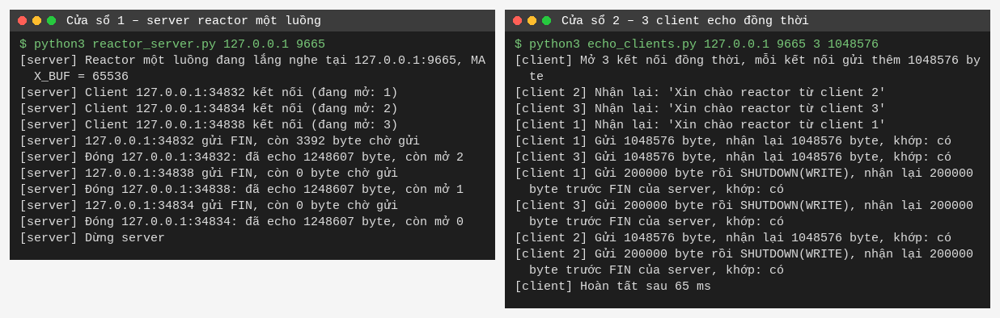

# Bài 6.3 – Server echo một luồng theo mô hình reactor (Python)

| Thông tin | Nội dung |
|---|---|
| Mã giả tương ứng | Mã giả 6.4 (Server echo một luồng dùng dồn kênh vào/ra) |
| Mục giáo trình | 6.2.4 Dồn kênh vào/ra và mô hình reactor |
| Kế thừa | Mã giả 3.1 (chức năng echo, SOCKET/SETOPT/BIND/LISTEN), 2.1; client: 2.2, 3.2, 3.4 (RECV_EXACT) |
| Thư viện | Thư viện chuẩn: `selectors` (epoll trên Linux), `socket`, `threading` (client) |

## Mục tiêu
Phục vụ nhiều client bằng một luồng duy nhất: mọi socket ở chế độ không chặn, vòng lặp chỉ chặn tại `SELECT` rồi xử lý các socket đã sẵn sàng. Mỗi kết nối có bộ đệm gửi riêng vì `SEND` có thể chỉ gửi một phần; socket có bộ đệm gửi đạt `MAX_BUF` bị loại khỏi tập theo dõi đọc (áp lực ngược).

## Tệp
- `reactor_server.py` – Mã giả 6.4: `reactor_server` với `selectors`.
- `echo_clients.py` – n client echo đồng thời, kiểm tra dữ liệu nhận lại.
- `netutil.py` – Mã giả 2.1, 2.2, 3.4.
- `demo.json` – kịch bản chạy minh họa (dùng với `tools/demo.py`).
- `ket_qua.txt`, `ket_qua.png` – kết quả thực thi thật.

## Cách chạy
Mở các cửa sổ dòng lệnh trong thư mục bài:
```bash
# Cửa sổ 1 – server (mặc định 0.0.0.0 9000)
python3 reactor_server.py 0.0.0.0 9000
# Cửa sổ 2 – 3 kết nối đồng thời, mỗi kết nối gửi thêm khối 1 MiB
python3 echo_clients.py 127.0.0.1 9000 3 1048576
```
Trên Windows dùng `python` thay cho `python3`.
Dừng server bằng Ctrl+C.

## Kết quả thực thi


Ba kết nối được một luồng duy nhất phục vụ xen kẽ. Mỗi client nhận lại đúng dòng chào và đúng khối 1 048 576 byte ngẫu nhiên. Sau đó mỗi client gửi thêm 200 000 byte rồi đóng chiều gửi (`SHUTDOWN(WRITE)`): server ghi nhận FIN, có thể vẫn còn dữ liệu chờ gửi trong `out_buf` (số byte còn lại thay đổi giữa các lần chạy), gửi nốt rồi mới đóng, nên client nhận lại đủ 200 000 byte trước FIN của server. Khi đóng, server ghi tổng số byte đã echo của từng kết nối.

## Ghi chú
- `MAX_BUF` = 65 536 byte (64 KiB) như dòng 4 của Mã giả 6.4.
- Mã giả không xử lý lỗi của `RECV`/`SEND`; bản cài đặt coi lỗi (ví dụ ConnectionReset) như client đã đóng: xóa khỏi bảng và đóng socket, để một client lỗi không làm dừng vòng lặp của cả server.
- Theo dòng 18–19 và 29–33 của Mã giả 6.4, nhận 0 byte (client gửi FIN) chỉ đưa socket vào tập `closing`; socket trong `closing` không còn được theo dõi đọc (dòng 8–9, vì sau FIN nó luôn được báo sẵn sàng đọc) và chỉ bị đóng khi bộ đệm gửi đã rỗng. Nhờ đó client đóng chiều gửi trước khi nhận hết phản hồi (half-close, như Mã giả 3.2) vẫn nhận đủ dữ liệu; client mẫu kiểm tra đúng trường hợp này ở phần cuối.
- Client gửi khối lớn ở một luồng phụ và nhận song song ở luồng chính. Nếu gửi hết rồi mới nhận, hai bên bế tắc: server ngừng đọc khi bộ đệm gửi đạt `MAX_BUF` (áp lực ngược, Mục 6.2.4), còn client không đọc phản hồi.
- `selectors` không nhận tập sự kiện rỗng, nên hàm `watch` hủy đăng ký socket khi không cần theo dõi đọc lẫn ghi và đăng ký lại khi cần. Socket được hủy đăng ký trước khi đóng.
- Kiểm thử: Linux, Python 3.13.18.
