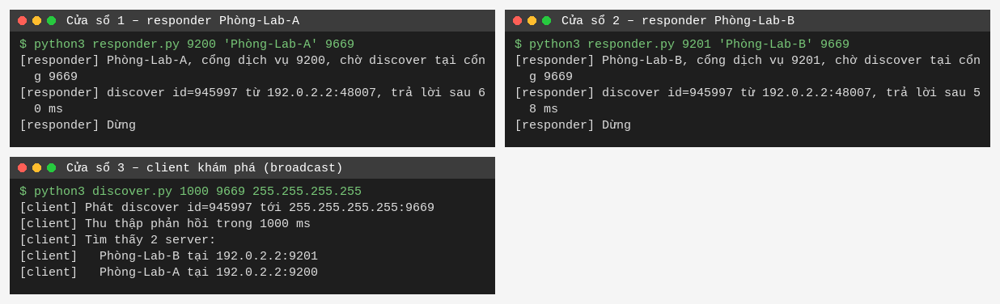

# Bài 6.5 – Khám phá server trong LAN bằng broadcast (Python)

| Thông tin | Nội dung |
|---|---|
| Mã giả tương ứng | Mã giả 6.7 (Khám phá server trong LAN bằng broadcast: DISCOVER, RESPONDER) |
| Mục giáo trình | 6.4.2 Broadcast, 6.4.4 Thiết lập TTL và tránh ngập lụt gói tin |
| Kế thừa | Mã giả 4.4 (UDP_REQUEST): gửi một yêu cầu, thu thập nhiều phản hồi đến hết thời gian chờ |
| Thư viện | Thư viện chuẩn: `socket` (`SO_BROADCAST`), `asyncio` (`sock_recvfrom`, `sock_sendto`), `json` |

## Mục tiêu
Client phát một yêu cầu `discover` tới địa chỉ broadcast giới hạn `255.255.255.255` (bắt buộc bật tùy chọn `BROADCAST`), mỗi server trả lời bằng unicast kèm cổng dịch vụ sau một khoảng trễ ngẫu nhiên 0–200 ms (tránh bùng nổ phản hồi); client thu thập mọi phản hồi có đúng `id` trong khoảng thời gian chờ.

## Tệp
- `discover.py` – Mã giả 6.7: DISCOVER.
- `responder.py` – Mã giả 6.7: RESPONDER.
- `demo.json` – kịch bản chạy minh họa (dùng với `tools/demo.py`).
- `ket_qua.txt`, `ket_qua.png` – kết quả thực thi thật.

## Cách chạy
Mở các cửa sổ dòng lệnh trong thư mục bài:
```bash
# Trên mỗi máy chạy server: responder.py [cổng dịch vụ] [tên] [DISC_PORT]   (mặc định 9200 server-chat 9999)
python3 responder.py 9200 Phòng-Lab-A 9999
# Trên máy client: discover.py [wait_ms] [DISC_PORT] [địa chỉ broadcast]   (mặc định 2000 9999 255.255.255.255)
python3 discover.py 2000 9999 255.255.255.255
```
Trên Windows dùng `python` thay cho `python3`.
Tường lửa của máy chạy responder phải cho phép UDP đến cổng `DISC_PORT`. Dừng responder bằng Ctrl+C.

## Kết quả thực thi


Hai responder chạy trên cùng máy kiểm thử nhận cùng một yêu cầu broadcast, trả lời sau các khoảng trễ ngẫu nhiên khác nhau; client tìm thấy cả hai server với tên và cổng dịch vụ. Địa chỉ 192.0.2.2 là địa chỉ của giao diện mạng của máy kiểm thử: gói tới `255.255.255.255` được gửi qua giao diện có tuyến mặc định và đồng thời được chuyển cho các socket cục bộ. Môi trường kiểm thử không chặn broadcast tới `255.255.255.255`.

## Ghi chú
- Socket của RESPONDER bật `REUSEADDR` trước `BIND` (mã giả không có) để hai responder chạy được trên cùng một máy trong kịch bản minh họa; datagram broadcast được giao cho mọi socket cùng cổng. Trong LAN mỗi máy một responder thì không cần tùy chọn này.
- `NEXT_ID()` sinh số ngẫu nhiên 1–999 999. Giáo trình không nêu `wait_ms` mặc định; bài chọn 2000 ms.
- Datagram không phải JSON hợp lệ bị bỏ qua mà không phản hồi, theo Mục 6.4.4.
- `RECVFROM_ASYNC` và gửi bất đồng bộ dùng `loop.sock_recvfrom`, `loop.sock_sendto` (Python 3.11 trở lên); `DELAY_ASYNC` là `asyncio.sleep`.
- Kiểm thử: Linux, Python 3.13.18.
