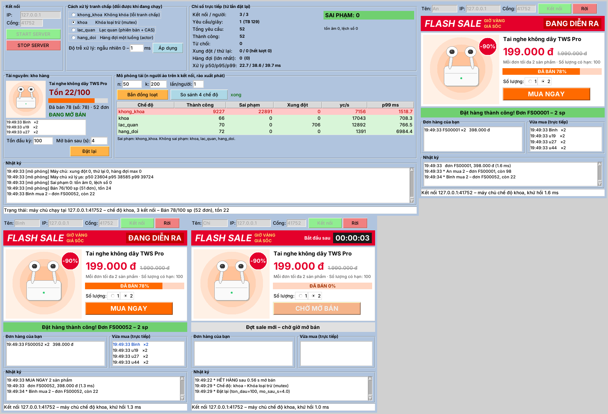
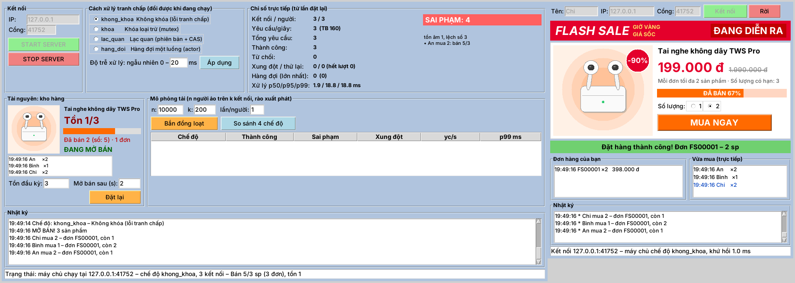
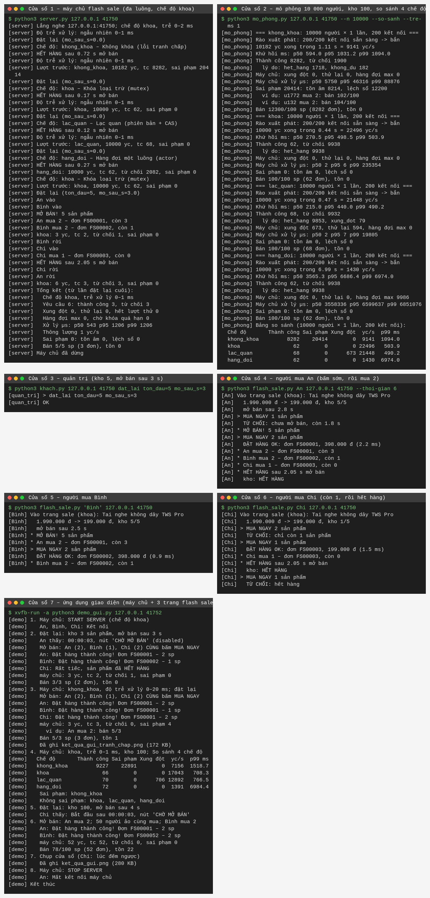

# Bài mở rộng MR6.11 – Flash sale: 10 000 người cùng bấm "MUA NGAY" cho 100 sản phẩm (Python)

| Thông tin | Nội dung |
|---|---|
| Loại | **Bài mở rộng**, không có trong giáo trình và không có mã giả tương ứng. Thuộc nhóm "tranh chấp tài nguyên" MR6.6–MR6.13, dùng chung khung của [MR6.6](../BaiMR6.6_DauGia/) |
| Liên hệ với giáo trình | Chương 6: Bài 6.1 (server đa luồng, một luồng mỗi kết nối), Bài 6.7 (kiểm thử tải); Chương 3: Bài 3.2 (định khung thông điệp theo dòng); bài mở rộng MR5.4/MR5.5 (luồng, đồng bộ) |
| Thư viện | Thư viện chuẩn: `socket`, `threading`, `queue`, `json`, `collections`, `random`; bản giao diện dùng thêm `tkinter`, còn kịch bản demo giao diện cần `subprocess` và ImageMagick (`import`, `convert`) để chụp cửa sổ |
| Bản ngôn ngữ khác | [C#](../../../csharp/Chuong06/BaiMR6.11_FlashSale/), [Java](../../../java/Chuong06/BaiMR6.11_FlashSale/), [Rust](../../../rust/Chuong06/BaiMR6.11_FlashSale/), [Go](../../../go/Chuong06/BaiMR6.11_FlashSale/) |

## Mục tiêu
Bài mô phỏng một "giờ vàng" flash sale. Kho có **100 sản phẩm** (tai nghe 1.990.000 đ, giá sale 199.000 đ), **mở bán lúc T** sau một đồng hồ đếm ngược, và **10 000 người** cùng bấm "MUA NGAY" đúng lúc mở, mỗi người đặt một đơn 1–2 sản phẩm. Luật bán: chưa tới giờ thì từ chối `chua_mo`; còn 1 mà mua 2 thì `khong_du`; hết thì `het_hang`. Tồn kho là **một ô duy nhất**, điểm nóng mà mọi đơn hàng cùng tranh. Máy chủ TCP đa luồng xử lý `mua` bằng thao tác "đọc tồn → kiểm tra (giả lập độ trễ cơ sở dữ liệu) → ghi" theo **bốn cách** đổi được khi đang chạy. **Sổ kiểm toán** đếm hai sai phạm: **tồn âm** (một đơn được chấp nhận làm tổng đã bán vượt tồn đầu kỳ, tức bán vượt kho) và **lệch sổ** (cuối buổi, tổng đã bán theo sổ khác tồn đầu kỳ − tồn hiện tại, tính theo số sản phẩm lệch).

## Kiến thức chính
Số liệu dưới đây lấy từ `ket_qua.txt`, là một lần chạy thật trên máy cục bộ (127.0.0.1, Python 3). Lượt so sánh dùng **độ trễ xử lý 0–1 ms** (`--tre-ms 1`), để chế độ hàng đợi một luồng xong 10 000 yêu cầu trong khoảng 7 s. Mỗi lần chạy, số liệu lệch đi đôi chút.

```
  Chế độ       Thành công Sai phạm Xung đột  yc/s  p99 ms
  khong_khoa         8282    20414        0  9141  1094.0
  khoa                 62        0        0 22496   503.9
  lac_quan             68        0      673 21448   490.2
  hang_doi             62        0        0  1430  6974.0
```
(10 000 người × 1 đơn, mỗi đơn 1–2 sản phẩm, kho 100, 200 kết nối, mở bán ngay khi đặt lại, nên rào xuất phát chính là "giờ G". "Thành công" là số đơn được chấp nhận, "Sai phạm" do sổ kiểm toán đếm, "Xung đột" là số lần so sánh-và-đổi thất bại, "yc/s" và "p99" (khứ hồi) đo ở bộ mô phỏng.)

- **Tranh chấp (race condition): bán vượt kho.** Ở `khong_khoa`, trong giây đầu, 200 luồng cùng đọc "còn 100", cùng qua bước kiểm tra, cùng ghi "100 − 2". Bản ghi sau đè bản trước (mất cập nhật), nên tồn kho giảm chậm hơn nhiều so với số hàng thật đã bán. Kết quả: **8282 đơn, 12 300 sản phẩm được bán từ kho 100**. Sổ kiểm toán đếm 8214 đơn bán vượt (ví dụ `u1772 mua 2: bán 102/100`) và lệch 12 200 sản phẩm giữa sổ với tồn kho. Mã đơn cũng trùng: ở giao diện, An, Bình và Chi cùng nhận **đơn FS00001**, vì bộ đếm đơn cũng bị mất cập nhật. Chế độ này chỉ dùng để minh họa lỗi trong phòng lab (loopback).
- **Vùng găng ngắn, việc chỉ đọc đặt ngoài vùng găng.** Hai kiểm tra không cần khóa: (1) **giờ mở bán**, chỉ đọc đồng hồ; (2) **"hết hàng nhanh"**, đọc tồn kho không khóa. Tồn kho chỉ giảm, nên một lần đọc thấy 0 thì chắc chắn là 0. Nhờ vậy, ở `khoa` chỉ những yêu cầu đến trong 0,17 s đầu (trước lúc cháy hàng) phải xếp hàng chờ khóa, còn phần lớn 10 000 yêu cầu được trả lời "hết hàng" ngay. Thời gian xử lý ở máy chủ có p50 là **2 µs** và p99 là 235 ms (những người chờ khóa ở giây đầu), thông lượng 22 496 yc/s. Kho cháy hàng sau 0,17 s mở bán.
- **Lạc quan (Kung & Robinson 1981).** `lac_quan` đọc (tồn, phiên bản), kiểm tra ngoài khóa rồi so sánh-và-đổi: có 673 xung đột, 594 lần thử lại, 79 đơn hết lượt thử ("xung đột, thử lại sau"). Sai phạm bằng 0, thông lượng ngang `khoa`. Kho cháy hàng sau 0,12 s.
- **Hàng đợi một luồng (actor).** `hang_doi` đúng và công bằng theo thứ tự đến. Tuy vậy, mọi yêu cầu đến trước lúc cháy hàng, tức gần như cả 10 000 (hàng đợi dài tối đa 9986), đã vượt qua bước "hết hàng nhanh" và nằm trong hàng, nên một luồng phải xử lý lần lượt từng yêu cầu, kể cả những yêu cầu sẽ nhận "hết hàng". Kết quả chỉ 1430 yc/s, p99 7 s. Đây là lý do các sàn thật đặt một **cờ "hết hàng" ở tầng trước hàng đợi**, hoặc dùng phòng chờ (MR6.13).
- **Đồng hồ mở bán, không tin client.** Máy chủ gửi `mo_con_ms` (số ms còn lại, đồng hồ đơn điệu, không gửi giờ tuyệt đối). Client tự đếm ngược và khóa nút "MUA NGAY", nhưng máy chủ vẫn kiểm tra lại: ở cửa sổ 4, An gõ `mua 1` sớm và nhận "chưa mở bán, còn 1.8 s". Khi tới giờ, luồng nền 100 ms của máy chủ phát `su_kien` "MỞ BÁN!".
- **Sổ kiểm toán, đối soát cuối ngày.** Sổ cộng số lượng của mọi đơn được chấp nhận, ghi trong vùng găng của chế độ (callback `khi_ghi`). Hai luật: tổng bán theo sổ không vượt tồn đầu kỳ, và tổng bán theo sổ bằng tồn đầu kỳ − tồn hiện tại. Bảng điều khiển máy chủ hiện "Đã bán 2 (sổ: 5)" màu đỏ khi hai con số lệch nhau.

### Giao thức (giống hệt ở 5 ngôn ngữ)
TCP, mỗi dòng một JSON UTF-8 kết thúc `\n`, tối đa 64 KB một dòng. Phần chung (chào, quản trị, `thong_ke`, `lap_lai`) xem [README MR6.6](../BaiMR6.6_DauGia/README.md#giao-thức-giống-hệt-ở-5-ngôn-ngữ).

| Chiều | Thông điệp |
|---|---|
| người dùng → server | `{"loai":"mua","ma_yc":k,"so_luong":2}` (kết nối gộp thêm `"nguoi":"u17"`) |
| server → client | `{"loai":"kq","ma_yc":k,"ok":true,"ma_don":"FS00012","so_luong":2,"ton":61,"nguoi":"An","thanh_tien":398000}` hoặc `{"loai":"kq","ma_yc":k,"ok":false,"ma_loi":"chua_mo"\|"khong_du"\|"het_hang"\|"sai_du_lieu"\|"xung_dot"\|…,"ly_do":…,"con_ms"/"ton":…}` |
| server → tất cả | `{"loai":"cap_nhat","che_do":…,"sp":{"ten","gia_goc","gia_sale","toi_da"},"ton_dau":100,"ton":61,"da_ban":39,"so_don":25,"ban_theo_so":39,"mo_ban":true,"mo_con_ms":0,"don_gan":[{"nguoi","so_luong","gio"}…]}` (≤ 10 lần/s); `{"loai":"su_kien","noi_dung":"MỞ BÁN! 100 sản phẩm"}`, `"HẾT HÀNG sau 0.17 s mở bán"`, `"An mua 2 – đơn FS00001, còn 98"` (chỉ người dùng thật) |
| quản trị → server | `{"loai":"dat_lai","ma_yc":k,"ton_dau":100,"mo_sau_s":30,"toi_da":2,"gia_goc":…,"gia_sale":…,"ten_sp":…}` |

## Cấu trúc tệp
- `chung.py`, `khach.py`, `giao_dien_chung.py`, phần KHUNG của `mo_phong.py`: **khung chung**, chép nguyên từ MR6.6.
- `may_chu.py`: nghiệp vụ `MayChuFlashSale` (ô `kho`, giờ mở bán, "hết hàng nhanh") và `SoKiemToanFlashSale`; `server.py` là bản dòng lệnh.
- `mo_phong.py`: phần NGHIỆP VỤ gồm `THAM_SO_DAT_LAI = {"mo_sau_s": 0}` và `NguoiAo` (đơn 1–2 sản phẩm; "chỉ còn k" thì mua đúng k).
- `flash_sale.py`: người mua bản dòng lệnh (`mua [n]`).
- `server_gui.py`: bảng điều khiển máy chủ; `flash_sale_gui.py`: trang flash sale; `demo_gui.py`: kịch bản tự bấm nút.
- `demo.json`, `ket_qua.txt`, `ket_qua.png`, `ket_qua_gui.png`, `ket_qua_gui_tranh_chap.png`: kịch bản và kết quả thực thi thật.

## Cách chạy
Chạy trong thư mục bài (trên Windows dùng `python` hoặc `py` thay cho `python3`):
```bash
python3 server.py 127.0.0.1 9000                                  # cửa sổ 1 (gõ lệnh ở đây)
python3 mo_phong.py 127.0.0.1 9000 --n 10000 --so-sanh --tre-ms 1 # cửa sổ 2: bảng so sánh 4 chế độ
python3 khach.py 127.0.0.1 9000 dat_lai ton_dau=5 mo_sau_s=10     # đợt sale mới, mở sau 10 s
python3 flash_sale.py An 127.0.0.1 9000                           # cửa sổ 3, 4…: gõ mua 2
```
- Lệnh của máy chủ: `che_do khong_khoa|khoa|lac_quan|hang_doi`, `tre <ms>`, `dat_lai [ton_dau=… mo_sau_s=… toi_da=…]`, `thong_ke`, `thoat`. Tùy chọn khi chạy: `--che-do`, `--tre-ms`, `--ton`, `--mo-sau` (mặc định 30 s).
- Lệnh của `flash_sale.py`: `mua [n]`, `thoat`. Dòng `@t lệnh` chờ tới giây thứ t rồi mới chạy lệnh.
- Trong demo (cửa sổ 3–6), kho có 5 sản phẩm, mở bán sau 3 s. An bấm sớm và bị từ chối, rồi mua 2. Bình mua 2. Chi mua 2 thì nhận "chỉ còn 1 sản phẩm", mua 1 thì thành công, lần sau nhận "hết hàng".

Muốn tái lập kết quả, chạy từ thư mục gốc của kho: `python3 tools/demo.py python/Chuong06/BaiMR6.11_FlashSale`.

## Ứng dụng giao diện


Ảnh trên là lần chạy thật của `demo_gui.py` (Linux, Xvfb, Python 3.12 + Tk 8.6): bảng điều khiển máy chủ (trên trái), An (trên phải), Bình (dưới trái), và Chi (dưới phải, **chụp lúc đếm ngược**: "Bắt đầu sau 00:00:03", nút "CHỜ MỞ BÁN" bị khóa, thanh "ĐÃ BÁN 0%"). Kịch bản đã chạy so sánh 4 chế độ (bảng ở giữa, dòng `khong_khoa` tô đỏ). Sau đó, trong đợt sale mới (kho 100, mở sau 4 s), vừa mở bán An mua 2, 50 người ảo cùng mua, rồi Bình mua 2. Kho còn 22, thanh tồn kho chuyển đỏ "SẮP CHÁY HÀNG – còn 22", và danh sách "Vừa mua" cập nhật trực tiếp.



Ở bước trước đó (ảnh trên), máy chủ chạy `khong_khoa` với độ trễ xử lý 0–20 ms, kho có **3 sản phẩm**. Vừa mở bán, An (2), Bình (1) và Chi (2) cùng bấm MUA NGAY. Cả ba "Đặt hàng thành công", cả ba cùng mã **đơn FS00001**, và tổng cộng 5 sản phẩm được bán từ kho 3 trong khi kho vẫn báo "Tồn 1/3". Ô **SAI PHẠM** chuyển đỏ (4: tồn âm 1, lệch sổ 3), dòng "Đã bán 2 (sổ: 5)" màu đỏ. Cùng thao tác đó ở `khoa` cho An 2, Bình 1, còn Chi nhận "Rất tiếc, sản phẩm đã HẾT HÀNG".

- **Máy chủ** (`server_gui.py`): IP, cổng, START/STOP; **4 nút chọn chế độ**; độ trễ xử lý; **chỉ số trực tiếp** (kết nối/người, yêu cầu/giây, thành công, từ chối theo mã lỗi, xung đột/thử lại, hàng đợi, xử lý p50/p95/p99, **SAI PHẠM** xanh/đỏ kèm ví dụ); **tài nguyên**: ảnh sản phẩm, "Tồn x/100", thanh đã bán, "Đã bán … (sổ: …) · … đơn" (đỏ khi lệch), đồng hồ "Mở bán sau 00:00:05" / "ĐANG MỞ BÁN" / "HẾT HÀNG", ba đơn gần nhất, ô tồn đầu kỳ và thời gian mở bán, nút **Đặt lại**; **mô phỏng tải**; nhật ký.
- **Trang flash sale** (`flash_sale_gui.py`): dải đỏ **FLASH SALE · GIỜ VÀNG GIÁ SỐC**, đồng hồ đếm ngược "Bắt đầu sau hh:mm:ss" (chạy cục bộ theo `mo_con_ms`), chuyển thành "ĐANG DIỄN RA" rồi "CHÁY HÀNG"; **thẻ sản phẩm** gồm ảnh tai nghe và hộp sạc vẽ bằng Canvas, nhãn "-90%", giá sale cỡ lớn, giá gốc gạch ngang, "Mỗi đơn tối đa 2 sản phẩm"; **thanh tồn kho** "ĐÃ BÁN x%" (cam), "SẮP CHÁY HÀNG – còn k" (đỏ, khi bán ≥ 80 %), "HẾT HÀNG" (ảnh phủ dải xám); chọn số lượng 1/2; nút **MUA NGAY** khóa ("CHỜ MỞ BÁN") tới giờ, "ĐANG XỬ LÝ…" khi chờ trả lời, "HẾT HÀNG" khi kho về 0; dòng thông báo kết quả; **Đơn hàng của bạn** (giờ, mã đơn, số lượng, thành tiền) và **Vừa mua (trực tiếp)**.

### Cách chạy
```bash
python3 server_gui.py 127.0.0.1 41752          # bấm START SERVER (kho 100, mở bán sau 30 s)
python3 flash_sale_gui.py An 127.0.0.1 41752
python3 flash_sale_gui.py Bình 127.0.0.1 41752
```
- **Windows:** Python cài từ python.org đã có sẵn Tkinter. **Linux:** `sudo apt install python3-tk`. Kịch bản tự động (Linux, cần `xvfb`, `imagemagick`): `xvfb-run -a -s "-screen 0 2600x1700x24" python3 demo_gui.py 127.0.0.1 41752`.
- Khi chạy riêng từng cửa sổ, mọi dòng nhật ký và cứ 5 giây một dòng số liệu cũng được in ra dòng lệnh.
- Thử trên nhiều máy: máy chủ nghe trên IP card mạng (hoặc `0.0.0.0`) và mở tường lửa cho cổng. Đặt tồn kho bằng khoảng 1/3 số sinh viên và mở bán sau 30 s để cả lớp cùng canh giờ. Khi đó **chỉ dùng `khoa`, `lac_quan`, `hang_doi`**.

## Kết quả thực thi


## Ghi chú
- Python có GIL nên các luồng không chạy song song thật trên nhiều lõi. Tranh chấp vẫn xảy ra vì luồng nhả GIL trong `time.sleep` (giả lập truy vấn cơ sở dữ liệu).
- Ở `khong_khoa`, tồn kho trong trạng thái không bao giờ âm: mỗi luồng ghi "giá trị cũ − số lượng", và giá trị cũ đã qua kiểm tra "đủ hàng". Cái âm là **tồn kho thật** (tồn đầu kỳ − tổng đã bán theo sổ), nên phải có sổ kiểm toán mới thấy được.
- Với độ trễ mặc định 0–2 ms, `hang_doi` cần khoảng 12 s cho 10 000 yêu cầu, và dòng "Máy chủ xử lý µs" của bộ mô phỏng có số 8 chữ số, dài quá 64 ký tự. Vì vậy demo dùng `--tre-ms 1`. Dòng "Lượt trước" của máy chủ (định dạng của khung chung) có thể dài 66 ký tự khi số sai phạm lên tới 5 chữ số.
- Trong kịch bản giao diện, máy chủ, bộ mô phỏng và cửa sổ cùng chạy trong một tiến trình, nên yc/s thấp hơn bản dòng lệnh. Bảng ở đó là một lần chạy riêng: `khong_khoa` 9227 đơn / 22 891 sai phạm, `khoa` 66 / 0, `lac_quan` 70 / 0 (706 xung đột), `hang_doi` 72 / 0.
- Kiểm thử trên Linux: Python 3.13 (dòng lệnh) và Python 3.12.3 + Tk 8.6 dưới Xvfb (giao diện).

## Bài tập gợi ý
1. Bỏ bước "hết hàng nhanh" trong `may_chu.py` rồi chạy lại so sánh. Thông lượng của `khoa` và p50 xử lý ở máy chủ thay đổi thế nào? Giải thích.
2. Thêm cờ "hết hàng" kiểm tra ngay trong luồng kết nối *trước khi* xếp vào hàng đợi của `hang_doi`, và kiểm tra lại cờ đó lúc luồng xử lý lấy việc ra. Thông lượng `hang_doi` tăng bao nhiêu? Vì sao vẫn đúng?
3. Thêm luật "mỗi khách tối đa 2 sản phẩm cho cả đợt" (không chỉ mỗi đơn). Cần thêm ô nào, và thao tác `mua` phải khóa những ô nào?
4. Chia kho 100 thành 10 "lô" (ô `kho_0` … `kho_9`, mỗi ô 10 sản phẩm), mỗi người mua ở lô theo băm tên, lô hết thì thử lô khác. Đây là cách giảm điểm nóng (sharding). Đo lại `khoa` và `lac_quan`.
5. Giả sử đồng hồ máy client chạy nhanh 2 s. Vì sao máy chủ gửi `mo_con_ms` thay vì giờ mở bán tuyệt đối, và vì sao vẫn phải kiểm tra giờ ở máy chủ?
6. Giao diện: thêm hiệu ứng "nháy" cho thanh tồn kho khi còn dưới 10 sản phẩm, và âm báo khi đặt hàng thành công.

## Đọc thêm
- H. T. Kung, J. T. Robinson (1981). *On Optimistic Methods for Concurrency Control*. ACM Transactions on Database Systems 6(2).
- E. G. Coffman, M. J. Elphick, A. Shoshani (1971). *System Deadlocks*. ACM Computing Surveys 3(2).
- Tài liệu Python: [`threading`](https://docs.python.org/3/library/threading.html) (Lock, Barrier), [`queue`](https://docs.python.org/3/library/queue.html), [`time.monotonic`](https://docs.python.org/3/library/time.html#time.monotonic), [`socket`](https://docs.python.org/3/library/socket.html), [`tkinter`](https://docs.python.org/3/library/tkinter.html).

Mã nguồn của bài được viết mới cho kho này.
