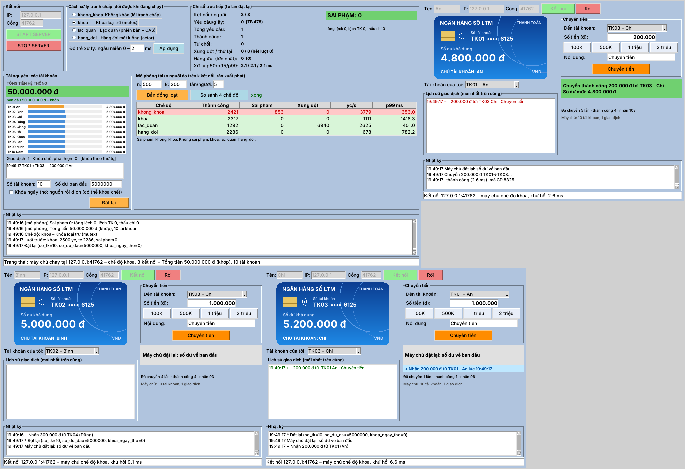
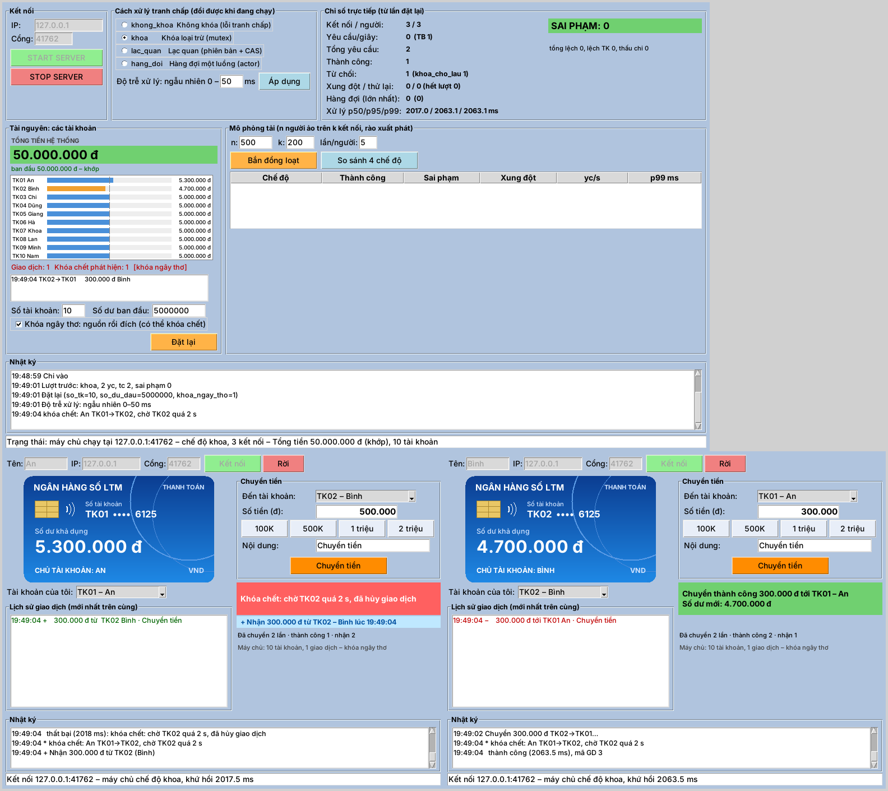
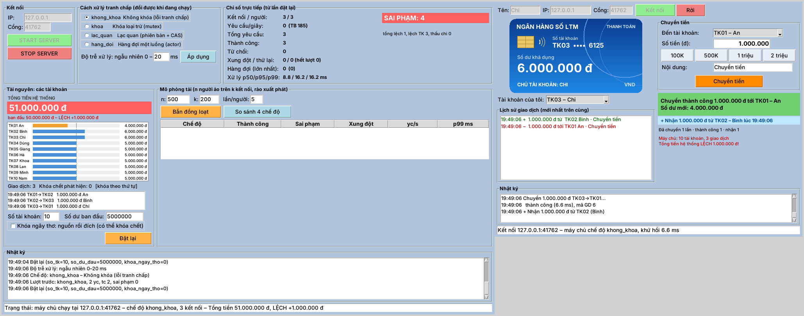
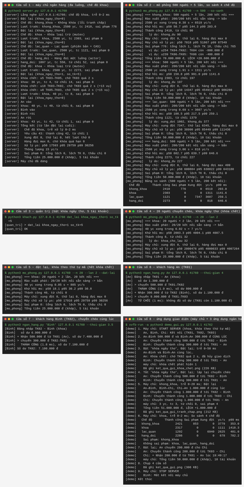

# Bài mở rộng MR6.12 – Chuyển khoản: n người chuyển tiền chéo nhau cùng lúc (Python)

| Thông tin | Nội dung |
|---|---|
| Loại | **Bài mở rộng**, không có trong giáo trình và không có mã giả tương ứng. Thuộc nhóm "tranh chấp tài nguyên" MR6.6–MR6.14 (khung chung chép từ [MR6.6](../BaiMR6.6_DauGia/)) |
| Liên hệ với giáo trình | Chương 6: Bài 6.1 (server đa luồng, một luồng mỗi kết nối), Bài 6.7 (kiểm thử tải); Chương 3: Bài 3.2 (định khung thông điệp theo dòng); bài mở rộng MR5.4/MR5.5 (luồng, đồng bộ) |
| Thư viện | Thư viện chuẩn: `socket`, `threading`, `queue`, `json`, `collections`, `itertools`, `random`; bản giao diện dùng thêm `tkinter`, còn kịch bản demo giao diện cần `subprocess` và ImageMagick (`import`, `convert`) để chụp cửa sổ |
| Bản ngôn ngữ khác | [C#](../../../csharp/Chuong06/BaiMR6.12_ChuyenKhoan/), [Java](../../../java/Chuong06/BaiMR6.12_ChuyenKhoan/), [Rust](../../../rust/Chuong06/BaiMR6.12_ChuyenKhoan/), [Go](../../../go/Chuong06/BaiMR6.12_ChuyenKhoan/) |

## Mục tiêu
Bài mô phỏng một ngân hàng nhỏ có 5–20 tài khoản (mặc định 10 tài khoản, mỗi tài khoản 5.000.000 đ). Một lệnh **chuyển khoản** (`chuyen`: từ, đến, số tiền) phải trừ tài khoản nguồn và cộng tài khoản đích **trong cùng một thao tác**, và bị từ chối nếu số dư nguồn không đủ. Khác với MR6.6 (một tài nguyên), mỗi thao tác ở đây chạm **hai tài nguyên**. Rất nhiều người chuyển chéo nhau cùng lúc (A→B và B→A), nên ngoài tranh chấp (mất cập nhật) còn xuất hiện **khóa chết** (deadlock) nếu khóa sai thứ tự.

Máy chủ TCP đa luồng giữ số dư. Mỗi lần chuyển là "đọc hai số dư → kiểm tra (giả lập độ trễ cơ sở dữ liệu 0–2 ms) → ghi hai số dư", xử lý theo bốn cách chọn được lúc đang chạy: không khóa, khóa loại trừ (hai tài khoản), lạc quan (phiên bản + so sánh-và-đổi cả hai tài khoản), hàng đợi một luồng. Chế độ `khoa` có thêm tùy chọn **khóa ngây thơ** (khóa nguồn rồi mới khóa đích) để thấy khóa chết. **Sổ kiểm toán** tự cộng trừ từng giao dịch được chấp nhận và đối chiếu: tổng tiền toàn hệ thống có giữ nguyên không, số dư từng tài khoản có khớp sổ không, có giao dịch nào làm tài khoản âm (thấu chi) không.

## Kiến thức chính
Số liệu dưới đây lấy từ `ket_qua.txt`, là một lần chạy thật trên máy cục bộ (127.0.0.1, Python 3, độ trễ xử lý ngẫu nhiên 0–2 ms). Mỗi lần chạy, số liệu lệch đi đôi chút.

```
  Chế độ       Thành công Sai phạm Xung đột  yc/s  p99 ms
  khong_khoa         2410      776        0  6519   203.0
  khoa               2303        0        0  1311  1141.6
  lac_quan           1121        0     7347  3607   259.1
  hang_doi           2273        0        0   818   646.6
```
(500 người × 5 lần chuyển = 2500 yêu cầu/chế độ, 200 kết nối, 10 tài khoản. Mỗi người chọn ngẫu nhiên một cặp tài khoản rồi chuyển qua lại A→B, B→A…, số tiền 100.000–2.000.000 đ. "Thành công" là số lệnh chuyển được chấp nhận, "Sai phạm" do sổ kiểm toán đếm, "Xung đột" là số lần so sánh-và-đổi thất bại, "yc/s" và "p99" (khứ hồi) đo ở bộ mô phỏng.)

- **Tranh chấp trên hai tài nguyên, mất cập nhật.** Ở `khong_khoa`, hai luồng cùng đọc số dư của TK04 (chẳng hạn 1.000.000 đ), cả hai cùng thấy "đủ tiền", cả hai cùng trừ và ghi, và bản ghi sau đè bản ghi trước. Kết quả có **776 sai phạm**: *thấu chi* 765 (theo sổ, giao dịch làm tài khoản nguồn âm, ví dụ `u254 TK04→TK02: TK04 còn -800.000 đ`), *lệch TK* 10 (cả 10 tài khoản có số dư cuối khác sổ) và *tổng lệch* 1: tổng tiền toàn hệ thống thành **70.600.000 đ, lệch +20.600.000 đ** so với 50.000.000 đ ban đầu. Tiền tự sinh ra vì một lần "cộng đích" bị ghi đè mất phần "trừ nguồn" của giao dịch khác. Trên giao diện, ba người chuyển vòng An→Bình, Bình→Chi, Chi→An mỗi người 1.000.000 đ cùng lúc (độ trễ 0–20 ms); cả ba đều "thành công", nhưng tổng tiền thành 51.000.000 đ và ô **TỔNG TIỀN HỆ THỐNG** chuyển đỏ (`ket_qua_gui_tranh_chap.png`). Chế độ này chỉ dùng để minh họa lỗi trong phòng lab (loopback).
- **Khóa theo từng tài nguyên, giữ cả hai khóa.** Chế độ `khoa` cho mỗi tài khoản một `threading.Lock` và giữ **cả hai** khóa suốt đọc – kiểm tra – ghi. Sai phạm bằng 0. Vì có 10 tài khoản, các cặp không chung tài khoản chạy song song, nên thông lượng (1311 yc/s) cao hơn hẳn `hang_doi` (818 yc/s, một luồng cho tất cả). Đổi lại, tài khoản "nóng" tạo hàng chờ dài, `threading.Lock` không xếp hàng công bằng, nên p99 khứ hồi lên tới 1,1 s.
- **Khóa chết và thứ tự khóa (Coffman và cộng sự 1971).** Khóa chết cần đủ bốn điều kiện: loại trừ lẫn nhau, giữ và chờ, không tước đoạt, và **vòng chờ**. Với khóa ngây thơ (`khoa_ngay_tho=1`: khóa nguồn rồi đích), A→B giữ A chờ B, B→A giữ B chờ A, và vòng chờ xuất hiện. Lượt `kc` (20 người × 2 lần, 5 tài khoản) cho thấy: 40 yêu cầu mất **6,02 s**, 32 yêu cầu bị hủy `khoa_cho_lau`, p50 khứ hồi đúng 2003 ms (bằng thời gian chờ khóa tối đa). Máy chủ in `khóa chết: u18 TK03→TK02, chờ TK03 quá 2 s (+13 vụ)`. Ở đây khóa chết được **phát hiện bằng hết thời gian chờ** (`acquire(timeout=2)`): giao dịch "nạn nhân" bị hủy, nhả khóa đang giữ, và giao dịch kia đi tiếp. Nhiều luồng khác đang xếp hàng sau khóa bị giữ cũng hết giờ theo (hiệu ứng dây chuyền). Cách phòng là **phá điều kiện vòng chờ**: mọi luồng khóa theo cùng một thứ tự (thứ tự mã tài khoản, TK01 trước TK02). Lượt `tt` cùng 20 người, cùng 5 tài khoản nhưng khóa có thứ tự: 40/40 thành công trong **0,05 s**, không còn vụ chờ khóa quá hạn nào. Trên giao diện, An→Bình và Bình→An cùng lúc ở chế độ khóa ngây thơ (trễ 0–50 ms): sau 2 s, An nhận "Khóa chết: chờ TK02 quá 2 s, đã hủy giao dịch", còn giao dịch của Bình hoàn tất (`ket_qua_gui_khoa_chet.png`).
- **Lạc quan trên nhiều ô (Kung & Robinson 1981).** `lac_quan` đọc (số dư, **phiên bản**) của cả hai tài khoản dưới một khóa rất ngắn, tính ngoài khóa, rồi **so sánh-và-đổi nguyên tử cả hai**: chỉ ghi khi phiên bản của *cả hai* chưa đổi. Sai phạm bằng 0, nhưng khi 200 luồng cùng đụng 10 tài khoản thì xung đột rất nhiều (7347 lần, 6345 lần thử lại), và 1002 yêu cầu hết 5 lượt thử nên bị từ chối "xung đột, thử lại sau". Vì vậy chỉ 1121 lệnh thành công, ít hơn hẳn `khoa`. Lạc quan hợp với tranh chấp *thưa*; tranh chấp *dày* thì tốn công làm lại.
- **Hàng đợi một luồng.** `hang_doi` không cần khóa, không thể khóa chết (chỉ một luồng chạm vào số dư), thứ tự đến trước phục vụ trước. Đổi lại, nó tuần tự hoàn toàn: 818 yc/s, hàng đợi dài tối đa 499.
- **Sổ kiểm toán = đối soát.** Sổ ghi mọi giao dịch được chấp nhận ngay trong vùng găng (callback `khi_ghi`) và tự tính số dư theo sổ. Bất biến của bài: tổng tiền không đổi; số dư từng tài khoản bằng số dư đầu cộng tiền vào trừ tiền ra theo sổ; không giao dịch nào làm số dư (theo sổ) âm. Bộ đối soát cuối ngày của ngân hàng thật cũng làm đúng việc này.
- **Idempotency, pipelining, đẩy trạng thái có gộp** dùng chung khung với MR6.6: gửi lại một `ma_yc` đã xử lý thì máy chủ không chuyển tiền lần nữa mà trả lại kết quả cũ kèm `"lap_lai": true`; mỗi kết nối của bộ mô phỏng chở vài người ảo; `cap_nhat` (số dư mọi tài khoản, tổng tiền, 20 giao dịch gần nhất) được gửi tối đa 10 lần/giây. Mã giao dịch `ma_gd` tăng mãi, kể cả qua các lần đặt lại, nên ứng dụng không báo "tiền đến" hai lần.

### Giao thức (giống hệt ở 5 ngôn ngữ)
TCP, mỗi dòng một JSON UTF-8 kết thúc `\n`, tối đa 64 KB một dòng. Mọi yêu cầu có `ma_yc` (số nguyên do client đánh), và trả lời mang lại đúng `ma_yc` đó.

| Chiều | Thông điệp |
|---|---|
| client → server | `{"loai":"chao","ten":"An","vai_tro":"nguoi_dung"\|"quan_tri"}` (đầu tiên, tên 1–16 ký tự); kết nối gộp của bộ mô phỏng thêm `"so_nguoi":m` |
| người dùng → server | `{"loai":"chuyen","ma_yc":k,"tu":"TK01","den":"TK02","so_tien":500000,"noi_dung":"…"}` (nội dung tùy chọn, ≤ 40 ký tự; kết nối gộp thêm `"nguoi":"u17"`) |
| quản trị → server | `{"loai":"che_do","ma_yc":k,"gia_tri":"khoa"}`, `{"loai":"tre","ma_yc":k,"ms":2}`, `{"loai":"dat_lai","ma_yc":k,"so_tk":10,"so_du_dau":5000000,"khoa_ngay_tho":0\|1}`, `{"loai":"thong_ke","ma_yc":k}` |
| server → client | `{"loai":"chao","ma":id,"che_do":"khoa","may_chu":"Ngân hàng MR6.12"}`, ngay sau đó là một `cap_nhat`; `{"loai":"loi","ly_do":…}` khi sai giao thức |
| server → client | `{"loai":"kq","ma_yc":k,"ok":true,"tu","den","so_tien","so_du"(số dư mới của nguồn),"ma_gd",…}` hoặc `{"loai":"kq","ma_yc":k,"ok":false,"ma_loi":"khong_du"\|"khoa_cho_lau"\|"xung_dot"\|"khong_co"\|"sai_du_lieu"\|…,"ly_do":…}` |
| server → tất cả | `{"loai":"cap_nhat","che_do":…,"tai_khoan":[{"ma","chu","so_du"}…],"tong","tong_dau","khoa_ngay_tho","khoa_chet","so_gd","lich_su":[{"ma","gio","nguoi","tu","den","so_tien","noi_dung"}…]}` (≤ 10 lần/s); `{"loai":"su_kien","noi_dung":"khóa chết: …"}` |
| server → quản trị | `{"loai":"thong_ke","ma_yc":k,"so_yc","thanh_cong","tu_choi","xung_dot","thu_lai","het_lan_thu","khoa_cho_lau","hang_doi_max","yc_s","thong_luong","p50_us","p95_us","p99_us","sai_pham":[{"ma","ten","so"}],"sai_pham_tong","tom_tat",…}` |

## Cấu trúc tệp
- `chung.py`, `khach.py`, `giao_dien_chung.py`, phần KHUNG của `mo_phong.py`: **khung chung** chép nguyên từ MR6.6 (giao thức, `KhoTranhChap` 4 chế độ và `khoa_ngay_tho`, `SoKiemToan`, `MayChuCoSo`, lõi client, giao diện chung).
- `may_chu.py`: nghiệp vụ ngân hàng `MayChuNganHang` (một ô mỗi tài khoản, chuyển khoản chạm hai ô, báo khóa chết) và `SoKiemToanNganHang`; `server.py` là bản dòng lệnh.
- `mo_phong.py`: bộ mô phỏng tải; phần NGHIỆP VỤ là `NguCanh`, `NguoiAo` (chuyển qua lại trong một cặp tài khoản).
- `ngan_hang.py`: khách hàng bản dòng lệnh.
- `server_gui.py`: bảng điều khiển máy chủ; `ngan_hang_gui.py`: ứng dụng ngân hàng; `demo_gui.py`: kịch bản tự bấm nút.
- `demo.json`, `ket_qua.txt`, `ket_qua.png`, `ket_qua_gui.png`, `ket_qua_gui_khoa_chet.png`, `ket_qua_gui_tranh_chap.png`: kịch bản và kết quả thực thi thật.

## Cách chạy
Chạy trong thư mục bài (trên Windows dùng `python` hoặc `py` thay cho `python3`):
```bash
python3 server.py 127.0.0.1 9000                                  # cửa sổ 1 (gõ lệnh ở đây)
python3 mo_phong.py 127.0.0.1 9000 --n 500 --so-sanh              # cửa sổ 2: bảng so sánh 4 chế độ
python3 khach.py 127.0.0.1 9000 dat_lai khoa_ngay_tho=1 so_tk=5   # bật khóa ngây thơ
python3 mo_phong.py 127.0.0.1 9000 --n 20 --lan 2                 # thấy khóa chết
python3 mo_phong.py 127.0.0.1 9000 --n 20 --lan 2 --dat-lai       # khóa có thứ tự: hết khóa chết
python3 ngan_hang.py An 127.0.0.1 9000                            # cửa sổ 3, 4…: chuyen TK02 500000
```
- Lệnh của máy chủ: `che_do khong_khoa|khoa|lac_quan|hang_doi`, `tre <ms>`, `dat_lai [khoa=giá_trị …]` (`so_tk`, `so_du_dau`, `khoa_ngay_tho`), `thong_ke`, `thoat`. Tùy chọn khi chạy: `--che-do`, `--tre-ms`, `--so-tk`, `--so-du`, `--khoa-ngay-tho`. Cứ 5 giây, nếu có yêu cầu mới, máy chủ in một dòng số liệu.
- Lệnh của `ngan_hang.py`: `chuyen <TK đích> <số tiền> [nội dung]`, `so_du`, `thoat`; tùy chọn `--tk TK05` để đăng nhập tài khoản khác (mặc định là tài khoản mang tên mình: An → TK01, Bình → TK02, Chi → TK03…). Dòng `@t lệnh` chờ tới giây thứ t rồi mới chạy lệnh.
- `mo_phong.py --dat-lai` và `--so-sanh` luôn gửi `khoa_ngay_tho=0`, tức khóa có thứ tự.

Muốn tái lập kết quả, chạy từ thư mục gốc của kho: `python3 tools/demo.py python/Chuong06/BaiMR6.12_ChuyenKhoan`.

## Ứng dụng giao diện


Ảnh trên là lần chạy thật của `demo_gui.py` (Linux, Xvfb, Python 3.12 + Tk 8.6): bảng điều khiển máy chủ (trên trái), An (trên phải), Bình và Chi (dưới). Kịch bản đã chạy so sánh 4 chế độ (bảng ở giữa, dòng `khong_khoa` tô đỏ), đặt lại, rồi An chuyển 200.000 đ cho Chi; tổng tiền hệ thống 50.000.000 đ (khớp, nền xanh), thanh số dư TK01 ngắn hơn và TK03 dài hơn mức ban đầu.



Khóa chết (ảnh trên): ô "Khóa ngây thơ" được bật, độ trễ xử lý 0–50 ms. An→Bình và Bình→An được bấm cùng lúc. Sau 2 s, An nhận thông báo đỏ "Khóa chết: chờ TK02 quá 2 s, đã hủy giao dịch", còn Bình nhận "Chuyển thành công". Máy chủ ghi "khóa chết: An TK01→TK02, chờ TK02 quá 2 s" và đếm "Khóa chết phát hiện: 1". Tắt ô này rồi đặt lại, cùng thao tác đó cho hai giao dịch thành công ngay.



Mất cập nhật (ảnh trên): ở `khong_khoa`, trễ 0–20 ms, ba người chuyển vòng 1.000.000 đ cùng lúc. Cả ba đều nhận "Chuyển thành công", nhưng ô **TỔNG TIỀN HỆ THỐNG** đỏ (lệch 1.000.000 đ) và **SAI PHẠM** 4 (tổng lệch 1, lệch TK 3).

- **Máy chủ** (`server_gui.py`): IP, cổng, START/STOP; 4 nút chọn chế độ; độ trễ xử lý; chỉ số trực tiếp (kết nối/người, yêu cầu/giây, thành công, từ chối theo mã lỗi, xung đột/thử lại, hàng đợi, xử lý p50/p95/p99, **SAI PHẠM** kèm ví dụ); **tài nguyên**: TỔNG TIỀN HỆ THỐNG (xanh khi khớp, đỏ khi lệch, kèm số lệch), bảng tài khoản dạng thanh số dư (vạch xám là số dư ban đầu, thanh cam khi thấp hơn), số giao dịch, số vụ khóa chết, ba giao dịch gần nhất, tham số đặt lại (số tài khoản, số dư ban đầu, ô "Khóa ngây thơ"); mô phỏng tải (Bắn đồng loạt, So sánh 4 chế độ); nhật ký.
- **Ngân hàng số** (`ngan_hang_gui.py`): **thẻ tài khoản** vẽ bằng Canvas (số tài khoản, chủ tài khoản, **số dư** cỡ lớn); chọn "tài khoản của tôi"; form **chuyển tiền** (tài khoản đích, số tiền, nút chọn nhanh 100K/500K/1 triệu/2 triệu, nội dung); dòng thông báo kết quả (xanh: thành công kèm số dư mới; cam: không đủ số dư; đỏ: khóa chết); dòng báo **tiền đến**; **lịch sử giao dịch** (tiền ra đỏ dấu −, tiền vào xanh dấu +; tiền ra do phiên khác của cùng tài khoản được ghi tên người thực hiện); thanh trạng thái hiện chế độ máy chủ và thời gian khứ hồi.

### Cách chạy
```bash
python3 server_gui.py 127.0.0.1 41762          # bấm START SERVER
python3 ngan_hang_gui.py An 127.0.0.1 41762
python3 ngan_hang_gui.py Bình 127.0.0.1 41762
```
- **Windows:** Python cài từ python.org đã có sẵn Tkinter. **Linux:** `sudo apt install python3-tk`. Kịch bản tự động (Linux, cần `xvfb`, `imagemagick`): `xvfb-run -a -s "-screen 0 2600x1700x24" python3 demo_gui.py 127.0.0.1 41762`.
- Khi chạy riêng từng cửa sổ (không qua `demo_gui.py`), mọi dòng nhật ký và cứ 5 giây một dòng số liệu cũng được in ra dòng lệnh. Có thể chuyển hướng vào tệp, ví dụ `python3 server_gui.py > server.txt`.
- Thử trên nhiều máy: máy chủ nghe trên IP card mạng (hoặc `0.0.0.0`) và mở tường lửa cho cổng; mỗi sinh viên chạy `ngan_hang_gui.py <tên>` với IP của máy thầy (tên trùng tên chủ tài khoản thì tự đăng nhập tài khoản đó). Khi đó **chỉ dùng `khoa`, `lac_quan`, `hang_doi`**, còn `khong_khoa` để dành cho phần minh họa lỗi. Muốn cả lớp thấy khóa chết: bật "Khóa ngây thơ", đặt trễ 50 ms, rồi từng cặp sinh viên chuyển cho nhau cùng lúc.

## Kết quả thực thi


## Ghi chú
- Python có GIL nên các luồng không chạy song song thật trên nhiều lõi. Dù vậy tranh chấp vẫn xảy ra, vì luồng nhả GIL trong lúc `time.sleep` (giả lập truy vấn cơ sở dữ liệu), và đó chính là khe giữa "đọc" và "ghi". Khóa chết thì không phụ thuộc GIL: nó do thứ tự xin khóa.
- Hết thời gian chờ khóa (2 s) là cách *phát hiện và phá* khóa chết, chứ không phải cách *phòng*. Nó cũng không phân biệt được khóa chết thật với một lần chờ quá lâu. Vì vậy, ở chế độ khóa có thứ tự, máy chủ ghi "chờ khóa quá hạn" thay cho "khóa chết". Cơ sở dữ liệu thật thường dò vòng chờ trên đồ thị chờ (wait-for graph) rồi chọn một giao dịch làm nạn nhân.
- Đổi chế độ hoặc đặt lại đi qua "cổng" `tam_dung()` của khung: chờ mọi thao tác đang chạy và đang xếp hàng xong rồi mới đổi.
- Trong kịch bản giao diện, máy chủ, bộ mô phỏng và cửa sổ cùng chạy trong một tiến trình, nên yc/s thấp hơn bản dòng lệnh. Bảng ở đó là một lần chạy riêng: `khong_khoa` 2421 thành công / 853 sai phạm, `khoa` 2317 / 0, `lac_quan` 1292 / 0 (6940 xung đột), `hang_doi` 2286 / 0.
- Trong `ket_qua.txt`, số dư lúc An, Bình đăng nhập không phải 5.000.000 đ, vì lượt `tt` của bộ mô phỏng vừa chuyển tiền giữa 5 tài khoản ngay trước đó.
- Kiểm thử trên Linux: Python 3.13 (dòng lệnh) và Python 3.12.3 + Tk 8.6 dưới Xvfb (giao diện).

## Bài tập gợi ý
1. Chạy lượt khóa chết với `--n 2 --lan 1` và một người chuyển A→B, người kia B→A (sửa `NguoiAo`). Đo chính xác thời gian và số giao dịch bị hủy. Vì sao chỉ một trong hai bị hủy?
2. Thay `acquire(timeout=2)` bằng `acquire()` (chờ mãi) ở chế độ khóa ngây thơ. Chuyện gì xảy ra với máy chủ và với bộ mô phỏng? Đây là lý do phải có thời gian chờ hoặc dò vòng chờ.
3. Cài đặt một cách phòng khóa chết khác: "thử khóa" (`acquire(blocking=False)`) khóa thứ hai, không được thì nhả khóa thứ nhất, nghỉ ngẫu nhiên rồi thử lại. So sánh với khóa có thứ tự. Có nguy cơ *livelock* không?
4. Tăng `so_tk` lên 20 và giảm xuống 5. Thông lượng của `khoa` và số xung đột của `lac_quan` thay đổi thế nào? Giải thích bằng xác suất hai lệnh chuyển chung một tài khoản.
5. Thêm thao tác `chuyen_nhieu` (một nguồn, nhiều đích: trả lương). Cần khóa bao nhiêu ô, theo thứ tự nào? Sổ kiểm toán có cần luật mới không?
6. Giao diện: vẽ trên Canvas của máy chủ đồ thị chờ (tài khoản là đỉnh, "giữ khóa X chờ khóa Y" là cạnh) khi bật khóa ngây thơ, và tô đỏ chu trình.

## Đọc thêm
- E. G. Coffman, M. J. Elphick, A. Shoshani (1971). *System Deadlocks*. ACM Computing Surveys 3(2): bốn điều kiện cần của khóa chết và các cách phòng, tránh, phát hiện.
- H. T. Kung, J. T. Robinson (1981). *On Optimistic Methods for Concurrency Control*. ACM Transactions on Database Systems 6(2).
- Tài liệu Python: [`threading`](https://docs.python.org/3/library/threading.html) (Lock và `acquire(timeout=…)`, Condition, Barrier), [`queue`](https://docs.python.org/3/library/queue.html), [`socket`](https://docs.python.org/3/library/socket.html), [`tkinter`](https://docs.python.org/3/library/tkinter.html).

Mã nguồn của bài được viết mới cho kho này.
