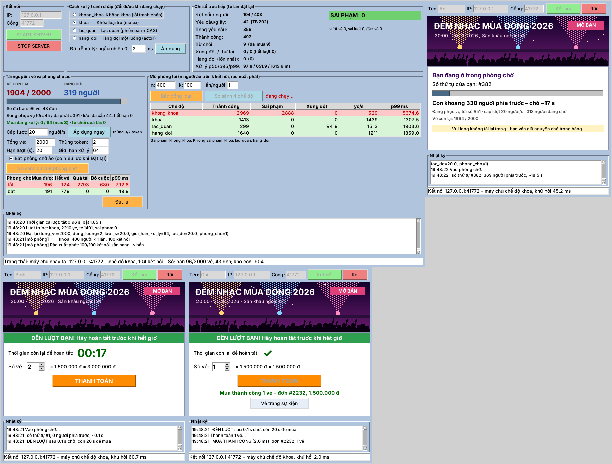
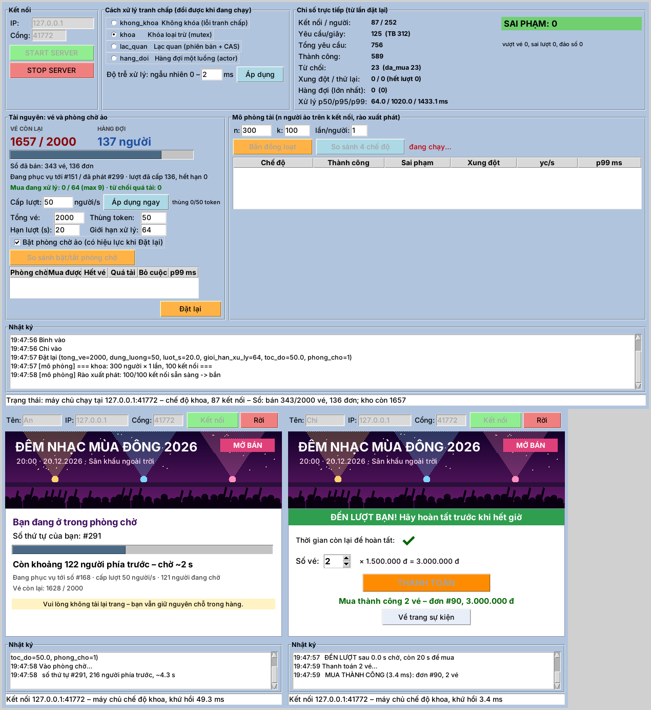
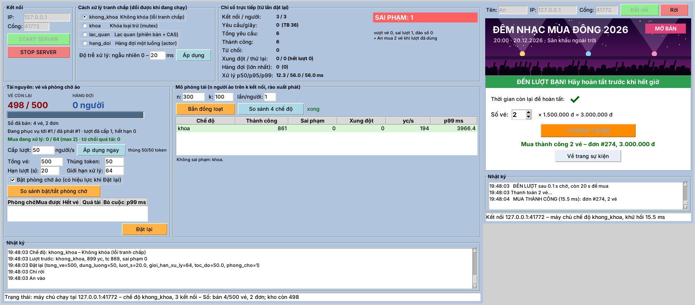
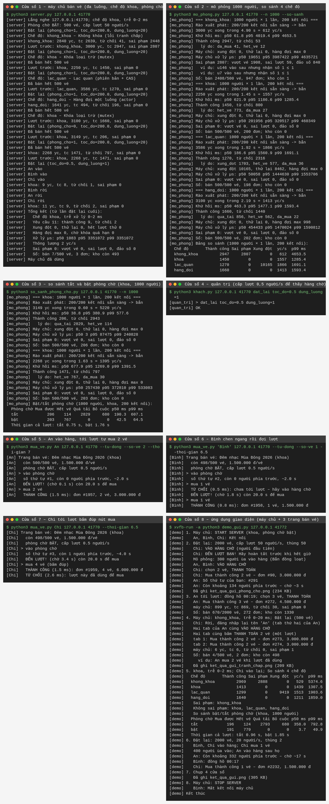

# Bài mở rộng MR6.13 – Phòng chờ ảo bán vé concert: hàng nghìn người tranh 500 vé (Python)

| Thông tin | Nội dung |
|---|---|
| Loại | **Bài mở rộng**, không có trong giáo trình và không có mã giả tương ứng. Thuộc nhóm "tranh chấp tài nguyên" MR6.6–MR6.13 (khung chung chép từ [MR6.6](../BaiMR6.6_DauGia/)) |
| Liên hệ với giáo trình | Chương 6: Bài 6.1 (server đa luồng, một luồng mỗi kết nối), Bài 6.7 (kiểm thử tải); Chương 3: Bài 3.2 (định khung thông điệp theo dòng); bài mở rộng MR5.4/MR5.5 (luồng, đồng bộ) |
| Thư viện | Thư viện chuẩn: `socket`, `threading`, `queue`, `heapq`, `json`, `collections`, `itertools`, `random`; bản giao diện dùng thêm `tkinter`, còn kịch bản demo giao diện cần `subprocess` và ImageMagick (`import`, `convert`) để chụp cửa sổ |
| Bản ngôn ngữ khác | [C#](../../../csharp/Chuong06/BaiMR6.13_PhongCho/), [Java](../../../java/Chuong06/BaiMR6.13_PhongCho/), [Rust](../../../rust/Chuong06/BaiMR6.13_PhongCho/), [Go](../../../go/Chuong06/BaiMR6.13_PhongCho/) |

## Mục tiêu
Bài mô phỏng trang bán 500 vé concert vào lúc mở bán, khi hàng nghìn người cùng bấm "Mua". Máy chủ có **phòng chờ ảo** (virtual waiting room). Người dùng gửi `xep_hang` để nhận **số thứ tự**, số người phía trước và thời gian chờ ước tính. Máy chủ **cấp lượt** cho người đầu hàng theo **thùng token** (token bucket, mặc định 50 người/giây, chỉnh được ngay lúc chạy). Mỗi lượt có hạn **20 s** để `mua` 1–4 vé. Một **công tắc** bật/tắt phòng chờ cho phép so sánh: khi tắt, mọi người dồn thẳng vào `mua`, máy chủ chỉ nhận tối đa 64 yêu cầu mua đang xử lý cùng lúc, phần vượt bị từ chối ngay "hệ thống quá tải".

Ba chỗ tranh chấp đi qua bốn cách xử lý của khung (không khóa, khóa loại trừ, lạc quan, hàng đợi một luồng): **phát số thứ tự** (đọc – cộng 1 – ghi), **trừ kho vé** và **tiêu lượt** (một lượt chỉ được mua một lần, kể cả khi người dùng mở hai tab). **Sổ kiểm toán** đếm ba sai phạm: *vượt vé* (bán quá 500 vé), *sai lượt* (một đơn được nhận khi lượt đã dùng) và *đảo số* (người vào hàng sau nhận số thứ tự không lớn hơn người vào trước, tức FIFO bị phá).

## Kiến thức chính
Số liệu dưới đây lấy từ `ket_qua.txt`, là một lần chạy thật trên máy cục bộ (127.0.0.1, Python 3, độ trễ xử lý ngẫu nhiên 0–2 ms). Mỗi lần chạy, số liệu lệch đi đôi chút.

```
  Chế độ       Thành công Sai phạm Xung đột  yc/s  p99 ms
  khong_khoa         2947     2807        0   612  4653.5
  khoa               1450        0        0  1557  1285.4
  lac_quan           1270        0    10165  1866  1691.1
  hang_doi           1660        0        0  1413  1593.4
```
(1000 người, 200 kết nối, phòng chờ bật, cấp lượt 200 người/s, thùng 20 token, 500 vé. Mỗi người `xep_hang` → `cho_luot` → `mua` 1–4 vé; cứ 10 người thì có 1 người là "tab thứ hai" của người liền trước. "Thành công" đếm mọi yêu cầu được chấp nhận (xếp hàng, tới lượt, mua), "Sai phạm" do sổ kiểm toán đếm, "yc/s" và "p99" (khứ hồi) đo ở bộ mô phỏng. Khứ hồi của `cho_luot` gồm cả thời gian đứng trong hàng.)

```
  Phòng chờ Mua được Hết vé Quá tải Bỏ cuộc p50 ms p99 ms
  tắt            206    114    2829     680  190.3  607.1
  bật            203    767       0       0   42.5   64.5
  Thời gian cả lượt: tắt 0.75 s, bật 1.76 s
```
(So sánh bật/tắt phòng chờ, chế độ `khoa`, 1000 người, giới hạn 64 yêu cầu mua đang xử lý. "Mua được", "Hết vé", "Bỏ cuộc" là số **người** theo kết quả cuối; "Quá tải" là số **lần** bị từ chối `qua_tai` (người dùng bấm lại ngay, tối đa 3 lần); p50/p99 là thời gian mua của từng người, từ lần bấm "Mua" đầu tiên tới kết quả cuối.)

- **Phòng chờ ảo và thùng token.** Thùng chứa tối đa `dung_luong` token, được rót đều `toc_do` token mỗi giây. Cứ 100 ms, luồng nền lấy người có số thứ tự nhỏ nhất ra khỏi hàng (`heapq`), mỗi người tốn một token. Thùng cho phép một "loạt" ban đầu (bằng dung lượng thùng) rồi giữ đúng tốc độ trung bình. Nhờ vậy phía "mua" (kiểm tra, ghi kho, phần đắt) chỉ nhận đều đặn vài chục người mỗi nhịp, dù hàng có hàng nghìn người. **Khi tắt phòng chờ**, 1000 người dồn vào `mua` cùng lúc: 2829 lần bị từ chối vì quá tải, **680 người bỏ cuộc** sau 3 lần bấm lại, p99 thời gian mua 607 ms. **Khi bật**, không lần nào quá tải, không ai bỏ cuộc vì quá tải, p99 chỉ 64,5 ms. Đổi lại, cả lượt kéo dài hơn (1,76 s so với 0,75 s), vì người dùng chờ *trong hàng* chứ không chờ *trong máy chủ*. Số vé bán được như nhau (500), nhưng phòng chờ chia vé theo thứ tự đến, còn khi tắt thì ai bấm lại nhanh, may mắn thì người đó được.
- **Chờ dài (long polling).** `cho_luot` không trả lời ngay: máy chủ giữ hàm trả lời của yêu cầu, và chỉ gọi nó khi cấp lượt (`"han_ms": 20000`) hoặc khi hết vé. Client không phải hỏi đi hỏi lại. Vị trí trong hàng thì client tự tính từ `cap_nhat` (số đang phục vụ `dang_phuc_vu`, tốc độ `toc_do`): còn `so − dang_phuc_vu − 1` người phía trước, chờ khoảng `(số người + 1) / toc_do` giây.
- **Phát số thứ tự cũng là tranh chấp: FIFO.** Ở `khong_khoa`, nhiều luồng cùng đọc `cuoi = 1`, cùng ghi 2… nên nhiều người nhận **cùng một số**, hoặc người vào sau nhận số nhỏ hơn. Sổ đếm được **840 lần đảo số** (ví dụ `u146 vào sau nhưng nhận số 1 ≤ 1`). Ba chế độ còn lại phát số tăng ngặt trong vùng găng nên đảo số bằng 0. Công bằng (fairness) ở đây có nghĩa là thứ tự ghi nhận vào hàng trùng với thứ tự số thứ tự, và thứ tự số thứ tự trùng với thứ tự được cấp lượt.
- **Bán vượt (overselling).** Ở `khong_khoa`, hàng chục người vừa được cấp lượt cùng đọc "còn 500 vé", cùng trừ, cùng ghi. Kho chỉ giảm vài vé mỗi đợt nên phòng chờ tưởng còn vé và cứ cấp lượt tiếp. Kết quả: sổ ghi **2408 vé đã bán trên 500 vé** (947 đơn), **vượt 1908 vé**, trong khi kho vẫn báo "còn 1". Với `khoa`, `lac_quan`, `hang_doi`, sổ ghi đúng 500/500 vé (≈ 200 đơn), và những người còn lại nhận "đã bán hết vé" ngay khi đang đứng trong hàng.
- **Tiêu lượt nguyên tử với trừ kho (hai ô trong một thao tác).** Lượt của mỗi người là một ô `luot:<tên>` (tạo lúc cấp lượt). `mua` đọc cả `kho` và ô lượt, rồi ghi cả hai trong **cùng một** thao tác: trừ vé và đánh dấu lượt đã dùng. Nếu một người mở **hai tab** (hai kết nối), cả hai tab cùng được lượt và cùng bấm "Thanh toán". Ở `khoa`, tab sau nhận "lượt này đã dùng để mua". Ở `khong_khoa`, cả hai đơn đều được nhận: sổ đếm **59 lần sai lượt** trong mô phỏng, và trên giao diện cả hai tab của An đều nhận "Mua thành công 2 vé" (`ket_qua_gui_tranh_chap.png`). Còn nếu *bấm đúp* trên **cùng một** kết nối thì không có tranh chấp: máy chủ đọc và xử lý tuần tự từng yêu cầu của một kết nối (một luồng mỗi kết nối), nên Chi trong `ket_qua.txt` nhận một "THÀNH CÔNG" và một "TỪ CHỐI: lượt này đã dùng để mua".
- **Chen ngang bị chặn.** Gọi `mua` khi chưa có lượt thì ô lượt chưa tồn tại, máy chủ trả "chưa tới lượt – hãy vào hàng chờ" ở mọi chế độ (Bình trong `ket_qua.txt`).
- **Bốn chế độ với ba điểm nóng.** `lac_quan` hợp với tranh chấp thưa. Ở đây 1000 người cùng xin số trên **một** ô `hang` nên có 10165 xung đột, và 1703 yêu cầu hết 5 lượt thử. `hang_doi` dồn cả xếp hàng lẫn mua vào **một** luồng: hàng đợi dài tối đa 998, các yêu cầu mua phải chờ sau hàng nghìn yêu cầu xếp hàng, nên vượt giới hạn 64 đang xử lý (856 lần quá tải) ngay cả khi phòng chờ bật. Bài học: tốc độ cấp lượt phải nhỏ hơn năng lực thật của phía mua, và phần "cửa vào hàng" nên rẻ, tách khỏi phần mua.
- **Giới hạn số yêu cầu đang xử lý (load shedding).** Một bộ đếm dưới khóa nhỏ: nếu đã có `gioi_han_xu_ly` yêu cầu mua đang xử lý thì từ chối ngay `qua_tai`, như HTTP 503. Từ chối sớm rẻ hơn nhiều so với để hàng nghìn yêu cầu xếp sau một khóa rồi hết giờ. Nhưng nếu người dùng bấm lại ngay, tải không giảm. Phòng chờ chữa đúng gốc của vấn đề, vì nó *định hình* luồng vào.

### Giao thức (giống hệt ở 5 ngôn ngữ)
TCP, mỗi dòng một JSON UTF-8 kết thúc `\n`, tối đa 64 KB một dòng. Mọi yêu cầu có `ma_yc` (số nguyên do client đánh), và trả lời mang lại đúng `ma_yc` đó.

| Chiều | Thông điệp |
|---|---|
| client → server | `{"loai":"chao","ten":"An","vai_tro":"nguoi_dung"\|"quan_tri"}` (đầu tiên, tên 1–16 ký tự); kết nối gộp của bộ mô phỏng thêm `"so_nguoi":m` |
| người dùng → server | `{"loai":"xep_hang","ma_yc":k}`, `{"loai":"cho_luot","ma_yc":k}` (chờ dài), `{"loai":"mua","ma_yc":k,"so_ve":2}` (kết nối gộp thêm `"nguoi":"u17"`) |
| quản trị → server | `{"loai":"che_do","ma_yc":k,"gia_tri":"khoa"}`, `{"loai":"tre","ma_yc":k,"ms":2}`, `{"loai":"dat_lai","ma_yc":k,"phong_cho":0\|1,"tong_ve":500,"toc_do":50,"dung_luong":50,"luot_s":20,"gioi_han_xu_ly":64,"ve_toi_da":4,"gia_ve":…,"ten_su_kien":…}`, `{"loai":"thong_ke","ma_yc":k}` |
| server → client | `{"loai":"chao","ma":id,"che_do":"khoa","may_chu":"Bán vé MR6.13"}`, ngay sau đó là một `cap_nhat`; `{"loai":"loi","ly_do":…}` khi sai giao thức |
| server → client | `xep_hang`: `{"loai":"kq","ma_yc":k,"ok":true,"so":291,"truoc":134,"cho_s":2.7,"trang_thai":"cho"[,"da_co":true]}`; `cho_luot` (khi tới lượt): `{"ok":true,"luot":true,"so":291,"han_ms":20000}`; `mua`: `{"ok":true,"ma_don":272,"so_ve":3,"thanh_tien":4500000,"con":…}`; từ chối: `"ma_loi":"het_ve"\|"qua_tai"\|"khong_luot"\|"da_mua"\|"het_luot"\|"pc_tat"\|"chua_xep_hang"\|"dat_lai"\|"xung_dot"\|"sai_du_lieu"` |
| server → tất cả | `{"loai":"cap_nhat","che_do":…,"su_kien":{"ten","gia_ve","tong_ve","ve_toi_da","luot_s"},"phong_cho","con_lai","da_ban","toc_do","dung_luong","token","dang_phuc_vu","so_cap","dang_cho","da_cap_luot","het_han","het_ve","dang_xu_ly","xu_ly_max","gioi_han","qua_tai","so_don","ban_so","lich_su":[…]}` (≤ 10 lần/s); `{"loai":"su_kien","noi_dung":"Đã bán hết 500 vé"}` |
| server → quản trị | `{"loai":"thong_ke","ma_yc":k,"so_yc","thanh_cong","tu_choi","xung_dot","thu_lai","het_lan_thu","khoa_cho_lau","hang_doi_max","yc_s","thong_luong","p50_us","p95_us","p99_us","sai_pham":[{"ma","ten","so"}],"sai_pham_tong","tom_tat",…}` |

## Cấu trúc tệp
- `chung.py`, `khach.py`, `giao_dien_chung.py`, phần KHUNG của `mo_phong.py`: **khung chung** chép nguyên từ MR6.6.
- `may_chu.py`: nghiệp vụ `MayChuPhongCho` (phát số thứ tự, thùng token cấp lượt, chờ dài, mua có giới hạn đang xử lý, thu hồi lượt quá hạn, `dat_toc_do`) và `SoKiemToanPhongCho`; `server.py` là bản dòng lệnh.
- `mo_phong.py`: bộ mô phỏng tải; phần NGHIỆP VỤ là `NguCanh`, `NguoiAo` (xếp hàng → chờ lượt → mua; tab thứ hai; bấm lại khi quá tải), `DoMua`, `so_sanh_phong_cho`, `bang_phong_cho`.
- `so_sanh_phong_cho.py`: so sánh bật/tắt phòng chờ (dòng lệnh).
- `mua_ve.py`: người mua bản dòng lệnh.
- `server_gui.py`: bảng điều khiển máy chủ; `phong_cho_gui.py`: trang bán vé; `demo_gui.py`: kịch bản tự bấm nút.
- `demo.json`, `ket_qua.txt`, `ket_qua.png`, `ket_qua_gui.png`, `ket_qua_gui_phong_cho.png`, `ket_qua_gui_tranh_chap.png`: kịch bản và kết quả thực thi thật.

## Cách chạy
Chạy trong thư mục bài (trên Windows dùng `python` hoặc `py` thay cho `python3`):
```bash
python3 server.py 127.0.0.1 9000                                  # cửa sổ 1 (gõ lệnh ở đây)
python3 mo_phong.py 127.0.0.1 9000 --n 1000 --so-sanh             # cửa sổ 2: bảng so sánh 4 chế độ
python3 so_sanh_phong_cho.py 127.0.0.1 9000 --n 1000              # bảng bật/tắt phòng chờ
python3 khach.py 127.0.0.1 9000 dat_lai toc_do=0.5 dung_luong=1   # cấp lượt thật chậm để thấy hàng
python3 mua_ve.py An 127.0.0.1 9000 --tu-dong --so-ve 2           # cửa sổ 3, 4…
```
- Lệnh của máy chủ: `che_do khong_khoa|khoa|lac_quan|hang_doi`, `tre <ms>`, `toc_do <người/s>` (đổi tốc độ cấp lượt ngay, không đặt lại), `dat_lai [khoa=giá_trị …]`, `thong_ke`, `thoat`. Tùy chọn khi chạy: `--che-do`, `--tre-ms`, `--tong-ve`, `--toc-do`, `--dung-luong`, `--luot-s`, `--gioi-han`, `--tat-phong-cho`.
- Lệnh của `mua_ve.py`: `xep_hang`, `mua <n>`, `mua2 <n>` (bấm đúp: hai yêu cầu liền nhau), `thoat`; `--tu-dong` vào hàng ngay (phòng chờ tắt thì mua ngay) và tới lượt thì tự mua `--so-ve` vé. Dòng `@t lệnh` chờ tới giây thứ t rồi mới chạy lệnh.
- `mo_phong.py --dat-lai`/`--so-sanh` gửi `phong_cho=1, toc_do=200, dung_luong=20`; `so_sanh_phong_cho.py` dùng cùng tham số, lần lượt `phong_cho=0` rồi `1`.

Muốn tái lập kết quả, chạy từ thư mục gốc của kho: `python3 tools/demo.py python/Chuong06/BaiMR6.13_PhongCho`.

## Ứng dụng giao diện


Ảnh trên là lần chạy thật của `demo_gui.py` (Linux, Xvfb, Python 3.12 + Tk 8.6): bảng điều khiển máy chủ (trên trái), An (trên phải), Bình và Chi (dưới). Kịch bản đã chạy so sánh 4 chế độ (bảng giữa, dòng `khong_khoa` tô đỏ) và so sánh bật/tắt phòng chờ (bảng nhỏ bên trái: tắt 196 người mua được, 2793 lần quá tải, 680 người bỏ cuộc, p99 792,8 ms; bật 191 người mua được, 0 quá tải, p99 49,9 ms). Sau đó máy chủ đặt lại với 2000 vé, cấp lượt 20 người/s, rồi 400 người ùa vào. Bình tới lượt trước và đang ở trang chọn vé (đồng hồ còn 00:17), Chi đã "Mua thành công 1 vé", còn An vào sau đám đông nên ở trang phòng chờ: "Còn khoảng 332 người phía trước – chờ ~17 s".



Phòng chờ khi đông (ảnh trên, chế độ `khoa`, 50 người/s): Chi vào hàng đầu tiên, tới lượt ngay và mua 2 vé. 300 người ảo ùa vào; An vào sau họ, nhận số #291, còn khoảng 134 người phía trước – chờ ~3 s, thanh tiến trình chạy dần. Máy chủ hiện số vé còn lại, độ dài hàng đợi, số đang phục vụ / đã phát, mức token trong thùng và số yêu cầu mua đang xử lý so với giới hạn.



Hai tab, một lượt (ảnh trên): ở `khong_khoa`, trễ 0–20 ms, cửa sổ Chi rời rồi đăng nhập lại bằng tên An (tab thứ hai của An). Hai tab cùng vào hàng, cùng được lượt, cùng bấm "Thanh toán" 2 vé. Cả hai đều nhận "Mua thành công", và ô **SAI PHẠM** chuyển đỏ (sai lượt 1: "An mua 2 vé khi lượt đã dùng"). Ở `khoa`, tab thứ hai nhận "Lượt này đã được dùng để mua".

- **Máy chủ** (`server_gui.py`): IP, cổng, START/STOP; 4 nút chọn chế độ; độ trễ xử lý; chỉ số trực tiếp (kết nối/người, yêu cầu/giây, thành công, từ chối theo mã lỗi, xung đột/thử lại, hàng đợi, xử lý p50/p95/p99, **SAI PHẠM** kèm ví dụ); **tài nguyên**: VÉ CÒN LẠI (số và thanh), độ dài HÀNG ĐỢI, sổ đã bán (đỏ khi vượt), số đang phục vụ / đã phát, lượt đã cấp / hết hạn, **mua đang xử lý / giới hạn** và số lần quá tải, **tốc độ cấp lượt** (ô nhập + "Áp dụng ngay"), mức token, tham số đặt lại (tổng vé, thùng token, hạn lượt, giới hạn xử lý, ô "Bật phòng chờ ảo"), nút **So sánh bật/tắt phòng chờ** và bảng kết quả; mô phỏng tải (Bắn đồng loạt, So sánh 4 chế độ); nhật ký.
- **Trang bán vé** (`phong_cho_gui.py`): áp phích concert vẽ bằng Canvas; *trang sự kiện* (giá vé, thanh vé còn lại, giải thích phòng chờ, nút "VÀO HÀNG CHỜ MUA VÉ" hoặc "MUA VÉ NGAY" khi phòng chờ tắt); *trang phòng chờ* (số thứ tự, **thanh tiến trình vị trí**, "Còn khoảng x người phía trước – chờ ~y s", số đang phục vụ, tốc độ cấp lượt, vé còn lại, lời nhắc không tải lại trang); *trang chọn vé* ("ĐẾN LƯỢT BẠN!", **đồng hồ 20 s** đỏ khi còn dưới 5 s, chọn số vé, thành tiền, nút "THANH TOÁN", kết quả: mua thành công kèm mã đơn, hết vé, quá tải, lượt đã dùng, hết thời gian giữ lượt).

### Cách chạy
```bash
python3 server_gui.py 127.0.0.1 41772          # bấm START SERVER
python3 phong_cho_gui.py An 127.0.0.1 41772
python3 phong_cho_gui.py Bình 127.0.0.1 41772
```
- **Windows:** Python cài từ python.org đã có sẵn Tkinter. **Linux:** `sudo apt install python3-tk`. Kịch bản tự động (Linux, cần `xvfb`, `imagemagick`): `xvfb-run -a -s "-screen 0 2600x1700x24" python3 demo_gui.py 127.0.0.1 41772`.
- Khi chạy riêng từng cửa sổ (không qua `demo_gui.py`), mọi dòng nhật ký và cứ 5 giây một dòng số liệu cũng được in ra dòng lệnh. Có thể chuyển hướng vào tệp, ví dụ `python3 server_gui.py > server.txt`.
- Thử trên nhiều máy: máy chủ nghe trên IP card mạng (hoặc `0.0.0.0`) và mở tường lửa cho cổng; đặt tốc độ cấp lượt thấp (ví dụ 1 người/s) rồi cho cả lớp cùng bấm "Vào hàng chờ" với IP của máy thầy. Khi đó **chỉ dùng `khoa`, `lac_quan`, `hang_doi`**, còn `khong_khoa` để dành cho phần minh họa lỗi.

## Kết quả thực thi


## Ghi chú
- Python có GIL nên các luồng không chạy song song thật trên nhiều lõi. Dù vậy tranh chấp vẫn xảy ra, vì luồng nhả GIL trong lúc `time.sleep` (giả lập truy vấn cơ sở dữ liệu), và đó chính là khe giữa "đọc" và "ghi".
- Ô lượt `luot:<tên>` được *tạo mới* lúc cấp lượt (chưa ai chạm vào), còn ghi thì luôn đi qua `KhoTranhChap`. Vì vậy cả bốn chế độ dùng chung đúng một hàm nghiệp vụ. Hạn lượt là thời điểm trên đồng hồ đơn điệu của máy chủ; client nhận `han_ms` (thời gian còn lại) chứ không nhận thời điểm tuyệt đối.
- Ở `khong_khoa`, khứ hồi p99 rất lớn (4,7 s), vì kho không bao giờ về 0 nên mọi người đều được cấp lượt (200 người/s × 5 s). Đó cũng là một hậu quả của mất cập nhật.
- Trong kịch bản giao diện, máy chủ, bộ mô phỏng và cửa sổ cùng chạy trong một tiến trình, nên yc/s thấp hơn bản dòng lệnh. Bảng ở đó là một lần chạy riêng: `khong_khoa` 2969 thành công / 2888 sai phạm, `khoa` 1413 / 0, `lac_quan` 1299 / 0 (9419 xung đột), `hang_doi` 1640 / 0. Lần chạy kết thúc khi đám đông 400 người vẫn đang chờ, nên nút STOP cắt các kết nối của bộ mô phỏng.
- Kiểm thử trên Linux: Python 3.13 (dòng lệnh) và Python 3.12.3 + Tk 8.6 dưới Xvfb (giao diện).

## Bài tập gợi ý
1. Chạy `so_sanh_phong_cho.py` với `--n 3000`, rồi đổi `gioi_han_xu_ly` (16, 64, 256). Khi tắt phòng chờ, giới hạn lớn hơn thì có đỡ hơn không, hay chỉ chuyển "quá tải" thành "chờ lâu"?
2. Đặt `toc_do` lớn hơn năng lực thật của phía mua (ví dụ 2000 người/s, thùng 200) và xem cột quá tải khi phòng chờ bật. Làm sao chọn tốc độ cấp lượt? Gợi ý: đo thông lượng `mua` ở chế độ `khoa`.
3. Sửa `NguoiAo` để 30% người được cấp lượt nhưng không mua (bỏ đi). Lượt của họ hết hạn sau 20 s. Cấp lại token cho người khác khi lượt hết hạn sẽ cải thiện tốc độ bán ra sao?
4. Phát số thứ tự là điểm nóng của `lac_quan` và `hang_doi`. Hãy thay ô `hang` bằng một bộ đếm nguyên tử riêng (`itertools.count` dưới một khóa rất ngắn) tách khỏi kho vé. Bảng so sánh thay đổi thế nào?
5. Thêm "chống bot": mỗi người chỉ được giữ một chỗ trong hàng (hai tab dùng chung chỗ, đã có), và giới hạn số lần `xep_hang` mỗi giây theo tên. Cần thêm gì vào sổ kiểm toán?
6. Giao diện: vẽ trên Canvas của máy chủ biểu đồ độ dài hàng đợi và số mua đang xử lý theo thời gian, để thấy thùng token "làm phẳng" luồng vào.

## Đọc thêm
- H. T. Kung, J. T. Robinson (1981). *On Optimistic Methods for Concurrency Control*. ACM Transactions on Database Systems 6(2).
- E. G. Coffman, M. J. Elphick, A. Shoshani (1971). *System Deadlocks*. ACM Computing Surveys 3(2).
- J. S. Turner (1986). *New Directions in Communications (or Which Way to the Information Age?)*. IEEE Communications Magazine 24(10): một trong những bài đầu mô tả cơ chế "leaky bucket" điều tiết lưu lượng, họ hàng của thùng token.
- J. Heinanen, R. Guerin (1999). *A Single Rate Three Color Marker*. RFC 2697, IETF: định nghĩa đo lưu lượng bằng thùng token (tốc độ rót và kích thước thùng).
- Tài liệu Python: [`threading`](https://docs.python.org/3/library/threading.html) (Lock, Condition, Barrier), [`heapq`](https://docs.python.org/3/library/heapq.html), [`queue`](https://docs.python.org/3/library/queue.html), [`socket`](https://docs.python.org/3/library/socket.html), [`tkinter`](https://docs.python.org/3/library/tkinter.html).

Mã nguồn của bài được viết mới cho kho này.
