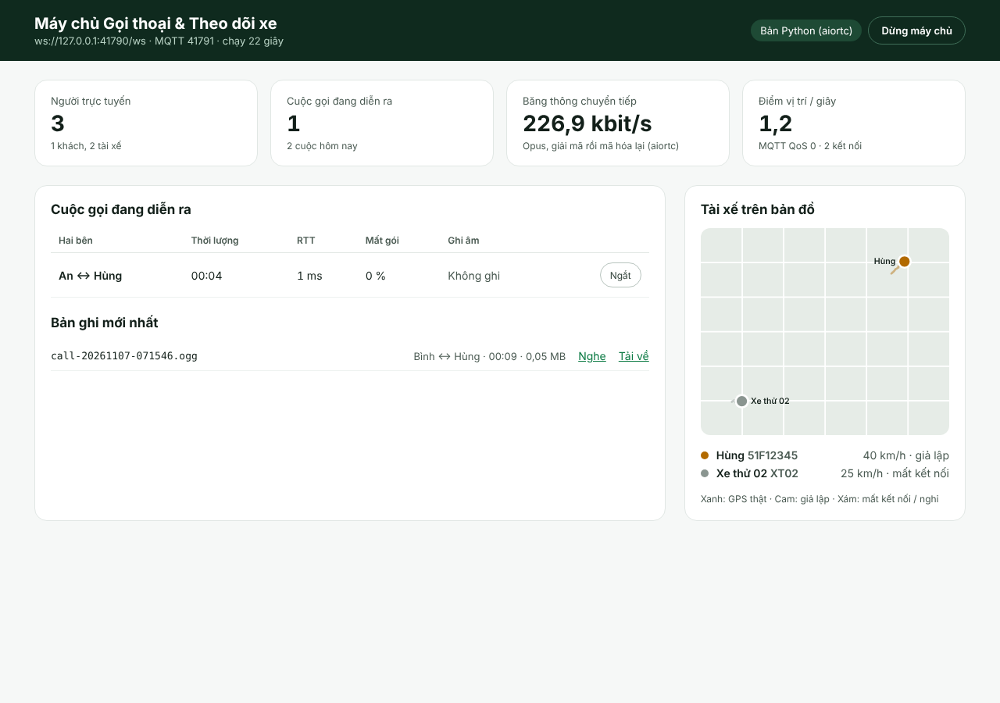
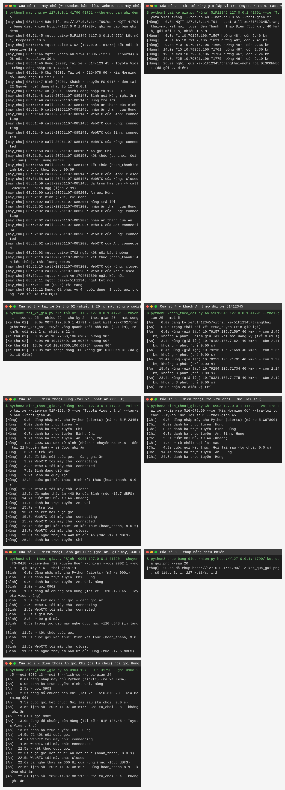

# Bài mở rộng MR6.15 – Gọi thoại qua máy chủ trung gian và theo dõi vị trí tài xế (Python)

| Thông tin | Nội dung |
|---|---|
| Loại | **Bài mở rộng**, không có trong giáo trình và không có mã giả tương ứng. Bài gồm **máy chủ** (Python và [Go](../../../go/Chuong06/BaiMR6.15_GoiThoaiTheoDoiXe/)) và **app Android** ([Kotlin + Jetpack Compose](../../../android/Chuong06/BaiMR6.15_GoiThoaiTheoDoiXe/)), không làm đủ 5 ngôn ngữ như các bài mở rộng khác |
| Liên hệ với giáo trình | Chương 6: MR6.2 (hội thoại âm thanh qua UDP), MR6.7 (đặt xe), Bài 6.1 (server phục vụ nhiều kết nối); Chương 7: Bài 7.8 (MQTT), Bài 7.4 (WebSocket); Chương 8: Bài 8.4 (TLS) |
| Thư viện | `aiohttp` (HTTP + WebSocket), `aiortc` (WebRTC, kéo theo `av` – PyAV/FFmpeg), `numpy` (điện thoại giả phân tích âm); MQTT broker và MQTT client **tự viết** trên `asyncio` (không dùng Mosquitto/paho). Tùy chọn: `ffmpeg` (trộn hai bên thành một tệp), `playwright` (chụp ảnh bảng điều khiển trong kịch bản demo) |
| Bản khác | Máy chủ [Go](../../../go/Chuong06/BaiMR6.15_GoiThoaiTheoDoiXe/) (Pion), app [Android](../../../android/Chuong06/BaiMR6.15_GoiThoaiTheoDoiXe/) |

## Mục tiêu
Các ứng dụng gọi xe cho khách và tài xế **gọi điện cho nhau trong app** mà không lộ số điện thoại, và cho khách **xem xe đang tới** trên bản đồ. Bài này dựng lại hai tính năng đó ở quy mô phòng lab:

1. **Gọi thoại qua máy chủ trung gian.** Mỗi điện thoại kết nối máy chủ qua `ws://<IP>:<cổng>/ws`, đăng nhập bằng mã người dùng, nhận **danh bạ** (ai đang trực tuyến, ai đang bận), rồi gọi – đổ chuông – trả lời/từ chối – kết thúc. Âm thanh đi bằng **WebRTC** (Opus trên RTP/SRTP), nhưng không nối thẳng hai máy: mỗi máy chỉ có **một kết nối WebRTC tới máy chủ**, máy chủ chuyển tiếp âm thanh sang bên kia (kiểu SFU – *Selective Forwarding Unit*). Hai bên không biết IP của nhau, giống "tổng đài ẩn số".
2. **Ghi âm trên máy chủ.** Nếu người gọi đồng ý (người nghe được báo trước khi trả lời), máy chủ ghi **từng bên** ra tệp `.ogg` (Opus) và sau cuộc gọi trộn hai bên thành một tệp bằng `ffmpeg`. Lịch sử cuộc gọi lưu ở `ban_ghi/lich_su.json`; app tải và nghe lại bản ghi qua `GET /banghi/<tệp>`.
3. **Theo dõi vị trí tài xế qua MQTT.** Tài xế gửi vị trí (GPS thật hoặc **giả lập** theo tuyến mẫu) lên chủ đề `xe/<mã xe>/vitri` mỗi giây; khách đăng ký đúng chủ đề chuyến của mình và tính quãng đường, thời gian xe tới. Máy chủ chạy luôn một **MQTT broker tự viết** (MQTT 3.1.1) để thấy rõ giao thức: tin giữ lại (*retain*), di chúc (*Last Will*) khi tài xế mất sóng, ký tự đại diện `+` và `#`.
4. **Bảng điều khiển** ở `http://<IP>:<cổng>/`: người trực tuyến, cuộc gọi đang diễn ra (RTT, mất gói, nút **Ngắt**), băng thông chuyển tiếp, bản ghi mới nhất (nghe/tải về), tài xế trên bản đồ.

Khi chưa có điện thoại, `dien_thoai_gia.py` (nói đúng giao thức của app, "micro" là âm sin), `tai_xe_gia.py` và `khach_theo_doi.py` đóng vai các máy.

## Kiến thức chính
Số liệu lấy từ `ket_qua.txt`, một lần chạy thật trên máy cục bộ (Linux, Python 3, 127.0.0.1). Kịch bản: Hùng và Chi là tài xế, Bình và An là khách; Bình gọi Hùng có ghi âm, giữ máy từ giây 4 đến giây 6 rồi kết thúc ở giây 9; An gọi Chi (Chi từ chối "Gọi lại sau") rồi gọi Hùng; hai tài xế giả lập gửi vị trí, xe thứ hai "mất sóng" giữa chừng; An theo dõi xe của Hùng.

```
[Hùng]  12.2s đã nghe thấy âm 440 Hz của Bình (mức -17.7 dBFS)
[Bình]   8.5s trong lúc giữ máy nghe được mức -120 dBFS (im lặng)
[Bình]  11.5s đã nghe thấy âm 660 Hz của Hùng (mức -17.6 dBFS)
[may_chu] 07:15:57 call-20261107-071546: đã trộn hai bên -> call-20261107-071546.ogg (lệch 4 ms)
[may_chu] 07:16:02 mqtt: taixe-XT02 ngắt kết nối bất thường
[An]   0.0s Hùng (giả lập) 10.79155,106.71594 40 km/h – còn 2.46 km, khoảng 4 phút – điểm giữ lại khi mới đăng ký (trễ 0.60 s)
```

- **Báo hiệu và đường âm tách riêng.** WebSocket chỉ chở tin JSON điều khiển cuộc gọi (vài trăm byte); âm thanh đi trên UDP bằng RTP. Luồng một cuộc gọi: A gửi `goi` → máy chủ gửi `do_chuong` cho A và `cuoc_goi_den` cho B → B gửi `tra_loi` → máy chủ gửi `da_tra_loi` cho cả hai → **mỗi bên** tạo `RTCPeerConnection` tới máy chủ, gửi *offer* (SDP), nhận *answer* → âm thanh A → máy chủ → B. Đây là mô hình *offer/answer* của JSEP; ICE tìm đường UDP giữa điện thoại và máy chủ (trong LAN chỉ cần ứng viên *host*, không cần STUN/TURN).
- **Âm thanh đúng là đi qua máy chủ.** Mỗi điện thoại giả phát một tần số riêng (Bình 440 Hz, Hùng 660 Hz) và phân tích FFT phần nghe được: Hùng nghe 440 Hz, Bình nghe 660 Hz. Khi Bình bấm **giữ máy**, máy chủ ngừng chuyển tiếp cả hai chiều và Bình đo được −120 dBFS (im lặng).
- **SFU giải mã hay không giải mã.** aiortc nhận gói Opus, **giải mã thành PCM** rồi mã hóa lại khi gửi cho bên kia (lớp `TiepAm`), nên tốn CPU nhưng dễ chèn xử lý (ghi âm, tắt tiếng). Bảng điều khiển đo băng thông máy chủ gửi đi khoảng **227 kbit/s** cho một cuộc gọi hai bên. Bản Go (Pion) chỉ **chép nguyên gói RTP** sang bên kia và ghi thẳng gói Opus ra Ogg – nhẹ hơn nhiều, đúng cách các SFU thật làm.
- **Ghi âm từng bên rồi trộn.** Mỗi bên một tệp `<mã cuộc>-<mã người>.ogg` (Opus 24 kbit/s, mono). Hai tệp bắt đầu lệch nhau vài ms (ở đây 4 ms), nên `ffmpeg` dùng `adelay` bù độ lệch rồi `amix` thành `<mã cuộc>.ogg`. Cuộc gọi bị từ chối hoặc không ghi âm thì chỉ có dòng lịch sử.
- **MQTT: retain và Last Will.** Vị trí gửi QoS 0 kèm cờ *retain*: An đăng ký sau khi Hùng đã chạy, vẫn nhận ngay điểm cuối cùng ("điểm giữ lại khi mới đăng ký"). Tài xế kết nối kèm di chúc `xe/<mã>/trangthai = mat_ket_noi`; xe XT02 đóng TCP đột ngột nên broker báo "ngắt kết nối bất thường" và tự phát di chúc, bảng điều khiển chuyển xe sang màu xám "mất kết nối". Thoát đúng cách (`DISCONNECT`) thì broker **không** phát di chúc.
- **Ước tính thời gian tới.** Có `con_lai_m` (tài xế chạy theo tuyến biết quãng còn lại) thì dùng; không thì lấy đường chim bay (haversine) tới điểm đón × 1,3. Thời gian ≈ quãng đường / tốc độ, tốc độ dưới 15 km/h coi như 15 (kẹt xe, chờ đèn).

### Giao thức báo hiệu (giống hệt ở bản Python, bản Go và app Android)
Mỗi tin là một đối tượng JSON trên WebSocket `/ws`:

| Chiều | Tin |
|---|---|
| app → máy chủ | `{"loai":"dang_nhap","ma","ten","vai_tro":"khach"\|"tai_xe","bien_so","xe","chuyen","diem_don","dong_y_ghi_am"}`, `{"loai":"goi","den":mã}`, `{"loai":"tra_loi"\|"huy"\|"ket_thuc","ma_cuoc"}`, `{"loai":"tu_choi","ma_cuoc","ly_do"}`, `{"loai":"sdp","ma_cuoc","sdp":{"type":"offer","sdp"}}`, `{"loai":"ice","ma_cuoc","ung_vien":{"candidate","sdpMid","sdpMLineIndex"}}`, `{"loai":"giu_may"\|"tat_mic","ma_cuoc","bat":bool}`, `{"loai":"thong_ke","ma_cuoc","rtt_ms","mat_goi"}`, `{"loai":"lich_su"}` |
| máy chủ → app | `{"loai":"dang_nhap_ok","ma","ma_xe","may_chu"}`, `{"loai":"danh_ba","ds":[{"ma","ten","vai_tro","mo_ta","ma_xe","truc_tuyen","ban"}]}`, `{"loai":"do_chuong","ma_cuoc","den"}`, `{"loai":"cuoc_goi_den","ma_cuoc","tu","ghi_am"}`, `{"loai":"da_tra_loi","ma_cuoc","ghi_am"}`, `{"loai":"sdp","ma_cuoc","sdp":{"type":"answer","sdp"}}`, `{"loai":"doi_phuong","ma_cuoc","giu_may"\|"tat_mic":bool}`, `{"loai":"da_ket_thuc","ma_cuoc","ket_qua","ly_do","thoi_luong"}`, `{"loai":"lich_su","ds":[…]}`, `{"loai":"loi","ly_do"}` |

- `ket_qua`: `hoan_thanh`, `tu_choi`, `huy` (người gọi hủy khi đang đổ chuông), `nho` (không trả lời sau 30 s), `ban` (máy bận), `mat_ket_noi` (một bên rớt mạng hoặc WebRTC thất bại).
- `ma_xe` = biển số bỏ ký tự không phải chữ/số, viết hoa (`51F-123.45` → `51F12345`); khách không có biển số thì `ma_xe` = mã người dùng.
- Máy chủ trả *answer* sau khi đã thu thập xong ứng viên ICE (answer chứa sẵn ứng viên), còn nhận ứng viên của app theo cả hai cách: nằm sẵn trong offer hoặc gửi dần bằng tin `ice` (*trickle ICE*).

### Chủ đề MQTT

| Chủ đề | Nội dung | QoS, cờ |
|---|---|---|
| `xe/<mã xe>/vitri` | `{"lat","lon","toc_do" (km/h),"huong" (độ),"do_chinh_xac" (m),"nguon":"gps"\|"gia_lap","t" (ms),"ten","xe","tuyen","con_lai_m","dich":{"lat","lon","ten"}}`; payload rỗng = xóa điểm giữ lại (tài xế tạm ẩn vị trí) | QoS 0, retain |
| `xe/<mã xe>/trangthai` | `truc_tuyen` khi vào mạng, `nghi` khi tạm ẩn hoặc thoát đúng cách, `mat_ket_noi` là Last Will | retain |

Broker hỗ trợ CONNECT/CONNACK (client id, keepalive, Last Will), PUBLISH QoS 0 và 1 (QoS 1 trả PUBACK, chuyển tiếp ở QoS 0), SUBSCRIBE/SUBACK với `+` và `#`, UNSUBSCRIBE, PINGREQ/PINGRESP, DISCONNECT; quá 1,5 × keepalive không nhận gói nào thì coi là mất kết nối. Không làm QoS 2, phiên bền, xác thực.

### HTTP

| Đường dẫn | Ý nghĩa |
|---|---|
| `GET /` | bảng điều khiển (`bang_dieu_khien.html`, dùng chung với bản Go) |
| `GET /api/trangthai` | số liệu cho bảng điều khiển (trang hỏi mỗi giây) |
| `POST /api/ngat/{mã cuộc}` | máy chủ ngắt một cuộc gọi |
| `POST /api/dung` | dừng máy chủ (chỉ nhận từ 127.0.0.1) |
| `GET /banghi/{tệp}` | tải bản ghi; tên tệp phải khớp `[A-Za-z0-9._-]+\.ogg` (chặn `../`) |

## Cấu trúc tệp
- `may_chu.py`: máy chủ – `MayChu` (đăng nhập, danh bạ, vòng đời cuộc gọi, nhận offer/ICE, ghi âm, trộn, lịch sử, đo băng thông, các đường HTTP), `TiepAm` (track gửi cho mỗi bên: lấy khung của bên kia, giữ máy thì phát im lặng), `GhiAm` (mã hóa Opus vào Ogg bằng PyAV), `tao_chung_chi` (chứng chỉ tự ký cho `--tls`).
- `mqtt_broker.py`: MQTT broker tự viết (dùng được riêng: `python mqtt_broker.py 0.0.0.0 1883`); `mqtt_khach.py`: MQTT client tối giản cho các công cụ dưới.
- `dien_thoai_gia.py`: điện thoại giả; `tai_xe_gia.py`: tài xế giả lập theo `tuyen_mau.json`; `khach_theo_doi.py`: khách theo dõi xe.
- `tuyen_mau.json`: hai tuyến mẫu (tọa độ gần đúng, chỉ để minh họa): "Bến Thành → Thảo Điền" và một tuyến vòng; app Android dùng chung tệp này.
- `bang_dieu_khien.html`: trang bảng điều khiển; `chup_bang_dieu_khien.py`: chụp trang bằng Playwright (chỉ dùng trong kịch bản demo).
- `demo.json`, `ket_qua.txt`, `ket_qua.png`, `ket_qua_gui.png`: kịch bản và kết quả thực thi thật.

## Cách chạy
Cài thư viện (một lần):
```bash
python3 -m pip install --user aiortc aiohttp numpy        # Windows: py -3 -m pip install --user aiortc aiohttp numpy
# tùy chọn: ffmpeg để trộn hai bên (Windows: winget install -e --id Gyan.FFmpeg; Linux: sudo apt install ffmpeg)
```
Chạy trong thư mục bài (Windows dùng `py -3` thay cho `python3`):
```bash
python3 may_chu.py 0.0.0.0 8080 1883                      # cửa sổ 1: báo hiệu 8080, MQTT 1883, bảng điều khiển http://127.0.0.1:8080/
python3 tai_xe_gia.py Hùng 51F12345 127.0.0.1 1883 --xe "Toyota Vios trắng" --toc-do 30
python3 dien_thoai_gia.py Hùng 0902 127.0.0.1 8080 --vai-tro tai_xe --bien-so 51F-123.45 --xe "Toyota Vios trắng" --tan-so 660
python3 dien_thoai_gia.py Bình 0901 127.0.0.1 8080 --ghi-am --goi 0902 2 --noi 10 --lich-su
python3 khach_theo_doi.py An 51F12345 127.0.0.1 1883
```
- `may_chu.py [host] [cổng_http] [cổng_mqtt] [--tls] [--thu-muc ban_ghi]`. `--tls`: báo hiệu thành `wss://`, trang thành `https://`, chứng chỉ tự ký sinh vào `chung_chi/` và **vân tay SHA-256** in ra cửa sổ máy chủ – nhập vân tay này vào app (hoặc điện thoại giả `--tls --van-tay AA:BB:…`) để app chỉ tin đúng máy chủ này.
- `dien_thoai_gia.py`: `--goi MÃ GIÂY` (lặp được), `--tra-loi tu_dong|tu_choi|khong`, `--ly-do`, `--noi N` (nói N giây rồi cúp), `--giu-may A B`, `--tan-so`, `--ghi-am` (đồng ý ghi âm khi gọi), `--lich-su`, `--thoi-gian` (tự thoát).
- `tai_xe_gia.py`: `--tuyen 0|1`, `--toc-do`, `--chu-ky` (giây), `--nhieu` (± mét), `--bat-dau 0..1` (bắt đầu giữa tuyến), `--mat-song` (cuối lượt đóng TCP đột ngột để thấy Last Will).
- `khach_theo_doi.py`: `--don LAT LON` (điểm đón; không có thì dùng `dich` tài xế gửi), `--moi N` (in mỗi N điểm).

Muốn tái lập kết quả, chạy từ thư mục gốc của kho: `python3 tools/demo.py python/Chuong06/BaiMR6.15_GoiThoaiTheoDoiXe` (cần thêm `playwright` + Chromium để chụp bảng điều khiển).

### Với điện thoại Android thật
1. Máy tính và điện thoại **cùng mạng Wi-Fi**. Chạy `python3 may_chu.py 0.0.0.0 8080 1883`; xem IP của máy tính (`ipconfig` trên Windows, `ip addr` trên Linux).
2. Mở tường lửa: TCP 8080 (báo hiệu, trang), TCP 1883 (MQTT) và **UDP** cho Python (aiortc mở cổng UDP ngẫu nhiên cho mỗi kết nối WebRTC). Trên Windows, lần đầu chạy bấm **Allow** cho `python.exe` ở mạng *Private* là đủ. Bản Go chỉ cần thêm một cổng UDP cố định.
3. Cài app (xem [README app Android](../../../android/Chuong06/BaiMR6.15_GoiThoaiTheoDoiXe/)), nhập IP, cổng 8080, tên, mã người dùng, vai trò. Điện thoại giả chạy trên máy tính hiện trong danh bạ như người thật: gọi Hùng (giả) thì nghe tiếng 660 Hz; tài xế giả lập hiện trên màn hình "Chuyến đi" của khách.

## Ứng dụng giao diện


Ảnh trên chụp bảng điều khiển ở giây thứ 20 của kịch bản (Chromium không giao diện qua Playwright): 3 người trực tuyến (1 khách, 2 tài xế – Bình đã thoát), cuộc gọi An ↔ Hùng đang diễn ra (RTT 1 ms do cùng máy, không ghi âm, nút **Ngắt**), băng thông chuyển tiếp 226,9 kbit/s, 1,2 điểm vị trí/giây; bản ghi `call-20261107-071546.ogg` của cuộc Bình ↔ Hùng (9 s) có nút **Nghe** và **Tải về**; bản đồ có Hùng (cam: giả lập, kèm vệt đã đi) và "Xe thử 02" (xám: mất kết nối sau Last Will).

Giao diện điện thoại là app Android Kotlin + Compose: [android/Chuong06/BaiMR6.15_GoiThoaiTheoDoiXe](../../../android/Chuong06/BaiMR6.15_GoiThoaiTheoDoiXe/).

## Kết quả thực thi


## Ghi chú
- **Chỉ dùng trong mạng lab.** Bản mặc định không mã hóa báo hiệu (`ws://`), không xác thực người dùng (ai biết mã là đăng nhập được), MQTT không có mật khẩu. Âm thanh WebRTC luôn được mã hóa (DTLS-SRTP) kể cả khi báo hiệu không mã hóa. Muốn mã hóa báo hiệu dùng `--tls` và ghim vân tay chứng chỉ ở app.
- **Ghi âm cần sự đồng ý.** Máy chủ chỉ ghi khi người gọi bật "đồng ý ghi âm"; người nghe thấy thông báo "Cuộc gọi này sẽ được máy chủ ghi âm" trước khi bấm trả lời, trả lời nghĩa là đồng ý. Bản ghi là dữ liệu cá nhân: xóa thư mục `ban_ghi/` sau buổi thực hành.
- Qua Internet (điện thoại dùng 4G) cần thêm máy chủ **STUN/TURN** (ví dụ coturn) vì điện thoại nằm sau NAT của nhà mạng; bài này chỉ làm trong LAN nên cấu hình ICE để trống.
- Không có `ffmpeg` thì máy chủ vẫn ghi hai tệp từng bên, chỉ bỏ bước trộn (bảng điều khiển và app vẫn nghe được từng bên).
- `aiortc` dùng `asyncio`; trên Windows giữ vòng lặp mặc định (Proactor) vì bước trộn gọi `ffmpeg` bằng `asyncio.create_subprocess_exec`.
- Kiểm thử trên Linux: Python 3.13, aiortc 1.16, aiohttp 3.14, PyAV 19, ffmpeg 6.1.

## Bài tập gợi ý
1. Thêm **chuyển cuộc gọi**: tài xế bận thì máy chủ chuyển cuộc gọi của khách sang tổng đài viên (một người dùng có vai trò `tong_dai`). Cần thêm những tin báo hiệu nào? Đường âm có cần tạo lại `RTCPeerConnection` không?
2. Đo CPU của máy chủ Python và máy chủ Go khi có 1, 5, 10 cuộc gọi đồng thời (dùng nhiều cặp `dien_thoai_gia.py`). Giải thích chênh lệch bằng việc giải mã/mã hóa lại Opus.
3. Đổi QoS của vị trí từ 0 sang 1 (broker đã hỗ trợ PUBACK). Đo số gói trên mạng mỗi giây (Wireshark, bộ lọc `mqtt`) và nêu khi nào QoS 1 đáng dùng cho dữ liệu vị trí.
4. Thêm **chia sẻ chuyến** thật: máy chủ cấp một mã ngẫu nhiên có hạn 30 phút, người nhận mở `http://<IP>:8080/chuyen/<mã>` thấy bản đồ xe. Mã cần bao nhiêu bit để không đoán được? Trang lấy vị trí bằng cách nào (hỏi định kỳ, SSE hay MQTT over WebSocket)?

## Đọc thêm
- H. Alvestrand (2021). *Overview: Real-Time Protocols for Browser-Based Applications*. RFC 8825.
- J. Uberti, C. Jennings, E. Rescorla (2023). *JavaScript Session Establishment Protocol (JSEP)*. RFC 9429 – mô hình offer/answer.
- A. Keranen, C. Holmberg, J. Rosenberg (2018). *Interactive Connectivity Establishment (ICE)*. RFC 8445; STUN: RFC 8489; TURN: RFC 8656.
- H. Schulzrinne và cộng sự (2003). *RTP: A Transport Protocol for Real-Time Applications*. RFC 3550.
- JM. Valin, K. Vos, T. Terriberry (2012). *Definition of the Opus Audio Codec*. RFC 6716; tệp Ogg Opus: RFC 7845.
- I. Fette, A. Melnikov (2011). *The WebSocket Protocol*. RFC 6455.
- OASIS (2014). *MQTT Version 3.1.1*. OASIS Standard – mục 3.1 (CONNECT, Will), 3.3 (PUBLISH, retain), 4.7 (ký tự đại diện).
- Tài liệu [aiortc](https://aiortc.readthedocs.io/), [aiohttp](https://docs.aiohttp.org/), [PyAV](https://pyav.org/docs/).

Mã nguồn của bài được viết mới cho kho này.
