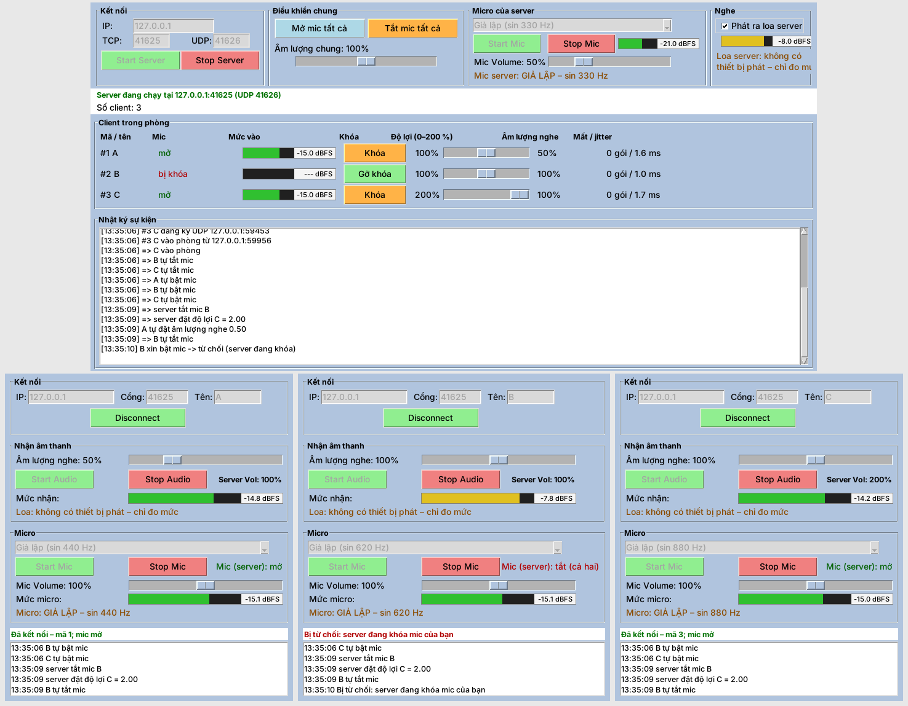
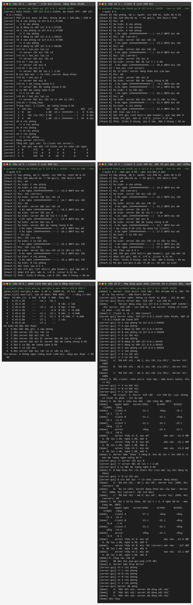

# Bài mở rộng MR6.2 – Phòng hội thoại âm thanh nhiều client (Python)

| Thông tin | Nội dung |
|---|---|
| Loại | **Bài mở rộng** – không có trong giáo trình, không có mã giả tương ứng |
| Liên hệ với giáo trình | Chương 6: Bài 6.1 (server đa luồng), Bài 6.4 (server chat nhiều client); Chương 4: Bài 4.1 (UDP); Chương 3: Bài 3.2 (định khung thông điệp) |
| Thư viện | Thư viện chuẩn: `socket`, `threading`, `struct`, `array`, `wave`, `json`, `math`; bản giao diện thêm `tkinter`. Tùy chọn: `sounddevice` (micro/loa thật) |
| Bản ngôn ngữ khác | [C#](../../../csharp/Chuong06/BaiMR6.2_HoiThoaiAmThanh/), [Java](../../../java/Chuong06/BaiMR6.2_HoiThoaiAmThanh/), [Rust](../../../rust/Chuong06/BaiMR6.2_HoiThoaiAmThanh/), [Go](../../../go/Chuong06/BaiMR6.2_HoiThoaiAmThanh/) |

## Mục tiêu
Xây dựng một "phòng họp thoại" thu nhỏ: n client nối tới một server; mỗi client gửi âm thanh micro dạng PCM qua UDP, server **trộn tiếng** và gửi cho mỗi người tiếng của *những người khác* ("mix-minus"). Kênh điều khiển TCP cho phép server tắt/bật mic của tất cả hoặc từng người, đặt độ lợi đầu vào từng người, âm lượng chung; mỗi client tự tắt mic và tự chỉnh âm lượng nghe. Client ghi lại những gì nghe được thành tệp WAV; chương trình phân tích tần số (thuật toán Goertzel) **chứng minh bằng số liệu** rằng mỗi lệnh điều khiển đã có hiệu lực.

## Kiến thức chính
- **Âm thanh số.** Lấy mẫu 16 000 lần/giây, mỗi mẫu 16 bit có dấu, một kênh (mono) → 16 000 × 16 = 256 kbit/s. Khung 20 ms = 320 mẫu = 640 byte → 50 gói/giây. Phụ phí header mỗi gói 12 (RTP) + 8 (UDP) + 20 (IPv4) = 40 byte → 16 kbit/s; tổng ≈ 272 kbit/s mỗi chiều cho mỗi client (đúng với số `272 kbit/s gồm header` client in ra khi mic mở suốt).
- **Hai kênh, hai giao thức.** Điều khiển cần tin cậy, đúng thứ tự → TCP, mỗi dòng một JSON (định khung theo dòng như Bài 3.2). Âm thanh cần đến đúng lúc → UDP: mất một gói chỉ mất 20 ms, còn truyền lại kiểu TCP sẽ đến quá muộn để phát.
- **Gói RTP (RFC 3550).** Header 12 byte: `V=2`, payload type (96 = âm thanh L16, 127 = gói giữ kết nối rỗng), **số thứ tự** 16 bit (phát hiện mất, đảo thứ tự), **nhãn thời gian** 32 bit tính bằng mẫu (tăng 320 mỗi khung, *kể cả khi tắt mic*), **SSRC** = mã client. Mẫu L16 theo thứ tự byte mạng (big-endian, RFC 3551), trong khi WAV lưu little-endian.
- **Bộ đệm jitter.** Gói đến không đều (jitter). Bên nhận giữ vài khung rồi mới phát mỗi 20 ms một khung theo số thứ tự: thiếu khung → phát khoảng lặng (che lỗi), rỗng → *cạn bộ đệm*, chờ nạp lại; đến sau lượt phát → *trễ*, bỏ. Đệm sâu hơn chịu jitter tốt hơn nhưng tăng độ trễ (3 khung = 60 ms). Jitter được ước lượng theo RFC 3550 mục 6.4.1: `J += (|D| − J)/16`.
- **Trộn tiếng, mix-minus, cắt ngọn.** Mỗi nhịp 20 ms: tổng `T = Σ gᵢ·xᵢ` của các client đang mở mic (gᵢ là độ lợi đầu vào); người nghe k nhận `(T − gₖ·xₖ) × âm_lượng_chung` – không nghe tiếng vọng của mình. Tổng có thể vượt phạm vi 16 bit → **cắt ngọn** (clipping) về −32768…32767, gây méo (sinh hài). Server đếm số mẫu bị cắt ngọn cho từng người nghe.
- **dBFS.** Mức RMS so với toàn thang: sin biên độ 0,25 → −15,1 dBFS; nhân 2 → +6,0 dB; nhân 0,5 → −6,0 dB; hai âm cùng mức cộng lại → +3 dB.
- **Goertzel.** Tính một điểm của DFT bằng bộ lọc bậc hai `s[n] = x[n] + 2cos(ω)s[n−1] − s[n−2]`, rẻ hơn FFT khi chỉ cần vài tần số (cách điện thoại giải mã phím DTMF). Mỗi client phát một tần số riêng (A 440 Hz, B 620 Hz, C 880 Hz), nên đo mức ở từng tần số là biết ai đang nói, to bao nhiêu.
- **Không tin client.** Server tự bỏ gói từ client đang bị tắt mic (kể cả client cố tình gửi), chỉ nhận UDP từ địa chỉ đã đăng ký và cùng IP với kết nối TCP; client `connect()` socket UDP để chỉ nhận gói từ server.

### Quy tắc quyền điều khiển

| # | Quy tắc |
|---|---|
| 1 | Mic của X mở **khi và chỉ khi** X không tự tắt **và** server không khóa mic của X |
| 2 | Server tắt (khóa) thắng client: đang bị khóa, client xin bật bị **từ chối** |
| 3 | Server bật = gỡ khóa, **không bật hộ** mic mà người dùng đã tự tắt (quyền riêng tư: server làm người dùng im lặng được, nhưng không tự ý mở micro của họ) |
| 4 | Độ lợi đầu vào từng người và âm lượng chung do server đặt, áp dụng khi trộn |
| 5 | Âm lượng nghe do từng client tự đặt, áp dụng tại client; server không có lệnh đổi giá trị này |
| 6 | Tự tắt mic có hiệu lực ngay tại client; tự bật phải chờ server xác nhận |

Âm lượng người A thực sự nghe thấy tiếng B: `độ_lợi_B × âm_lượng_chung × âm_lượng_nghe_A`.

## Cấu trúc tệp
- `chung.py` – hằng số âm thanh, đóng/tách gói RTP, PCM ↔ byte, dBFS, thanh đo mức, `BoDemJitter`, Goertzel, đọc/ghi WAV.
- `server_am_thanh.py` – server: kênh TCP (mỗi client một luồng), luồng nhận UDP, luồng trộn 20 ms, bảng điều khiển đọc stdin.
- `khach_am_thanh.py` – client: nguồn âm (sin / WAV / micro thật), vòng 20 ms thu–gửi–nhận–phát, ghi WAV và tệp mốc sự kiện `*_moc.json`.
- `phan_tich_wav.py` – chia bản ghi theo mốc sự kiện, đo mức từng âm bằng Goertzel, kiểm tra mix-minus.
- Bản giao diện (Tkinter):
  - `phong_am_thanh.py` – lõi server dạng lớp `PhongAmThanh` (cùng giao thức, cùng 6 quy tắc; Start/Stop nhiều lần; micro và "tai nghe" của server; thông điệp thêm `do_loi`).
  - `thiet_bi_am_thanh.py` – liệt kê/mở micro, loa thật qua `sounddevice`; micro giả lập (sin) khi không có.
  - `giao_dien_chung.py` – hàng đợi luồng nền → luồng giao diện, thanh đo mức dBFS, ô nhật ký, gom sự kiện kéo thanh trượt.
  - `server_gui.py` – cửa sổ "Bảng điều khiển âm thanh"; `khach_gui.py` – lớp `KetNoiAmThanh` (mạng + âm thanh) và cửa sổ client.
  - `demo_gui.py` – kịch bản tự bấm nút, đo mức từng âm, chụp cửa sổ thành `ket_qua_gui.png`.
- `demo.json`, `ket_qua.txt`, `ket_qua.png` – kịch bản minh họa và kết quả thực thi thật (bản dòng lệnh + bản giao diện); `ket_qua_gui.png` – ảnh chụp các cửa sổ giao diện.

## Cách chạy
Trong thư mục bài (Windows: `python` hoặc `py` thay cho `python3`):
```bash
python3 server_am_thanh.py 127.0.0.1 9000 9001                        # cửa sổ 1 (gõ lệnh điều khiển ở đây)
python3 khach_am_thanh.py B 127.0.0.1 9000 --tan-so 620                # cửa sổ 2
python3 khach_am_thanh.py C 127.0.0.1 9000 --tan-so 880                # cửa sổ 3
python3 khach_am_thanh.py A 127.0.0.1 9000 --tan-so 440 --ghi out/ghi_A.wav --thoi-gian 20
python3 phan_tich_wav.py out/ghi_A.wav 440:A 620:B 880:C              # sau khi A kết thúc
```
Lệnh server: `tat_mic tat_ca`, `tat_mic B`, `bat_mic tat_ca`, `do_loi C 2`, `am_luong_chung 0.5`, `trang_thai`, `thoat`. Lệnh client: `tat_mic`, `bat_mic`, `am_luong 0.5`, `thoat`. Dòng `@t lệnh` chờ tới giây thứ t rồi mới chạy lệnh (dùng cho kịch bản tự động).

Tùy chọn client: `--wav tệp.wav` (nguồn là tệp WAV 16 bit mono 16 kHz, phát lặp), `--mat-goi 0.05` (giả lập mất 5 % gói gửi), `--dem 3` (độ sâu bộ đệm jitter), `--thoi-gian`.

**Micro và loa thật (tùy chọn):** `pip install sounddevice` (cần thư viện PortAudio của hệ điều hành; Windows và macOS có sẵn trong gói), rồi thêm `--mic` và/hoặc `--loa`. Nếu không nhập được `sounddevice`, client báo và dùng nguồn tổng hợp. Nên đeo tai nghe: phòng không có khử vọng (echo cancellation), loa sẽ lọt lại vào micro. Phần này chưa được kiểm thử trong môi trường không có thiết bị âm thanh.

Tái lập kết quả từ thư mục gốc của kho: `python3 tools/demo.py python/Chuong06/BaiMR6.2_HoiThoaiAmThanh`.

## Ứng dụng giao diện


Ảnh trên là lần chạy thật của `demo_gui.py` (Linux, Xvfb, Python 3.12 + Tk 8.6, **thiết bị giả lập** – máy chạy không có micro/loa): server (trên) đã khóa mic B, đặt độ lợi C = 200 % (C hiện "Server Vol: 200%"); A tự giảm âm lượng nghe còn 50 %; B xin bật mic lại và bị từ chối.

**Server – "Bảng điều khiển âm thanh"** (`server_gui.py`): nhóm *Kết nối* (IP, cổng TCP/UDP, Start/Stop Server); *Điều khiển chung* (Mở mic tất cả = gỡ khóa, Tắt mic tất cả = khóa, Âm lượng chung 0–200 %); *Micro của server* (chọn thiết bị thật hoặc "Giả lập (sin 330 Hz)", Start/Stop Mic, Mic Volume, thanh đo mức); *Nghe* (phát ra loa server tổng tiếng các client, không gồm tiếng của chính server). Mỗi client một hàng: mã/tên, trạng thái mic (mở / tự tắt / bị khóa), thanh đo mức vào (dBFS, 10 lần/s), nút Khóa/Gỡ khóa, thanh độ lợi 0–200 %, âm lượng nghe client báo lên, số gói mất và jitter. Dưới cùng là nhật ký sự kiện.

**Client** (`khach_gui.py`): *Kết nối* (IP, cổng, tên, Connect/Disconnect); *Nhận âm thanh* (âm lượng nghe 0–200 %, Start/Stop Audio = phát/không phát ra loa, nhãn "Server Vol: xx%", thanh đo mức tiếng nhận); *Micro* (thiết bị thật hoặc "Giả lập (sin 440 Hz)", Start/Stop Mic, Mic Volume, thanh đo mức); dòng trạng thái và danh sách sự kiện.

Tiếng của server là một nguồn nữa trong bộ trộn với mã `SSRC_SERVER = 0`: mọi client nghe thấy, còn loa server phát `T − tiếng_server` (mix-minus cho chính server). Giao thức chỉ **thêm** một thông điệp (client cũ bỏ qua loại lạ, nên vẫn chạy chéo với bản dòng lệnh và các ngôn ngữ khác):

| Chiều | Thông điệp | Khi nào |
|---|---|---|
| server → client | `{"loai": "do_loi", "gia_tri": g}` | một lần ngay sau `chao`, và mỗi khi server đổi độ lợi đầu vào của client đó; client hiện "Server Vol: g×100 %" |

Server dòng lệnh `server_am_thanh.py` không gửi `do_loi`; client giao diện nối vào đó hiện "Server Vol: --". Client giao diện vừa kết nối mà chưa bấm Start Mic thì gửi `tu_tat_mic` (server mặc định coi mic mở); Start Mic gửi `tu_bat_mic` và có thể bị từ chối (quy tắc 2).

### Cách chạy
```bash
python3 server_gui.py 127.0.0.1 41620 41621            # cửa sổ server
python3 khach_gui.py A 127.0.0.1 41620 --tan-so 440    # mỗi client một cửa sổ (tên, host, cổng TCP)
python3 khach_gui.py B 127.0.0.1 41620 --tan-so 620
```
- **Windows:** dùng `py` hoặc `python` (bản cài từ python.org đã có Tkinter). Micro/loa thật: `py -m pip install sounddevice` (gói đã kèm PortAudio cho Windows và macOS). Cho phép ứng dụng dùng micro trong *Settings → Privacy & security → Microphone*.
- **Linux:** cần Tkinter (`sudo apt install python3-tk`) và PortAudio (`sudo apt install libportaudio2`), rồi `pip install sounddevice`.
- Không cài `sounddevice` (hoặc thiếu PortAudio, hoặc máy không có thiết bị): danh sách chỉ có mục "Giả lập", phát loa bị bỏ qua nhưng vẫn đo mức – chương trình vẫn chạy đầy đủ. Muốn nghe thật nên đeo tai nghe (không có khử vọng).
- Chọn thiết bị: danh sách lấy từ host API mặc định của PortAudio (`0: Microphone Array …`), mục cuối là nguồn giả lập. **Micro thật chỉ được mở khi bấm Start Mic**, không bao giờ tự bật lúc khởi động; dòng chỉ báo dưới nhóm Micro ghi rõ `THẬT – <tên thiết bị>` hay `GIẢ LẬP – sin … Hz`. Nếu mở thiết bị thật lỗi, chương trình báo và chuyển sang giả lập.
- Mặc định server nghe `127.0.0.1`; muốn máy khác trong mạng LAN nối vào thì nhập địa chỉ IP của card mạng (hoặc `0.0.0.0`) và mở tường lửa cho hai cổng.
- Kịch bản tự động (Linux): `xvfb-run -a -s "-screen 0 1600x1250x24" python3 demo_gui.py 127.0.0.1 41625 41626`.

### Sơ đồ luồng
```
 luồng giao diện (Tk mainloop)        luồng mạng (lõi)                    luồng PortAudio
 ─────────────────────────────        ─────────────────────               ───────────────
 bấm nút ──gọi phương thức──▶  PhongAmThanh / KetNoiAmThanh                 micro: callback
                               ├ chờ kết nối TCP, mỗi client 1 luồng       ──queue──▶ vòng 20 ms
 root.after(50): đọc hàng đợi ◀─bao(...)── nhật ký, sự kiện               loa: callback
 root.after(100): anh_chup()  ◀──đọc dưới khóa── mức dBFS, trạng thái     ◀──queue── vòng 20 ms
                               ├ nhận UDP → bộ đệm jitter
                               └ vòng 20 ms: trộn / thu – gửi / nhận – phát
```
Quy tắc: **chỉ luồng giao diện chạm vào điều khiển Tk**. Luồng nền không gọi widget; chúng đưa `(hàm, tham số)` vào `HangDoiGiaoDien` (một `queue.Queue`), luồng giao diện lấy ra mỗi 50 ms bằng `root.after`; số liệu hay đổi (mức dBFS) được luồng giao diện tự đọc 10 lần/s. Việc có thể chờ lâu (`connect`, dừng server và chờ luồng nền kết thúc) chạy trên luồng phụ, xong mới báo về – cửa sổ không bao giờ "đứng hình". Thanh trượt độ lợi/âm lượng được gom (`TreHoan`, 200 ms) để kéo một lần chỉ gửi một thông điệp TCP.

## Kết quả thực thi


Kịch bản: B (620 Hz), C (880 Hz), A (440 Hz, giả lập mất 5 % gói gửi) vào phòng; A ghi những gì nghe được. Server lần lượt: tắt mic tất cả (2,5 s) → bật lại (3,5 s) → tắt mic B và đặt độ lợi C = 2 (4,5 s) → B xin bật mic, **bị từ chối** → bật mic B và đặt âm lượng chung 0,5 (5,5 s); A tự đặt âm lượng nghe 0,5 (≈ 6,5 s); C tự tắt mic (≈ 7,5 s); server "bật mic tất cả" (8,0 s) nhưng C **vẫn tắt** (quy tắc 3). Kết quả phân tích bản ghi của A khớp đúng giá trị lý thuyết:

| Đoạn | Trạng thái | B 620 Hz | C 880 Hz | Lý thuyết |
|---|---|---|---|---|
| 1, 3 | mọi mic mở | −15,1 | −15,1 | sin 0,25 → −15,1 dBFS |
| 2 | server tắt tất cả | vắng | vắng | |
| 4 | B bị khóa, độ lợi C = 2 | vắng | −9,0 | +6,0 dB |
| 5 | âm lượng chung 0,5 | −21,1 | −15,1 | −6,0 dB (C: 2 × 0,5 = 1) |
| 6 | A tự đặt âm lượng nghe 0,5 | −27,1 | −21,1 | thêm −6,0 dB |
| 7, 8 | C tự tắt; server bật tất cả | −27,1 | vắng | C vẫn tắt |

Âm 440 Hz của chính A vắng ở mọi đoạn – mix-minus đúng. Server đếm được số gói mất trong luồng của A đúng bằng số gói A giả lập làm rơi, các khung thiếu được thay bằng khoảng lặng. Jitter trên máy cục bộ chỉ khoảng 0,1–0,5 ms; các client không cạn bộ đệm (3 khung) lần nào trong lần chạy này. Nếu một nhịp bị hệ điều hành lập lịch trễ làm bộ đệm cạn, đoạn chứa lần cạn đó có thêm vài chục ms im lặng và đo thấp hơn vài phần mười dB (một lần chạy thử đo được −21,5 thay vì −21,1 dBFS). Mức nghe in mỗi giây là trung bình của cả giây nên thay đổi dần qua các mốc; bảng phân tích bỏ 0,15 s đầu mỗi đoạn để loại độ trễ (≈ 80 ms: bộ đệm jitter + một nhịp trộn).

**Bản giao diện** (cửa sổ cuối trong `ket_qua.png`, chạy thật dưới Xvfb trên Linux, Python 3.12, mọi micro/loa là giả lập; `sounddevice` 0.5.6 nạp được nhưng máy không có thiết bị nên tự chuyển "chỉ đo mức"). `demo_gui.py` đo mức từng âm trong 1 s cuối mà mỗi bên nghe được (Goertzel):

| Người nghe | server 330 Hz (Mic Volume 50 %) | A 440 | B 620 | C 880 |
|---|---|---|---|---|
| Lần 1 – mọi mic mở: client A | −21,1 | vắng | −15,1 | −15,1 |
| Lần 1: loa server | vắng | −15,1 | −15,1 | −15,1 |
| Lần 2 – khóa B, độ lợi C = 2, A nghe 50 %: client A | −27,1 | vắng | vắng | −15,1 |
| Lần 2: client B | −21,1 | −15,1 | vắng | −9,0 |
| Lần 2: loa server | vắng | −15,1 | vắng | −9,0 |

Đúng lý thuyết: Mic Volume 50 % → −6,0 dB; độ lợi 2 → +6,0 dB; âm lượng nghe 50 % → −6,0 dB; mỗi người không nghe chính mình, loa server không phát tiếng server. B xin bật mic khi bị khóa nhận "Bị từ chối: server đang khóa mic của bạn"; Stop Server làm cả ba client báo "Mất kết nối". Micro/loa thật (nhánh `MicThat`, `LoaThat`) chưa được kiểm thử vì máy chạy demo không có thiết bị âm thanh.

## Ghi chú
- Thời gian và số gói có thể chênh vài đơn vị giữa các lần chạy (lịch luồng của hệ điều hành); mức dBFS trong bảng phân tích ổn định tới 0,1 dB.
- Luồng trộn chạy theo đồng hồ của server, luồng gửi theo đồng hồ của từng client; trên máy thật hai đồng hồ trôi lệch nhau (clock drift) nên bộ đệm sẽ dần đầy hoặc cạn – hệ thống thực tế co giãn nhẹ âm thanh để bù.
- Hệ thống thực tế nén âm thanh (Opus, RFC 6716 – khoảng 16–32 kbit/s cho thoại), mã hóa và xác thực gói (SRTP, RFC 3711), khử vọng, tự động cân bằng mức; bài giữ PCM không nén để dễ quan sát. Không có SRTP, bất kỳ ai trên đường truyền đều nghe được và có thể giả gói với SSRC của người khác – kiểm tra địa chỉ nguồn chỉ là lớp phòng vệ tối thiểu.
- Python 3.13 không còn mô-đun `audioop`; bài tự tính dBFS, trộn và cắt ngọn bằng Python thuần (đủ nhanh cho vài client).
- Giao thức giống hệt bản Go: client Python nối được vào server Go và ngược lại (đã thử).
- Kiểm thử: Linux, Python 3.13.18 (không có thiết bị âm thanh; `--mic` chỉ được thử nhánh dự phòng khi thiếu PortAudio). Bản giao diện: Python 3.12.3 + Tk 8.6 dưới Xvfb; đã thử chéo lõi server giao diện với `khach_am_thanh.py` và lõi client giao diện với `server_am_thanh.py`.

## Bài tập gợi ý
1. Đổi `--dem` của client thành 1 và chạy kèm `--mat-goi 0.1`; đếm số lần cạn bộ đệm và nghe thử bản ghi. Giải thích sự đánh đổi giữa độ trễ và độ ổn định.
2. Đặt `do_loi C 5`: quan sát số mẫu cắt ngọn trong `trang_thai`/tổng kết và đo hài bậc 3 (2640 Hz) bằng `phan_tich_wav.py ... 2640:H3`. Cài đặt giới hạn mềm (soft limiter) thay cho cắt cứng.
3. Thay phát khoảng lặng khi mất gói bằng lặp lại khung trước (packet loss concealment) và so sánh mức đo được của âm bị mất gói.
4. Thêm lệnh server `chi_nghe <tên>` (chế độ người nghe) và lệnh client `xin_phat_bieu` (giơ tay) – server duyệt rồi mới gỡ khóa.
5. Giao diện: thêm vào hàng của mỗi client trên server nút "Nghe riêng" – loa server chỉ phát tiếng client đó (solo); chỉ sửa `PhongAmThanh._vong_tron` và `server_gui.py`, không đổi giao thức.
6. Giao diện: client vẽ thêm một "dao động ký" (Canvas, 320 mẫu gần nhất) cạnh thanh đo mức; giải thích vì sao phải lấy dữ liệu dưới khóa và vẽ bằng `root.after` thay vì vẽ từ vòng 20 ms.
7. Nâng cao: thêm gói báo cáo kiểu RTCP (RFC 3550 mục 6.4) để mỗi client định kỳ báo cho server tỉ lệ mất và jitter của luồng mình nhận; server hiển thị trong `trang_thai`.

## Đọc thêm
- RFC 3550 – *RTP: A Transport Protocol for Real-Time Applications* (header RTP mục 5.1; ước lượng jitter mục 6.4.1; tính số gói mất phụ lục A.3).
- RFC 3551 – *RTP Profile for Audio and Video Conferences with Minimal Control* (payload type động, định dạng L16 mục 4.5.11).
- RFC 7667 – *RTP Topologies* (Topo-Mixer – server trộn như bài này; Topo-SFU).
- RFC 768 – *User Datagram Protocol*.
- G. Goertzel, “An Algorithm for the Evaluation of Finite Trigonometric Series”, *The American Mathematical Monthly*, 65(1), 1958, tr. 34–37.
- Tài liệu Python: [`wave`](https://docs.python.org/3/library/wave.html), [`array`](https://docs.python.org/3/library/array.html), [`socket`](https://docs.python.org/3/library/socket.html); thư viện tùy chọn [python-sounddevice](https://python-sounddevice.readthedocs.io/).

Mã nguồn của bài được viết mới cho kho này.
