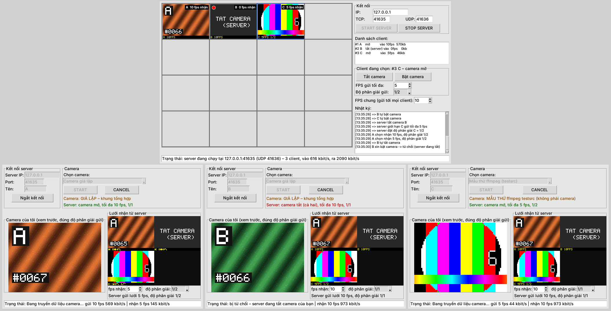
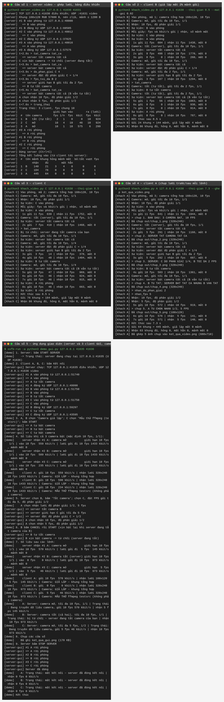
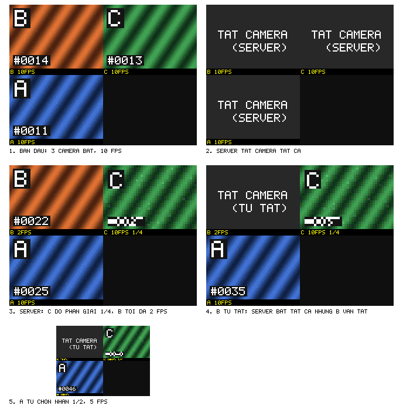

# Bài mở rộng MR6.3 – Phòng hội thoại video nhiều client (Python)

| Thông tin | Nội dung |
|---|---|
| Loại | **Bài mở rộng** – không có trong giáo trình, không có mã giả tương ứng |
| Liên hệ với giáo trình | Bài mở rộng MR6.2 (hội thoại âm thanh); Chương 6: Bài 6.1 (server đa luồng), Bài 6.4 (server chat); Chương 4: Bài 4.1 (UDP); Chương 3: Bài 3.2 (định khung thông điệp) |
| Thư viện | Thư viện chuẩn: `socket`, `threading`, `struct`, `zlib`, `json`; bản giao diện thêm `tkinter`, `subprocess`. Camera thật: công cụ `ffmpeg` (bản giao diện) hoặc `opencv-python` (bản dòng lệnh, `--camera`) |
| Bản ngôn ngữ khác | [C#](../../../csharp/Chuong06/BaiMR6.3_HoiThoaiVideo/), [Java](../../../java/Chuong06/BaiMR6.3_HoiThoaiVideo/), [Rust](../../../rust/Chuong06/BaiMR6.3_HoiThoaiVideo/), [Go](../../../go/Chuong06/BaiMR6.3_HoiThoaiVideo/) |

## Mục tiêu
Cùng ý tưởng với MR6.2 nhưng cho hình ảnh: n client gửi khung hình camera qua UDP; server ghép khung của mọi người thành một **lưới** và gửi cho từng người theo tốc độ khung (fps) và độ phân giải mà người đó chọn. Server điều khiển được: tắt/bật camera của tất cả hoặc từng người, giới hạn fps gửi và độ phân giải gửi của từng người (tương tự độ lợi đầu vào ở MR6.2), giới hạn fps chung (tương tự âm lượng chung). Client tự tắt/bật camera, tự chọn fps và độ phân giải nhận. Client chụp lưới đang xem thành PNG trước/sau mỗi lệnh và ghép thành `ket_qua_video.png` – bằng chứng trực quan rằng lệnh có hiệu lực.

## Kiến thức chính
- **Kích thước khung và tốc độ bit.** Khung 160×120 điểm RGB = 160 × 120 × 3 = 57 600 byte; 10 fps không nén cần 57 600 × 8 × 10 ≈ 4,6 Mbit/s. Nén zlib (không mất dữ liệu) còn khoảng 7 KB/khung → ≈ 560–640 kbit/s. Giảm độ phân giải 1/4 mỗi chiều → 40×30 điểm = 1/16 số điểm ảnh, client C trong kết quả chỉ còn ≈ 47 kbit/s. Khung tổng hợp có "hạt nhiễu" thưa như cảm biến thật; không có nhiễu, ảnh nhân tạo nén quá tốt (≈ 1 KB) và không phản ánh được thực tế.
- **Chia mảnh và ghép khung.** Một khung nén (vài KB) lớn hơn một datagram an toàn. Mỗi datagram ≤ 1200 byte – mức QUIC (RFC 9000 mục 14) yêu cầu mọi đường truyền phải chở được, nhỏ hơn MTU 1500 của Ethernet sau khi trừ header IP/UDP và phần bọc của VPN, nên không bị phân mảnh IP. Header 20 byte: phiên bản, loại, mã nguồn, **số khung**, **chỉ số mảnh**, **tổng số mảnh**, rộng, cao, nhãn thời gian. Bên nhận gom đủ mảnh mới giải nén; **mất một mảnh là hỏng cả khung** – lý do codec thực tế có cơ chế chống lỗi (FEC, khung tham chiếu, yêu cầu khung khóa).
- **Video trực tiếp chỉ cần khung mới nhất.** Khi một khung đủ mảnh, mọi khung cũ hơn còn dở bị bỏ; không chờ, không truyền lại. Số khung tăng dần cho phép đếm khung hỏng (thiếu mảnh) và khung mất hẳn.
- **MCU và SFU (RFC 7667).** Bài dùng kiến trúc *ghép* (MCU/Topo-Mixer): server giải nén, ghép lưới, nén lại riêng cho từng người nhận – nên điều chỉnh được fps/độ phân giải *nhận* của từng người, nhưng tốn CPU server. Kiến trúc *chuyển tiếp chọn lọc* (SFU) chỉ chuyển tiếp luồng của từng người, client tự ghép; server nhẹ hơn nhiều nhưng muốn đổi độ phân giải cho từng người nhận thì người gửi phải gửi nhiều lớp (simulcast). Khác với âm thanh (mix-minus), lưới video có cả hình của chính mình (self-view) – không gây vọng, chỉ tốn băng thông.
- **Giới hạn hai phía.** Phía gửi: server báo `fps` tối đa và `chia` (1, 2, 4) qua TCP; client tuân thủ, và server **tự thực thi** – bỏ khung đến nhanh hơn 0,8/fps giây (cột "vượt fps": vài khung bị bỏ khi đồng hồ của client nhích sớm) và bỏ khung của camera đang tắt. Phía nhận: `fps nhận = min(fps client chọn, fps chung)`.
- **Phóng to và thu nhỏ ảnh.** Thu nhỏ: lấy 1 điểm trong mỗi khối d×d (dùng phép cắt lát `hang[c::3*d]` của Python). Phóng to: lặp điểm gần nhất (nearest neighbour), nên ô của C ở độ phân giải 1/4 hiện thành các ô vuông 4×4.
- **PNG viết tay.** Chữ ký 8 byte + các khối `IHDR`, `IDAT` (zlib của các hàng ảnh, mỗi hàng mở đầu bằng 1 byte bộ lọc), `IEND`; mỗi khối có CRC-32 (`zlib.crc32`).
- **Phòng vệ.** Giới hạn 256 mảnh/khung, giải nén có giới hạn kích thước (`decompressobj().decompress(dữ_liệu, 4 MB)`) chống "bom nén", kiểm tra rộng × cao × 3 khớp dữ liệu, chỉ nhận UDP từ địa chỉ đã đăng ký.

### Quy tắc quyền điều khiển (giống mic ở MR6.2)

| # | Quy tắc |
|---|---|
| 1 | Camera của X mở **khi và chỉ khi** X không tự tắt **và** server không tắt camera của X |
| 2 | Server tắt thắng client: đang bị server tắt, client xin bật bị **từ chối** |
| 3 | Server bật = gỡ lệnh tắt của server, **không bật hộ** camera mà người dùng tự tắt |
| 4 | Giới hạn gửi (fps tối đa, độ phân giải 1/1, 1/2, 1/4) của từng người và fps chung do server đặt |
| 5 | Tham số nhận (fps, độ phân giải lưới 1/1 hoặc 1/2) do từng client tự chọn; fps nhận không vượt fps chung |
| 6 | Tự tắt camera có hiệu lực ngay tại client; tự bật phải chờ server xác nhận |

## Cấu trúc tệp
- `chung.py` – header datagram, `chia_manh`, `GhepKhung`, phông chữ bitmap 5×7, tô/vẽ chữ, thu nhỏ/phóng to, `CameraTongHop`, `giai_nen`, `ghi_png` (PNG viết tay).
- `server_video.py` – server: kênh TCP, luồng nhận UDP (ghép mảnh, kiểm tra quyền, vẽ ô), luồng ghép lưới và gửi theo hạn của từng người nhận, bảng điều khiển.
- `khach_video.py` – client: vòng gửi theo fps cho phép, luồng nhận lưới, lệnh `chup`, ghép ảnh chụp (`--ghep`).
- Bản giao diện (Tkinter):
  - `phong_video.py` – lõi server dạng lớp `PhongVideo` (cùng giao thức, cùng 6 quy tắc, dùng lại `ghep_luoi` của `server_video.py`; Start/Stop nhiều lần).
  - `camera.py` – liệt kê camera và thu khung qua tiến trình `ffmpeg` (ống stdout, khung RGB 160×120), mẫu thử `testsrc`, camera giả lập.
  - `giao_dien_chung.py` – hàng đợi luồng nền → luồng giao diện, RGB → `PhotoImage` (PPM), ô nhật ký.
  - `server_gui.py` – cửa sổ "Camera Server" (lưới 4×4); `khach_gui.py` – lớp `KetNoiVideo` (mạng + camera) và cửa sổ "Camera Client".
  - `demo_gui.py` – kịch bản tự bấm nút, in fps/kbit/s, chụp cửa sổ thành `ket_qua_gui.png`.
- `demo.json`, `ket_qua.txt`, `ket_qua.png` – kịch bản và kết quả thực thi thật (bản dòng lệnh + bản giao diện); `ket_qua_video.png` – 5 ảnh lưới do client A chụp trong lần chạy đó; `ket_qua_gui.png` – ảnh chụp các cửa sổ giao diện.

## Cách chạy
Trong thư mục bài (Windows: `python` hoặc `py` thay cho `python3`):
```bash
python3 server_video.py 127.0.0.1 9000 9001                    # cửa sổ 1 (gõ lệnh điều khiển ở đây)
python3 khach_video.py B 127.0.0.1 9000                         # cửa sổ 2
python3 khach_video.py C 127.0.0.1 9000                         # cửa sổ 3
python3 khach_video.py A 127.0.0.1 9000 --thoi-gian 60 --ghep ket_qua_video.png   # cửa sổ 4
```
Lệnh server: `tat_camera tat_ca`, `tat_camera B`, `bat_camera tat_ca`, `fps_toi_da B 2`, `do_phan_giai C 4`, `fps_chung 5`, `trang_thai`, `thoat`. Lệnh client: `tat_camera`, `bat_camera`, `nhan_fps 5`, `nhan_do_phan_giai 2`, `chup <nhãn>` (lưu `out/chup_N.png`), `thoat`. Dòng `@t lệnh` chờ tới giây thứ t. Nhãn ảnh chụp chỉ vẽ được chữ in hoa không dấu, số và vài ký hiệu (phông 5×7 tự định nghĩa).

Tùy chọn client: `--fps 10` (tốc độ khung camera), `--mat-goi 0.02` (giả lập mất 2 % mảnh gửi), `--thoi-gian`.

**Camera thật (tùy chọn):** `pip install opencv-python`, thêm `--camera`; khung được thu về 160×120. Không có OpenCV hoặc không mở được camera, client báo và dùng camera tổng hợp (đã thử nhánh này: máy kiểm thử có OpenCV nhưng không có camera). Bài không hiển thị video trực tiếp; xem bằng các ảnh `chup` (xem Bài tập 4).

Tái lập kết quả từ thư mục gốc của kho: `python3 tools/demo.py python/Chuong06/BaiMR6.3_HoiThoaiVideo`.

## Ứng dụng giao diện


Ảnh trên là lần chạy thật của `demo_gui.py` (Linux, Xvfb, Python 3.12 + Tk 8.6, ffmpeg 6.1; **không có webcam**): A, B dùng "Camera giả lập", C dùng "Mẫu thử ffmpeg (testsrc)" – đi đúng đường camera thật (tiến trình ffmpeg → ống → khung RGB) nhưng nguồn là ảnh mẫu. Server đã tắt camera của B (chấm đỏ, ô "TAT CAMERA (SERVER)"), giới hạn C 5 fps và độ phân giải 1/2 (ô C thành ô vuông 2×2); A chọn nhận lưới 1/2, 5 fps (lưới 160×120 phóng to); B bấm START lại và bị từ chối.

**Server – "Camera Server"** (`server_gui.py`): lưới 4×4 ô, mỗi client một ô (hình mới nhất server nhận, tên, fps nhận, chấm đỏ khi camera tắt; bấm vào ô để chọn client). Khung phải: IP, cổng, START SERVER/STOP SERVER; danh sách client; với client đang chọn: Tắt/Bật camera (khóa của server), FPS gửi tối đa 1–15, độ phân giải gửi 1/1, 1/2, 1/4; FPS chung; nhật ký. Thanh trạng thái: số client, tổng kbit/s vào/ra.

**Client – "Camera Client"** (`khach_gui.py`): *Kết nối server* (IP, cổng, tên, Kết nối/Ngắt kết nối); *Camera* (danh sách camera thật + "Mẫu thử ffmpeg (testsrc)" + "Camera giả lập", START/CANCEL = tự bật/tắt camera, chỉ báo THẬT/MẪU THỬ/GIẢ LẬP và tham số server cho phép); khung xem trước camera của mình (đúng độ phân giải đang gửi); khung "Lưới nhận từ server" (fps nhận, độ phân giải nhận 1/1, 1/2); thanh trạng thái ("Đang truyền dữ liệu camera…", fps gửi, kbit/s gửi/nhận).

Giao thức **không đổi** – bản giao diện chạy chéo với bản dòng lệnh và các ngôn ngữ khác. Client vừa kết nối mà chưa bấm START thì gửi `tu_tat_camera`; START mở camera rồi gửi `tu_bat_camera` (server có thể từ chối – quy tắc 2); CANCEL gửi `tu_tat_camera` và dừng ffmpeg.

### Cách chạy
```bash
python3 server_gui.py 127.0.0.1 41630 41631      # cửa sổ server
python3 khach_gui.py A 127.0.0.1 41630           # mỗi client một cửa sổ (tên, host, cổng TCP)
python3 khach_gui.py B 127.0.0.1 41630
```
- **Windows:** `py server_gui.py …` (Python từ python.org đã có Tkinter). Cài ffmpeg: `winget install -e --id Gyan.FFmpeg`, mở cửa sổ dòng lệnh mới để `ffmpeg` có trong PATH. Camera được liệt kê bằng `ffmpeg -hide_banner -list_devices true -f dshow -i dummy` và thu bằng `-f dshow -i video="Tên camera"`. Cho phép ứng dụng desktop dùng camera trong *Settings → Privacy & security → Camera*.
- **Linux:** `sudo apt install python3-tk ffmpeg`; camera là `/dev/video*` (`-f v4l2`), người dùng cần thuộc nhóm `video`. **macOS:** `brew install ffmpeg`; camera qua `-f avfoundation`.
- Lệnh thu cụ thể (xem `camera.lenh_ffmpeg`): `ffmpeg -f <dshow|v4l2|avfoundation> -i <camera> -vf scale=160:120,fps=15 -pix_fmt rgb24 -f rawvideo pipe:1`; mỗi khung đúng 57 600 byte, luồng đọc chỉ giữ khung mới nhất, vòng gửi lấy theo fps server cho phép rồi thu nhỏ – nén – chia mảnh như bản dòng lệnh.
- Không có ffmpeg: danh sách chỉ còn "Camera giả lập" (khung tổng hợp của `chung.CameraTongHop`). Camera thật **chỉ được mở khi bấm START**, không tự bật lúc khởi động. ffmpeg báo lỗi (camera bận, sai tên…) thì dòng chỉ báo chuyển thành "Camera lỗi: …".
- Mặc định server nghe `127.0.0.1`; muốn máy khác nối vào thì nhập IP card mạng (hoặc `0.0.0.0`) và mở tường lửa cho hai cổng.
- Kịch bản tự động (Linux): `xvfb-run -a -s "-screen 0 2200x1200x24" python3 demo_gui.py 127.0.0.1 41635 41636`.

### Sơ đồ luồng
```
 luồng giao diện (Tk mainloop)       luồng mạng (lõi)                       tiến trình ffmpeg
 ─────────────────────────────       ────────────────                       ─────────────────
 bấm nút ──gọi phương thức──▶  PhongVideo / KetNoiVideo                     camera → RGB thô
                               ├ TCP: mỗi client một luồng                        │ ống stdout
 root.after(50): hàng đợi    ◀─bao(...)── nhật ký, sự kiện              luồng đọc ống: giữ khung mới nhất
 root.after(100): anh_chup() ◀─đọc dưới khóa── ô hình, khung xem trước,         │
   → PhotoImage(PPM) → Canvas     lưới nhận, fps, kbit/s               vòng gửi: thu nhỏ → zlib → mảnh → UDP
                               ├ nhận UDP → ghép mảnh → giải nén
                               └ server: ghép lưới, nén, gửi theo fps của từng người nhận
```
Quy tắc: **chỉ luồng giao diện chạm vào điều khiển Tk** (kể cả tạo `PhotoImage`). Luồng nền chỉ ghi khung mới nhất vào đối tượng lõi dưới khóa; cứ 100 ms luồng giao diện đọc và vẽ – server chỉ tạo lại ảnh của ô vừa đổi. `connect` và dừng server (chờ luồng nền kết thúc) chạy trên luồng phụ nên cửa sổ không "đứng hình". Ảnh hiển thị không cần thư viện ngoài: `b"P6 160 120 255\n" + rgb` là một ảnh PPM mà `tk.PhotoImage(data=…, format="PPM")` đọc được, `zoom(2)` phóng to.

## Kết quả thực thi


Ảnh lưới do client A chụp trong lần chạy trên (ô theo thứ tự vào phòng: B, C, A; dải vàng dưới mỗi ô là giới hạn gửi server đặt cho người đó):



1. Ba camera bật, 10 fps; số khung (`#0014`…) do camera của từng client vẽ.
2. Server `tat_camera tat_ca`: cả ba ô "TAT CAMERA (SERVER)"; C xin bật camera và **bị từ chối**.
3. Server bật lại, `do_phan_giai C 4`, `fps_toi_da B 2`: ô C thành các ô vuông 4×4 (40×30 điểm được phóng to), luồng của C giảm từ ≈ 630 xuống ≈ 47 kbit/s; B chỉ còn gửi 2 fps.
4. B tự tắt camera; server `bat_camera tat_ca` nhưng ô B vẫn "TAT CAMERA (TU TAT)" (quy tắc 3).
5. A tự chọn nhận độ phân giải 1/2 và 5 fps: lưới A nhận còn 160×120, luồng nhận giảm từ ≈ 920 xuống ≈ 140 kbit/s (1/4 số điểm ảnh × 1/2 số khung).

Luồng của B giả lập mất 2 % mảnh: server đếm được khung hỏng và mảnh mất (bảng tổng kết), các khung đó bị bỏ, lưới vẫn hiện khung đủ gần nhất của B.

**Bản giao diện** (cửa sổ cuối trong `ket_qua.png`, chạy thật dưới Xvfb trên Linux): khi cả ba camera bật ở 10 fps, server nhận A ≈ 560, B ≈ 590 kbit/s (khung tổng hợp có hạt nhiễu) và C ≈ 234 kbit/s (ảnh mẫu testsrc ít chi tiết, nén tốt hơn), gửi lại mỗi người lưới 320×240 ở 10 fps ≈ 1430 kbit/s. Sau các lệnh: B 0 fps (server bỏ khung, client B ngừng gửi); C còn 5 fps, ≈ 46 kbit/s (1/4 số điểm ảnh × 1/2 số khung); lưới A nhận còn 160×120, 5 fps, ≈ 145 kbit/s. Không mất mảnh nào trên máy cục bộ. Camera thật qua ffmpeg (`dshow`/`v4l2`/`avfoundation`) chưa được kiểm thử vì máy chạy demo không có webcam; đường đọc ống ffmpeg đã được kiểm thử bằng nguồn `testsrc`.

## Ghi chú
- Số fps/kbit/s đo theo cửa sổ 1 giây không thẳng hàng với thời điểm lệnh, nên giây chuyển tiếp có giá trị trung gian; ở 5 fps một cửa sổ có thể đếm được 5 hoặc 6 khung.
- Nén zlib không mất dữ liệu kém xa codec video thật: H.264/VP8/AV1 nén có mất dữ liệu và chỉ gửi phần thay đổi giữa các khung (nén liên khung), đạt chất lượng tương đương ở vài chục kbit/s cho khung nhỏ như thế này. Video thật còn cần SRTP để mã hóa, điều khiển tắc nghẽn để tự giảm tốc khi mạng nghẽn, và đồng bộ hình–tiếng theo nhãn thời gian.
- Python ghép lưới và nén lại cho từng người nhận mỗi khung; với nhiều client hơn, CPU server sẽ là nút thắt – đó chính là lý do hệ thống lớn dùng SFU.
- Giao thức (header, JSON, zlib) giống hệt bản Go: client Python nối được vào server Go và ngược lại (đã thử). Bản Go nén zlib mức `BestSpeed` cho dung lượng lớn hơn một chút so với `zlib.compress(…, 1)` của Python.
- Kiểm thử: Linux, Python 3.13.18. Bản giao diện: Python 3.12.3 + Tk 8.6 dưới Xvfb, ffmpeg 6.1.1.

## Bài tập gợi ý
1. Thêm `fps_chung 3` vào kịch bản server và quan sát fps nhận của mọi client; giải thích vì sao `nhan_fps 30` của client vẫn không vượt được giới hạn này.
2. Chạy client với `--mat-goi 0.1`: tính xác suất một khung 6 mảnh đến đủ (0,9⁶ ≈ 53 %) và so sánh với số khung hỏng server đếm được. Vì sao khung lớn chịu mất gói kém hơn?
3. Bỏ ô của chính người nhận khỏi lưới (giống mix-minus) và đo băng thông tiết kiệm được.
4. Giao diện: thêm vào cửa sổ server nút "Chụp lưới" lưu lưới 4×4 đang hiển thị thành PNG bằng `chung.ghi_png` (dữ liệu lấy từ `anh_chup()`, không đọc lại từ widget).
5. Giao diện: client hiện thêm biểu đồ kbit/s gửi trong 30 s gần nhất (Canvas, cập nhật mỗi giây bằng `root.after`); thử đổi độ phân giải gửi ở server và quan sát bước nhảy.
6. Nâng cao: chuyển server sang kiến trúc SFU – chuyển tiếp nguyên mảnh của từng người, client tự ghép lưới; giới hạn fps nhận bằng cách server bỏ cả khung (mọi mảnh có cùng số khung). So sánh CPU server và độ trễ với bản MCU.

## Đọc thêm
- RFC 9000 – *QUIC: A UDP-Based Multiplexed and Secure Transport*, mục 14 (kích thước datagram 1200 byte).
- RFC 7667 – *RTP Topologies* (Topo-Mixer/MCU, Topo-SFU).
- RFC 8085 – *UDP Usage Guidelines* (mục 3.2: tránh phân mảnh IP, kích thước thông điệp).
- RFC 1950, RFC 1951 – định dạng zlib và DEFLATE.
- W3C, *Portable Network Graphics (PNG) Specification* (Second Edition), 2003 (cấu trúc khối, CRC, bộ lọc hàng).
- Tài liệu Python: [`zlib`](https://docs.python.org/3/library/zlib.html), [`struct`](https://docs.python.org/3/library/struct.html); thư viện tùy chọn [OpenCV `VideoCapture`](https://docs.opencv.org/4.x/d8/dfe/classcv_1_1VideoCapture.html).

Mã nguồn của bài được viết mới cho kho này.
