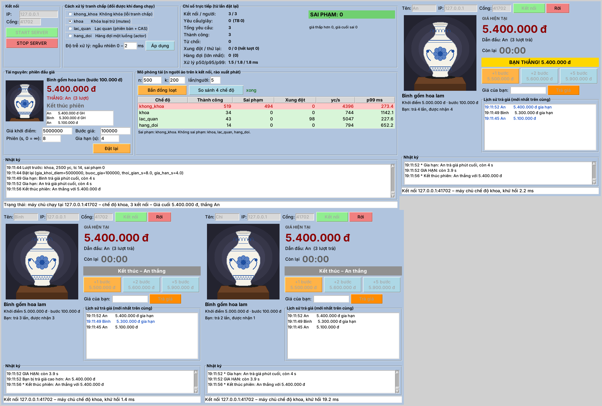
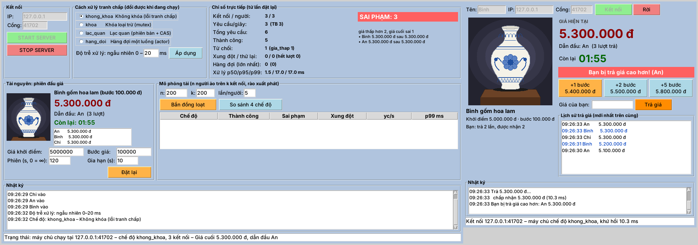
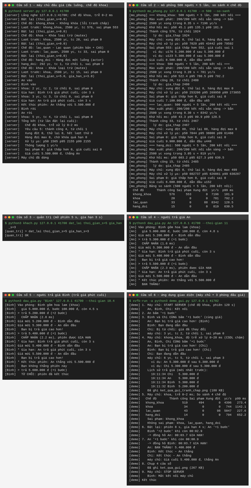

# Bài mở rộng MR6.6 – Đấu giá trực tuyến: n người cùng tranh một món hàng (Python)

| Thông tin | Nội dung |
|---|---|
| Loại | **Bài mở rộng**, không có trong giáo trình và không có mã giả tương ứng. Đây là bài đầu của nhóm "tranh chấp tài nguyên" MR6.6–MR6.14 |
| Liên hệ với giáo trình | Chương 6: Bài 6.1 (server đa luồng, một luồng mỗi kết nối), Bài 6.7 (kiểm thử tải); Chương 3: Bài 3.2 (định khung thông điệp theo dòng); bài mở rộng MR5.4/MR5.5 (luồng, đồng bộ) |
| Thư viện | Thư viện chuẩn: `socket`, `threading`, `queue`, `json`, `collections`, `contextlib`, `random`; bản giao diện dùng thêm `tkinter`, còn kịch bản demo giao diện cần `subprocess` và ImageMagick (`import`, `convert`) để chụp cửa sổ |
| Bản ngôn ngữ khác | [C#](../../../csharp/Chuong06/BaiMR6.6_DauGia/), [Java](../../../java/Chuong06/BaiMR6.6_DauGia/), [Rust](../../../rust/Chuong06/BaiMR6.6_DauGia/), [Go](../../../go/Chuong06/BaiMR6.6_DauGia/) |

## Mục tiêu
Bài mô phỏng một phòng đấu giá trực tuyến. Một món hàng có giá khởi điểm và bước giá. **n người cùng trả giá**, và giá chỉ được nhận khi **≥ giá hiện tại + bước giá**. Đồng hồ đếm ngược đóng phiên; ai trả giá trong 10 giây cuối thì phiên được **gia hạn 10 giây** (đóng mềm, chống "bắn tỉa" phút cuối). Hết giờ, máy chủ công bố người thắng. Máy chủ TCP đa luồng giữ trạng thái. Mỗi lần trả giá là một thao tác "đọc → kiểm tra (giả lập độ trễ cơ sở dữ liệu 0–2 ms) → ghi", và thao tác này được xử lý theo **bốn cách** chọn được ngay lúc đang chạy: không khóa, khóa loại trừ, điều khiển đồng thời lạc quan, hàng đợi một luồng. **Sổ kiểm toán** độc lập đếm sai phạm, còn **bộ mô phỏng tải** (500 người × 5 lần trên 200 kết nối, có rào xuất phát và pipelining) cho thấy bằng số liệu thật: chỉ chế độ không khóa sinh sai phạm, ba chế độ còn lại cho 0 sai phạm nhưng khác nhau về thông lượng và độ trễ.

Phần khung (`chung.py`, `khach.py`, phần KHUNG của `mo_phong.py`, `giao_dien_chung.py`) dùng chung cho cả 9 bài MR6.6–MR6.14. Bài sau chép khung này và chỉ viết thêm nghiệp vụ.

## Kiến thức chính
Số liệu dưới đây lấy từ `ket_qua.txt`, là một lần chạy thật trên máy cục bộ (127.0.0.1, Python 3, độ trễ xử lý ngẫu nhiên 0–2 ms). Mỗi lần chạy, số liệu lệch đi đôi chút.

```
  Chế độ       Thành công Sai phạm Xung đột  yc/s  p99 ms
  khong_khoa          576      553        0  7196   181.9
  khoa                 20        0        0   781   792.2
  lac_quan             33        0       88  8342   128.5
  hang_doi             15        0        0   819   630.5
```
(500 người × 5 lần trả giá = 2500 yêu cầu/chế độ, 200 kết nối. "Thành công" là số giá được chấp nhận, "Sai phạm" do sổ kiểm toán đếm, "Xung đột" là số lần so sánh-và-đổi thất bại, "yc/s" và "p99" (khứ hồi) đo ở bộ mô phỏng.)

- **Tranh chấp (race condition) và mất cập nhật.** Chế độ `khong_khoa` làm "đọc giá → chờ 0–2 ms → kiểm tra → ghi" mà không đồng bộ. Hàng trăm luồng cùng đọc một giá cũ, ai cũng qua được kiểm tra, ai cũng nhận "CHẤP NHẬN", và bản ghi sau đè bản ghi trước. Kết quả: 576 giá được chấp nhận, trong đó **552** giá thấp hơn (giá đã chấp nhận trước + bước giá). Ví dụ có `u176 5.200.000 đ` được chấp nhận *sau* khi `5.300.000 đ` đã được chấp nhận. Ngoài ra, **giá cuối sai**: giá và người dẫn đầu còn lại không phải giá cao nhất từng được chấp nhận. Người trả giá cao nhất được báo "chấp nhận" nhưng rồi bị xóa mất. Giao diện cho thấy rõ chuyện này: khi đặt độ trễ 0–20 ms và ba người cùng bấm "+1 bước", cả ba cùng được chấp nhận ở **cùng một giá** 5.300.000 đ (sai phạm 3, xem `ket_qua_gui_tranh_chap.png`). Chế độ này chỉ dùng để minh họa lỗi trong phòng lab (loopback).
- **Vùng găng (critical section) và khóa theo tài nguyên.** Chế độ `khoa` cho mỗi ô tài nguyên một `threading.Lock` riêng và giữ khóa suốt đọc – kiểm tra – ghi. Sai phạm bằng 0. Đổi lại, mọi yêu cầu (kể cả yêu cầu sẽ bị từ chối) phải xếp hàng qua một khóa duy nhất, nên thông lượng chỉ còn ≈ 1 / (thời gian xử lý trung bình) ≈ 781 yc/s. Thời gian xử lý ở máy chủ, tính cả lúc chờ khóa, có p50 là 253 ms. Một món hàng là "điểm nóng" (hot spot), và khóa theo từng tài nguyên chỉ có lợi khi có nhiều tài nguyên (ghế, tài khoản, xem MR6.8, MR6.12). Khung khóa nhiều ô **theo thứ tự khóa đã sắp xếp** để không khóa chết; tùy chọn `khoa_ngay_tho` (MR6.12) cho thấy điều ngược lại.
- **Điều khiển đồng thời lạc quan (optimistic concurrency, Kung & Robinson 1981).** Chế độ `lac_quan` đọc (giá trị, **phiên bản**) dưới một khóa rất ngắn, xử lý *ngoài* khóa, rồi **so sánh-và-đổi** (compare-and-swap): chỉ ghi khi phiên bản chưa đổi. Nếu phiên bản đã đổi thì đó là xung đột, và thao tác thử lại (tối đa 5 lần, nghỉ ngẫu nhiên 0–1 ms). Sai phạm bằng 0 và thông lượng **cao nhất** (8342 yc/s), vì phần lớn yêu cầu bị từ chối ngay sau lần đọc ("giá thấp") mà không phải chờ ai. Chỉ những yêu cầu thật sự ghi mới đi qua CAS; có 88 xung đột và 88 lần thử lại, không yêu cầu nào hết lượt thử. Khi tranh chấp cao và nhiều thao tác cùng *ghi*, lạc quan sẽ tốn công làm lại.
- **Hàng đợi một luồng (mô hình actor, vòng lặp sự kiện).** Chế độ `hang_doi` cho luồng kết nối đặt yêu cầu vào `queue.Queue` rồi đọc tiếp ngay. **Một** luồng xử lý lần lượt, đến trước phục vụ trước, không cần khóa vì chỉ luồng này chạm vào trạng thái. Sai phạm bằng 0, thông lượng 819 yc/s (cũng tuần tự như `khoa`), và hàng đợi dài tối đa **499** (gần bằng số người đang chờ trả lời). Độ trễ khứ hồi phản ánh đúng thời gian xếp hàng.
- **Sổ kiểm toán.** Sổ ghi mọi giao dịch được chấp nhận dưới khóa riêng, ngay trong vùng găng của chế độ (callback `khi_ghi`), nên thứ tự trong sổ đúng là thứ tự ghi. Luật của bài: một giá chấp nhận phải ≥ (giá cao nhất đã chấp nhận + bước giá), và giá/người dẫn đầu cuối cùng phải đúng là giá cao nhất trong sổ. Sổ không ngăn lỗi, chỉ *phát hiện* lỗi sau buổi chạy, giống đối soát cuối ngày.
- **Rào xuất phát, pipelining, idempotency.** Bộ mô phỏng mở 200 kết nối, mỗi kết nối chở 2–3 người ảo (`"so_nguoi"` trong lời chào, tên người ở trường `"nguoi"`). Mọi luồng chờ ở `threading.Barrier` rồi cùng bắn. Mỗi kết nối gửi yêu cầu của mọi người mình chở trong một lần `sendall`, và nhận được trả lời nào (ghép theo `ma_yc`) thì gửi ngay lần trả giá kế tiếp của người đó: giá = giá hiện tại đọc từ `kq`/`cap_nhat` + bước × ngẫu nhiên 1–3. Nếu một `ma_yc` đã xử lý bị gửi lại, máy chủ không trả giá lần nữa mà gửi lại kết quả cũ kèm `"lap_lai": true`.
- **Đẩy trạng thái có gộp.** Mỗi khi trạng thái đổi, máy chủ chỉ đặt một cờ. Luồng nền cứ 100 ms gửi **một** `cap_nhat` (gồm giá, người dẫn đầu, thời gian còn lại, 12 giá gần nhất) cho mọi client, nên dù có 8000 yc/s thì mỗi client cũng chỉ nhận tối đa 10 cập nhật mỗi giây. Đồng hồ đếm ngược chạy cục bộ ở client theo `con_lai_ms`.
- **Đóng mềm (soft close).** Trong lượt chạy dòng lệnh (phiên 5 s, gia hạn 3 s), Bình trả giá khi còn ≈ 0,9 s nên phiên được gia hạn. An trả giá phút cuối nên phiên được gia hạn lần nữa. Không còn ai trả giá thì phiên đóng: "Kết thúc phiên: An thắng với 5.500.000 đ". Lần trả giá sau đó của Bình nhận "TỪ CHỐI: phiên đã kết thúc". Việc đóng phiên cũng là một thao tác ghi đi qua cùng chế độ xử lý tranh chấp, nên không thể "chen" một giá vào sau khi đã đóng.

### Giao thức (giống hệt ở 5 ngôn ngữ)
TCP, mỗi dòng một JSON UTF-8 kết thúc `\n`, tối đa 64 KB một dòng. Mọi yêu cầu có `ma_yc` (số nguyên do client đánh), và trả lời mang lại đúng `ma_yc` đó.

| Chiều | Thông điệp |
|---|---|
| client → server | `{"loai":"chao","ten":"An","vai_tro":"nguoi_dung"\|"quan_tri"}` (đầu tiên, tên 1–16 ký tự); kết nối gộp của bộ mô phỏng thêm `"so_nguoi":m` |
| người dùng → server | `{"loai":"tra_gia","ma_yc":k,"gia":5300000}` (kết nối gộp thêm `"nguoi":"u17"`) |
| quản trị → server | `{"loai":"che_do","ma_yc":k,"gia_tri":"khoa"}`, `{"loai":"tre","ma_yc":k,"ms":2}`, `{"loai":"dat_lai","ma_yc":k,"thoi_gian_s":120,"gia_han_s":10,"gia_khoi_diem":…,"buoc_gia":…,"ten_mon":…}`, `{"loai":"thong_ke","ma_yc":k}` |
| server → client | `{"loai":"chao","ma":id,"che_do":"khoa","may_chu":"Đấu giá MR6.6"}`, ngay sau đó là một `cap_nhat`; `{"loai":"loi","ly_do":…}` khi sai giao thức |
| server → client | `{"loai":"kq","ma_yc":k,"ok":true,"gia":…,"nguoi_dan_dau":…,"gia_han":bool}` hoặc `{"loai":"kq","ma_yc":k,"ok":false,"ma_loi":"gia_thap"\|"het_phien"\|"xung_dot"\|"sai_du_lieu"\|…,"ly_do":…,"gia":…}` |
| server → tất cả | `{"loai":"cap_nhat","che_do":…,"mon":{"ten","gia_khoi_diem","buoc_gia","gia_han_s"},"gia","nguoi_dan_dau","so_lan","con_lai_ms"(null = không giới hạn),"ket_thuc","lich_su":[{"nguoi","gia","gio","gia_han"}…]}` (≤ 10 lần/s); `{"loai":"su_kien","noi_dung":"Kết thúc phiên: An thắng với …"}` |
| server → quản trị | `{"loai":"thong_ke","ma_yc":k,"so_yc","thanh_cong","tu_choi","xung_dot","thu_lai","het_lan_thu","khoa_cho_lau","hang_doi_max","yc_s","thong_luong","p50_us","p95_us","p99_us","sai_pham":[{"ma","ten","so"}],"sai_pham_tong","tom_tat",…}` |

## Cấu trúc tệp
- `chung.py`: **khung chung** gồm giao thức (`gui_json`, `doc_dong`, `doc_lenh_stdin`, `doc_tham_so`), `phan_vi`, `ThongKe`, `KhoTranhChap` (4 chế độ, cổng `tam_dung`), `SoKiemToan`, `MayChuCoSo` (máy chủ TCP đa luồng), các hàm in `dong_thong_ke`, `bang_so_sanh`, `tien`.
- `may_chu.py`: nghiệp vụ đấu giá `MayChuDauGia` (trả giá, gia hạn, đóng phiên) và `SoKiemToanDauGia`; `server.py` là bản dòng lệnh.
- `khach.py`: lõi client `KetNoiKhach` (pipelining, ghép theo `ma_yc`), `QuanTri`; chạy riêng được như công cụ quản trị dòng lệnh.
- `mo_phong.py`: bộ mô phỏng tải (`chay_luot`, `so_sanh`); phần NGHIỆP VỤ là `NguCanh`, `NguoiAo`.
- `dau_gia.py`: người trả giá bản dòng lệnh.
- `giao_dien_chung.py`: khung giao diện chung (`CuaSoServerCoSo`, `CuaSoNguoiDungCoSo`, `chay_kich_ban`, `chup`, `ghep_anh`).
- `server_gui.py`: bảng điều khiển máy chủ; `dau_gia_gui.py`: phòng đấu giá; `demo_gui.py`: kịch bản tự bấm nút.
- `demo.json`, `ket_qua.txt`, `ket_qua.png`, `ket_qua_gui.png`, `ket_qua_gui_tranh_chap.png`: kịch bản và kết quả thực thi thật.

## Cách chạy
Chạy trong thư mục bài (trên Windows dùng `python` hoặc `py` thay cho `python3`):
```bash
python3 server.py 127.0.0.1 9000                                  # cửa sổ 1 (gõ lệnh ở đây)
python3 mo_phong.py 127.0.0.1 9000 --n 500 --so-sanh              # cửa sổ 2: bảng so sánh 4 chế độ
python3 mo_phong.py 127.0.0.1 9000 --n 2000 --k 200 --che-do lac_quan --dat-lai
python3 khach.py 127.0.0.1 9000 dat_lai thoi_gian_s=60 gia_han_s=10   # mở phiên 60 s
python3 dau_gia.py An 127.0.0.1 9000                              # cửa sổ 3, 4…: gõ tang 1 / tra 5300000
```
- Lệnh của máy chủ: `che_do khong_khoa|khoa|lac_quan|hang_doi`, `tre <ms>`, `dat_lai [khoa=giá_trị …]`, `thong_ke`, `thoat`. Tùy chọn khi chạy: `--che-do`, `--tre-ms`, `--thoi-gian` (0 = không giới hạn), `--gia`, `--buoc`, `--gia-han`. Cứ 5 giây, nếu có yêu cầu mới, máy chủ in một dòng số liệu.
- Lệnh của `dau_gia.py`: `tang [n]` (trả giá hiện tại + n bước), `tra <giá>`, `thoat`. Dòng `@t lệnh` chờ tới giây thứ t rồi mới chạy lệnh.
- `khach.py <host> <cổng> che_do x | tre ms | dat_lai k=v … | thong_ke` gửi lệnh quản trị.

Muốn tái lập kết quả, chạy từ thư mục gốc của kho: `python3 tools/demo.py python/Chuong06/BaiMR6.6_DauGia`.

## Ứng dụng giao diện


Ảnh trên là lần chạy thật của `demo_gui.py` (Linux, Xvfb, Python 3.12 + Tk 8.6): bảng điều khiển máy chủ (trên trái), An (trên phải, "BẠN THẮNG!"), Bình và Chi (dưới). Kịch bản đã chạy so sánh 4 chế độ (bảng ở giữa, dòng `khong_khoa` tô đỏ) rồi mở phiên 8 s, gia hạn 4 s: Bình trả giá khi còn 2,9 s, An trả giá khi còn 0,9 s, phiên được gia hạn hai lần và An thắng với 5.400.000 đ.



Ở bước trước đó (ảnh trên), máy chủ đang ở `khong_khoa` với độ trễ xử lý 0–20 ms. An, Bình và Chi cùng bấm "+1 bước" ở cùng một giá, và cả ba đều được chấp nhận 5.300.000 đ. Ô **SAI PHẠM** chuyển đỏ (3: giá thấp hơn 2, giá cuối sai 1), còn lịch sử của Bình có ba dòng cùng giá. Cùng thao tác đó ở chế độ `khoa` thì người thứ hai nhận "Bị từ chối: giá đã thay đổi".

- **Máy chủ** (`server_gui.py`): IP, cổng, START/STOP; **4 nút chọn chế độ** (đổi được khi đang chạy); độ trễ xử lý; **chỉ số trực tiếp**: kết nối/người, yêu cầu/giây, tổng, thành công, từ chối (theo mã lỗi), xung đột/thử lại, hàng đợi (lớn nhất), xử lý p50/p95/p99, **SAI PHẠM** (xanh khi bằng 0, đỏ khi > 0) kèm ví dụ; **tài nguyên**: ảnh món hàng, giá hiện tại, người dẫn đầu/thắng, đồng hồ phiên, ba giá gần nhất, tham số đặt lại (giá khởi điểm, bước giá, thời gian phiên, gia hạn) và nút **Đặt lại**; **mô phỏng tải**: n, k, số lần/người, **Bắn đồng loạt** (chế độ hiện tại), **So sánh 4 chế độ** (bảng kết quả); nhật ký.
- **Phòng đấu giá** (`dau_gia_gui.py`): ảnh "Bình gốm hoa lam" vẽ bằng Canvas; **giá hiện tại** cỡ lớn; người dẫn đầu và số lượt; **đồng hồ đếm ngược** (đỏ khi còn dưới 10 s, chớp "GIA HẠN!"); dòng thông báo ("Bạn đang dẫn đầu", "Bạn bị trả giá cao hơn!", "Bị từ chối: giá đã thay đổi", "BẠN THẮNG!", "Kết thúc – … thắng"); nút **+1/+2/+5 bước** ghi sẵn giá sẽ trả; ô nhập giá; lịch sử trả giá (giá của mình tô xanh, giá có gia hạn được đánh dấu); thanh trạng thái hiện chế độ của máy chủ và thời gian khứ hồi.

### Cách chạy
```bash
python3 server_gui.py 127.0.0.1 41702          # bấm START SERVER (phiên mặc định 120 s)
python3 dau_gia_gui.py An 127.0.0.1 41702
python3 dau_gia_gui.py Bình 127.0.0.1 41702
```
- **Windows:** Python cài từ python.org đã có sẵn Tkinter. **Linux:** `sudo apt install python3-tk`. Kịch bản tự động (Linux, cần `xvfb`, `imagemagick`): `xvfb-run -a -s "-screen 0 2600x1700x24" python3 demo_gui.py 127.0.0.1 41702`.
- Khi chạy riêng từng cửa sổ (không qua `demo_gui.py`), mọi dòng nhật ký và cứ 5 giây một dòng số liệu cũng được in ra dòng lệnh. Có thể chuyển hướng vào tệp, ví dụ `python3 server_gui.py > server.txt`.
- Thử trên nhiều máy: máy chủ nghe trên IP card mạng (hoặc `0.0.0.0`) và mở tường lửa cho cổng; mỗi sinh viên chạy `dau_gia_gui.py` với IP của máy thầy. Khi đó **chỉ dùng `khoa`, `lac_quan`, `hang_doi`**, còn `khong_khoa` để dành cho phần minh họa lỗi.

## Kết quả thực thi


## Ghi chú
- Python có GIL nên các luồng không chạy song song thật trên nhiều lõi. Dù vậy, tranh chấp vẫn xảy ra, vì luồng nhả GIL trong lúc `time.sleep` (giả lập truy vấn cơ sở dữ liệu) và khi gọi socket, và đó chính là khe giữa "đọc" và "ghi". Nếu đặt độ trễ 0 ms thì khe hẹp lại và sai phạm hiếm hơn hẳn, nhưng không hết.
- Đổi chế độ hoặc đặt lại đi qua "cổng" `tam_dung()`: đóng cổng, chờ mọi thao tác đang chạy và đang xếp hàng xong, rồi mới đổi. Nhờ vậy hai chế độ không bao giờ chạy lẫn vào nhau.
- "Xử lý µs" ở máy chủ tính từ lúc đọc xong yêu cầu tới lúc gửi trả lời, gồm cả thời gian chờ khóa/hàng đợi. Phân vị tính theo hạng gần nhất trên tối đa 200 000 mẫu từ lần đặt lại cuối.
- Trong kịch bản giao diện, máy chủ, bộ mô phỏng và cửa sổ cùng chạy trong một tiến trình, nên yc/s thấp hơn bản dòng lệnh. Bảng ở đó là một lần chạy riêng: `khong_khoa` 519 thành công / 494 sai phạm, `khoa` 34 / 0, `lac_quan` 43 / 0 (98 xung đột), `hang_doi` 14 / 0.
- Kiểm thử trên Linux: Python 3.13 (dòng lệnh) và Python 3.12.3 + Tk 8.6 dưới Xvfb (giao diện).

## Bài tập gợi ý
1. Chạy `mo_phong.py --so-sanh` với `--tre-ms 0`, `2`, `10`. Sai phạm của `khong_khoa` và thông lượng của `khoa` thay đổi thế nào? Hãy giải thích bằng độ rộng của khe "đọc → ghi".
2. Tăng `--n` lên 5000 với `--k 200` rồi `--k 20`. Hàng đợi lớn nhất của `hang_doi` và p99 thay đổi ra sao? Vì sao pipelining giúp vài trăm kết nối "chở" được hàng nghìn người?
3. Ở `lac_quan`, sửa `NguoiAo` cho mọi người trả đúng "giá hiện tại + 1 bước" (không ngẫu nhiên). Đếm số yêu cầu hết lượt thử ("xung đột, thử lại sau"). Tăng `SO_LAN_THU` có giải quyết được không?
4. Thêm thao tác `rut_gia` (người đang dẫn đầu rút giá, giá quay về giá trước đó). Cần những gì trong trạng thái? Sổ kiểm toán cần thêm luật nào?
5. Thêm nhiều món hàng (ô `mon_1`, `mon_2`, …) và cho mô phỏng chia người ra các món. So sánh `khoa` (khóa theo từng món) với `hang_doi` (một luồng cho tất cả) khi số món tăng.
6. Giao diện: vẽ trên Canvas của máy chủ biểu đồ giá theo thời gian. Ở `khong_khoa`, đường giá có "tụt xuống" không?

## Đọc thêm
- H. T. Kung, J. T. Robinson (1981). *On Optimistic Methods for Concurrency Control*. ACM Transactions on Database Systems 6(2).
- E. G. Coffman, M. J. Elphick, A. Shoshani (1971). *System Deadlocks*. ACM Computing Surveys 3(2): điều kiện khóa chết và cách phòng bằng thứ tự khóa (khung dùng cho chế độ `khoa`).
- Tài liệu Python: [`threading`](https://docs.python.org/3/library/threading.html) (Lock, Condition, Barrier), [`queue`](https://docs.python.org/3/library/queue.html), [`socket`](https://docs.python.org/3/library/socket.html), [`tkinter`](https://docs.python.org/3/library/tkinter.html).

Mã nguồn của bài được viết mới cho kho này.
