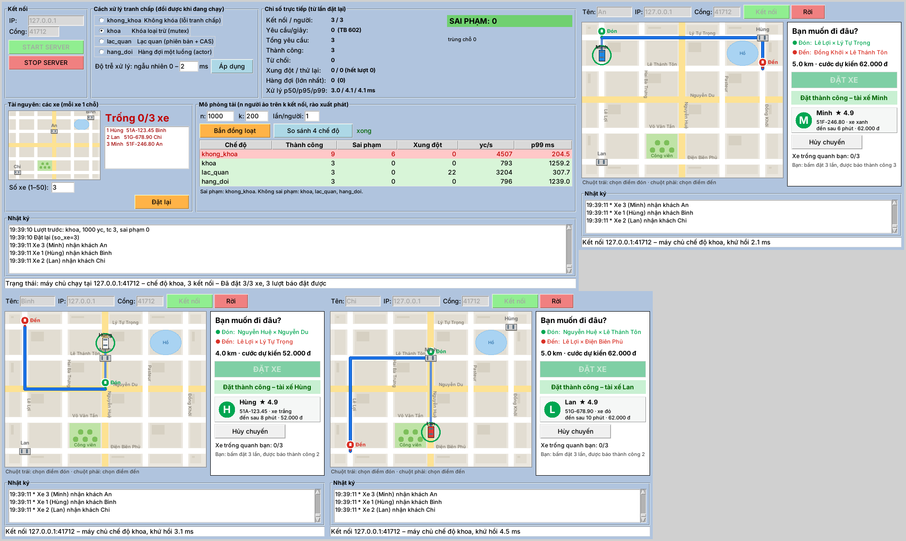
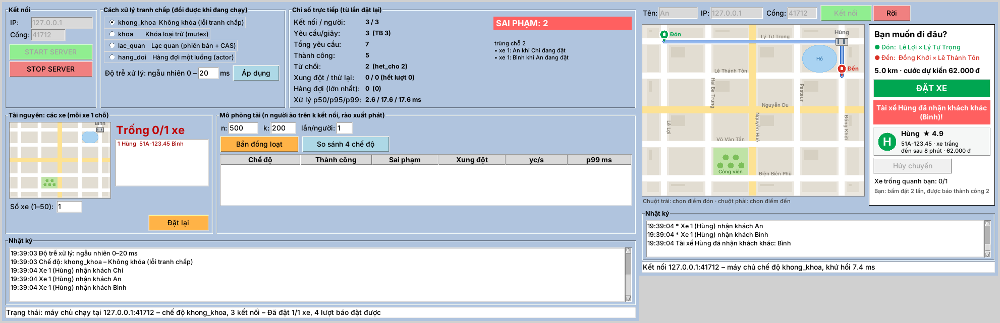
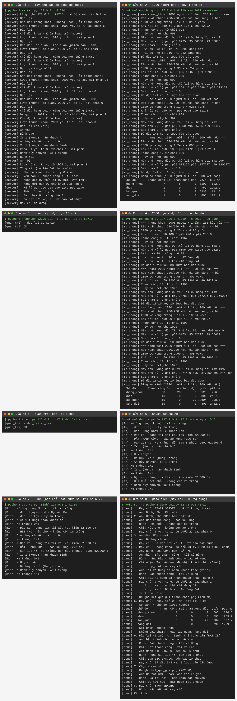

# Bài mở rộng MR6.7 – Đặt xe: n người cùng bấm "Đặt xe" cho một chỗ (Python)

| Thông tin | Nội dung |
|---|---|
| Loại | **Bài mở rộng**, không có trong giáo trình và không có mã giả tương ứng. Bài thứ hai của nhóm "tranh chấp tài nguyên" MR6.6–MR6.13, dùng chung khung của [MR6.6](../BaiMR6.6_DauGia/) |
| Liên hệ với giáo trình | Chương 6: Bài 6.1 (server đa luồng, một luồng mỗi kết nối), Bài 6.7 (kiểm thử tải); Chương 3: Bài 3.2 (định khung thông điệp theo dòng); bài mở rộng MR5.4/MR5.5 (luồng, đồng bộ) |
| Thư viện | Thư viện chuẩn: `socket`, `threading`, `queue`, `json`, `itertools`, `random`; bản giao diện dùng thêm `tkinter`, còn kịch bản demo giao diện cần `subprocess` và ImageMagick (`import`, `convert`) để chụp cửa sổ |
| Bản ngôn ngữ khác | [C#](../../../csharp/Chuong06/BaiMR6.7_DatXe/), [Java](../../../java/Chuong06/BaiMR6.7_DatXe/), [Rust](../../../rust/Chuong06/BaiMR6.7_DatXe/), [Go](../../../go/Chuong06/BaiMR6.7_DatXe/) |

## Mục tiêu
Bài mô phỏng một ứng dụng gọi xe. Có **m chiếc xe** (mặc định 1), mỗi xe **một chỗ**. **n người cùng bấm "Đặt xe"**: máy chủ giao xe trống gần điểm đón nhất, hết xe thì báo "Hết chỗ". Người đặt được có thể hủy chuyến để trả xe. Mỗi lần đặt là một thao tác "đọc trạng thái các xe → chọn xe (giả lập độ trễ cơ sở dữ liệu 0–2 ms) → ghi", xử lý theo **bốn cách** chọn được ngay lúc đang chạy: không khóa, khóa loại trừ, lạc quan, hàng đợi một luồng. **Sổ kiểm toán** đếm số lần một chỗ đã có người lại được giao cho người thứ hai. **Bộ mô phỏng tải** (1000 người cùng đặt 1 xe; 2000 người cùng đặt 10 xe; 200 kết nối, rào xuất phát, pipelining) cho thấy bằng số liệu thật: chỉ chế độ không khóa "bán" một chỗ cho nhiều người.

Phần khung (`chung.py`, `khach.py`, phần KHUNG của `mo_phong.py`, `giao_dien_chung.py`) chép nguyên từ MR6.6. Bài này chỉ viết nghiệp vụ (`may_chu.py`, phần NGHIỆP VỤ của `mo_phong.py`), ứng dụng người dùng, bảng tài nguyên của máy chủ và kịch bản demo.

## Kiến thức chính
Số liệu dưới đây lấy từ `ket_qua.txt`, là một lần chạy thật trên máy cục bộ (127.0.0.1, Python 3, độ trễ xử lý ngẫu nhiên 0–2 ms). Mỗi lần chạy, số liệu lệch đi đôi chút.

```
1000 người cùng đặt 1 xe:
  Chế độ       Thành công Sai phạm Xung đột  yc/s  p99 ms
  khong_khoa            7        6        0  8197   122.2
  khoa                  1        0        0   752  1292.6
  lac_quan              1        0        4  9238   111.8
  hang_doi              1        0        0   806  1221.4
2000 người cùng đặt 10 xe:
  Chế độ       Thành công Sai phạm Xung đột  yc/s  p99 ms
  khong_khoa           38       28        0  8128   256.8
  khoa                 10        0        0   806  2427.9
  lac_quan             10        0       70 10604   208.7
  hang_doi             10        0        0   800  2462.2
```
(Mỗi người bấm một lần, 200 kết nối. "Thành công" là số người được báo "Đặt thành công", "Sai phạm" do sổ kiểm toán đếm, "Xung đột" là số lần so sánh-và-đổi thất bại, "yc/s" và "p99" (khứ hồi) đo ở bộ mô phỏng.)

- **Tranh chấp (race condition): một chỗ, nhiều người.** Ở `khong_khoa`, thao tác đặt xe làm "đọc các xe → chờ 0–2 ms → chọn xe trống → ghi" mà không đồng bộ. Mọi luồng đọc được trước lần ghi đầu tiên đều thấy "xe 1 trống", đều được báo "Đặt thành công – tài xế Hùng", và bản ghi sau đè bản ghi trước. Với 1 xe, **7 người** cùng được báo thành công cho **một** chỗ, sổ kiểm toán đếm **6** lần "trùng chỗ" (ví dụ `xe 1: u12 khi u200 đang đặt`). Với 10 xe, 38 người được báo thành công cho 10 chỗ (28 sai phạm). Người bị đè không hề biết: trên giao diện, họ thấy "Tài xế Hùng đã nhận khách khác!" khi bản cập nhật kế tiếp tới, tức là sau khi đã được báo thành công. Chế độ này chỉ dùng để minh họa lỗi trong phòng lab (loopback).
- **Vì sao 1 xe cho ít sai phạm hơn 10 xe.** Khe tranh chấp chỉ mở từ lúc luồng đầu tiên đọc tới lúc nó ghi xong (vài phần mười mili giây tới 2 ms). Mọi người đọc sau lần ghi đó đều thấy "Hết chỗ" và bị từ chối đúng. Một xe là một khe, còn mười xe là mười khe, nên con số sai phạm tăng theo số chỗ chứ không theo số người. Ở MR6.6 (đấu giá) mỗi lần trả giá lại mở khe mới, nên sai phạm lên tới hàng trăm.
- **Vùng găng nhiều ô.** Để biết người đặt đã có chuyến chưa và xe trống nào gần nhất, mỗi lần đặt đọc **cả m ô** `xe1…xem`. Chế độ `khoa` giữ khóa của mọi ô (theo thứ tự tên ô, nên không khóa chết) suốt đọc – chọn – ghi, và sai phạm bằng 0. Đổi lại, mọi yêu cầu đi qua cùng một bộ khóa, nên thông lượng chỉ còn ≈ 1 / (thời gian xử lý trung bình) ≈ 750–800 yc/s, như `hang_doi`. Khóa theo từng tài nguyên chỉ có lợi khi mỗi thao tác chạm vào ít ô, như ghế rạp ở [MR6.8](../BaiMR6.8_DatVePhim/).
- **Lạc quan (Kung & Robinson 1981).** Chế độ `lac_quan` đọc (giá trị, phiên bản) của các ô, chọn xe *ngoài* khóa, rồi so sánh-và-đổi: chỉ ghi nếu không ô nào đổi phiên bản. Chỉ vài yêu cầu đầu thật sự ghi, nên xung đột ít (4 với 1 xe, 70 với 10 xe), và mọi người đến sau bị từ chối "hết chỗ" ngay sau lần đọc mà không phải chờ ai. Vì vậy thông lượng cao nhất (9238 và 10604 yc/s).
- **Hàng đợi một luồng (actor).** Chế độ `hang_doi` cho một luồng xử lý lần lượt, đến trước phục vụ trước. Sai phạm bằng 0, nhưng hàng đợi dài tối đa **996** (1000 người) và **1997** (2000 người), và khứ hồi p99 ≈ 1,2–2,5 s chính là thời gian xếp hàng.
- **Ảnh chụp trạng thái có số thứ tự.** Máy chủ đẩy `cap_nhat` gộp 10 lần/giây, nên một bản cập nhật chụp *trước* lần ghi của mình có thể tới *sau* trả lời `kq`. Nếu client tin bản đó, nó sẽ báo sai "đã mất xe". Vì vậy mỗi lần ghi được đánh số (`kq["phien"]`) và mỗi `cap_nhat` mang `"phien"` lúc chụp. Client chỉ kết luận "xe đã nhận khách khác" từ một bản cập nhật có `phien` ≥ số của lần đặt của mình. Đây là cùng ý tưởng với phiên bản trong điều khiển đồng thời lạc quan, nhưng dùng ở phía client.
- **Idempotency và pipelining.** Bộ mô phỏng gửi mọi yêu cầu của 5–10 người trên một kết nối trong một lần `sendall` (`"so_nguoi"`, `"nguoi"`), sau khi qua `threading.Barrier`. Một `ma_yc` gửi lại không bị đặt lần hai; máy chủ gửi lại kết quả cũ kèm `"lap_lai": true`.

### Giao thức (giống hệt ở 5 ngôn ngữ)
Khung chung (chào, quản trị, `kq`, `cap_nhat`, `su_kien`, `thong_ke`) xem [README MR6.6](../BaiMR6.6_DauGia/README.md#giao-thức-giống-hệt-ở-5-ngôn-ngữ). Phần riêng của bài:

| Chiều | Thông điệp |
|---|---|
| người dùng → server | `{"loai":"dat_xe","ma_yc":k,"don":[x,y],"den":[x,y]}` (ngã tư trên lưới 5 × 5, tọa độ 0.1/0.3/0.5/0.7/0.9; bỏ trống thì đón ở [0.5,0.5]); `{"loai":"huy","ma_yc":k}`. Kết nối gộp thêm `"nguoi":"u17"` |
| quản trị → server | `{"loai":"dat_lai","ma_yc":k,"so_xe":10}` (1–50) |
| server → client | `{"loai":"kq","ma_yc":k,"ok":true,"xe":1,"khach","tai_xe","bien_so","mau","phut","cuoc","phien"}`; từ chối: `"ma_loi":"het_cho"\|"da_dat"\|"chua_dat"\|"xung_dot"\|"sai_du_lieu"\|…` |
| server → tất cả | `{"loai":"cap_nhat","che_do","phien","so_xe","trong","xe":[{"ma","tai_xe","bien_so","mau","vi_tri","khach","don","den","gio","cuoc","phut"}…],"lich_su":[…]}`; `{"loai":"su_kien","noi_dung":"Xe 1 (Hùng) nhận khách An"}` (chỉ cho người dùng thật) |

Sai phạm trong `thong_ke`: `[{"ma":"trung_cho","ten":"trùng chỗ","so":n}]`; `tom_tat`: `Đã đặt 1/1 xe, 7 lượt báo đặt được`.

## Cấu trúc tệp
- `chung.py`, `khach.py`, `giao_dien_chung.py`: **khung chung**, chép nguyên từ MR6.6 (chỉ sửa dòng đầu docstring của `khach.py`).
- `may_chu.py`: nghiệp vụ `MayChuDatXe` (đặt xe, hủy, chọn xe gần nhất, cước, số thứ tự lần ghi) và `SoKiemToanDatXe`; bản đồ (tên phố, ngã tư); `server.py` là bản dòng lệnh.
- `mo_phong.py`: bộ mô phỏng tải; phần NGHIỆP VỤ là `NguCanh`, `NguoiAo` (đặt từ một ngã tư ngẫu nhiên), `THAM_SO_DAT_LAI = {}` (giữ số xe hiện tại của máy chủ).
- `dat_xe.py`: người gọi xe bản dòng lệnh.
- `server_gui.py`: bảng điều khiển máy chủ; `dat_xe_gui.py`: ứng dụng gọi xe (lớp `BanDo` vẽ bản đồ, dùng ở cả hai cửa sổ); `demo_gui.py`: kịch bản tự bấm nút.
- `demo.json`, `ket_qua.txt`, `ket_qua.png`, `ket_qua_gui.png`, `ket_qua_gui_tranh_chap.png`: kịch bản và kết quả thực thi thật.

## Cách chạy
Chạy trong thư mục bài (trên Windows dùng `python` hoặc `py` thay cho `python3`):
```bash
python3 server.py 127.0.0.1 9000                                  # cửa sổ 1 (gõ lệnh ở đây)
python3 mo_phong.py 127.0.0.1 9000 --n 1000 --so-sanh             # cửa sổ 2: 1000 người, 1 xe
python3 khach.py 127.0.0.1 9000 dat_lai so_xe=10                  # 10 xe
python3 mo_phong.py 127.0.0.1 9000 --n 2000 --so-sanh             # 2000 người, 10 xe
python3 dat_xe.py An 127.0.0.1 9000                               # cửa sổ 3, 4…: gõ dat / huy
```
- Lệnh của máy chủ: `che_do khong_khoa|khoa|lac_quan|hang_doi`, `tre <ms>`, `dat_lai [so_xe=…]`, `thong_ke`, `thoat`. Tùy chọn khi chạy: `--che-do`, `--tre-ms`, `--so-xe`.
- Lệnh của `dat_xe.py`: `dat` (đặt từ điểm đón mặc định theo tên), `huy`, `thoat`. Dòng `@t lệnh` chờ tới giây thứ t rồi mới chạy lệnh.
- `mo_phong.py` có thêm `--k` (số kết nối), `--lan` (số lần bấm lại khi bị từ chối vì xung đột), `--che-do`, `--dat-lai`, `--tre-ms`.

Trong lượt chạy dòng lệnh (1 xe, chế độ `khoa`), An đặt được, Bình nhận "HẾT CHỖ", An hủy, Bình đặt lại được, rồi đến lượt An nhận "HẾT CHỖ". Muốn tái lập kết quả, chạy từ thư mục gốc của kho: `python3 tools/demo.py python/Chuong06/BaiMR6.7_DatXe`.

## Ứng dụng giao diện


Ảnh trên là lần chạy thật của `demo_gui.py` (Linux, Xvfb, Python 3.12 + Tk 8.6): bảng điều khiển máy chủ (trên trái), An (trên phải), Bình và Chi (dưới). Kịch bản đã chạy so sánh 4 chế độ với 3 xe (1000 người: `khong_khoa` 9 người được báo thành công, 6 sai phạm; ba chế độ kia 3 người, 0 sai phạm), rồi đặt lại 3 xe. Ba người cùng bấm "ĐẶT XE" và mỗi người được một xe (Minh, Hùng, Lan), xe chạy hoạt hình theo tuyến nét đứt tới điểm đón rồi theo tuyến xanh tới điểm đến.



Ở bước trước đó, máy chủ đang ở `khong_khoa` với độ trễ 0–20 ms và chỉ có 1 xe. An, Bình và Chi cùng bấm "ĐẶT XE", và cả ba đều nhận trả lời thành công. Bản cập nhật kế tiếp cho thấy xe 1 chở Bình, nên An và Chi thấy "Tài xế Hùng đã nhận khách khác (Bình)!". Ô **SAI PHẠM** chuyển đỏ (trùng chỗ 2). Cùng thao tác đó ở `khoa` thì một người "Đặt thành công", hai người "Hết chỗ – không còn xe trống".

- **Máy chủ** (`server_gui.py`): phần chung giống MR6.6 (START/STOP, 4 chế độ, độ trễ, chỉ số trực tiếp, SAI PHẠM, mô phỏng tải, bảng so sánh, nhật ký); **tài nguyên**: bản đồ thu nhỏ với các xe (xe có khách mờ đi và ghi tên khách), "Trống x/m xe", danh sách xe (tài xế, biển số, khách), ô **Số xe** và nút **Đặt lại**.
- **Gọi xe** (`dat_xe_gui.py`): **bản đồ** vẽ bằng Canvas (5 × 5 phố có tên, đường chính màu vàng, công viên, hồ, nhà); **điểm đón** (ghim xanh, chuột trái) và **điểm đến** (ghim đỏ, chuột phải); tuyến đường; các xe theo màu, xe đã có khách mờ đi; quãng đường và **cước dự kiến**; nút **ĐẶT XE**; trạng thái "Đang tìm tài xế…", "Đặt thành công – tài xế …", "Hết chỗ – không còn xe trống", "Tài xế … đã nhận khách khác!", "Tài xế … đã đón bạn – đang đi", "Đã tới nơi"; **thẻ tài xế** (tên, biển số, màu xe, thời gian tới, cước); nút **Hủy chuyến** (sau khi tới nơi thành **Hoàn tất chuyến**, cũng gửi `huy` để trả xe); "Xe trống quanh bạn"; thanh trạng thái hiện chế độ máy chủ và khứ hồi.

### Cách chạy
```bash
python3 server_gui.py 127.0.0.1 41712          # bấm START SERVER (1 xe)
python3 dat_xe_gui.py An 127.0.0.1 41712
python3 dat_xe_gui.py Bình 127.0.0.1 41712
```
- **Windows:** Python cài từ python.org đã có sẵn Tkinter. **Linux:** `sudo apt install python3-tk`. Kịch bản tự động (Linux, cần `xvfb`, `imagemagick`): `xvfb-run -a -s "-screen 0 2600x1700x24" python3 demo_gui.py 127.0.0.1 41712`.
- Khi chạy riêng từng cửa sổ, mọi dòng nhật ký và cứ 5 giây một dòng số liệu cũng được in ra dòng lệnh.
- Thử trên nhiều máy: máy chủ nghe trên IP card mạng (hoặc `0.0.0.0`) và mở tường lửa cho cổng; mỗi sinh viên chạy `dat_xe_gui.py` với IP của máy thầy, cả lớp đếm ngược rồi cùng bấm "ĐẶT XE". Khi đó **chỉ dùng `khoa`, `lac_quan`, `hang_doi`**, còn `khong_khoa` để dành cho phần minh họa lỗi.

## Kết quả thực thi


## Ghi chú
- Python có GIL nên các luồng không chạy song song thật. Tranh chấp vẫn xảy ra vì luồng nhả GIL trong lúc `time.sleep` (giả lập truy vấn cơ sở dữ liệu). Với 1 xe, khe tranh chấp rất hẹp (từ lần đọc đầu tới lần ghi đầu), nên số sai phạm của `khong_khoa` dao động mạnh giữa các lần chạy (từ 1 tới 8 trong khoảng mười lần thử với 1000 người). Bản C#, Java, Rust, Go chạy đa lõi thật sẽ cho nhiều sai phạm hơn.
- Đổi chế độ hoặc đặt lại đi qua cổng `tam_dung()` của khung, nên hai chế độ không bao giờ chạy lẫn vào nhau. `THAM_SO_DAT_LAI = {}`: `--so-sanh` đặt lại trạng thái mà vẫn giữ số xe đang có.
- Trong kịch bản giao diện, máy chủ, bộ mô phỏng và cửa sổ cùng chạy trong một tiến trình, nên yc/s thấp hơn bản dòng lệnh.
- Kiểm thử trên Linux: Python 3.13 (dòng lệnh) và Python 3.12.3 + Tk 8.6 dưới Xvfb (giao diện).

## Bài tập gợi ý
1. Chạy `mo_phong.py --che-do khong_khoa --dat-lai` nhiều lần với 1 xe, rồi với `--tre-ms 10`. Vì sao số sai phạm tăng theo độ trễ mà gần như không tăng theo `--n`?
2. Đổi `_xu_ly_yeu_cau` để mỗi lần đặt chỉ khóa **một** ô (máy chủ đọc không khóa để chọn xe, rồi `thuc_hien(["xeK"], …)`; nếu xe vừa có người thì thử xe kế). Đo thông lượng `khoa` với 10 xe. Kiểm tra "một người không đặt hai xe" còn được bảo đảm không, và cần thêm gì?
3. Thêm thao tác `hoan_thanh` (tài xế báo xong chuyến) và cho `NguoiAo` đặt – hủy – đặt lại nhiều vòng (`--lan 5`). Sai phạm của `khong_khoa` thay đổi thế nào khi mỗi lần hủy lại mở một khe tranh chấp mới?
4. Cho xe di chuyển thật ở máy chủ (cập nhật `vi_tri` trong `_dinh_ky`). Mỗi lần di chuyển cũng là một thao tác ghi: ở `lac_quan`, số xung đột của thao tác đặt xe tăng ra sao?
5. Giao diện: khi ứng dụng nhận "Đặt thành công" nhưng sau đó thấy "đã nhận khách khác", hãy tự động đặt lại (tìm xe khác). Đây có phải cách "sửa" tranh chấp không? Vì sao?

## Đọc thêm
- H. T. Kung, J. T. Robinson (1981). *On Optimistic Methods for Concurrency Control*. ACM Transactions on Database Systems 6(2).
- E. G. Coffman, M. J. Elphick, A. Shoshani (1971). *System Deadlocks*. ACM Computing Surveys 3(2): điều kiện khóa chết và cách phòng bằng thứ tự khóa (khung khóa nhiều ô theo thứ tự tên ô).
- Tài liệu Python: [`threading`](https://docs.python.org/3/library/threading.html) (Lock, Condition, Barrier), [`queue`](https://docs.python.org/3/library/queue.html), [`socket`](https://docs.python.org/3/library/socket.html), [`tkinter`](https://docs.python.org/3/library/tkinter.html).

Mã nguồn của bài được viết mới cho kho này.
