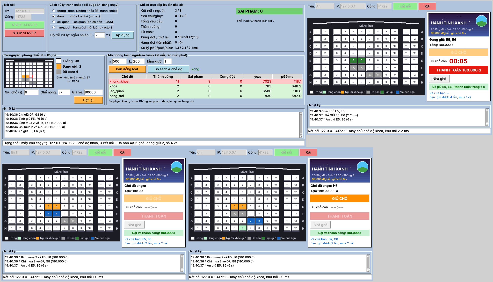
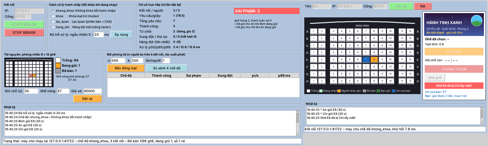
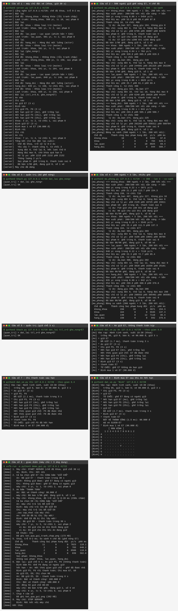

# Bài mở rộng MR6.8 – Đặt vé xem phim: giữ chỗ có thời hạn, n người cùng tranh một ghế (Python)

| Thông tin | Nội dung |
|---|---|
| Loại | **Bài mở rộng**, không có trong giáo trình và không có mã giả tương ứng. Thuộc nhóm "tranh chấp tài nguyên" MR6.6–MR6.14, dùng chung khung của [MR6.6](../BaiMR6.6_DauGia/) |
| Liên hệ với giáo trình | Chương 6: Bài 6.1 (server đa luồng, một luồng mỗi kết nối), Bài 6.7 (kiểm thử tải); Chương 3: Bài 3.2 (định khung thông điệp theo dòng); bài mở rộng MR5.4/MR5.5 (luồng, đồng bộ) |
| Thư viện | Thư viện chuẩn: `socket`, `threading`, `queue`, `json`, `itertools`, `random`; bản giao diện dùng thêm `tkinter`, còn kịch bản demo giao diện cần `subprocess` và ImageMagick (`import`, `convert`) để chụp cửa sổ |
| Bản ngôn ngữ khác | [C#](../../../csharp/Chuong06/BaiMR6.8_DatVePhim/), [Java](../../../java/Chuong06/BaiMR6.8_DatVePhim/), [Rust](../../../rust/Chuong06/BaiMR6.8_DatVePhim/), [Go](../../../go/Chuong06/BaiMR6.8_DatVePhim/) |

## Mục tiêu
Bài mô phỏng một ứng dụng đặt vé xem phim. Phòng chiếu có **8 hàng (A–H) × 12 ghế**. Người xem chọn ghế rồi **giữ chỗ** (`giu_cho`): ghế được giữ riêng cho họ trong **30 giây** (TTL). Trong thời gian đó họ **thanh toán** (`thanh_toan`) để nhận vé, hoặc **nhả** (`nha`) ghế. Quá hạn mà chưa thanh toán thì ghế **tự nhả**: luồng nền của máy chủ dọn ghế quá hạn mỗi 100 ms, và một lượt giữ quá hạn cũng bị coi là trống ngay cả khi chưa kịp dọn. Thanh toán sau hạn bị từ chối. Mỗi ghế là một ô tài nguyên, và mọi thao tác là "đọc → kiểm tra (giả lập độ trễ cơ sở dữ liệu 0–2 ms) → ghi", xử lý theo **bốn cách**: không khóa, khóa loại trừ theo từng ghế, lạc quan, hàng đợi một luồng. **Sổ kiểm toán** đếm ghế giữ/bán cho hai người và thanh toán sai. **Bộ mô phỏng tải** chạy hai tình huống: 500 người cùng giữ một ghế "nóng" E7, và 300 người × 3 lần thử chọn nhóm 1–2 ghế ngẫu nhiên trên cả rạp.

Phần khung (`chung.py`, `khach.py`, phần KHUNG của `mo_phong.py`, `giao_dien_chung.py`) chép nguyên từ MR6.6. Bài này chỉ viết nghiệp vụ, ứng dụng người dùng, bảng tài nguyên của máy chủ và kịch bản demo.

## Kiến thức chính
Số liệu dưới đây lấy từ `ket_qua.txt`, là một lần chạy thật trên máy cục bộ (127.0.0.1, Python 3, độ trễ xử lý ngẫu nhiên 0–2 ms). Mỗi lần chạy, số liệu lệch đi đôi chút.

```
500 người cùng giữ ghế nóng E7 (giữ được thì thanh toán ngay):
  Chế độ       Thành công Sai phạm Xung đột  yc/s  p99 ms
  khong_khoa           10        8        0  5454    97.0
  khoa                  2        0        0   784   629.3
  lac_quan              2        0       10  8825    69.4
  hang_doi              2        0        0   844   588.7
300 người × 3 lần thử, nhóm 1–2 ghế ngẫu nhiên (96 ghế):
  Chế độ       Thành công Sai phạm Xung đột  yc/s  p99 ms
  khong_khoa          150       18        0  3971   154.3
  khoa                164        0        0  5545   137.3
  lac_quan            148        0       12  7110    95.4
  hang_doi            150        0        0   842   376.6
```
("Thành công" đếm cả lần giữ chỗ và lần thanh toán được chấp nhận; "Sai phạm" do sổ kiểm toán đếm; "Xung đột" là số lần so sánh-và-đổi thất bại; "yc/s" và "p99" (khứ hồi) đo ở bộ mô phỏng; 200 kết nối.)

- **Tranh chấp trên một ghế nóng.** Ở `khong_khoa`, 500 người cùng đọc "E7 trống", và **9** người cùng được báo "ĐÃ GIỮ" (10 thành công = 9 lần giữ + 1 lần thanh toán). Sổ kiểm toán đếm **8** lần "ghế trùng" (ví dụ `E7 giữ cho u199 khi u5 đang giữ`). Tám người kia đi thanh toán thì bị từ chối "ghế E7 không do bạn giữ" (`khong_giu 8`), vì lượt giữ của họ đã bị đè mất. Người dùng thật thấy điều này trên giao diện: vừa được báo "Đã giữ E8" thì ngay sau đó là "Ghế E8 đã bị Chi lấy mất!". Ba chế độ còn lại cho đúng 1 người giữ, 1 vé, 0 sai phạm. Chế độ `khong_khoa` chỉ dùng để minh họa lỗi trong phòng lab (loopback).
- **Khóa theo từng tài nguyên.** Ở tình huống nhiều ghế, mỗi yêu cầu chỉ chạm 1–2 ô. Chế độ `khoa` khóa riêng từng ghế, nên hai người chọn hai ghế khác nhau chạy **song song**. Thông lượng đạt **5545 yc/s** (thời gian xử lý ở máy chủ p50 3,2 ms), gấp khoảng 6,5 lần `hang_doi` (842 yc/s, p50 299 ms, hàng đợi max 299), trong khi với một ghế nóng thì hai chế độ ngang nhau (784 và 844 yc/s). Đây là điều MR6.6 và MR6.7 (một điểm nóng) không cho thấy được: một khóa toàn cục hay một luồng duy nhất tuần tự hóa cả những thao tác không hề đụng nhau.
- **Khóa nhiều ô theo thứ tự, không khóa chết.** Giữ "E7, E8" phải khóa cả hai ô cùng lúc (nhóm ghế hoặc được cả, hoặc không được gì). Khung xin khóa theo **thứ tự tên ô đã sắp xếp**, nên hai người giữ "E8, E7" và "E7, E8" không bao giờ chờ nhau vòng tròn (Coffman và cộng sự 1971). Ở tình huống nhiều ghế, chế độ `khoa` bán hết 96/96 ghế.
- **Lạc quan.** Chế độ `lac_quan` đọc (giá trị, phiên bản) của các ghế trong yêu cầu, kiểm tra ngoài khóa, rồi so sánh-và-đổi. Xung đột ít (10 và 12), vì phần lớn yêu cầu bị từ chối ngay sau lần đọc ("đã bán", "đang có người giữ"), nên thông lượng cao nhất ở cả hai tình huống (8825 và 7110 yc/s).
- **Giữ chỗ có thời hạn (TTL) và luồng dọn.** Lượt giữ lưu thời điểm hết hạn theo **đồng hồ đơn điệu** (`time.monotonic`), còn client nhận `con_lai_ms` chứ không nhận thời điểm tuyệt đối. Nhả ghế quá hạn cũng là một thao tác ghi đi qua cùng chế độ xử lý tranh chấp, nên ở `khoa` không thể có chuyện "luồng dọn nhả ghế đúng lúc chủ ghế đang thanh toán". Ở `khong_khoa` thì có thể: luồng dọn đọc "giữ quá hạn của An", trong lúc đó Bình giữ lại ghế, rồi luồng dọn ghi "trống" đè lên lượt giữ của Bình. Lượt chạy dòng lệnh (giữ chỗ 3 s) cho thấy:
  - An giữ E7 rồi không thanh toán. Bình giữ E7 khi An còn hạn thì bị từ chối "ghế E7 đang có người giữ". Hết hạn, máy chủ báo "Hết hạn giữ E7 (An), ghế trống lại", rồi Bình giữ và mua được E7 (mã vé `S1930-E7`).
  - An bấm thanh toán muộn thì nhận "TỪ CHỐI: ghế E7 không do bạn giữ" (ghế đã là của Bình).
  - Chi giữ F5, F6, thanh toán sau hạn thì nhận "TỪ CHỐI: giữ chỗ F5 đã hết hạn" (máy chủ nhớ ai giữ ghế lần cuối để báo đúng lý do).
- **Sổ kiểm toán.** Sổ giữ bản sao "ghế → (giữ/bán, người, hạn)" và kiểm tra từng giao dịch theo thứ tự ghi: một lượt giữ hay bán cho ghế mà người khác đang giữ còn hạn hoặc đã mua là `trung_ghe`; một lần thanh toán được chấp nhận cho ghế không do mình giữ hoặc đã quá hạn là `tt_sai`. Thời điểm dùng để kiểm tra hạn là thời điểm mà hàm nghiệp vụ đã dùng (`_luc`, không gửi cho client), nên sổ không báo nhầm khi thanh toán sát giờ hết hạn.
- **Ảnh chụp trạng thái có số thứ tự.** Mỗi lần ghi được đánh số (`kq["phien"]`), và mỗi `cap_nhat` mang `"phien"` lúc chụp. Client chỉ kết luận "ghế đã bị lấy" hoặc "đã hết hạn" từ bản cập nhật có `phien` ≥ số của lần giữ của mình, nên một bản cập nhật cũ tới muộn không làm giao diện báo sai.

### Giao thức (giống hệt ở 5 ngôn ngữ)
Khung chung (chào, quản trị, `kq`, `cap_nhat`, `su_kien`, `thong_ke`) xem [README MR6.6](../BaiMR6.6_DauGia/README.md#giao-thức-giống-hệt-ở-5-ngôn-ngữ). Phần riêng của bài:

| Chiều | Thông điệp |
|---|---|
| người dùng → server | `{"loai":"giu_cho","ma_yc":k,"ghe":["E7","E8"]}`, `{"loai":"thanh_toan","ma_yc":k,"ghe":[…]}`, `{"loai":"nha","ma_yc":k,"ghe":[…]}` (1–8 mã ghế A1–H12, không trùng). Kết nối gộp thêm `"nguoi":"u17"` |
| quản trị → server | `{"loai":"dat_lai","ma_yc":k,"ttl_s":30,"ghe_nong":"E7"\|"","gia_ve":90000,"phim":…,"suat":"19:30"}` |
| server → client | giữ: `{"loai":"kq","ok":true,"ghe":[…],"moi":[…],"het_han_ms":30000,"nguoi","phien"}`; thanh toán: `{"ok":true,"ghe","ma_ve":["S1930-E7"],"tien","nguoi","phien"}`; nhả: `{"ok":true,"ghe","nguoi","phien"}`; từ chối: `"ma_loi":"dang_giu"\|"da_ban"\|"khong_giu"\|"het_han"\|"xung_dot"\|"sai_du_lieu"\|…` (giữ thất bại kèm `"ghe_ban":[…]`) |
| server → tất cả | `{"loai":"cap_nhat","che_do","phien","phim","suat","gia_ve","ttl_s","ghe_nong","hang":"ABCDEFGH","cot":12,"so_do":["....g..b....",…] (. trống, g đang giữ, b đã bán),"chu":{"E7":"An",…},"con_lai_ms":{"E7":27000,…},"dem":{"trong","giu","ban"}}`; `su_kien` cho người dùng thật: "An giữ E7 (30 s)", "Bình mua 1 vé E7 (90.000 đ)", "Hết hạn giữ E7 (An), ghế trống lại" |

Sai phạm trong `thong_ke`: `ghế trùng`, `thanh toán sai`; `tom_tat`: `Đã bán 96/96 ghế, đang giữ 0, sổ 96 vé`.

## Cấu trúc tệp
- `chung.py`, `khach.py`, `giao_dien_chung.py`: **khung chung**, chép nguyên từ MR6.6 (chỉ sửa dòng đầu docstring của `khach.py`).
- `may_chu.py`: nghiệp vụ `MayChuDatVe` (giữ chỗ, thanh toán, nhả, dọn ghế quá hạn trong `_dinh_ky`, số thứ tự lần ghi) và `SoKiemToanDatVe`; `server.py` là bản dòng lệnh.
- `mo_phong.py`: bộ mô phỏng tải; phần NGHIỆP VỤ là `NguCanh` (sơ đồ ghế kết nối biết, chọn nhóm ghế trống ngẫu nhiên), `NguoiAo` (lần đầu giữ ghế nóng, giữ được thì thanh toán, bị từ chối thì chọn ghế khác), `THAM_SO_DAT_LAI = {}`.
- `dat_ve.py`: người đặt vé bản dòng lệnh (có lệnh `xem` in sơ đồ ghế).
- `server_gui.py`: bảng điều khiển máy chủ; `dat_ve_gui.py`: ứng dụng đặt vé (lớp `SoDoGhe` vẽ phòng chiếu, dùng ở cả hai cửa sổ); `demo_gui.py`: kịch bản tự bấm.
- `demo.json`, `ket_qua.txt`, `ket_qua.png`, `ket_qua_gui.png`, `ket_qua_gui_tranh_chap.png`: kịch bản và kết quả thực thi thật.

## Cách chạy
Chạy trong thư mục bài (trên Windows dùng `python` hoặc `py` thay cho `python3`):
```bash
python3 server.py 127.0.0.1 9000                                  # cửa sổ 1 (gõ lệnh ở đây)
python3 mo_phong.py 127.0.0.1 9000 --n 500 --so-sanh              # cửa sổ 2: 500 người, ghế nóng E7
python3 khach.py 127.0.0.1 9000 dat_lai ghe_nong=                 # bỏ ghế nóng: chọn ghế ngẫu nhiên
python3 mo_phong.py 127.0.0.1 9000 --n 300 --lan 3 --so-sanh      # nhiều ghế
python3 khach.py 127.0.0.1 9000 dat_lai ttl_s=10 ghe_nong=E7      # giữ chỗ 10 s
python3 dat_ve.py An 127.0.0.1 9000                               # cửa sổ 3, 4…: giu E7 / tt / nha / xem
```
- Lệnh của máy chủ: `che_do khong_khoa|khoa|lac_quan|hang_doi`, `tre <ms>`, `dat_lai [ttl_s=… ghe_nong=… gia_ve=…]`, `thong_ke`, `thoat`. Tùy chọn khi chạy: `--che-do`, `--tre-ms`, `--ttl`, `--ghe-nong`.
- Lệnh của `dat_ve.py`: `giu E7 [E8 …]`, `tt [ghế…]` (mặc định là các ghế vừa giữ, kể cả khi đã hết hạn, để thấy máy chủ từ chối), `nha [ghế…]`, `xem`, `thoat`. Dòng `@t lệnh` chờ tới giây thứ t rồi mới chạy lệnh.
- `mo_phong.py --lan L`: mỗi người thử giữ chỗ tối đa L lần.

Muốn tái lập kết quả, chạy từ thư mục gốc của kho: `python3 tools/demo.py python/Chuong06/BaiMR6.8_DatVePhim`.

## Ứng dụng giao diện


Ảnh trên là lần chạy thật của `demo_gui.py` (Linux, Xvfb, Python 3.12 + Tk 8.6): bảng điều khiển máy chủ (trên trái), An (trên phải), Bình và Chi (dưới). Kịch bản đã chạy so sánh 4 chế độ với ghế nóng E7 (bảng ở giữa, `khong_khoa` 9 sai phạm tô đỏ), rồi đặt lại với thời hạn giữ chỗ 6 s. An giữ F5, F6 mà không thanh toán. Bình bấm F6 thì thấy "Ghế F6 đang có người giữ". Hết hạn, An thấy "Hết thời gian giữ chỗ – ghế đã được nhả", Bình giữ lại F5, F6 và mua được (xanh dương trong ứng dụng của Bình, xám ở người khác). Chi mua G7, G8. Lúc chụp, An đang giữ E5, E6 (xanh lá, đồng hồ còn 00:05, nút "THANH TOÁN 180.000 đ"), hai người kia thấy hai ghế đó màu cam, còn Chi đang chọn H6 (xanh nhạt).



Ở bước trước đó, máy chủ đang ở `khong_khoa` với độ trễ 0–20 ms. Cả ba chọn E8 rồi cùng bấm "GIỮ CHỖ", và cả ba đều nhận trả lời "ĐÃ GIỮ E8". Bản cập nhật kế tiếp cho thấy E8 thuộc Chi, nên An và Bình thấy "Ghế E8 đã bị Chi lấy mất!". Ô **SAI PHẠM** chuyển đỏ (ghế trùng 2). Cùng thao tác đó ở `khoa` (bước 2 với ghế E7) thì một người giữ được, hai người nhận "Không giữ được: ghế E7 đang có người giữ".

- **Máy chủ** (`server_gui.py`): phần chung giống MR6.6; **tài nguyên**: sơ đồ phòng chiếu thu nhỏ (trống / đang giữ / đã bán, ghế nóng viền đỏ), số ghế trống – đang giữ – đã bán, ghế nóng đang thuộc ai, ô **Giữ chỗ (s)**, **Ghế nóng**, **Giá vé** và nút **Đặt lại**.
- **Đặt vé** (`dat_ve_gui.py`): áp phích phim vẽ bằng Canvas (tên phim, suất, phòng, giá, thời hạn giữ chỗ); **sơ đồ ghế** với MÀN HÌNH, hai lối đi, nhãn hàng A–H hai bên, số ghế; màu: **trống**, **đang chọn**, **người khác giữ**, **đã bán**, **bạn giữ**, **vé của bạn**, kèm chú giải; bấm ghế để chọn/bỏ chọn (tối đa 8); "Ghế đã chọn", "Tạm tính"; nút **GIỮ CHỖ**; **đồng hồ giữ chỗ** đếm ngược (đỏ khi còn dưới 10 s, hết giờ thì khóa nút thanh toán); nút **THANH TOÁN** ghi tổng tiền; nút **Nhả ghế**; dòng thông báo ("Đã giữ …", "Ghế … vừa có người giữ", "Ghế … đã bị … lấy mất!", "Hết thời gian giữ chỗ", "Đặt vé thành công!", "Thanh toán bị từ chối: …"); "Vé của bạn". Sơ đồ đổi ngay khi người khác giữ hoặc mua ghế (≤ 10 cập nhật/giây).

### Cách chạy
```bash
python3 server_gui.py 127.0.0.1 41722          # bấm START SERVER (giữ chỗ 30 s)
python3 dat_ve_gui.py An 127.0.0.1 41722
python3 dat_ve_gui.py Bình 127.0.0.1 41722
```
- **Windows:** Python cài từ python.org đã có sẵn Tkinter. **Linux:** `sudo apt install python3-tk`. Kịch bản tự động (Linux, cần `xvfb`, `imagemagick`): `xvfb-run -a -s "-screen 0 2600x1700x24" python3 demo_gui.py 127.0.0.1 41722`.
- Khi chạy riêng từng cửa sổ, mọi dòng nhật ký và cứ 5 giây một dòng số liệu cũng được in ra dòng lệnh.
- Thử trên nhiều máy: máy chủ nghe trên IP card mạng (hoặc `0.0.0.0`) và mở tường lửa cho cổng; mỗi sinh viên chạy `dat_ve_gui.py` với IP của máy thầy, cả lớp cùng tranh ghế E7. Khi đó **chỉ dùng `khoa`, `lac_quan`, `hang_doi`**, còn `khong_khoa` để dành cho phần minh họa lỗi.

## Kết quả thực thi


## Ghi chú
- Python có GIL nên các luồng không chạy song song thật. Tranh chấp vẫn xảy ra vì luồng nhả GIL trong lúc `time.sleep` (giả lập truy vấn cơ sở dữ liệu), và cũng vì thế mà lợi thế của khóa theo từng ghế ở Python đến từ việc các luồng *cùng chờ* cơ sở dữ liệu (giả lập), không phải từ nhiều lõi. Bản C#, Java, Rust, Go chạy đa lõi thật.
- Ở tình huống nhiều ghế, `khong_khoa` kết thúc với "Đã bán 91/96 ghế, đang giữ 5": năm lượt giữ "mồ côi" của những người bị đè (họ thanh toán thì bị từ chối), và các ghế này chỉ trống lại sau 30 s. Đây là một hệ quả thực tế của tranh chấp: ghế không bán được dù có người muốn mua.
- `THAM_SO_DAT_LAI = {}`: `--so-sanh` đặt lại sơ đồ ghế mà vẫn giữ thời hạn và ghế nóng hiện tại của máy chủ.
- Trong kịch bản giao diện, máy chủ, bộ mô phỏng và cửa sổ cùng chạy trong một tiến trình, nên yc/s thấp hơn bản dòng lệnh. Bảng ở đó là một lần chạy riêng: `khong_khoa` 11 thành công / 9 sai phạm, ba chế độ còn lại 2 / 0.
- Kiểm thử trên Linux: Python 3.13 (dòng lệnh) và Python 3.12.3 + Tk 8.6 dưới Xvfb (giao diện).

## Bài tập gợi ý
1. Chạy tình huống nhiều ghế với `--tre-ms 0`, `2`, `10`. Khoảng cách thông lượng giữa `khoa` và `hang_doi` thay đổi thế nào? Giải thích bằng số ghế mà các yêu cầu đồng thời chạm vào.
2. Bật `khoa_ngay_tho` của `KhoTranhChap` (khóa theo thứ tự người dùng gửi) rồi cho một nửa số người ảo giữ "E8, E7" và nửa kia giữ "E7, E8". Có xuất hiện `khoa_cho_lau` (nghi khóa chết) không? So sánh với thứ tự đã sắp xếp.
3. Thêm thao tác `gia_han` (gia hạn giữ chỗ thêm 30 s, tối đa một lần). Sổ kiểm toán cần thêm luật nào để phát hiện gia hạn quá số lần ở `khong_khoa`?
4. Bỏ "lazy expiry" (chỉ để luồng dọn nhả ghế quá hạn). Một người đến đúng lúc ghế vừa hết hạn mà luồng dọn chưa chạy sẽ thấy gì? Đo xem điều đó làm giảm bao nhiêu vé bán được trong một suất có TTL 3 s.
5. Làm "ghế đôi" (cặp ghế bán cùng nhau, ví dụ H5–H6). Giữ một nửa cặp phải bị từ chối. Viết hàm nghiệp vụ và luật sổ kiểm toán tương ứng.
6. Giao diện: hiện trên sơ đồ, cho ghế người khác đang giữ, một vòng tròn nhỏ thể hiện thời gian giữ còn lại (từ `con_lai_ms`).

## Đọc thêm
- H. T. Kung, J. T. Robinson (1981). *On Optimistic Methods for Concurrency Control*. ACM Transactions on Database Systems 6(2).
- E. G. Coffman, M. J. Elphick, A. Shoshani (1971). *System Deadlocks*. ACM Computing Surveys 3(2): điều kiện khóa chết và cách phòng bằng thứ tự khóa (khung khóa nhiều ghế theo thứ tự tên ô).
- Tài liệu Python: [`threading`](https://docs.python.org/3/library/threading.html) (Lock, Condition, Barrier), [`queue`](https://docs.python.org/3/library/queue.html), [`time.monotonic`](https://docs.python.org/3/library/time.html#time.monotonic), [`socket`](https://docs.python.org/3/library/socket.html), [`tkinter`](https://docs.python.org/3/library/tkinter.html).

Mã nguồn của bài được viết mới cho kho này.
