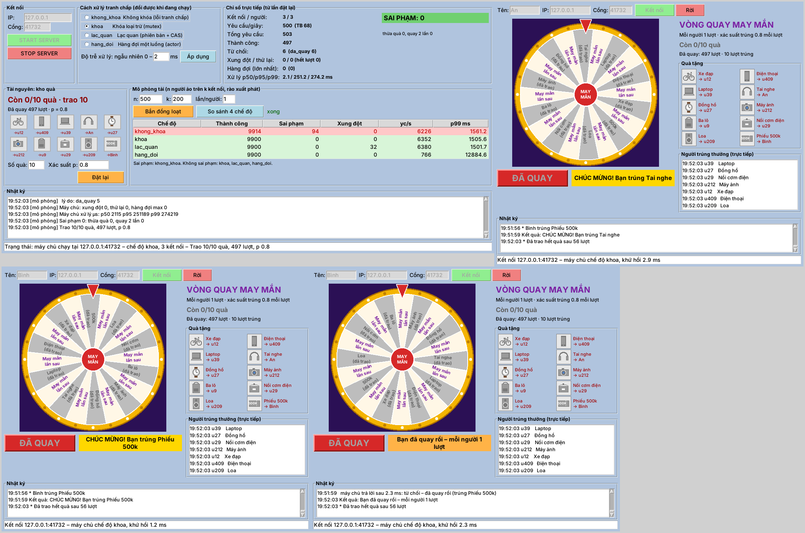
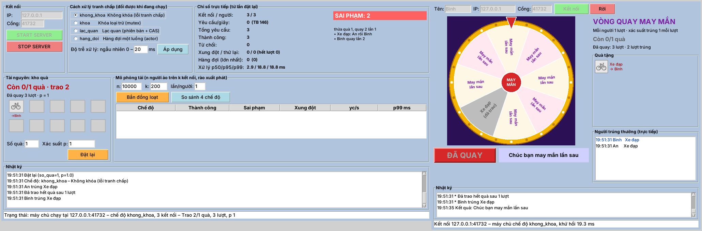
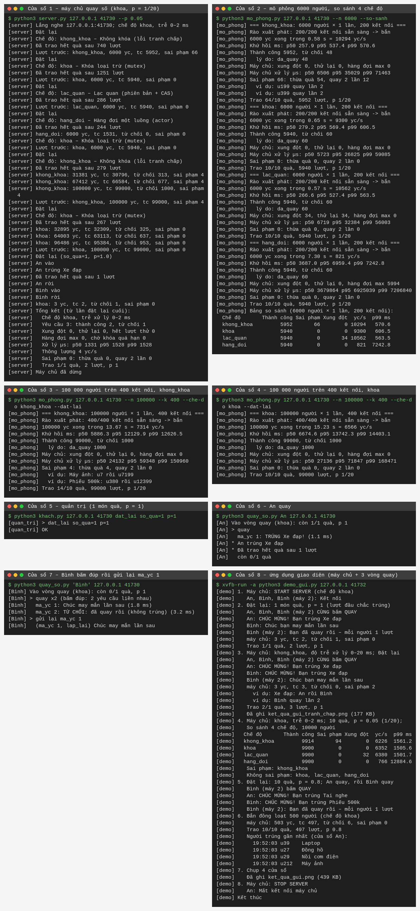

# Bài mở rộng MR6.9 – Quay số trúng thưởng: 100 000 lượt quay tranh 10 món quà (Python)

| Thông tin | Nội dung |
|---|---|
| Loại | **Bài mở rộng**, không có trong giáo trình và không có mã giả tương ứng. Thuộc nhóm "tranh chấp tài nguyên" MR6.6–MR6.14, dùng chung khung của [MR6.6](../BaiMR6.6_DauGia/) |
| Liên hệ với giáo trình | Chương 6: Bài 6.1 (server đa luồng, một luồng mỗi kết nối), Bài 6.7 (kiểm thử tải); Chương 3: Bài 3.2 (định khung thông điệp theo dòng); bài mở rộng MR5.4/MR5.5 (luồng, đồng bộ) |
| Thư viện | Thư viện chuẩn: `socket`, `threading`, `queue`, `json`, `collections`, `random`; bản giao diện dùng thêm `tkinter`, còn kịch bản demo giao diện cần `subprocess` và ImageMagick (`import`, `convert`) để chụp cửa sổ |
| Bản ngôn ngữ khác | [C#](../../../csharp/Chuong06/BaiMR6.9_QuaySo/), [Java](../../../java/Chuong06/BaiMR6.9_QuaySo/), [Rust](../../../rust/Chuong06/BaiMR6.9_QuaySo/), [Go](../../../go/Chuong06/BaiMR6.9_QuaySo/) |

## Mục tiêu
Bài mô phỏng chương trình khuyến mãi "Vòng quay may mắn". Kho có **10 món quà**, hàng chục nghìn khách hàng mỗi người được **quay đúng một lần**. Mỗi lượt trúng với xác suất **p** (mặc định 1/2000) nếu kho còn quà, và người trúng nhận ngẫu nhiên một món còn lại. Có hai tài nguyên bị tranh chấp:
- **kho quà** (một ô "nóng", mọi lượt trúng cùng ghi);
- **lượt quay của từng người** (một ô cho mỗi người). Hai thiết bị của cùng một người, hoặc một lần bấm đúp, cùng gửi yêu cầu `quay`.

Máy chủ TCP đa luồng xử lý thao tác "đọc → kiểm tra (giả lập độ trễ cơ sở dữ liệu 0–2 ms) → ghi" theo **bốn cách** chọn được ngay lúc đang chạy: không khóa, khóa loại trừ, lạc quan, hàng đợi một luồng. **Sổ kiểm toán** đếm hai sai phạm: **thừa quà** (một món đã trao lại được trao lần nữa, tức là tổng số quà trao lớn hơn số quà có) và **quay 2 lần** (một người có hai lượt quay được chấp nhận). Bộ mô phỏng tải dồn **100 000 người lên 400 kết nối** (pipelining) để đo thông lượng.

## Kiến thức chính
Số liệu dưới đây lấy từ `ket_qua.txt`, là một lần chạy thật trên máy cục bộ (127.0.0.1, Python 3, độ trễ xử lý ngẫu nhiên 0–2 ms). Để sai phạm hiện rõ trong vài giây, máy chủ trong demo chạy với **p = 1/20** (`server.py --p 0.05`) thay vì 1/2000. Với 1/2000, 10 món quà chỉ hết sau khoảng 20 000 lượt, và lượt trúng thưa tới mức hai lượt trúng hiếm khi rơi vào cùng một khe 0–2 ms. Mỗi lần chạy, số liệu lệch đi đôi chút.

```
  Chế độ       Thành công Sai phạm Xung đột  yc/s  p99 ms
  khong_khoa         5952       66        0 10294   570.6
  khoa               5940        0        0  9300   606.5
  lac_quan           5940        0       34 10562   563.5
  hang_doi           5940        0        0   821  7242.8
```
(6000 người × 1 lượt quay, 200 kết nối, 10 quà, p = 1/20. "Thành công" là số lượt quay được chấp nhận (trúng hoặc không). 60 yêu cầu còn lại là thiết bị thứ hai của 60 người và đúng ra phải bị từ chối. "Sai phạm" do sổ kiểm toán đếm, "Xung đột" là số lần so sánh-và-đổi thất bại, "yc/s" và "p99" (khứ hồi) đo ở bộ mô phỏng.)

**100 000 người trên 400 kết nối**, cùng p = 1/20:

| Chế độ | Thời gian | yc/s | Khứ hồi p99 | Thành công / từ chối | Sai phạm |
|---|---|---|---|---|---|
| `khong_khoa` | 13,67 s | 7314 | 12,6 s | 99 000 / 1000 | 4 (thừa quà 4: **trao 14/10 quà**) |
| `khoa` | 15,23 s | 6566 | 14,4 s | 99 000 / 1000 | 0 (trao 10/10) |

- **Tranh chấp (race condition) trên kho quà.** Ở `khong_khoa`, hai lượt trúng gần như cùng lúc cùng đọc kho, chẳng hạn còn (Máy ảnh, Loa, …). Cả hai cùng bốc ngẫu nhiên một món rồi ghi lại. Có khi hai người bốc trúng **cùng một món** (ví dụ trong sổ: `Máy ảnh: u7 rồi u7199`). Có khi bản ghi sau đè bản trước, làm món vừa trao "sống lại" trong kho và lại được trao tiếp. Kết quả là 6000 người được trao **64 món** từ kho 10 món, sổ ghi 54 lần "thừa quà". Với 100 000 người, cuộc tranh chỉ diễn ra trong vài trăm lượt đầu (kho hết sau 279 lượt), nên vẫn trao 14/10. Chế độ này chỉ dùng để minh họa lỗi trong phòng lab (loopback).
- **Idempotency theo tên, không chỉ theo `ma_yc`.** Khung đã chống *gửi lại* (cùng `ma_yc`): máy chủ trả lại kết quả cũ kèm `"lap_lai": true` (cửa sổ 7: `gui_lai 1` nhận lại đúng "Chúc may mắn lần sau" mà không quay lần nữa). Thế nhưng bấm đúp hay mở hai thiết bị sinh ra **hai `ma_yc` khác nhau**. Luật "mỗi người một lượt" vì vậy phải nằm trong trạng thái: ô `ng:<tên>` ghi kết quả lượt quay, và yêu cầu thứ hai nhận `da_quay` ("đã quay rồi (không trúng)"). Ở `khong_khoa`, cả hai yêu cầu cùng đọc thấy "chưa quay", nên cả hai được chấp nhận (sổ đếm 12 lần "quay 2 lần" trong lượt 6000 người). Ở giao diện, Bình bấm QUAY trên hai thiết bị: chế độ `khoa` cho đúng một lượt, chế độ `khong_khoa` cho cả hai.
- **Khóa theo tài nguyên, và chỉ khóa thứ thật sự tranh.** Việc rút thăm (`random() < p`) làm **trước**, ngoài vùng găng, vì nó không phụ thuộc trạng thái. Lượt không trúng chỉ khóa ô của chính người đó, nên hàng trăm lượt chạy song song. Chỉ lượt trúng mới khóa thêm ô `qua` (hai khóa, xin theo thứ tự đã sắp xếp nên không khóa chết). Khi kho đã hết, lượt trúng thăm không cần chạm ô `qua` nữa vì quà không tăng lại. Nhờ vậy `khoa` và `lac_quan` có thông lượng ngang `khong_khoa` (khoảng 9300–10 500 yc/s), khác hẳn MR6.6, nơi một món hàng là điểm nóng của mọi yêu cầu.
- **Lạc quan (Kung & Robinson 1981).** Chế độ `lac_quan` đọc (giá trị, phiên bản) của các ô liên quan, xử lý ngoài khóa, rồi so sánh-và-đổi. Chỉ 34 xung đột (lượt trúng đụng nhau ở ô `qua`, hoặc hai thiết bị đụng nhau ở ô của một người), mỗi xung đột thử lại thành công, và sai phạm bằng 0.
- **Hàng đợi một luồng (actor).** Chế độ `hang_doi` đúng tuyệt đối nhưng **tuần tự**: mọi lượt quay, kể cả lượt không trúng (vốn chạy song song được), đều đi qua một luồng, nên chỉ đạt 821 yc/s. Hàng đợi dài tới 5994, p99 khứ hồi 7,2 s. Với 100 000 người, chế độ này sẽ mất khoảng 2 phút, vì thế lượt 100 000 người chỉ chạy `khong_khoa` và `khoa`.
- **Pipelining, rào xuất phát.** 400 kết nối, mỗi kết nối chở 250 người ảo (`"so_nguoi"` trong lời chào, tên người ở trường `"nguoi"`). Mọi luồng chờ ở `threading.Barrier`, rồi mỗi kết nối gửi 250 yêu cầu trong một lần `sendall`. Người thứ 100, 200, … mang tên của người liền trước (thiết bị thứ hai), nên đúng 1000 yêu cầu bị từ chối `da_quay`.
- **Đẩy trạng thái có gộp.** `cap_nhat` (số quà còn, món nào đã trao cho ai, số lượt đã quay, 20 người trúng gần nhất) được gửi tối đa 10 lần/giây. Thông báo "X trúng Y" (`su_kien`) chỉ phát cho người dùng thật, còn người ảo của bộ mô phỏng chỉ hiện trong danh sách người trúng.

### Giao thức (giống hệt ở 5 ngôn ngữ)
TCP, mỗi dòng một JSON UTF-8 kết thúc `\n`, tối đa 64 KB một dòng. Phần chung (chào, quản trị, `thong_ke`, `lap_lai`) xem [README MR6.6](../BaiMR6.6_DauGia/README.md#giao-thức-giống-hệt-ở-5-ngôn-ngữ).

| Chiều | Thông điệp |
|---|---|
| người dùng → server | `{"loai":"quay","ma_yc":k}` (kết nối gộp thêm `"nguoi":"u17"`) |
| server → client | `{"loai":"kq","ma_yc":k,"ok":true,"trung":true,"qua":3,"ten_qua":"Tai nghe","nguoi":"An","con_lai":9}` · `{"loai":"kq","ma_yc":k,"ok":true,"trung":false,"qua":null,"nguoi":"An"}` · `{"loai":"kq","ma_yc":k,"ok":false,"ma_loi":"da_quay","ly_do":"đã quay rồi (trúng Tai nghe)","qua":3}` |
| server → tất cả | `{"loai":"cap_nhat","che_do":…,"so_qua":10,"p":0.0005,"con_lai":7,"qua":[{"ma","ten","con","nguoi"}…],"da_quay":12345,"so_trung":3,"nguoi_trung":[{"nguoi","qua","gio"}…]}` (≤ 10 lần/s); `{"loai":"su_kien","noi_dung":"An trúng Tai nghe"}` |
| quản trị → server | `{"loai":"dat_lai","ma_yc":k,"so_qua":10,"p":0.0005}` (số quà 1–10, p trong [0, 1]) |

## Cấu trúc tệp
- `chung.py`, `khach.py`, `giao_dien_chung.py`, phần KHUNG của `mo_phong.py`: **khung chung**, chép nguyên từ MR6.6.
- `may_chu.py`: nghiệp vụ `MayChuQuaySo` (ô `qua`, ô `ng:<tên>` tạo khi người đó quay lần đầu, rút thăm ngoài vùng găng) và `SoKiemToanQuaySo`; `server.py` là bản dòng lệnh.
- `mo_phong.py`: phần NGHIỆP VỤ gồm `NguoiAo` (quay `lan` lần; người thứ 100, 200, … dùng tên người liền trước).
- `quay_so.py`: người quay bản dòng lệnh (`quay`, `quay x2`, `gui_lai [k]`).
- `server_gui.py`: bảng điều khiển máy chủ; `vong_quay_gui.py`: vòng quay may mắn; `demo_gui.py`: kịch bản tự bấm nút.
- `demo.json`, `ket_qua.txt`, `ket_qua.png`, `ket_qua_gui.png`, `ket_qua_gui_tranh_chap.png`: kịch bản và kết quả thực thi thật.

## Cách chạy
Chạy trong thư mục bài (trên Windows dùng `python` hoặc `py` thay cho `python3`):
```bash
python3 server.py 127.0.0.1 9000 --p 0.05                          # cửa sổ 1 (gõ lệnh ở đây)
python3 mo_phong.py 127.0.0.1 9000 --n 6000 --so-sanh              # cửa sổ 2: bảng so sánh 4 chế độ
python3 mo_phong.py 127.0.0.1 9000 --n 100000 --k 400 --che-do khoa --dat-lai
python3 khach.py 127.0.0.1 9000 dat_lai so_qua=10 p=0.0005          # chương trình thật: p = 1/2000
python3 quay_so.py An 127.0.0.1 9000                               # cửa sổ 3, 4…: gõ quay / quay x2
```
- Lệnh của máy chủ: `che_do khong_khoa|khoa|lac_quan|hang_doi`, `tre <ms>`, `dat_lai [so_qua=… p=…]`, `thong_ke`, `thoat`. Tùy chọn khi chạy: `--che-do`, `--tre-ms`, `--so-qua`, `--p`.
- Lệnh của `quay_so.py`: `quay`; `quay x2` (bấm đúp: hai yêu cầu với hai `ma_yc` khác nhau); `gui_lai [k]` (gửi lại đúng `ma_yc` k); `thoat`. Dòng `@t lệnh` chờ tới giây thứ t rồi mới chạy lệnh.

Muốn tái lập kết quả, chạy từ thư mục gốc của kho: `python3 tools/demo.py python/Chuong06/BaiMR6.9_QuaySo` (khoảng 1,5 phút).

## Ứng dụng giao diện


Ảnh trên là lần chạy thật của `demo_gui.py` (Linux, Xvfb, Python 3.12 + Tk 8.6): bảng điều khiển máy chủ (trên trái), An (trên phải), Bình và "Bình (máy 2)" (dưới). Kịch bản đã chạy so sánh 4 chế độ (10 000 người, p = 1/20, bảng ở giữa, dòng `khong_khoa` tô đỏ). Sau đó, với 10 quà và p = 0,8, An quay trúng Tai nghe, Bình trúng Phiếu 500k, còn "Bình (máy 2)" bấm QUAY thì nhận "Bạn đã quay rồi – mỗi người 1 lượt". Cuối cùng, 500 người ảo quay hết số quà còn lại, và danh sách người trúng cập nhật trực tiếp ở cả ba cửa sổ.



Ở bước trước đó (ảnh trên), máy chủ chạy `khong_khoa` với độ trễ xử lý 0–20 ms, kho có **1 món quà** và p = 1 (lượt đầu chắc trúng). An, Bình và Bình (máy 2) cùng bấm QUAY. Máy chủ trao chiếc Xe đạp cho **cả An và Bình**, và "Bình (máy 2)" cũng được quay một lượt nữa (không trúng, ảnh bên phải) dù Bình đã quay. Ô **SAI PHẠM** chuyển đỏ (2: thừa quà 1, quay 2 lần 1), tóm tắt ghi "Trao 2/1 quà". Cùng thao tác đó ở `khoa` cho đúng một người trúng, và thiết bị thứ hai của Bình bị từ chối.

- **Máy chủ** (`server_gui.py`): IP, cổng, START/STOP; **4 nút chọn chế độ**; độ trễ xử lý; **chỉ số trực tiếp** (kết nối/người, yêu cầu/giây, thành công, từ chối theo mã lỗi, xung đột/thử lại, hàng đợi, xử lý p50/p95/p99, **SAI PHẠM** xanh/đỏ kèm ví dụ); **tài nguyên**: số quà còn lại và số đã trao (đỏ khi trao quá số quà), số lượt đã quay, p, ảnh 10 món quà (viền xanh là còn, xám kèm tên người nhận là đã trao), ô số quà và p, nút **Đặt lại**; **mô phỏng tải**: n, k, số lần/người, **Bắn đồng loạt**, **So sánh 4 chế độ**; nhật ký.
- **Vòng quay may mắn** (`vong_quay_gui.py`): bánh xe vẽ bằng Canvas, mỗi món quà một ô màu, xen giữa là ô "May mắn lần sau", món đã trao chuyển xám "(đã trao)"; kim chỉ ở đỉnh; đèn viền nhấp nháy khi quay. Bấm **QUAY**: bánh xe quay tự do ngay, khi có kết quả thì giảm tốc (ease-out, 2,6 s) và dừng **đúng ô kết quả**. Sau đó hiện "CHÚC MỪNG! Bạn trúng …", "Chúc bạn may mắn lần sau" hoặc "Bạn đã quay rồi", và nút chuyển thành "ĐÃ QUAY". Bên phải: số quà còn lại, số lượt đã quay, ảnh từng món kèm trạng thái còn hoặc "→ người nhận", danh sách **người trúng thưởng trực tiếp** (tên mình tô xanh).

### Cách chạy
```bash
python3 server_gui.py 127.0.0.1 41732          # bấm START SERVER (10 quà, p = 1/2000)
python3 vong_quay_gui.py An 127.0.0.1 41732
python3 vong_quay_gui.py Bình 127.0.0.1 41732
```
- **Windows:** Python cài từ python.org đã có sẵn Tkinter. **Linux:** `sudo apt install python3-tk`. Kịch bản tự động (Linux, cần `xvfb`, `imagemagick`): `xvfb-run -a -s "-screen 0 2600x1700x24" python3 demo_gui.py 127.0.0.1 41732`.
- Khi chạy riêng từng cửa sổ, mọi dòng nhật ký và cứ 5 giây một dòng số liệu cũng được in ra dòng lệnh.
- Thử trên nhiều máy: máy chủ nghe trên IP card mạng (hoặc `0.0.0.0`) và mở tường lửa cho cổng; mỗi sinh viên chạy `vong_quay_gui.py` với IP của máy thầy. Muốn cả lớp có người trúng, hãy đặt p = 0,1–0,3 và số quà bằng khoảng 1/5 số sinh viên. Khi đó **chỉ dùng `khoa`, `lac_quan`, `hang_doi`**.

## Kết quả thực thi


## Ghi chú
- Python có GIL nên các luồng không chạy song song thật trên nhiều lõi. Tranh chấp vẫn xảy ra vì luồng nhả GIL trong `time.sleep` (giả lập truy vấn cơ sở dữ liệu), và đó chính là khe giữa "đọc" và "ghi".
- Ô `ng:<tên>` được tạo lúc người đó quay lần đầu, dưới một khóa tạo ô riêng (để hai thiết bị không tạo hai ô khác nhau cho cùng một người). Đó không phải khóa nghiệp vụ: việc kiểm tra "đã quay chưa" vẫn đi qua chế độ đang chọn.
- Với 100 000 người, khứ hồi p50 khoảng 6–7 s là do mỗi kết nối xếp 250 yêu cầu nối đuôi nhau (một luồng máy chủ mỗi kết nối xử lý lần lượt), không phải do khóa. Thời gian xử lý ở máy chủ có p99 khoảng 0,15 s.
- Dòng 5 giây và dòng "Lượt trước" của máy chủ có thể dài 65–66 ký tự khi số yêu cầu lên tới 100 000. Định dạng này thuộc khung chung (MR6.6), bài này không sửa.
- Trong kịch bản giao diện, máy chủ, bộ mô phỏng và cửa sổ cùng chạy trong một tiến trình, nên yc/s thấp hơn bản dòng lệnh. Bảng ở đó là một lần chạy riêng (10 000 người): `khong_khoa` 94 sai phạm, `khoa` 0, `lac_quan` 0 (32 xung đột), `hang_doi` 0 (766 yc/s).
- Kiểm thử trên Linux: Python 3.13 (dòng lệnh) và Python 3.12.3 + Tk 8.6 dưới Xvfb (giao diện).

## Bài tập gợi ý
1. Chạy `mo_phong.py --n 30000 --so-sanh` với p = 1/2000 (giá trị thật). `khong_khoa` có còn trao thừa quà không? Vì sao xác suất hai lượt trúng "đụng nhau" phụ thuộc vào p × (số yêu cầu đang xử lý cùng lúc) × (độ rộng khe đọc–ghi)?
2. Bỏ đoạn "hết quà thì khỏi chạm ô `qua`" trong `may_chu.py`, rồi đo lại thông lượng của `khoa` với p = 1/20. Giải thích kết quả.
3. Gộp ô của mọi người thành một ô `da_quay` (một tập hợp tên). Thông lượng của `khoa` và số xung đột của `lac_quan` thay đổi thế nào? Đây là bài học về độ mịn của khóa (lock granularity).
4. Thêm luật "mỗi người quay tối đa 3 lần, trúng tối đa 1 lần". Cần đổi giá trị của ô `ng:<tên>` và luật của sổ kiểm toán ra sao?
5. Ở chế độ `lac_quan`, nếu rút thăm *bên trong* `xu_ly` (mỗi lần thử lại rút lại) thì xác suất trúng thực tế có còn là p không? Vì sao phải rút thăm một lần, ngoài vùng găng?
6. Giao diện: thêm âm thanh "tách tách" mỗi khi kim đi qua một ô (dùng `root.bell()`), và cho bánh xe dừng có "nảy" nhẹ.

## Đọc thêm
- H. T. Kung, J. T. Robinson (1981). *On Optimistic Methods for Concurrency Control*. ACM Transactions on Database Systems 6(2).
- E. G. Coffman, M. J. Elphick, A. Shoshani (1971). *System Deadlocks*. ACM Computing Surveys 3(2): thứ tự khóa (lượt trúng giữ hai khóa: ô người và ô quà).
- Tài liệu Python: [`threading`](https://docs.python.org/3/library/threading.html) (Lock, Barrier), [`queue`](https://docs.python.org/3/library/queue.html), [`random`](https://docs.python.org/3/library/random.html), [`socket`](https://docs.python.org/3/library/socket.html), [`tkinter`](https://docs.python.org/3/library/tkinter.html) (Canvas: `create_arc`, `create_text(angle=…)`).

Mã nguồn của bài được viết mới cho kho này.
