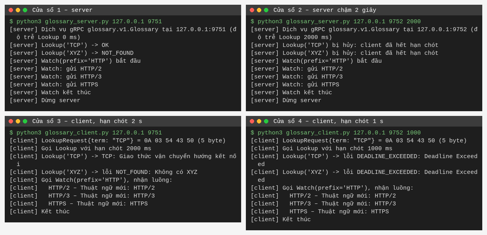

# Bài 7.5 – Dịch vụ gRPC tra cứu thuật ngữ (Python)

| Thông tin | Nội dung |
|---|---|
| Mã giả tương ứng | Mã giả 7.6 (Cài đặt và gọi dịch vụ gRPC – mã nghiệp vụ) |
| Mục giáo trình | 7.4.2 Protocol Buffers, 7.4.3 Bốn kiểu gọi và cơ chế truyền trên HTTP/2 |
| Kế thừa | Mã giả 3.7 (nhánh "lookup" của PROCESS_REQUEST thành phương thức Lookup) |
| Thư viện | NGOẠI LỆ thư viện: `grpcio`, `grpcio-tools` (PyPI, xem `requirements.txt`); `asyncio` |

## Mục tiêu
Cài đặt phần nghiệp vụ của dịch vụ gRPC theo hợp đồng `tra_cuu.proto` (Mục 7.4.2): lớp `GlossaryService` kế thừa lớp cơ sở do công cụ sinh, phương thức unary `Lookup` (báo `NOT_FOUND` bằng mã trạng thái gRPC) và phương thức luồng từ server `Watch` (lọc theo tiền tố, dừng khi client hủy); phía client gọi `Lookup` có hạn chót và đọc luồng `Watch`. Client in cách mã hóa Protocol Buffers của `LookupRequest{term: "TCP"}` để đối chiếu với ví dụ 5 byte `0A 03 54 43 50` của giáo trình. Bài tập “Dịch vụ gRPC có hạn chót” được minh họa bằng server cố ý chậm 2 giây và client đặt hạn chót 1 giây.

## Tệp
- `tra_cuu.proto` – hợp đồng dịch vụ (dùng chung ba ngôn ngữ).
- `glossary_server.py` – lớp `GlossaryService(GlossaryServicer)`: `Lookup`, `Watch`; server `grpc.aio`.
- `glossary_client.py` – gọi `Lookup` có hạn chót, đọc luồng `Watch`.
- `requirements.txt` – gói cần cài.
- `tra_cuu_pb2.py`, `tra_cuu_pb2_grpc.py` – mã sinh từ `tra_cuu.proto` (tạo ở bước chuẩn bị, không lưu trong kho).
- `demo.json` – kịch bản chạy minh họa (dùng với `tools/demo.py`).
- `ket_qua.txt`, `ket_qua.png` – kết quả thực thi thật.

## Cách chạy
```bash
pip install -r requirements.txt
python3 -m grpc_tools.protoc -I. --python_out=. --grpc_python_out=. tra_cuu.proto
```
```bash
# Cửa sổ 1 – server
python3 glossary_server.py 0.0.0.0 5001
# Cửa sổ 2 – client (hạn chót mặc định 2000 ms)
python3 glossary_client.py 127.0.0.1 5001
# Bài tập hạn chót: server chậm 2 giây, client chờ 1 giây
python3 glossary_server.py 0.0.0.0 5002 2000
python3 glossary_client.py 127.0.0.1 5002 1000
```
Trên Windows thay `python3` bằng `py` hoặc `python`.

## Kết quả thực thi


`LookupRequest{term: "TCP"}` được mã hóa đúng 5 byte `0A 03 54 43 50` như Mục 7.4.2. Với server bình thường, `Lookup('TCP')` thành công, `Lookup('XYZ')` nhận `NOT_FOUND` và `Watch` trả ba thuật ngữ bắt đầu bằng “HTTP”. Với server chậm 2 giây, cả hai lời gọi `Lookup` có hạn chót 1 giây nhận `DEADLINE_EXCEEDED`, đồng thời server ghi nhận lời gọi bị hủy: hạn chót được truyền sang server qua `grpc-timeout` nên server dừng xử lý.

## Ghi chú
- Lớp cơ sở `GlossaryServicer` và stub `GlossaryStub` do `grpcio-tools` sinh (tương ứng `GlossaryBase`, `GlossaryClient` của mã giả).
- `RAISE RpcError(NOT_FOUND, …)` là `await context.abort(grpc.StatusCode.NOT_FOUND, …)`; `stream.write(t)` là `await context.write(t)`; `ctx.cancelled` là `context.cancelled()`; `deadline ← 2000` là `timeout=2.0`.
- Tệp `tra_cuu.proto` giống nhau ở ba ngôn ngữ; các dòng `option csharp_namespace`, `java_package`, `java_multiple_files` chỉ tác động tới trình sinh mã tương ứng. `Import` và `Sync` có trong hợp đồng nhưng không được cài đặt (gọi sẽ nhận `UNIMPLEMENTED`), đúng phạm vi của Mã giả 7.6.
- Mã giả dùng `https://glossary.local:5001` (HTTP/2 trên TLS); bài chạy HTTP/2 không mã hóa (h2c) trên máy cục bộ cho phòng thí nghiệm. Triển khai thật phải dùng TLS (Chương 8).
- `CHANGES_FEED()` được mô phỏng bằng danh sách cố định HTTP/2, QUIC, HTTP/3, gRPC, HTTPS, mỗi 0,5 giây một mục; `Watch(prefix='HTTP')` nhận ba mục.
- Tham số thứ ba của server là độ trễ cố ý của `Lookup` (ms), dùng cho bài tập hạn chót; mặc định 0.
- Kiểm thử: Linux, Python 3.13.18, grpcio và grpcio-tools 1.85.1.
