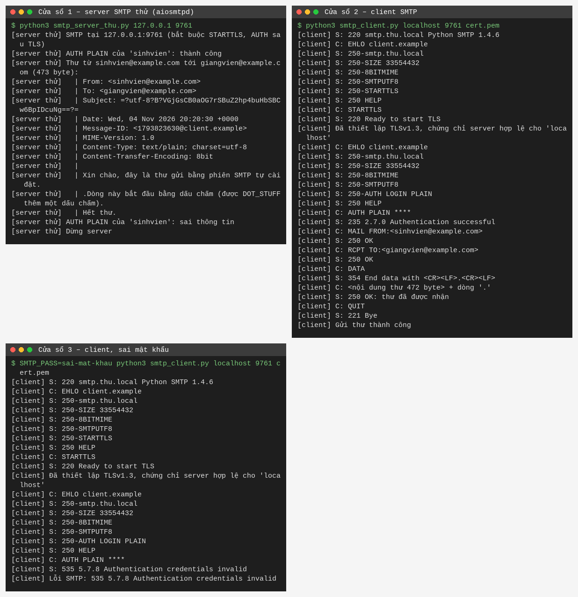

# Bài 7.6 – Phiên gửi thư SMTP có STARTTLS và xác thực (Python)

| Thông tin | Nội dung |
|---|---|
| Mã giả tương ứng | Mã giả 7.7 (Phiên gửi thư SMTP có STARTTLS và xác thực) |
| Mục giáo trình | 7.5.1 Thư điện tử: SMTP và IMAP |
| Kế thừa | Mã giả 2.2 (SAFE_CONNECT), Mã giả 3.5 (READ_LINE); TLS_WRAP (Mục 8.4) |
| Thư viện | Thư viện chuẩn: `socket`, `ssl`, `base64`; server thử: `aiosmtpd` (PyPI) |

## Mục tiêu
Cài đặt `SMTP_REPLY` (phản hồi nhiều dòng `250-…`/`250 …`), `CMD` (gửi lệnh, so chữ số đầu của mã), `SEND_MAIL` (lời chào 220, EHLO, STARTTLS, nâng cấp TLS có kiểm tra chứng chỉ và tên máy, EHLO lại, AUTH PLAIN, MAIL FROM, RCPT TO, DATA, nội dung kết thúc bằng dòng `.`, QUIT) và `DOT_STUFF`. Thư thử có Subject tiếng Việt mã hóa MIME và một dòng bắt đầu bằng dấu chấm. Server thử nghiệm cục bộ (aiosmtpd) bắt buộc STARTTLS bằng chứng chỉ tự ký và chỉ cho AUTH sau TLS.

## Tệp
- `smtp_client.py` – Mã giả 7.7: `smtp_reply`, `cmd`, `send_mail`, `dot_stuff`, `build_message`.
- `smtp_server_thu.py` – server SMTP thử nghiệm (aiosmtpd): bắt buộc STARTTLS, AUTH PLAIN/LOGIN sau TLS, in thư nhận được; dùng chung cho demo ba ngôn ngữ.
- `tao_chung_chi.sh` – tạo chứng chỉ tự ký `cert.pem`/`key.pem` (CN và SAN: `localhost`, `127.0.0.1`) bằng openssl.
- `chay_server_thu.sh` – tạo chứng chỉ nếu chưa có rồi khởi động server thử.
- `requirements.txt` – `aiosmtpd` cho server thử.
- `demo.json` – kịch bản chạy minh họa (dùng với `tools/demo.py`).
- `ket_qua.txt`, `ket_qua.png` – kết quả thực thi thật.

## Cách chạy
Chuẩn bị server thử (cần Python ≥ 3.11 và openssl; trên Windows chạy các lệnh `sh` bằng Git Bash hoặc WSL):
```bash
pip install -r requirements.txt
# Cửa sổ 1 – server thử (tạo cert.pem, key.pem nếu chưa có); cổng 587 cần quyền quản trị nên dùng 2525
sh chay_server_thu.sh 127.0.0.1 2525
```
Tài khoản thử lấy từ biến môi trường `SMTP_USER`, `SMTP_PASS` (mặc định `sinhvien` / `matkhau-thu`); client đọc cùng hai biến này.
```bash
# Cửa sổ 2 – client (host, cổng, tệp CA)
export SMTP_USER=sinhvien SMTP_PASS=matkhau-thu
python3 smtp_client.py localhost 2525 cert.pem
```

## Kết quả thực thi


Cửa sổ client in toàn bộ hội thoại `C:`/`S:`: danh sách mở rộng trước TLS có `STARTTLS` nhưng chưa có `AUTH`; sau STARTTLS (TLS 1.3, chứng chỉ được kiểm tra với `cert.pem` và tên `localhost`) danh sách có `AUTH LOGIN PLAIN`; xác thực 235, DATA 354, thư được nhận 250. Server thử in thư nhận được, trong đó dòng bắt đầu bằng dấu chấm đã được server bỏ dấu chấm thêm vào. Cửa sổ thứ ba chạy với mật khẩu sai: server trả 535 và client báo `SmtpError` thay vì gửi tiếp.

## Ghi chú
- `TLS_WRAP(s, CLIENT, host)` là `ssl.create_default_context(cafile=…).wrap_socket(s, server_hostname=host)` (kiểm tra chứng chỉ và tên máy).
- Mật khẩu không ghi trong mã nguồn mà lấy từ biến môi trường; dòng AUTH được in dạng `AUTH PLAIN ****`.
- Chứng chỉ tự ký được tin cậy bằng cách nạp `cert.pem` làm nơi tin cậy, không tắt kiểm tra; tham số `-` dùng kho chứng chỉ của hệ điều hành (khi đó server thử bị từ chối với lỗi TLS – đã thử).
- Sau STARTTLS, `Reader` được tạo mới nên mọi byte nhận trước khi bắt tay TLS bị bỏ, tránh lỗi chèn lệnh vào phiên đã mã hóa.
- Theo dòng 5–8 của Mã giả 7.7, `SMTP_REPLY` báo lỗi giao thức khi `READ_LINE` trả NULL (server đóng kết nối) hoặc dòng ngắn hơn 3 ký tự, và coi dòng chỉ gồm mã ba chữ số (RFC 5321 cho phép bỏ phần văn bản) là dòng cuối của phản hồi.
- Ngoài mã giả: kiểm tra mã lời chào là 220. Thân thư dùng `Content-Transfer-Encoding: 8bit` và server thử có quảng bá 8BITMIME; client đầy đủ nên gửi `BODY=8BITMIME` hoặc mã hóa quoted-printable/base64.
- Mã giả cố định cổng 587; bài nhận cổng qua tham số (mặc định 587) để chạy server thử ở cổng không đặc quyền. Ứng dụng thật nên dùng thư viện SMTP/MIME của nền tảng.
- Kiểm thử: Linux, Python 3.13.18, aiosmtpd 1.4.6, OpenSSL 3.0.13.
