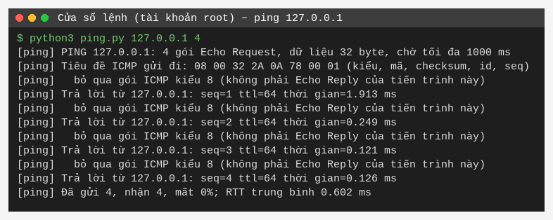

# Bài 7.7 – Gửi ICMP Echo Request và đo thời gian khứ hồi (Python)

| Thông tin | Nội dung |
|---|---|
| Mã giả tương ứng | Mã giả 7.8 (Gửi ICMP Echo Request và đo thời gian khứ hồi) |
| Mục giáo trình | 7.5.3 ICMP và chương trình ping |
| Kế thừa | Mã giả 4.4 (cùng mẫu gửi rồi chờ phản hồi có hạn giờ, bỏ qua gói không khớp) |
| Thư viện | Thư viện chuẩn: `socket` (`SOCK_RAW`, `IPPROTO_ICMP`), `struct`, `time.perf_counter` |

## Mục tiêu
Cài đặt `INET_CHECKSUM` (RFC 1071) và `PING`: tạo gói Echo Request (kiểu 8, mã 0, tổng kiểm tra, mã định danh = PID, số thứ tự, 32 byte dữ liệu ngẫu nhiên), gửi qua socket RAW, nhận gói có cả tiêu đề IPv4, tính độ dài tiêu đề từ IHL, chỉ chấp nhận Echo Reply (kiểu 0) đúng mã định danh và số thứ tự, đọc TTL ở byte 8 của tiêu đề IP và đo thời gian khứ hồi.

## Tệp
- `ping.py` – Mã giả 7.8: `inet_checksum`, `ping` và vòng ping có thống kê.
- `demo.json` – kịch bản chạy minh họa (dùng với `tools/demo.py`).
- `ket_qua.txt`, `ket_qua.png` – kết quả thực thi thật.

## Cách chạy
Socket RAW cần quyền quản trị:
```bash
# Linux, macOS
sudo python3 ping.py 127.0.0.1 4 1000
```
Trên Windows mở cửa sổ lệnh bằng “Run as administrator” rồi chạy `py ping.py 127.0.0.1 4 1000`.

## Kết quả thực thi


Bốn gói đều nhận Echo Reply với TTL 64 (Linux) và thời gian khứ hồi dưới 0,2 ms qua loopback. Trước mỗi Echo Reply, socket RAW nhận chính gói Echo Request (kiểu 8) do máy gửi tới 127.0.0.1; vòng lặp của mã giả bỏ qua gói này – đây là lý do mã giả kiểm tra kiểu, mã định danh và số thứ tự thay vì nhận gói đầu tiên.

## Ghi chú
- Kịch bản minh họa chạy bằng tài khoản root nên không cần `sudo`; không có quyền, chương trình báo cần quyền quản trị.
- Trên Windows, socket RAW ICMP nhận gói có tiêu đề IP như Linux; một số phiên bản Windows chặn socket RAW hoặc bị tường lửa chặn ICMP.
- Theo dòng 21–23 của Mã giả 7.8, thời gian chờ được tính theo một hạn chót chung: mỗi lần `RECVFROM` chỉ chờ phần thời gian còn lại (tối thiểu 1 ms), nên các gói ICMP lạ (ví dụ phản hồi của chương trình ping khác) không kéo dài thời gian chờ quá `timeout_ms`.
- Mỗi lần ping mở một socket mới như mã giả; giữa hai lần ping có khoảng nghỉ 1 giây như lệnh ping của hệ điều hành; cuối cùng in số gói gửi, nhận, tỉ lệ mất và RTT trung bình.
- Bài tập cuối chương (ping 5 máy trong mạng lab, so sánh TTL 64/128) chạy cùng chương trình với địa chỉ các máy đó; kịch bản minh họa chỉ ping 127.0.0.1.
- Kiểm thử: Linux, Python 3.13.18.
