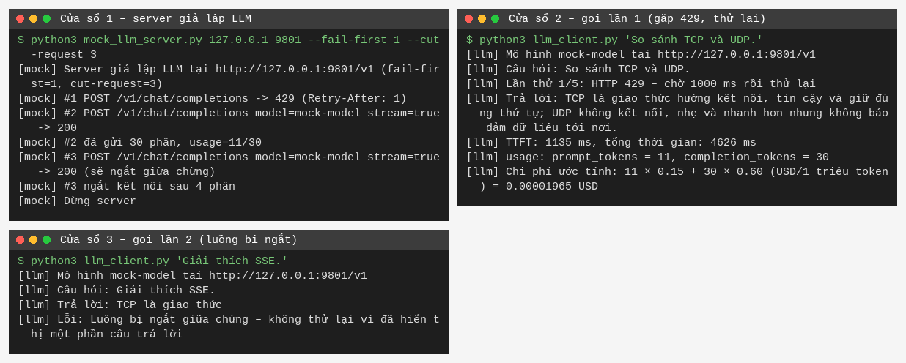

# Bài 8.1 – Gọi API LLM: truyền luồng SSE, giới hạn tần suất, thử lại (Python)

| Thông tin | Nội dung |
|---|---|
| Mã giả tương ứng | Mã giả 8.1 (Nhận câu trả lời của LLM theo luồng SSE), Mã giả 8.2 (Gọi LLM có giới hạn tần suất, thử lại và hạn chót) |
| Mục giáo trình | 8.2.2 Truyền luồng kết quả bằng SSE, 8.2.3 Giới hạn tần suất, thử lại và thời gian chờ, 8.2.5 Chi phí |
| Kế thừa | Mã giả 7.5 (SSE_READ), Mã giả 5.8 (RETRY_ASYNC), Mã giả 8.3 (ACQUIRE_TOKENS), lớp NetError của Mã giả 2.2 |
| Thư viện | Thư viện chuẩn: `urllib.request`, `json`, `threading` |

## Mục tiêu
Gọi API mô hình ngôn ngữ lớn theo định dạng tương thích OpenAI Chat Completions (`POST {LLM_BASE_URL}/chat/completions`, `"stream": true`), hiển thị từng phần câu trả lời ngay khi nhận sự kiện SSE, đo TTFT và tổng thời gian, ghi nhận `usage` và tính chi phí theo Công thức (8.1). Lời gọi được bọc trong thủ tục thử lại có lùi thời gian và nhiễu ngẫu nhiên, tôn trọng `Retry-After` khi gặp mã 429, chỉ thử lại khi chưa nhận token nào, và tự giới hạn tần suất bằng thùng token. Khóa API chỉ lấy từ biến môi trường. Demo dùng server giả lập cục bộ `mock_llm_server.py`, không gọi dịch vụ LLM thật.

## Tệp
- `llm_client.py` – CALL_LLM (Mã giả 8.2), RETRY (Mã giả 5.8), HTTPS_POST, chương trình chính.
- `llm_stream.py` – NetError, SSE_READ (Mã giả 7.5), STREAM_COMPLETION (Mã giả 8.1).
- `thung_token.py` – ACQUIRE_TOKENS (Mã giả 8.3, bản đồng bộ chép gọn).
- `mock_llm_server.py` – server giả lập API LLM (Python, thư viện chuẩn), dùng chung cho cả ba ngôn ngữ: phát luồng SSE mã hóa khối, trả 401 khi thiếu khóa, `--fail-first N` trả 429 kèm `Retry-After` cho N yêu cầu đầu, `--cut-request K` ngắt kết nối giữa luồng ở yêu cầu thứ K.
- `demo.json` – kịch bản chạy minh họa (dùng với `tools/demo.py`).
- `ket_qua.txt`, `ket_qua.png` – kết quả thực thi thật.

## Cách chạy
```bash
# Cửa sổ 1 – server giả lập
python3 mock_llm_server.py 127.0.0.1 9000 --fail-first 1 --cut-request 3
# Cửa sổ 2 – client
export LLM_BASE_URL=http://127.0.0.1:9000/v1 LLM_API_KEY=khoa-thu-nghiem LLM_MODEL=mock-model
export LLM_PRICE_IN=0.15 LLM_PRICE_OUT=0.60      # tùy chọn: đơn giá USD/1 triệu token
python3 llm_client.py "So sánh TCP và UDP."
```
Trên Windows (PowerShell) đặt biến bằng `$env:LLM_API_KEY = "khoa-thu-nghiem"`, tương tự cho các biến khác. Khóa API không được ghi vào mã nguồn hay tệp cấu hình đưa lên kho mã.

## Kết quả thực thi


Lần gọi thứ nhất nhận 429 kèm `Retry-After: 1`, chương trình chờ 1 000 ms rồi thử lại và nhận câu trả lời theo luồng; TTFT đo từ lúc bắt đầu gọi nên gồm cả thời gian chờ thử lại. Lần gọi thứ hai bị server giả lập ngắt giữa luồng: không gặp `[DONE]` nên chương trình báo "Luồng bị ngắt giữa chừng" và không thử lại vì đã hiển thị một phần câu trả lời.

## Ghi chú
- `ESTIMATE_TOKENS` không được giáo trình định nghĩa; bài dùng ước lượng thô: tổng số ký tự các thông điệp chia 4, cộng `max_tokens`. Thùng token đặt dung lượng 20 000, nạp 2 000 token/giây (hạn mức tự đặt để minh họa).
- Lỗi kết nối được ánh xạ như Mã giả 2.2: bị từ chối → `REFUSED`, không thử lại; không tới được hoặc hết thời gian chờ → thử lại.
- Đơn giá tính chi phí lấy từ `LLM_PRICE_IN`, `LLM_PRICE_OUT` (USD cho 1 triệu token); không đặt thì không in chi phí.
- Đổi sang dịch vụ thật (Ollama cục bộ `http://localhost:11434/v1` hoặc nhà cung cấp đám mây) chỉ cần đổi `LLM_BASE_URL`, `LLM_MODEL`, `LLM_API_KEY`; cần đối chiếu tài liệu của nhà cung cấp về tên trường và cách xác thực.
- `urllib` là thư viện chặn, nên CALL_LLM, RETRY và ACQUIRE_TOKENS được cài đặt dạng đồng bộ; với chương trình dòng lệnh, hành vi tương đương bản ASYNC của mã giả.
- Theo Mã giả 8.2 và 5.8, `call_llm(req, on_token, ct)` truyền tín hiệu hủy `ct` (ở đây là `threading.Event`) xuống `retry_call(…, ct)`, `one_attempt(ct)` và `https_post(…, ct)`; khoảng chờ giữa hai lần thử là `ct.wait(delay)`, nên hủy là dừng ngay, không thử lại. `retry_call` bắt cả `TimeoutError` (luôn thử lại) và `NetError` (chỉ khi `retry`). `urllib` không hủy được một yêu cầu đang chạy nên `ct` chỉ được kiểm tra trước khi gửi; chương trình dòng lệnh không có nút Hủy nên `ct` không bao giờ được đặt.
- `urlopen(timeout=30)` dùng một giá trị cho cả thời gian chờ kết nối và thời gian chờ mỗi lần đọc (đóng vai thời gian chờ nhàn rỗi giữa hai sự kiện); không tách riêng thời gian chờ kết nối 3 giây như C#, Java.
- Kiểm thử: Linux, Python 3.13.18.
