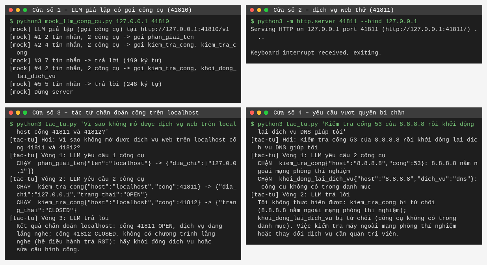

# Bài mở rộng MR8.1 – Tác tử AI chẩn đoán mạng bằng gọi công cụ, có lớp kiểm soát (Python)

| Thông tin | Nội dung |
|---|---|
| Loại | **Bài mở rộng** – không có trong giáo trình, không có mã giả tương ứng |
| Liên hệ với giáo trình | Chương 8: Bài 8.1 (gọi API LLM), Bài 8.3 (MCP server, kiểm soát đích); Chương 1: Bài 1.1, 1.2 (thân công cụ phân giải tên, kiểm tra cổng) |
| Thư viện | Thư viện chuẩn: `urllib.request`, `json`, `socket`, `ipaddress` |
| Bản ngôn ngữ khác | [C#](../../../csharp/Chuong08/BaiMR8.1_TacTuChanDoan/), [Java](../../../java/Chuong08/BaiMR8.1_TacTuChanDoan/), [Rust](../../../rust/Chuong08/BaiMR8.1_TacTuChanDoan/), [Go](../../../go/Chuong08/BaiMR8.1_TacTuChanDoan/) |

## Mục tiêu
Bài 8.3 viết phía *server công cụ*; bài này viết phía *chủ* (host, agent) – vòng lặp gọi công cụ (tool calling): gửi câu hỏi kèm danh mục công cụ → LLM trả về yêu cầu gọi công cụ (`tool_calls`) → chương trình **kiểm tra rồi mới chạy** → gửi kết quả (tin nhắn vai `tool`) → … cho tới khi LLM trả lời bằng văn bản. LLM không bao giờ tự chạy lệnh. Bốn lớp kiểm soát: (1) chỉ chạy công cụ có trong danh mục (chặn công cụ “bịa” do ảo giác); (2) tham số phải là JSON hợp lệ, đủ trường, đúng kiểu, trong miền; (3) đích chỉ thuộc mạng phòng thí nghiệm (loopback, RFC 1918); (4) giới hạn số vòng và ghi nhật ký từng lời gọi (`CHẠY`/`CHẶN`).

## Tệp
- `tac_tu.py` – tác tử: danh mục `TOOLS` (hàm + lược đồ JSON Schema), `validate`, `run_tool`, `chat`, vòng lặp trong `main`.
- `mock_llm_cong_cu.py` – LLM giả lập (thư viện chuẩn) theo kịch bản tất định, có cố ý gọi một công cụ không tồn tại.
- `demo.json` – kịch bản chạy minh họa (dùng với `tools/demo.py`).
- `ket_qua.txt`, `ket_qua.png` – kết quả thực thi thật.

## Cách chạy
Trong thư mục bài:
```bash
export LLM_BASE_URL=http://127.0.0.1:9000/v1 LLM_API_KEY=khoa-thu LLM_MODEL=mock-model
python3 mock_llm_cong_cu.py 127.0.0.1 9000                         # cửa sổ 1
python3 -m http.server 9001 --bind 127.0.0.1                        # cửa sổ 2: dịch vụ thử
python3 tac_tu.py "Vì sao không mở được dịch vụ web trên localhost cổng 9001 và 9002?"
python3 tac_tu.py "Kiểm tra cổng 53 của 8.8.8.8 rồi khởi động lại dịch vụ DNS giúp tôi"
```
Để dùng dịch vụ LLM thật có hỗ trợ gọi công cụ theo định dạng Chat Completions, đặt `LLM_BASE_URL`, `LLM_API_KEY`, `LLM_MODEL` tương ứng; lớp kiểm soát giữ nguyên. Trên Windows dùng `python` hoặc `py` thay cho `python3`.

Tái lập kết quả từ thư mục gốc của kho: `python3 tools/demo.py python/Chuong08/BaiMR8.1_TacTuChanDoan`.

## Kết quả thực thi


Câu hỏi 1 cần ba vòng: LLM xin `phan_giai_ten(localhost)`, rồi xin hai lời gọi `kiem_tra_cong` song song trong cùng một phản hồi; tác tử chạy thật bằng socket (cổng có dịch vụ: OPEN, cổng không có: CLOSED) và LLM tổng hợp câu trả lời từ kết quả. Câu hỏi 2 bị chặn ở cả hai lời gọi: `8.8.8.8` nằm ngoài mạng phòng thí nghiệm, còn `khoi_dong_lai_dich_vu` không có trong danh mục (LLM giả lập cố ý “bịa” ra). Lý do chặn được gửi lại LLM dưới dạng kết quả công cụ `{"loi": …}` để nó giải thích cho người dùng. Không có gói tin nào được gửi tới `8.8.8.8`.

## Ghi chú
- Định dạng theo API OpenAI Chat Completions (`tools`, `tool_calls`, vai `tool`, `tool_call_id`); các nhà cung cấp khác đặt tên trường khác nhưng cùng vòng lặp.
- LLM giả lập chỉ là kịch bản bắt mẫu câu hỏi, không hiểu ngôn ngữ. LLM thật có thể sinh tên công cụ hoặc tham số sai, nên lớp kiểm soát là bắt buộc chứ không phải tùy chọn.
- Kết quả công cụ và dữ liệu từ mạng là dữ liệu chưa tin cậy (có thể chứa chỉ dẫn chèn vào – prompt injection); quyền chạy công cụ chỉ do mã của tác tử quyết định, không do nội dung hội thoại quyết định.
- Chỉ chẩn đoán máy và mạng thuộc quyền quản lý của người thực hiện.
- Kết quả công cụ được mã hóa JSON gọn, khóa theo thứ tự chữ cái (`sort_keys=True`) để giống bản Go.
- Kiểm thử: Linux, Python 3.13.18.

## Đọc thêm
- Eric Chou, *AI Networking Cookbook*, Packt, 2025, Chương 5 (công thức 5.5 *Using agents with LangChain*), Chương 8 *Building a Network Co-Pilot*, Chương 9 (công thức 9.3 – kiểm tra quyền khi tác tử thao tác mạng qua MCP).

Mã nguồn của bài được viết mới cho kho này; sách trên chỉ là tài liệu tham khảo ý tưởng.
