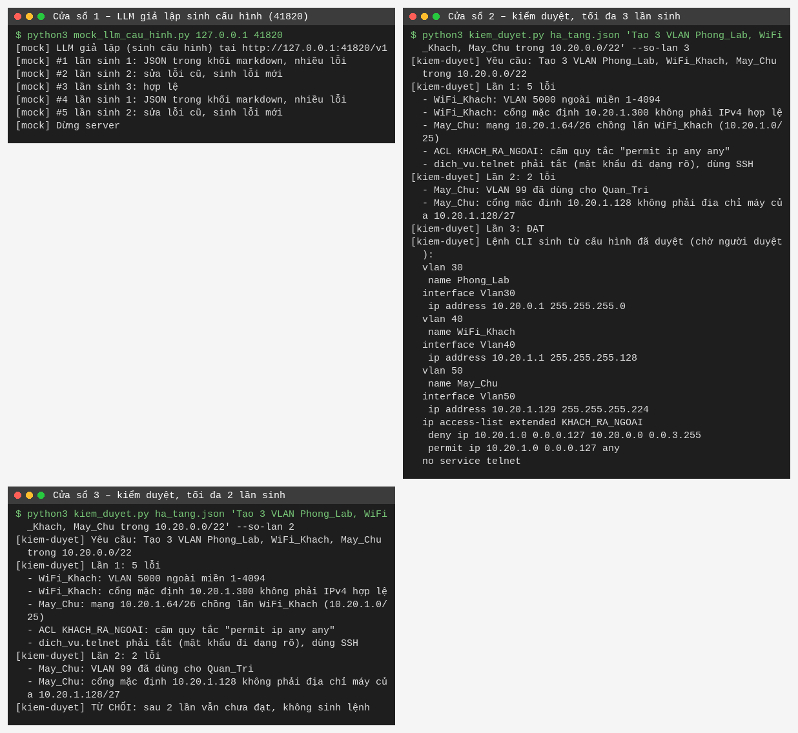

# Bài mở rộng MR8.2 – Kiểm duyệt cấu hình do LLM sinh ra (guardrail và vòng phản hồi) (Python)

| Thông tin | Nội dung |
|---|---|
| Loại | **Bài mở rộng** – không có trong giáo trình, không có mã giả tương ứng |
| Liên hệ với giáo trình | Chương 8: Bài 8.1 (gọi API LLM); Chương 3: Bài 3.3 (dữ liệu JSON); MR1.1 (kiểm tra địa chỉ); MR3.2 (áp dụng cấu hình sau khi duyệt) |
| Thư viện | Thư viện chuẩn: `urllib.request`, `json`, `re`, `ipaddress` |
| Bản ngôn ngữ khác | [Go](../../../go/Chuong08/BaiMR8.2_KiemDuyetCauHinhAI/) |

## Mục tiêu
Đầu ra của LLM “trông hợp lý” nhưng không bảo đảm đúng, nên phải coi là **dữ liệu chưa tin cậy**, giống dữ liệu nhận từ một client lạ. Chương trình yêu cầu LLM sinh cấu hình VLAN/ACL dạng JSON, rồi kiểm duyệt bốn tầng: (1) tách và phân tích JSON (LLM hay bọc JSON trong khối ```` ```json ```` kèm lời dẫn); (2) lược đồ – đủ trường, đúng kiểu; (3) ngữ nghĩa – VLAN 1–4094 và không trùng với hạ tầng đang dùng, mạng con hợp lệ, trong khối địa chỉ, không chồng lấn, cổng mặc định là địa chỉ máy của mạng; (4) chính sách – cấm `permit ip any any`, cấm bật telnet. Có lỗi thì gửi danh sách lỗi lại cho LLM để sửa, tối đa N lần; hết lượt vẫn sai thì **từ chối**. Chỉ cấu hình đạt mới được chuyển thành lệnh CLI.

## Tệp
- `kiem_duyet.py` – `extract_json`, `check_schema`, `check_semantics`, `check_policy`, `render`, vòng phản hồi trong `main`.
- `mock_llm_cau_hinh.py` – LLM giả lập: lần 1 nhiều lỗi, lần 2 sửa lỗi cũ nhưng sinh lỗi mới, lần 3 hợp lệ.
- `ha_tang.json` – khối địa chỉ và hạ tầng đang dùng (VLAN 99, mạng `10.20.3.0/24`).
- `demo.json` – kịch bản chạy minh họa (dùng với `tools/demo.py`).
- `ket_qua.txt`, `ket_qua.png` – kết quả thực thi thật.

## Cách chạy
Trong thư mục bài:
```bash
export LLM_BASE_URL=http://127.0.0.1:9000/v1 LLM_API_KEY=khoa-thu LLM_MODEL=mock-model
python3 mock_llm_cau_hinh.py 127.0.0.1 9000        # cửa sổ 1
python3 kiem_duyet.py ha_tang.json "Tạo 3 VLAN Phong_Lab, WiFi_Khach, May_Chu trong 10.20.0.0/22" --so-lan 3
```
Mã thoát 1 khi cấu hình bị từ chối – thuận tiện để dùng trong quy trình tích hợp liên tục. Trên Windows dùng `python` hoặc `py` thay cho `python3`.

Tái lập kết quả từ thư mục gốc của kho: `python3 tools/demo.py python/Chuong08/BaiMR8.2_KiemDuyetCauHinhAI`.

## Kết quả thực thi


Lần sinh 1 có 5 lỗi: VLAN 5000 ngoài miền, cổng mặc định `10.20.1.300` sai cú pháp, mạng `10.20.1.64/26` chồng lấn `10.20.1.0/25`, ACL cho phép mọi thứ, bật telnet. Sau phản hồi, lần 2 sửa hết nhưng sinh 2 lỗi mới: dùng lại VLAN 99 của mạng quản trị và lấy địa chỉ mạng `10.20.1.128` làm cổng mặc định. Lần 3 đạt và được chuyển thành lệnh CLI. Cửa sổ 3 chỉ cho phép 2 lần sinh nên cấu hình bị từ chối, không lệnh nào được sinh. Hai bản cho kết quả giống hệt nhau.

## Ghi chú
- Tham số `response_format` (chế độ JSON) hay *structured outputs* theo JSON Schema của các API giúp giảm lỗi cú pháp, nhưng không kiểm được ngữ nghĩa mạng (chồng lấn, trùng VLAN…) – kiểm duyệt phía chương trình vẫn bắt buộc.
- Lệnh CLI sinh ra vẫn cần người duyệt trước khi áp dụng (có thể áp dụng bằng cách tự động hóa như MR3.2, với chế độ chạy thử trước).
- Mặt nạ ký tự đại diện (wildcard) trong ACL như `0.0.0.127` là phần bù của mặt nạ mạng `/25`.
- Kiểm thử: Linux, Python 3.13.18.

## Đọc thêm
- Eric Chou, *AI Networking Cookbook*, Packt, 2025, Chương 2 (công thức 2.5 *Generating methods of procedure (MOPs)*), Chương 3 (3.2 *Specifying return formats*, 3.4 *Providing feedback*), Chương 5 (5.2 *Creating a network configuration analyzer*).
- Claus Töpke, *Network Programming and Automation Essentials*, Packt, 2023, Chương 4 *Working with Network Configurations and Definitions* (nguồn sự thật – source of truth, mẫu cấu hình).

Mã nguồn của bài được viết mới cho kho này; sách trên chỉ là tài liệu tham khảo ý tưởng.
