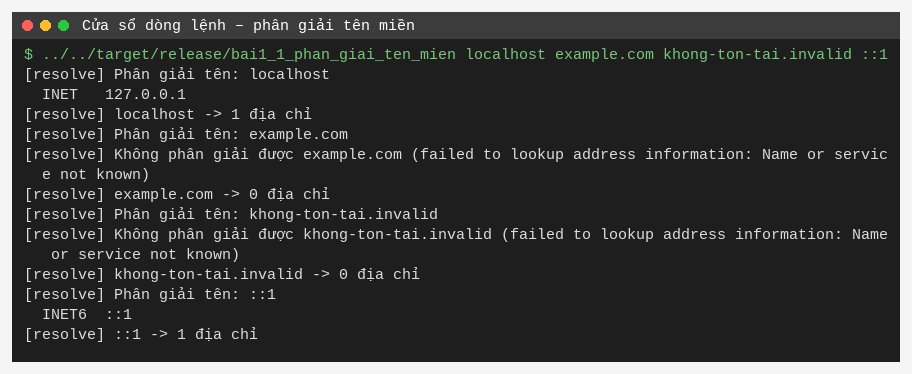

# Bài 1.1 – Phân giải tên miền thành danh sách địa chỉ (Rust)

| Thông tin | Nội dung |
|---|---|
| Mã giả tương ứng | Mã giả 1.1 (RESOLVE_HOST – phân giải tên miền thành danh sách địa chỉ) |
| Mục giáo trình | 1.2.3 Địa chỉ IP và tên miền |
| Kế thừa | Không (thủ tục gốc; được dùng lại ở Bài 1.2) |
| Thư viện | Thư viện chuẩn Rust: `std::net` (`ToSocketAddrs`, `IpAddr`); không dùng crate ngoài |

## Mục tiêu
Minh họa lệnh `RESOLVE`: một tên có thể ánh xạ tới nhiều địa chỉ thuộc hai họ INET (IPv4) và INET6 (IPv6); lỗi phân giải được bắt trong `CATCH` (nhánh `Err` của `match`) và chuyển thành danh sách rỗng thay vì làm dừng chương trình.

## Tệp
- `Cargo.toml`, `Cargo.lock` – gói Cargo `bai1_1_phan_giai_ten_mien` (edition 2021).
- `src/main.rs` – hàm `resolve_host(name)` (Mã giả 1.1) và chương trình chính phân giải lần lượt các tên nhận từ dòng lệnh.
- `demo.json` – kịch bản chạy minh họa (dùng với `tools/demo.py`).
- `ket_qua.txt`, `ket_qua.png` – kết quả thực thi thật.

## Cách chạy
Trong thư mục bài:
```bash
cargo run -q --release -- localhost example.com
```
Không có tham số thì chương trình phân giải `localhost`. Lần chạy đầu Cargo biên dịch chương trình vào thư mục dùng chung `rust/target/` (đặt trong `rust/.cargo/config.toml`); sau đó có thể chạy trực tiếp tệp `../../target/release/bai1_1_phan_giai_ten_mien` (Windows: `..\..\target\release\bai1_1_phan_giai_ten_mien.exe`) như trong `demo.json`.

## Kết quả thực thi


`localhost` được phân giải thành `127.0.0.1` theo tệp hosts của máy kiểm thử (tệp này không khai báo `::1`). Môi trường kiểm thử chặn truy vấn DNS ra Internet nên `example.com` không phân giải được, giống tên `khong-ton-tai.invalid` vốn được dành riêng để không bao giờ tồn tại (RFC 6761); trên máy có Internet, `example.com` trả về cả địa chỉ IPv4 và IPv6. Chuỗi `::1` là địa chỉ dạng số nên được trả lại nguyên dạng với họ INET6.

## Ghi chú
- `RESOLVE(name)` tương ứng với `(name, 0).to_socket_addrs()`: thư viện chuẩn gọi `getaddrinfo` với kiểu `SOCK_STREAM`, nên mỗi địa chỉ chỉ xuất hiện một lần như trong mã giả; cổng 0 vì chỉ cần địa chỉ.
- `ResolveError` của mã giả tương ứng với `Err(io::Error)`. Thư viện chuẩn Rust không trả mã `EAI_*` của `getaddrinfo` (bản Python in "mã lỗi −2"), chỉ có thông báo `failed to lookup address information: …`; chương trình in nguyên thông báo này.
- Thứ tự địa chỉ do hệ điều hành quyết định (RFC 6724) và phụ thuộc tệp hosts, máy chủ DNS, bộ nhớ đệm DNS.
- Kiểm thử: Linux, Rust 1.97.0.
