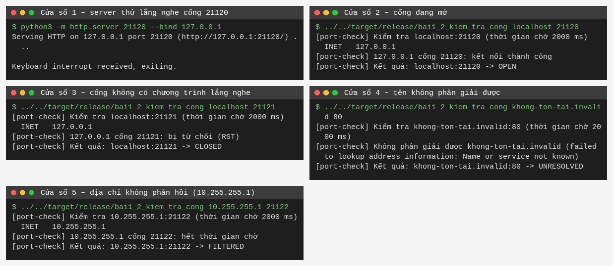

# Bài 1.2 – Kiểm tra trạng thái một cổng TCP (Rust)

| Thông tin | Nội dung |
|---|---|
| Mã giả tương ứng | Mã giả 1.2 (PORT_CHECK – kiểm tra trạng thái một cổng TCP) |
| Mục giáo trình | 1.2.4 Cổng và bộ năm thông số, 1.2.5 Socket |
| Kế thừa | Mã giả 1.1 (RESOLVE_HOST, chép từ Bài 1.1) |
| Thư viện | Thư viện chuẩn Rust: `std::net` (`TcpStream::connect_timeout`, `ToSocketAddrs`), `std::io::ErrorKind`; không dùng crate ngoài |

## Mục tiêu
Minh họa cách kết hợp phân giải tên, socket và cổng: thử kết nối TCP tới lần lượt từng địa chỉ của tên máy với thời gian chờ, rồi kết luận một trong bốn trạng thái: `OPEN` (bắt tay ba bước thành công), `CLOSED` (nhận gói RST), `FILTERED` (không địa chỉ nào phản hồi trong thời gian chờ hoặc không có đường đi), `UNRESOLVED` (tên không phân giải được). Chỉ kiểm tra trên máy và mạng thuộc quyền quản lý của người thực hiện.

## Tệp
- `Cargo.toml`, `Cargo.lock` – gói Cargo `bai1_2_kiem_tra_cong`.
- `src/main.rs` – `resolve_host` (Mã giả 1.1), `port_check` (Mã giả 1.2) và chương trình chính.
- `demo.json` – kịch bản chạy minh họa (dùng với `tools/demo.py`).
- `ket_qua.txt`, `ket_qua.png` – kết quả thực thi thật.

## Cách chạy
Mở hai cửa sổ dòng lệnh trong thư mục bài:
```bash
# Cửa sổ 1 – một server bất kỳ để có cổng đang mở
python3 -m http.server 9000 --bind 127.0.0.1
# Cửa sổ 2 – kiểm tra cổng: <host> <port> [timeout_ms], mặc định timeout_ms = 2000
cargo run -q --release -- localhost 9000
cargo run -q --release -- localhost 9001
cargo run -q --release -- khong-ton-tai.invalid 80
```
Dừng server bằng Ctrl+C. Sau lần biên dịch đầu có thể chạy trực tiếp `../../target/release/bai1_2_kiem_tra_cong` như trong `demo.json`.

## Kết quả thực thi


Server thử (`python3 -m http.server`, giống bản C#) chỉ lắng nghe trên `127.0.0.1`; cổng của server cho `OPEN`, cổng kế bên không có chương trình lắng nghe nên hệ điều hành trả RST và kết quả là `CLOSED`; tên `khong-ton-tai.invalid` (dành riêng theo RFC 6761) cho `UNRESOLVED` mà không có lỗi nào thoát khỏi hàm. Cửa sổ 5 (thêm so với bản Python) thử địa chỉ `10.255.255.1` không phản hồi: sau đúng 2000 ms chờ, kết quả là `FILTERED`.

## Ghi chú
- `SOCKET(FAMILY(a), STREAM)`, `SETOPT(s, CONNECT_TIMEOUT, timeout_ms)` và `CONNECT` được gộp trong `TcpStream::connect_timeout(&addr, timeout)`: hàm tạo socket đúng họ địa chỉ và trả `ErrorKind::TimedOut` khi hết thời gian chờ.
- `ConnectionRefused`, `NetworkUnreachable`, `HostUnreachable` tương ứng với `ErrorKind::ConnectionRefused`, `ErrorKind::NetworkUnreachable`, `ErrorKind::HostUnreachable`. Các lỗi khác được trả về nơi gọi (`Err`), đúng như mã giả không bắt chúng.
- `FINALLY CLOSE(s)`: Rust tự đóng socket khi biến ra khỏi phạm vi (cơ chế `Drop`), kể cả khi có lỗi.
- Bản Rust kiểm tra thêm tham số cổng (`Cổng phải là số nguyên: …`, `Cổng không hợp lệ: …`) như các bài từ Chương 2.
- Trạng thái `FILTERED`: trong môi trường kiểm thử, kết nối tới `10.255.255.1` cổng 80 được proxy trong suốt của mạng ảo trả lời bắt tay thay cho máy đích (cho `OPEN` dù máy đích không tồn tại – đúng ngoại lệ mà giải thích bước (6) của Mã giả 1.2 nêu), còn cổng khác (ở đây 21122) không có phản hồi nên minh họa được `FILTERED`. Kết quả này phụ thuộc mạng nơi chạy.
- Tệp hosts của máy kiểm thử chỉ khai báo `127.0.0.1` cho `localhost`, nên tình huống `::1` trả RST trước khi `127.0.0.1` kết nối được (Mục 1.2.5) không xuất hiện.
- Các dòng `[port-check] <địa chỉ> cổng <n>: …` được in thêm để quan sát kết quả của từng lần thử; mã giả chỉ trả về trạng thái.
- Kiểm thử: Linux, Rust 1.97.0.
