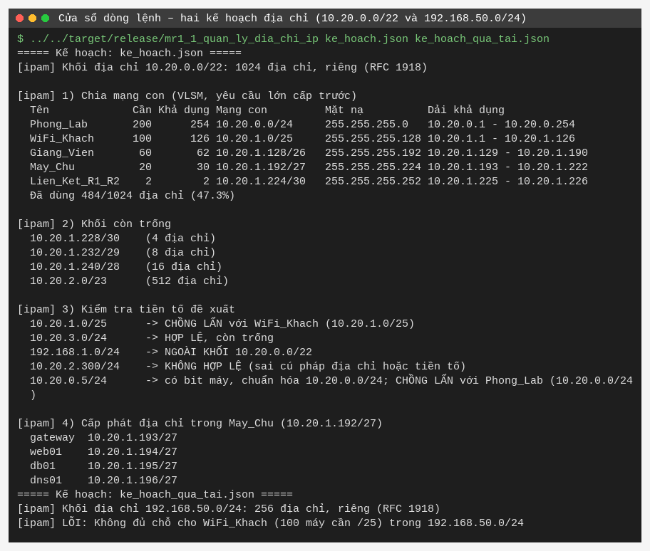

# Bài mở rộng MR1.1 – Quản lý địa chỉ IP (IPAM): chia mạng con, kiểm tra chồng lấn, cấp phát (Rust)

| Thông tin | Nội dung |
|---|---|
| Loại | **Bài mở rộng** – không có trong giáo trình, không có mã giả tương ứng |
| Liên hệ với giáo trình | Chương 1, Mục 1.2.3 (địa chỉ IP, tiền tố mạng); Bài 1.1. Kế hoạch địa chỉ được dùng lại ở MR3.2 và MR8.2 |
| Thư viện | Thư viện chuẩn Rust: `std::net::Ipv4Addr`; crate `serde_json` 1.0.154 (đọc kế hoạch JSON) |
| Bản ngôn ngữ khác | [C#](../../../csharp/Chuong01/BaiMR1.1_QuanLyDiaChiIP/), [Java](../../../java/Chuong01/BaiMR1.1_QuanLyDiaChiIP/), [Python](../../../python/Chuong01/BaiMR1.1_QuanLyDiaChiIP/), [Go](../../../go/Chuong01/BaiMR1.1_QuanLyDiaChiIP/) |

## Mục tiêu
Dùng thư viện địa chỉ IP thay vì tự cắt chuỗi: đọc một kế hoạch địa chỉ (JSON), chia khối `10.20.0.0/22` thành các mạng con theo số máy cần (VLSM – yêu cầu lớn cấp trước để mọi khối đều thẳng hàng), liệt kê phần còn trống dưới dạng ít khối CIDR nhất, kiểm tra các tiền tố đề xuất (sai cú pháp, có bit máy, ngoài khối, chồng lấn) và cấp phát địa chỉ cho thiết bị. Đây là phần lõi của các công cụ IPAM và là bước đầu tiên của mọi kịch bản tự động hóa mạng.

## Kiến thức chính
- Địa chỉ IPv4 là số nguyên 32 bit: `u32::from(Ipv4Addr)` và `Ipv4Addr::from(u32)` cho phép tính toán mạng con bằng phép dịch bit và phép AND với mặt nạ.
- Khối CIDR `/n` có `2^(32−n)` địa chỉ và phải bắt đầu tại bội số của kích thước khối (thẳng hàng); cấp yêu cầu lớn trước bảo đảm điều này mà không tạo lỗ hổng.
- Một khoảng địa chỉ bất kỳ được chia thành ít khối CIDR nhất bằng cách lặp: chọn khối lớn nhất thẳng hàng tại đầu khoảng mà không vượt cuối khoảng.
- Hai mạng chồng lấn khi khoảng `[địa chỉ mạng, địa chỉ quảng bá]` của chúng giao nhau.

## Tệp
- `Cargo.toml`, `Cargo.lock` – gói Cargo `mr1_1_quan_ly_dia_chi_ip`.
- `src/main.rs` – chương trình chính: kiểu `Net`, `parse_net`, `prefix_for_hosts`, `plan_vlsm`, `range_to_cidr`, `free_blocks`, `check_prefix`, `assign_hosts`; có `cargo test` cho phần chia khối.
- `ke_hoach.json`, `ke_hoach_qua_tai.json` – giống bản Python.
- `demo.json` – kịch bản chạy minh họa (dùng với `tools/demo.py`).
- `ket_qua.txt`, `ket_qua.png` – kết quả thực thi thật.

## Cách chạy
Trong thư mục bài:
```bash
cargo run -q --release -- ke_hoach.json ke_hoach_qua_tai.json
cargo test -q                       # kiểm thử range_to_cidr, prefix_for_hosts
```
Chương trình nhận một hoặc nhiều tệp kế hoạch; mã thoát 1 nếu có kế hoạch không thực hiện được. `demo.json` chạy trực tiếp tệp đã biên dịch `../../target/release/mr1_1_quan_ly_dia_chi_ip`.

Tái lập kết quả từ thư mục gốc của kho: `python3 tools/demo.py rust/Chuong01/BaiMR1.1_QuanLyDiaChiIP`.

## Kết quả thực thi


Năm yêu cầu được cấp từ lớn đến nhỏ: `/24` (254 máy), `/25`, `/26`, `/27` và `/30` cho liên kết điểm–điểm, dùng 484/1024 địa chỉ. Phần còn trống `10.20.1.228 – 10.20.3.255` được biểu diễn bằng bốn khối CIDR. Năm tiền tố đề xuất cho bốn kết luận khác nhau; `10.20.0.5/24` có bit máy nên được chuẩn hóa thành `10.20.0.0/24` rồi mới phát hiện chồng lấn. Kế hoạch thứ hai thất bại vì sau khi cấp `/24` cho Phong_Lab, khối `192.168.50.0/24` không còn chỗ cho `/25`. Bản Rust in kết quả giống hệt bản Python và bản Go.

## Khác biệt so với bản Python
- Thư viện chuẩn Rust chỉ có `Ipv4Addr`, không có kiểu mạng (`ipaddress.ip_network` của Python, `netip.Prefix` của Go), nên bài tự viết kiểu `Net` khoảng 40 dòng: phân tích `a.b.c.d/n`, mặt nạ, chồng lấn, chứa trong.
- `free_blocks` không dùng `address_exclude` mà tính các khoảng trống rồi gọi `range_to_cidr` (như bản Go); kết quả giống nhau vì cách chia một khoảng thành ít khối CIDR nhất là duy nhất.
- "Riêng (RFC 1918)" chỉ kiểm tra ba khối `10/8`, `172.16/12`, `192.168/16`; `is_private` của Python còn coi loopback, link-local… là riêng.

## Bài tập gợi ý
1. Thêm tham số `--p2p31` để liên kết điểm–điểm dùng `/31` (RFC 3021) và so sánh số địa chỉ tiết kiệm được.
2. Mở rộng `Net` cho IPv6 bằng `u128` và `Ipv6Addr`; chia `2001:db8::/48` thành các `/64`.
3. Xuất kết quả chia mạng con ra tệp CSV để dùng cho MR3.2.

## Ghi chú
- Chỉ xử lý IPv4 cho gọn.
- Liên kết điểm–điểm dùng `/30`; RFC 3021 cho phép `/31` (không có địa chỉ mạng và quảng bá) nhưng bài không dùng.
- Cột *Khả dụng* = số địa chỉ của khối trừ địa chỉ mạng và địa chỉ quảng bá.
- Kiểm thử: Linux, Rust 1.97.0.

## Đọc thêm
- Claus Töpke, *Network Programming and Automation Essentials*, Packt, 2023, Chương 4 (mục *IP allocation considerations*) và Chương 5 (mục *Use IP libraries*).

Mã nguồn của bài được viết mới cho kho này; sách trên chỉ là tài liệu tham khảo ý tưởng.
