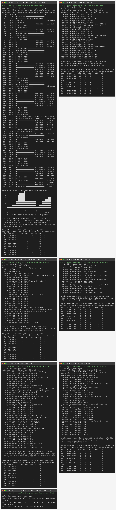
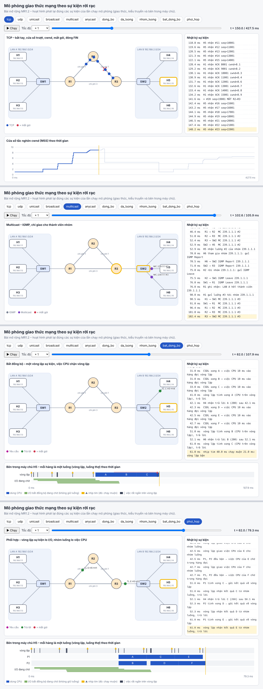

# Bài mở rộng MR1.2 – Mô phỏng giao thức, kiểu truyền và mô hình máy chủ: TCP, UDP, unicast, broadcast, multicast, anycast; đồng bộ, đa luồng, nhóm luồng, bất đồng bộ, phối hợp (Rust)

| Thông tin | Nội dung |
|---|---|
| Loại | **Bài mở rộng** – không có trong giáo trình, không có mã giả tương ứng |
| Liên hệ với giáo trình | Chương 1 (Mục 1.2: địa chỉ, cổng, giao thức; Bài 1.1, 1.2); là “bản đồ” trước khi lập trình thật ở Chương 3 (TCP, Bài 3.1), Chương 4 (UDP, Bài 4.1, 4.4), Chương 5 (luồng, bất đồng bộ – Bài 5.1–5.3), Chương 6 (server đa luồng, nhóm luồng, bất đồng bộ – Bài 6.1, 6.2; broadcast, multicast – Bài 6.5, 6.6); MR5.2, MR5.4, MR5.5 (đo thật cùng các mô hình) |
| Thư viện | Thư viện chuẩn Rust: `std::collections::BinaryHeap`, `HashMap`, `VecDeque`, `include_str!`; crate `serde_json` 1.0.154 (ghi dữ liệu hoạt hình); không mở socket, không tạo luồng thật (luồng, lõi CPU, khóa, vòng lặp sự kiện đều được mô phỏng). Playwright + Pillow (Python, tệp `chup_hoat_hinh.py` chép từ bản Python) chỉ dùng để chụp ảnh hoạt hình trong kịch bản minh họa |
| Bản ngôn ngữ khác | [C#](../../../csharp/Chuong01/BaiMR1.2_MoPhongGiaoThuc/), [Java](../../../java/Chuong01/BaiMR1.2_MoPhongGiaoThuc/), [Python](../../../python/Chuong01/BaiMR1.2_MoPhongGiaoThuc/), [Go](../../../go/Chuong01/BaiMR1.2_MoPhongGiaoThuc/) |

## Mục tiêu
Trước khi viết socket thật, sinh viên cần “nhìn thấy” gói tin đi trong mạng: TCP bắt tay, trượt cửa sổ và phản ứng khi mất gói ra sao; UDP khác TCP ở chỗ nào; vì sao quảng bá dừng ở router; multicast chỉ tới thành viên nhóm thế nào; anycast chọn máy phục vụ gần nhất và tự chuyển sang máy khác khi một máy hỏng. Bài xây dựng một **bộ mô phỏng sự kiện rời rạc** nhỏ: mỗi gói là một đối tượng, mỗi bước chuyển trên liên kết là một sự kiện có thời điểm (trễ lan truyền + thời gian đẩy gói theo băng thông + hàng đợi FIFO). Kết quả **tất định**: cùng `--seed` thì cùng kết quả, và bản Rust in ra giống hệt bản Python, bản Go.

Topo: hai đoạn LAN nối qua ba router; đường R1–R3 là đường dự phòng chi phí cao.
```text
 H1 ─┐                                        ┌─ H4
 H2 ─┼─ SW1 ── R1 ──(1)── R2 ──(1)── R3 ── SW2 ─┼─ H5
 H3 ─┘          └──────────(3)───────┘          └─ H6
 LAN A 192.168.1.0/24              LAN B 192.168.2.0/24
 trong LAN: 100 Mbit/s, 0,5 ms     giữa router: 10 Mbit/s, 5 ms (R1–R3: 8 ms)
```

| Kịch bản | Nội dung |
|---|---|
| `tcp` | H1 gửi 40 đoạn × 1000 byte tới H5: bắt tay ba bước, khởi đầu chậm (slow start), tránh tắc nghẽn (congestion avoidance), mất đoạn #20 → 3 ACK trùng → gửi lại nhanh; bản gửi lại cũng mất → hết giờ RTO → cwnd về 1; đóng bằng FIN. In **sơ đồ thời gian – trình tự** dạng văn bản và **biểu đồ cwnd** ASCII |
| `udp` | H2 gửi 12 datagram tới H6; liên kết R2–R3 mất gói 20 % và trễ dao động 0–15 ms → mất gói, sai thứ tự, không ai gửi lại |
| `unicast` | H1→H2 (cùng LAN, switch chỉ chuyển ra một cổng), H1→H5 (qua 3 router, TTL 64→61); liên kết R1–R2 hỏng → định tuyến tính lại, đi đường R1–R3 |
| `broadcast` | H1 quảng bá 192.168.1.255, H4 quảng bá 255.255.255.255: switch gửi tràn trong LAN, router chặn |
| `multicast` | H2, H5, H6 tham gia/rời nhóm 239.1.1.1 bằng IGMP; switch có IGMP snooping, router chỉ chuyển sang LAN có thành viên |
| `anycast` | Địa chỉ 10.53.0.53 do H3 và H6 cùng phục vụ: H1 tới H3 (chi phí 2), H5 tới H6; H3 hỏng → H1 được chuyển sang H6 (chi phí 6) |

Mỗi kịch bản in nhật ký từng bước và **bảng tổng kết theo nút**: số gói phát ra, nhận, đưa lên ứng dụng, chuyển tiếp, bỏ.

**Bên trong máy chủ: luồng, đa luồng, đồng bộ, bất đồng bộ và phối hợp.** Cùng topo trên, 6 yêu cầu (A–F) từ H4, H6 (LAN B) và H1, H2, H3 (LAN A) đi qua mạng tới máy chủ H5. Mỗi yêu cầu cần **đọc CSDL 30 ms** (chờ I/O – luồng chờ nhưng không tốn CPU) rồi **xử lý 10 ms CPU**; máy chủ có **2 lõi**. Năm kịch bản tổ chức máy chủ theo năm cách:

| Kịch bản | Mô hình | Điều cần quan sát |
|---|---|---|
| `dong_bo` | **Đồng bộ, một luồng**: nhận – xử lý – trả lời lần lượt | yêu cầu sau nằm trong hàng đợi kết nối, thời gian chờ cộng dồn; CPU rảnh khi luồng bị chặn chờ CSDL |
| `da_luong` | **Mỗi yêu cầu một luồng** (tạo luồng 1 ms); cập nhật bộ đếm chung trong **đoạn găng có khóa** 3 ms | các lần chờ I/O chồng lên nhau; 6 luồng nhưng chỉ 2 lõi nên luồng phải **chờ lõi**; luồng phải **chờ khóa**; số luồng tăng theo số yêu cầu |
| `nhom_luong` | **Nhóm 2 luồng thợ + hàng đợi tối đa 2** | số luồng cố định; hàng đợi đầy thì **từ chối ngay (503)** |
| `bat_dong_bo` | **Một luồng chạy vòng lặp sự kiện**, I/O không chặn; phần CPU chạy ngay trên vòng lặp | nhiều I/O chờ cùng lúc chỉ với một luồng; việc CPU **chặn vòng lặp** – nhịp tim 10 ms chạy muộn tới 41 ms |
| `phoi_hop` | **Vòng lặp sự kiện + nhóm 2 luồng**: vòng lặp lo I/O, đẩy việc CPU sang nhóm luồng (trong tokio: `spawn_blocking`), luồng thợ trả kết quả về vòng lặp (gửi qua kênh `oneshot`/`mpsc`) | vòng lặp luôn rảnh (nhịp tim đúng giờ), việc CPU chạy song song trên 2 lõi, hoàn tất sớm nhất |
| `so_sanh` | chạy cả năm mô hình, in **bảng so sánh** | số luồng, thời gian hoàn tất, phản hồi trung bình/lớn nhất, số yêu cầu bị từ chối, trễ nhịp tim |

Mỗi kịch bản máy chủ in nhật ký, **biểu đồ Gantt** các luồng của H5 (CHỮ HOA: dùng CPU; chữ thường: bị chặn chờ I/O; `+` tạo luồng; `-` chờ lõi CPU; `#` giữ khóa; `~` chờ khóa; `·` vòng lặp chạy một việc rất ngắn; hàng *I/O đang chờ* đếm số lệnh I/O bất đồng bộ đang chờ – không giữ luồng nào), bảng thời gian phản hồi từng yêu cầu và nhận xét.

## Kiến thức chính
- **Mô phỏng sự kiện rời rạc:** hàng đợi ưu tiên theo thời điểm (`BinaryHeap` với khóa `Reverse((thời điểm, thứ tự thêm))`), đồng hồ nhảy tới sự kiện kế tiếp; cùng thời điểm thì theo thứ tự thêm vào – nhờ đó kết quả tất định.
- **Trễ trên một chặng** = thời gian chờ hàng đợi + thời gian đẩy gói (kích thước / băng thông) + trễ lan truyền. Đoạn 1000 byte trên liên kết 10 Mbit/s mất 0,8 ms để đẩy lên dây.
- **TCP (rút gọn theo Reno):** bắt tay SYN/SYN+ACK/ACK; xác nhận tích lũy; cửa sổ = cwnd; slow start (+1 MSS mỗi ACK ⇒ gấp đôi mỗi RTT) tới `ssthresh`, sau đó congestion avoidance (+MSS²/cwnd mỗi ACK ⇒ +1 MSS mỗi RTT); 3 ACK trùng ⇒ gửi lại nhanh, `ssthresh = cwnd = max(đang bay/2, 2 MSS)`; hết giờ ⇒ `cwnd = 1 MSS`, RTO gấp đôi; đóng bốn bước FIN/ACK, TIME_WAIT.
- **UDP:** không kết nối, không xác nhận, không sắp xếp lại; ứng dụng phải tự đánh số thứ tự nếu cần (như Bài 4.4).
- **Định tuyến theo chi phí:** Dijkstra từ mọi nút; host không làm nút trung chuyển; khi liên kết/nút hỏng thì tính lại.
- **Kiểu địa chỉ:** unicast (một đích), broadcast (mọi máy trong một LAN – router là biên của miền quảng bá), multicast (thành viên nhóm, IGMP Report/Leave, IGMP snooping ở switch), anycast (nhiều máy cùng một địa chỉ, định tuyến chọn máy gần nhất).
- **Bộ sinh ngẫu nhiên có seed:** xorshift32 tự viết (Rust không có bộ sinh ngẫu nhiên trong thư viện chuẩn) để bản Rust, Python và Go sinh cùng dãy số.
- **Luồng và tài nguyên của máy chủ** (`src/may_chu.rs`): luồng là một hàng trong biểu đồ; *lõi CPU* là tài nguyên có hạn (2 lõi, cấp theo thứ tự đến) – luồng nhiều hơn lõi thì phải chờ; *chờ I/O* chặn luồng nhưng không tốn lõi; *khóa* chỉ cho một luồng vào đoạn găng mỗi lúc, luồng khác xếp hàng chờ (như `std::sync::Mutex`).
- **Đồng bộ (blocking) và bất đồng bộ (non-blocking):** mô hình đồng bộ giữ luồng trong suốt thời gian chờ CSDL; mô hình bất đồng bộ gửi lệnh I/O rồi quay về vòng lặp ngay, kết quả I/O đến sau như một sự kiện trong hàng đợi của vòng lặp (FIFO) – như runtime tokio (dựa trên `mio`/`epoll`), `asyncio` của Python, `Selector`/NIO của Java.
- **Đa luồng có chi phí:** mỗi yêu cầu một luồng (`std::thread::spawn`) đơn giản nhưng số luồng tăng theo tải (bộ nhớ, thời gian tạo, chuyển ngữ cảnh) và dữ liệu dùng chung phải có khóa (`Arc<Mutex<_>>`); nhóm luồng + hàng đợi giới hạn (ví dụ kênh có giới hạn `std::sync::mpsc::sync_channel`) đặt trần tài nguyên và từ chối sớm khi quá tải (như Bài 6.1).
- **Không chặn vòng lặp sự kiện:** việc CPU (hoặc lời gọi chặn) chạy trên vòng lặp làm mọi việc khác chờ theo; nhịp tim 10 ms đo được độ trễ đó. Phối hợp đúng: vòng lặp giao việc CPU cho nhóm luồng, luồng thợ **không** chạm vào trạng thái của vòng lặp mà gửi kết quả về bằng một kênh an toàn luồng. Trong Rust: `tokio::task::spawn_blocking` (tương đương `run_in_executor` của Python) trả về `JoinHandle` để vòng lặp `.await`; hoặc luồng thợ gửi kết quả qua `tokio::sync::oneshot`/`mpsc` (tương đương `call_soon_threadsafe`).

## Cấu trúc tệp
- `Cargo.toml`, `Cargo.lock` – gói Cargo `mr1_2_mo_phong_giao_thuc`.
- `src/main.rs` – chương trình chính: đọc tham số, chạy kịch bản, in kết quả, ghi HTML.
- `src/mang.rs` – lõi mô phỏng: topo, hàng đợi sự kiện, Dijkstra, quy tắc chuyển tiếp của host/switch/router, bảng tổng kết; trait `App` là tầng ứng dụng của kịch bản.
- `src/tcp.rs` – kịch bản TCP: bên gửi (cwnd, ssthresh, bộ hẹn giờ RTO), bên nhận (ACK tích lũy, giữ đoạn đến sớm), sơ đồ thời gian, biểu đồ cwnd.
- `src/kich_ban.rs` – các kịch bản UDP, unicast, broadcast, multicast, anycast.
- `src/may_chu.rs` – bên trong máy chủ H5: luồng (`Lane`), lõi CPU và khóa dùng chung, năm mô hình (`dong_bo`, `da_luong`, `nhom_luong`, `bat_dong_bo`, `phoi_hop`), vòng lặp sự kiện có hàng đợi việc và nhịp tim, biểu đồ Gantt, bảng so sánh; mỗi việc (thay cho hàm đóng của bản Python) là một giá trị `enum Viec`.
- `khung_hoat_hinh.html` – khung trang hoạt hình (giống bản Python), được nhúng vào chương trình bằng `include_str!`; chương trình chèn dữ liệu JSON của lần chạy vào hằng `DATA`.
- `chup_hoat_hinh.py` – chép từ bản Python: chụp ảnh trang hoạt hình bằng Playwright (chỉ cho kịch bản minh họa).
- `demo.json` – kịch bản chạy minh họa (dùng với `tools/demo.py`).
- `ket_qua.txt`, `ket_qua.png` – kết quả thực thi thật; `mo_phong.html` – tệp hoạt hình sinh ra từ lần chạy đó; `ket_qua_gui.png` – ảnh chụp tệp hoạt hình.

## Cách chạy
Trong thư mục bài:
```bash
cargo build -q --release
B=../../target/release/mr1_2_mo_phong_giao_thuc       # hoặc: cargo run -q --release -- <tham số>
$B tcp                                 # TCP, mặc định 40 đoạn, mất đoạn #20 hai lần
$B tcp --mat 12 --doan 30              # chỉ mất #12 một lần: chỉ có gửi lại nhanh
$B tcp --mat "" --loss 0.05 --seed 3   # mất ngẫu nhiên 5 % trên R2–R3
$B udp --seed 42                       # đổi seed: mẫu mất gói/sai thứ tự khác
$B multicast
$B da_luong                            # máy chủ mỗi yêu cầu một luồng, chờ lõi, chờ khóa
$B phoi_hop                            # vòng lặp sự kiện + nhóm luồng
$B so_sanh                             # bảng so sánh năm mô hình máy chủ
$B tat_ca --html mo_phong.html         # chạy cả 11 kịch bản và ghi hoạt hình
```
Mở `mo_phong.html` bằng trình duyệt bất kỳ (không cần mạng, không cần server): chọn kịch bản, bấm Chạy/Dừng, đổi tốc độ, kéo thanh thời gian; với các kịch bản máy chủ, khung *Bên trong máy chủ H5* vẽ từng luồng theo thời gian cùng lúc với gói yêu cầu/trả lời chạy trên mạng; có thể mở thẳng một thời điểm bằng `mo_phong.html#kb=tcp&t=150000&dung=1` (t tính bằng µs).

Trên Windows tệp chạy là `..\..\target\release\mr1_2_mo_phong_giao_thuc.exe`.

Tái lập kết quả từ thư mục gốc của kho: `python3 tools/demo.py rust/Chuong01/BaiMR1.2_MoPhongGiaoThuc` (bước chụp ảnh cần `pip install playwright pillow && playwright install chromium`).

## Kết quả thực thi


Ảnh hoạt hình (từ trên xuống: TCP lúc t = 150 ms – đoạn #20 vừa mất trên R2→R3, các ACK đang về; multicast lúc luồng #3 đang tới hai thành viên H5, H6 của LAN B; `bat_dong_bo` và `phoi_hop` cùng lúc t = 62 ms – một bên vòng lặp bị việc CPU A, B, C chiếm liền, nhịp tim dự kiến lúc 40 ms đỏ vì phải đợi tới 61 ms; bên kia vòng lặp chỉ có những vạch rất ngắn, việc CPU chạy song song trên P1, P2):



Diễn giải (seed 7):
- **TCP:** RTT ≈ 26 ms. cwnd tăng 1→2→4→8 MSS trong ba vòng đầu (slow start) rồi chỉ tăng ~1 MSS mỗi vòng (8,1; 8,2; …) khi vượt `ssthresh` = 8. Đoạn #20 mất; ba đoạn #21–#23 sinh ba ACK trùng `ACK 19001` → t = 160,3 ms gửi lại nhanh, `ssthresh = cwnd = 4,5`. Bản gửi lại cũng bị ép mất, không còn đủ ACK trùng → t = 257,0 ms hết giờ RTO (100 ms), cwnd = 1. Khi #20 tới nơi, bên nhận đã giữ sẵn #21–#28 nên trả `ACK 28001` một lần. 40 đoạn truyền 42 lần, xong sau 363,2 ms, thông lượng ≈ 881 kbit/s – rất xa 10 Mbit/s vì cửa sổ nhỏ và hai lần mất gói. Đóng kết nối: FIN → ACK → FIN → ACK, H1 vào TIME_WAIT.
- **UDP:** 12 gửi, 10 nhận; #4 và #7 mất trên R2→R3; #2 đến sau #3 (sai thứ tự) do trễ dao động. Không có gửi lại.
- **Unicast:** gói H1→H5 qua 3 router nên TTL còn 61; khi R1–R2 hỏng, đường mới H1→SW1→R1→R3→SW2→H5 (chi phí 7, TTL còn 62).
- **Broadcast:** SW1 gửi tràn tới H2, H3, R1; R1 chặn. Tương tự R3 chặn quảng bá của H4. Bảng tổng kết: H4–H6 nhận 0 gói từ LAN A.
- **Multicast:** luồng #1 chỉ tới H2, R1 không chuyển đi vì phía sau không có thành viên; sau khi H5 tham gia, luồng #2 tới H2 và H5 (H4, H6 không nhận); sau khi H6 tham gia và H2 rời, luồng #3 chỉ tới H5, H6 – trên mỗi liên kết chỉ có một bản sao.
- **Anycast:** truy vấn của H1 tới H3 (chi phí 2 so với 6), của H5 tới H6; H3 ngừng hoạt động lúc 40 ms → truy vấn #2 của H1 được định tuyến tới H6.
- **Đồng bộ:** A tới H5 lúc 1,0 ms; B–F lần lượt vào hàng đợi kết nối (tới 5 yêu cầu chờ). Mỗi yêu cầu chiếm luồng 40 ms nên F được trả lời lúc 254,9 ms; trong 30 ms chờ CSDL của mỗi yêu cầu, CPU rảnh hoàn toàn.
- **Đa luồng:** 6 luồng T1–T6; I/O chồng nhau nên hoàn tất lúc 81,9 ms. Nhưng C, E, F phải chờ lõi (cả 2 lõi bận), B, D, F phải chờ khóa của đoạn găng; bộ đếm chung tăng đúng 1 → 6 vì có khóa.
- **Nhóm luồng:** W1, W2 nhận A, B; C, D vào hàng đợi (2/2); E, F bị từ chối ngay (503) và nhận trả lời sau ≈ 25 ms. Số luồng luôn là 2.
- **Bất đồng bộ:** một luồng nhận cả 6 yêu cầu, hàng *I/O đang chờ* lên tới 6 lệnh; nhưng 6 việc CPU nối nhau 60 ms trên vòng lặp: nhịp tim dự kiến lúc 50 ms chạy muộn 41 ms, F hoàn tất lúc 104,9 ms.
- **Phối hợp:** vòng lặp chỉ chạy những việc rất ngắn; việc CPU chạy trên P1, P2 song song; nhịp tim không trễ (0,0 ms); hoàn tất sớm nhất, 76,3 ms, với 3 luồng.

Năm bản C#, Java, Python, Rust, Go cho kết quả trùng từng ký tự (cùng thuật toán, cùng bộ sinh ngẫu nhiên, cùng thứ tự sự kiện); tệp `mo_phong.html` sinh ra cũng trùng từng byte với tệp của bản Python. Đã đối chiếu thêm các biến thể `tcp --mat 12 --doan 30`, `tcp --mat 12,12`, `tcp --mat "" --loss 0.05 --seed 3`, `udp --seed 42`, `udp --loss 0.4 --seed 5`, `tat_ca --seed 11`, `so_sanh --seed 3 --loss 0.3`: đều trùng bản Python.

## Ghi chú
- Đây là mô hình giảng dạy, đã đơn giản hóa: RTO cố định 100 ms (RFC 6298 tính từ RTT đo được), không thổi phồng cwnd trong khôi phục nhanh (Fast Recovery của RFC 5681 §3.2), không có ACK trễ, cửa sổ bên nhận đủ lớn; không mô phỏng ARP, Ethernet, kiểm tra tổng.
- Thông tin thành viên multicast được trao đổi giữa các router một cách lý tưởng (thực tế dùng PIM); switch có IGMP snooping (RFC 4541), nếu không có thì switch gửi tràn multicast như quảng bá.
- Anycast trong bài chọn theo chi phí định tuyến nội bộ; trên Internet, anycast thường được thực hiện bằng BGP (RFC 4786).
- `--loss` áp dụng cho cả hai chiều của liên kết R2–R3. Thời gian in ra là thời điểm gói **tới** nút (µs làm tròn xuống 0,1 ms).
- Khác Python/Go về cách viết: Rust không cho cất hàm đóng (closure) vừa mượn `Net` vừa mượn trạng thái kịch bản vào hàng đợi, nên mỗi sự kiện là một giá trị `enum Ev` (gói tới nút, gói mất, việc của kịch bản mang số hiệu); kịch bản cài trait `App` (`deliver`, `loss`, `event`). Gói được sao chép ở mỗi chặng bằng `clone()` (tương đương `copy.copy`).
- Mô hình máy chủ đã đơn giản hóa: lõi CPU cấp theo thứ tự đến và không chia lát thời gian (không preemption), chuyển ngữ cảnh tốn 0 ms, đoạn găng chỉ tính thời gian giữ khóa, việc rất ngắn trên vòng lặp tốn 0 ms; thời gian tạo luồng, đọc CSDL, xử lý CPU là hằng số (đổi ở đầu `src/may_chu.rs`). Số đo thật trên máy (luồng hệ điều hành, tokio…) xem MR5.2, MR5.4, MR5.5.
- Trong `src/may_chu.rs`, các hàm đóng của bản Python (việc hẹn giờ, việc làm tiếp khi xong CPU/khóa, việc trên vòng lặp) thành các nhánh của `enum Viec`, lồng nhau bằng `Box<Viec>` (ví dụ `Cpu(luồng, mã, Box::new(Khoa(…, Box::new(DaXong(…)))))`); việc hẹn giờ được cất trong `HashMap` theo số hiệu của `Ev::App`. Thứ tự gọi `net.at` giữ đúng như bản Python để kết quả trùng khớp.
- Căn cột `{:<n}` của Rust đếm theo ký tự Unicode như Python, nên sơ đồ có ký tự `─`, `►` và chữ có dấu vẫn thẳng hàng; độ dài nhãn tính bằng `chars().count()`, không dùng `len()` (đếm byte).
- Kiểm thử: Linux, Rust 1.97.0; ảnh hoạt hình chụp bằng Playwright (Chromium không màn hình).

## Bài tập gợi ý
1. Chạy `udp` với vài seed khác nhau và `--loss 0`, `0.1`, `0.4`; ghi tỉ lệ mất gói đo được, giải thích vì sao với 12 datagram tỉ lệ đo khác 10 %, 40 %.
2. Chạy `tcp --mat 12` rồi `tcp --mat 12,12`: so sánh thời gian hoàn thành, số lần gửi lại và hình dạng biểu đồ cwnd giữa “chỉ gửi lại nhanh” và “có hết giờ”.
3. Thêm cửa sổ bên nhận `rwnd` (ví dụ 4 đoạn) vào `src/tcp.rs`: bên gửi dùng `min(cwnd, rwnd)`. Quan sát cwnd vẫn tăng nhưng thông lượng không tăng – phân biệt điều khiển luồng và điều khiển tắc nghẽn.
4. Cài đặt Fast Recovery đầy đủ (RFC 5681 §3.2: `cwnd = ssthresh + 3 MSS`, tăng 1 MSS mỗi ACK trùng) và tính RTO theo RFC 6298 (SRTT, RTTVAR). So sánh kết quả.
5. Trong `src/may_chu.rs` đổi `SO_LOI` thành 1 rồi 4 và `SO_THO` thành 4: mô hình nào thay đổi nhiều nhất? Vì sao `bat_dong_bo` không nhanh hơn khi có thêm lõi?
6. Bỏ khóa trong `da_luong` (cho mọi luồng vào đoạn găng cùng lúc, đọc – tăng – ghi bộ đếm trong 3 ms): bộ đếm cuối còn đúng 6 không? Liên hệ tranh chấp dữ liệu ở MR5.4 (trong Rust thật, trình biên dịch buộc phải dùng `Mutex`/`AtomicUsize` mới cho chia sẻ bộ đếm giữa các luồng).
7. Thêm mô hình `bat_dong_bo` “chia nhỏ”: việc CPU 10 ms chia thành 10 bước 1 ms, sau mỗi bước nhường vòng lặp (`tokio::task::yield_now().await`). Nhịp tim trễ tối đa còn bao nhiêu? So sánh với `phoi_hop`.
8. (Nâng cao) Thêm hàng đợi giới hạn (ví dụ 8 gói) ở R2 hướng R3 và bỏ `--mat`: để TCP tự gây tắc nghẽn bằng slow start và quan sát hình răng cưa của cwnd; thêm một luồng TCP thứ hai H2→H6 để thấy chia sẻ băng thông.

## Đọc thêm
- RFC 9293 – *Transmission Control Protocol (TCP)*, 2022 (§3.5 thiết lập kết nối, §3.6 đóng kết nối).
- RFC 5681 – *TCP Congestion Control*, 2009 (slow start, congestion avoidance, fast retransmit/fast recovery); RFC 6298 – *Computing TCP's Retransmission Timer*, 2011.
- RFC 768 – *User Datagram Protocol*, 1980.
- RFC 919 – *Broadcasting Internet Datagrams*, 1984; RFC 1112 – *Host Extensions for IP Multicasting*, 1989; RFC 2236 – *Internet Group Management Protocol, Version 2*, 1997; RFC 4541 – *Considerations for IGMP and MLD Snooping Switches*, 2006.
- RFC 4786 – *Operation of Anycast Services*, 2006.
- Ilya Grigorik, *High Performance Browser Networking*, O'Reilly, 2013, Chương 2 *Building Blocks of TCP* và Chương 3 *Building Blocks of UDP*.
- James F. Kurose, Keith W. Ross, *Computer Networking: A Top-Down Approach*, Pearson, Chương 3 (tầng giao vận: TCP, điều khiển tắc nghẽn).
- *The Rust Programming Language*, Chương 16 *Fearless Concurrency* (`thread::spawn`, kênh `mpsc`, `Mutex`, `Arc`) (doc.rust-lang.org/book); tài liệu tokio: `tokio::task::spawn_blocking`, mục *Bridging with sync code* và *CPU-bound tasks and blocking code* (docs.rs/tokio, tokio.rs).
- Dan Kegel, *The C10K problem* (kegel.com/c10k.html) – các mô hình máy chủ: mỗi kết nối một luồng, nhóm luồng, vòng lặp sự kiện.

Mã nguồn của bài được viết mới cho kho này; các tài liệu trên chỉ là nguồn tham khảo kiến thức.
