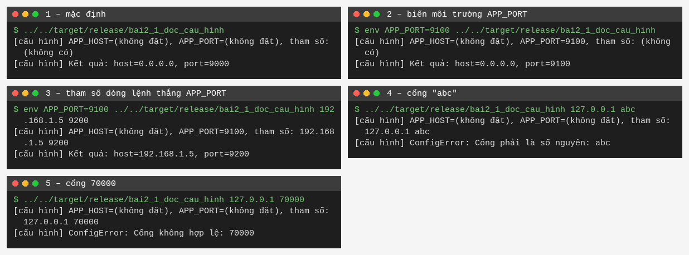

# Bài 2.1 – Đọc cấu hình địa chỉ và cổng (Rust)

| Thông tin | Nội dung |
|---|---|
| Mã giả tương ứng | Mã giả 2.1 (PARSE_ENDPOINT – đọc địa chỉ và cổng từ tham số dòng lệnh, biến môi trường) |
| Mục giáo trình | 2.1.3 Tham số hóa địa chỉ và cổng |
| Kế thừa | Không (thủ tục gốc, được dùng lại ở mọi server và client từ Chương 3) |
| Thư viện | Thư viện chuẩn Rust: `std::env`, `std::process`; không dùng crate ngoài |

## Mục tiêu
Minh họa thứ tự ưu tiên cấu hình: tham số dòng lệnh > biến môi trường `APP_HOST`, `APP_PORT` > giá trị mặc định (`0.0.0.0`, `9000`), cùng việc chuyển chuỗi sang số và kiểm tra phạm vi cổng 1–65535 với lỗi `ConfigError` rõ ràng.

## Tệp
- `Cargo.toml`, `Cargo.lock` – gói Cargo `bai2_1_doc_cau_hinh`.
- `src/main.rs` – hàm `parse_endpoint` (Mã giả 2.1), kiểu lỗi `ConfigError` và chương trình in cấu hình nhận được.
- `demo.json` – kịch bản chạy minh họa năm trường hợp (dùng với `tools/demo.py`).
- `ket_qua.txt`, `ket_qua.png` – kết quả thực thi thật.

## Cách chạy
```bash
# Linux/macOS, trong thư mục bài
cargo run -q --release                                   # mặc định
APP_PORT=9100 cargo run -q --release                     # biến môi trường
APP_PORT=9100 cargo run -q --release -- 192.168.1.5 9200
cargo run -q --release -- 127.0.0.1 abc                  # cổng không phải số
cargo run -q --release -- 127.0.0.1 70000                # cổng ngoài phạm vi
```
```powershell
# Windows PowerShell
$env:APP_PORT="9100"; cargo run -q --release
Remove-Item Env:APP_PORT
```

## Kết quả thực thi


Năm tiến trình cho đúng kết quả nêu trong giáo trình: giá trị mặc định `0.0.0.0:9000`; cổng 9100 lấy từ `APP_PORT`; tham số `192.168.1.5 9200` thắng `APP_PORT=9100`; cổng `abc` và `70000` bị từ chối bằng `ConfigError` với thông báo cụ thể. Trong `demo.json`, biến môi trường được đặt riêng cho từng tiến trình bằng lệnh `env`.

## Ghi chú
- Lỗi được trả về bằng `Result<(String, u16), ConfigError>` thay cho ngoại lệ; chương trình trả mã thoát 2 khi gặp `ConfigError`.
- `TO_INT` dùng `str::parse::<i64>()` sau khi bỏ khoảng trắng hai đầu: chấp nhận dấu `+` (`"+9000"`), không chấp nhận dấu gạch dưới (`"9_000"`, khác `int()` của Python); mã giả không đề cập các trường hợp này. Số được đọc thành `i64` rồi mới kiểm tra phạm vi, nên `70000` cho đúng thông báo "Cổng không hợp lệ" thay vì lỗi tràn kiểu `u16`.
- Thủ tục không kiểm tra `host` (đúng như mã giả); địa chỉ sai được phát hiện ở bước kết nối (Bài 2.2).
- Kiểm thử: Linux, Rust 1.97.0.
