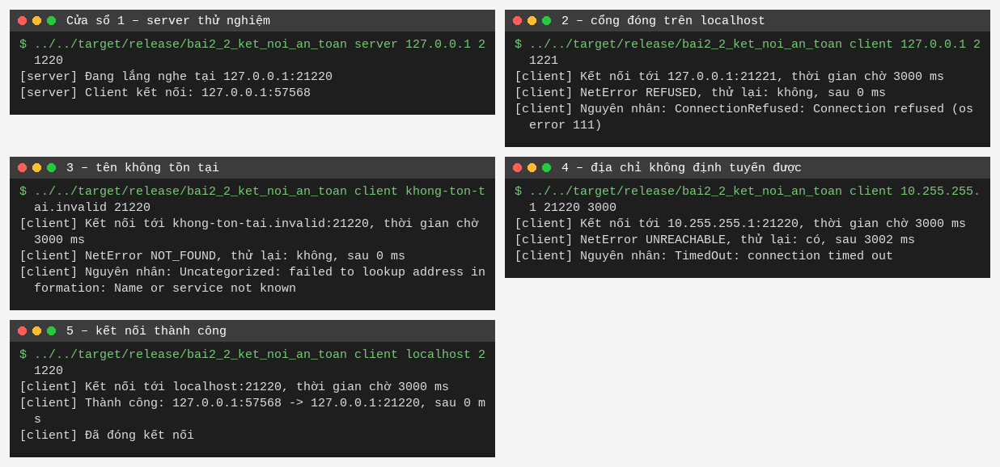

# Bài 2.2 – Kết nối có thời gian chờ và phân loại lỗi (Rust)

| Thông tin | Nội dung |
|---|---|
| Mã giả tương ứng | Mã giả 2.2 (SAFE_CONNECT – kết nối có thời gian chờ và phân loại lỗi) |
| Mục giáo trình | 2.2.3 Khung xử lý lỗi dùng chung |
| Kế thừa | Mã giả 1.2 (PORT_CHECK), Mã giả 2.1 (PARSE_ENDPOINT, rút gọn) |
| Thư viện | Thư viện chuẩn Rust: `std::net` (`TcpStream::connect_timeout`, `TcpListener`), `std::io::ErrorKind`; không dùng crate ngoài |

## Mục tiêu
Cài đặt thủ tục kết nối thử lần lượt các địa chỉ của một tên, luôn đặt thời gian chờ, đóng socket khi thất bại và gom mọi lỗi về `NetError` với ba loại: `NOT_FOUND` (tên không tồn tại, không thử lại), `REFUSED` (mọi địa chỉ trả RST, không thử lại), `UNREACHABLE` (hết thời gian chờ hoặc không có đường đi, có thể thử lại).

## Tệp
- `Cargo.toml`, `Cargo.lock` – gói Cargo `bai2_2_ket_noi_an_toan`.
- `src/main.rs` – phân nhánh vai trò `server` / `client`.
- `src/endpoint.rs` – `ConfigError`, `parse_endpoint` (Mã giả 2.1, rút gọn).
- `src/safe_connect.rs` – `NetError`, `ConnectError` và `safe_connect` (Mã giả 2.2).
- `src/client.rs` – client gọi `safe_connect` và in kết quả hoặc loại lỗi.
- `src/test_server.rs` – server thử nghiệm tối giản: chấp nhận kết nối rồi đóng ngay, chỉ để tạo trường hợp thành công.
- `demo.json` – kịch bản chạy minh họa (dùng với `tools/demo.py`).
- `ket_qua.txt`, `ket_qua.png` – kết quả thực thi thật.

## Cách chạy
```bash
# Cửa sổ 1 – server thử nghiệm
cargo run -q --release -- server 127.0.0.1 9000
# Cửa sổ 2 – client: [host] [port] [timeout_ms]
cargo run -q --release -- client localhost 9000              # thành công
cargo run -q --release -- client 127.0.0.1 9001              # REFUSED
cargo run -q --release -- client khong-ton-tai.invalid 9000  # NOT_FOUND
cargo run -q --release -- client 10.255.255.1 9000 3000      # UNREACHABLE (hết thời gian chờ)
```
Dừng server bằng Ctrl+C. `demo.json` chạy trực tiếp tệp đã biên dịch `../../target/release/bai2_2_ket_noi_an_toan`.

## Kết quả thực thi


Cổng đóng trên máy cục bộ bị từ chối ngay (`ErrorKind::ConnectionRefused` → `REFUSED`, không thử lại); tên thuộc miền `.invalid` không phân giải được (`NOT_FOUND`); địa chỉ `10.255.255.1` không phản hồi nên thủ tục dừng sau khoảng 3000 ms (`ErrorKind::TimedOut` → `UNREACHABLE`, có thể thử lại); kết nối tới `localhost` thành công và server ghi nhận đúng cổng nguồn của client.

## Ghi chú
- `SOCKET`, `SETOPT(CONNECT_TIMEOUT)` và `CONNECT` được gộp trong `TcpStream::connect_timeout`; thời gian chờ này chỉ áp dụng cho bước kết nối (các thao tác đọc, ghi sau đó đặt riêng bằng `set_read_timeout`, `set_write_timeout`).
- Mã giả chuyển các lỗi khác ba loại trên lên nơi gọi; trong Rust, hàm trả `ConnectError::Other(io::Error)` cho trường hợp này, còn ba loại đã phân loại nằm trong `ConnectError::Net(NetError)`.
- Socket thất bại được đóng tự động khi ra khỏi phạm vi (`Drop`), tương ứng nhánh `FINALLY` chỉ đóng khi thất bại của mã giả; socket thành công được trả cho nơi gọi.
- Dòng "Nguyên nhân" in loại lỗi `ErrorKind` và thông báo của hệ điều hành; thư viện chuẩn không trả mã `EAI_*` của lỗi phân giải tên.
- Server thử nghiệm dừng bằng Ctrl+C mà không in dòng "Dừng server" (thư viện chuẩn Rust không có hàm bắt tín hiệu Ctrl+C), giống bản C#.
- Thời gian (ms) in ra phụ thuộc máy chạy; trên mạng khác, `10.255.255.1` có thể cho `HostUnreachable` sớm hơn.
- Kiểm thử: Linux, Rust 1.97.0.
