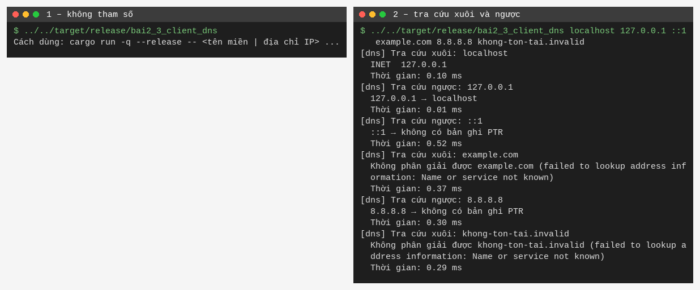

# Bài 2.3 – Client tra cứu DNS (Rust)

| Thông tin | Nội dung |
|---|---|
| Mã giả tương ứng | Mã giả 2.3 (client tra cứu DNS dùng bộ phân giải của hệ điều hành) |
| Mục giáo trình | 2.5 Ví dụ: client tra cứu DNS |
| Kế thừa | Mã giả 1.1 (RESOLVE_HOST) |
| Thư viện | Thư viện chuẩn Rust: `std::net` (`ToSocketAddrs`, `IpAddr`), `std::time::Instant`; crate `dns-lookup` 2.1.0 cho tra cứu ngược |

## Mục tiêu
Nhận một hoặc nhiều tham số; với tên miền, in danh sách địa chỉ IPv4/IPv6 (tra cứu xuôi qua `getaddrinfo`); với địa chỉ IP, tra cứu ngược bản ghi PTR (`getnameinfo`); in thời gian tra cứu của từng tham số. Lỗi của một tham số không làm dừng các tham số còn lại.

## Tệp
- `Cargo.toml`, `Cargo.lock` – gói Cargo `bai2_3_client_dns`, phụ thuộc `dns-lookup = "=2.1.0"`.
- `src/main.rs` – `resolve_host` (Mã giả 1.1) và chương trình chính (Mã giả 2.3).
- `demo.json` – kịch bản chạy minh họa (dùng với `tools/demo.py`).
- `ket_qua.txt`, `ket_qua.png` – kết quả thực thi thật.

## Cách chạy
```bash
cargo run -q --release                                                   # in cách dùng
cargo run -q --release -- localhost 127.0.0.1 www.ut.edu.vn 8.8.8.8 khong-ton-tai.invalid
```
Lần biên dịch đầu Cargo tải crate `dns-lookup` từ crates.io (cần Internet một lần).

## Kết quả thực thi


Không có tham số, chương trình in cách dùng. `localhost` phân giải thành `127.0.0.1` (tệp hosts của máy kiểm thử không khai báo `::1`) và `127.0.0.1` tra ngược ra `localhost`. Môi trường kiểm thử không truy cập được máy chủ DNS bên ngoài nên `example.com` không phân giải được và `8.8.8.8` không có bản ghi PTR; trên mạng thông thường, `8.8.8.8` cho tên `dns.google`. Tên `khong-ton-tai.invalid` đi vào nhánh `ResolveError`.

## Ghi chú
- Thư viện chuẩn Rust chỉ có tra cứu xuôi (`ToSocketAddrs`), không có tra cứu ngược; `REVERSE_RESOLVE` dùng `dns_lookup::lookup_addr`, hàm bọc `getnameinfo` với cờ `NI_NAMEREQD` (báo lỗi khi không có tên thay vì trả lại địa chỉ dạng số). Đây là crate ngoài duy nhất của bài.
- `IS_IP_ADDRESS` là `q.parse::<IpAddr>()`: thành công nghĩa là chuỗi là địa chỉ IPv4/IPv6 dạng số.
- Chương trình in thêm dòng tiêu đề `[dns] Tra cứu xuôi/ngược: …` trước kết quả của mỗi tham số để dễ đọc; mã giả không có dòng này.
- Thư viện chuẩn không trả mã `EAI_*` của lỗi phân giải; dòng lỗi in thông báo `failed to lookup address information: …` của hệ điều hành.
- Kiểm thử: Linux, Rust 1.97.0.
