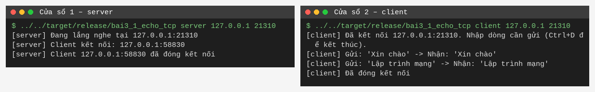

# Bài 3.1 – TCP Echo Server và Echo Client (Rust)

| Thông tin | Nội dung |
|---|---|
| Mã giả tương ứng | Mã giả 3.1 (TCP Echo Server tuần tự), Mã giả 3.2 (TCP Echo Client) |
| Mục giáo trình | 3.2.2 Server tuần tự, 3.2.3 Client |
| Kế thừa | Mã giả 2.1 (đọc địa chỉ, cổng), Mã giả 2.2 (kết nối có thời gian chờ) |
| Thư viện | Thư viện chuẩn Rust: `std::net` (`TcpListener`, `TcpStream`), `std::io`; không dùng crate ngoài |

## Mục tiêu
Minh họa vòng đời socket TCP: server `bind` – `listen` – `accept` – `read`/`write_all` – đóng; client `connect` – `write_all` – `read` – `shutdown` – đóng.

## Tệp
- `Cargo.toml`, `Cargo.lock` – gói Cargo `bai3_1_echo_tcp`.
- `src/main.rs` – phân nhánh vai trò `server` / `client`.
- `src/netutil.rs` – `parse_endpoint` (Mã giả 2.1, rút gọn), `safe_connect` (Mã giả 2.2, rút gọn).
- `src/echo_server.rs` – server tuần tự, gửi trả nguyên văn dữ liệu nhận được (Mã giả 3.1).
- `src/echo_client.rs` – client đọc từng dòng từ bàn phím, gửi và in phản hồi (Mã giả 3.2).
- `demo.json` – kịch bản chạy minh họa (dùng với `tools/demo.py`).
- `ket_qua.txt`, `ket_qua.png` – kết quả thực thi thật.

## Cách chạy
Mở hai cửa sổ dòng lệnh trong thư mục bài:
```bash
# Cửa sổ 1 – server
cargo run -q --release -- server 0.0.0.0 9000
# Cửa sổ 2 – client
cargo run -q --release -- client 127.0.0.1 9000
```
Nhập vài dòng ở cửa sổ client; nhấn Ctrl+D (Linux/macOS) hoặc Ctrl+Z rồi Enter (Windows) để kết thúc. Dừng server bằng Ctrl+C. `demo.json` chạy trực tiếp tệp đã biên dịch `../../target/release/bai3_1_echo_tcp`.

## Kết quả thực thi


Server in địa chỉ client khi kết nối và khi client đóng kết nối; client nhận lại đúng chuỗi đã gửi, kể cả chuỗi tiếng Việt có dấu (UTF-8).

## Ghi chú
- `SOCKET`, `SETOPT(REUSEADDR)`, `BIND`, `LISTEN` được gộp trong `TcpListener::bind`: thư viện chuẩn tự bật `SO_REUSEADDR` trên Linux/macOS và tự chọn độ dài hàng đợi (backlog), không đặt được giá trị 16 như mã giả.
- `SEND_ALL` là `write_all` (lặp `write` đến khi gửi hết); `CLOSE` là `drop(conn)` – Rust cũng tự đóng socket khi biến ra khỏi phạm vi.
- Client gọi `read` với bộ đệm 4096 byte một lần cho mỗi dòng: chấp nhận được với dòng ngắn, nhưng sai khi thông điệp lớn vì TCP là luồng byte không giữ ranh giới thông điệp (Mục 3.4). Bài 3.2 bổ sung định khung.
- Server dừng bằng Ctrl+C mà không in dòng "Dừng server" như bản Python, vì thư viện chuẩn Rust không có hàm bắt tín hiệu Ctrl+C.
- Kiểm thử: Linux, Rust 1.97.0.
