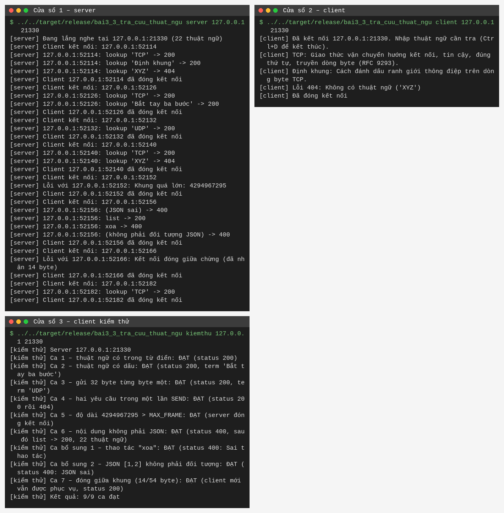

# Bài 3.3 – Dịch vụ tra cứu thuật ngữ dùng JSON (Rust)

| Thông tin | Nội dung |
|---|---|
| Mã giả tương ứng | Mã giả 3.7 (Server tra cứu thuật ngữ), Mã giả 3.8 (Client tra cứu thuật ngữ) |
| Mục giáo trình | 3.4.5 Đặc tả giao thức, 3.5.1 Dịch vụ tra cứu thuật ngữ dùng JSON, 3.5.3 (tập ca kiểm thử tối thiểu) |
| Kế thừa | Mã giả 3.1 (khung sườn server, thay HANDLE_ECHO bằng HANDLE_LOOKUP), Mã giả 3.2 (phần kết nối của client), Mã giả 3.6 (SEND_JSON, RECV_JSON), Mã giả 2.1, 2.2 |
| Thư viện | Thư viện chuẩn Rust: `std::net`, `std::io`, `std::fs`; crate `serde_json` 1.0.143 (bật `preserve_order`) |

## Mục tiêu
Cài đặt dịch vụ tra cứu đúng theo đặc tả giao thức của giáo trình: TCP, cổng mặc định 9100, khung tiền tố độ dài 4 byte, nội dung là đối tượng JSON mã hóa UTF-8. Hàm nghiệp vụ `process_request` được tách khỏi phần truyền nhận; một client kiểm thử riêng tái hiện các ca kiểm thử 1–7 của tập ca kiểm thử tối thiểu.

| Thao tác | Yêu cầu | Phản hồi |
|---|---|---|
| Tra cứu | `{"op":"lookup","term":"TCP"}` | `{"status":200,"term":"TCP","text":"..."}` hoặc `{"status":404,"error":"..."}` |
| Liệt kê | `{"op":"list"}` | `{"status":200,"terms":["TCP","UDP",...]}` |
| Kết thúc | `{"op":"bye"}` | Không phản hồi; server đóng kết nối |
| Lỗi chung | Thao tác không hợp lệ hoặc JSON sai | `{"status":400,"error":"..."}` |

## Tệp
- `Cargo.toml`, `Cargo.lock` – gói Cargo `bai3_3_tra_cuu_thuat_ngu`.
- `src/main.rs` – phân nhánh vai trò `server` / `client` / `kiemthu`.
- `src/lookup_server.rs` – server: nạp `glossary.json` một lần, `process_request` (nghiệp vụ, không dùng socket), `handle_lookup` (vòng nhận khung JSON).
- `src/lookup_client.rs` – client: mỗi dòng nhập là một thuật ngữ cần tra.
- `src/kiem_thu.rs` – client kiểm thử tự tạo dãy byte gửi đi cho các ca 1–7 và hai ca bổ sung.
- `src/framing.rs`, `src/netutil.rs` – thư viện định khung (Bài 3.2) và tiện ích kết nối (Mã giả 2.1, 2.2), chép nguyên để bài tự chứa.
- `glossary.json` – từ điển 22 thuật ngữ của Chương 1–3 (có thuật ngữ tiếng Việt có dấu), giống bản Python.
- `demo.json`, `ket_qua.txt`, `ket_qua.png` – kịch bản và kết quả thực thi thật.

## Cách chạy
Mở các cửa sổ dòng lệnh trong thư mục bài (server đọc `glossary.json` ở thư mục hiện hành):
```bash
# Cửa sổ 1 – server
cargo run -q --release -- server 0.0.0.0 9100
# Cửa sổ 2 – client: nhập thuật ngữ, ví dụ TCP, Định khung, XYZ
cargo run -q --release -- client 127.0.0.1 9100
# Cửa sổ 3 – client kiểm thử
cargo run -q --release -- kiemthu 127.0.0.1 9100
```
Kết thúc nhập ở client bằng Ctrl+D (Linux/macOS) hoặc Ctrl+Z rồi Enter (Windows); client khi đó gửi `{"op":"bye"}`. Dừng server bằng Ctrl+C.

## Kết quả thực thi


Client tra cứu "TCP" và "Định khung" nhận `status` 200, "XYZ" nhận 404. Client kiểm thử đạt 9/9 ca: gửi từng byte cách nhau 100 ms (ca 3), hai yêu cầu trong một lần gửi (ca 4), độ dài 0xFFFFFFFF bị từ chối và kết nối bị đóng (ca 5), nội dung không phải JSON, thao tác "xoa" và JSON không phải đối tượng `[1,2]` nhận 400 nhưng kết nối vẫn dùng được (ca 6, ca bổ sung 1, 2), đóng giữa khung được ghi nhật ký "đã nhận 14 byte" và server tiếp tục phục vụ client mới (ca 7).

## Ghi chú
- `serde_json` với tính năng `preserve_order` giữ thứ tự thuật ngữ như trong `glossary.json`, nên thao tác `list` trả danh sách theo đúng thứ tự tệp (giống `dict` của Python).
- Theo Mã giả 3.7 (bản hiện hành), yêu cầu là JSON hợp lệ nhưng không phải đối tượng (ví dụ `[1, 2]` hoặc `"abc"`) nhận 400 "JSON sai" (`IF NOT IS_OBJECT(req)`, kiểm thử bằng ca bổ sung 2); đối tượng thiếu trường `op` được xử lý như thao tác không hợp lệ (400 "Sai thao tác"); `term` không phải chuỗi cho kết quả 404.
- Byte không phải UTF-8 hợp lệ trong khung cũng được coi là lỗi JSON (400 "JSON sai").
- Tra cứu khớp chính xác và phân biệt hoa thường như `req.term IN DICT`; thuật ngữ có dấu phải cùng dạng chuẩn hóa NFC với từ điển (Mục 3.4.4).
- Ca 5 dùng độ dài 0xFFFFFFFF; server báo `ProtocolError` trước khi cấp phát bộ nhớ, lỗi đi lên vòng ACCEPT, kết nối bị đóng.
- Mỗi ca kiểm thử mở kết nối trong một khối `{ … }` riêng: ra khỏi khối, socket tự đóng (tương đương `with` của Python).
- Server ghi một dòng nhật ký cho mỗi yêu cầu (không có trong mã giả) để đối chiếu với client kiểm thử. Như Mục 3.6.1 đã nêu, server tuần tự chưa đặt thời gian chờ nhận cho `conn`. Server dừng bằng Ctrl+C mà không in dòng "Dừng server".
- Ca 8, 9 (tải tệp) thuộc Bài 3.4. Ca 3 kéo dài khoảng 3,2 giây (32 byte × 100 ms).
- Kiểm thử: Linux, Rust 1.97.0.
