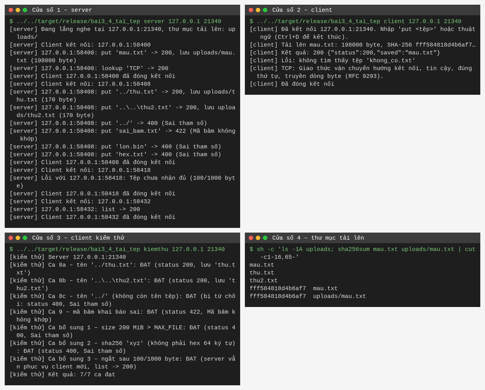

# Bài 3.4 – Tải tệp lên server có kiểm tra toàn vẹn (Rust)

| Thông tin | Nội dung |
|---|---|
| Mã giả tương ứng | Mã giả 3.9 (Server nhận tệp có kiểm tra mã băm), Mã giả 3.10 (Client tải tệp lên server) |
| Mục giáo trình | 3.5.2 Truyền tệp có kiểm tra toàn vẹn, 3.5.3 (ca kiểm thử 8, 9) |
| Kế thừa | Mã giả 3.7 (HANDLE_LOOKUP, thêm nhánh `IF req.op = "put" THEN HANDLE_PUT(conn, req); CONTINUE`), Mã giả 3.8 (client tra cứu), Mã giả 3.6 (khung JSON), Mã giả 3.3 (SEND_ALL), Mã giả 2.1, 2.2 |
| Thư viện | Thư viện chuẩn Rust: `std::net`, `std::io`, `std::fs`, `std::path`; crate `serde_json` 1.0.143 (bật `preserve_order`), `sha2` 0.10.9 |

## Mục tiêu
Mở rộng dịch vụ tra cứu để client tải tệp lên server trong cùng một phiên, kết hợp hai cách định khung: phần điều khiển dùng khung JSON, nội dung tệp là dòng byte thô có độ dài khai báo trước trong tiêu đề. Trình tự bốn bước:

1. Client gửi `{"op":"put","name":…,"size":…,"sha256":…}` (mã băm SHA-256 dạng hex chữ thường).
2. Server kiểm tra tham số, trả `{"status":100}` (sẵn sàng) hoặc `{"status":400,"error":"Sai tham số"}`.
3. Client gửi đúng `size` byte nội dung, đọc tệp theo từng khối 64 KiB.
4. Server ghi tệp tạm `.part`, tính lại mã băm, trả `{"status":200,"saved":…}` nếu khớp (đổi tên tệp tạm thành tệp chính thức) hoặc `{"status":422,"error":"Mã băm không khớp"}` (xóa tệp tạm).

Ba biện pháp an toàn theo giáo trình: chỉ lấy phần tên tệp (chặn duyệt đường dẫn kiểu `../../etc/passwd`), giới hạn `MAX_FILE` = 100 MiB, ghi vào tệp `.part` và chỉ đổi tên khi mã băm khớp.

## Tệp
- `Cargo.toml`, `Cargo.lock` – gói Cargo `bai3_4_tai_tep`.
- `src/main.rs` – phân nhánh vai trò `server` / `client` / `kiemthu`.
- `src/put_server.rs` – server: `process_request` (tra cứu), `basename`, `handle_put` (Mã giả 3.9), `handle_lookup` có nhánh `put`.
- `src/put_client.rs` – client: `put_file` (Mã giả 3.10) và tra cứu trong cùng một kết nối.
- `src/kiem_thu.rs` – client kiểm thử tự tạo tiêu đề và nội dung cho ca 8, 9 và ba ca bổ sung (kích thước vượt giới hạn, `sha256` không phải hex, ngắt giữa chừng).
- `src/framing.rs`, `src/netutil.rs` – thư viện định khung (Bài 3.2) và tiện ích kết nối (Mã giả 2.1, 2.2), chép nguyên để bài tự chứa.
- `glossary.json` – từ điển thuật ngữ dùng cho thao tác tra cứu (như Bài 3.3).
- `demo.json`, `ket_qua.txt`, `ket_qua.png` – kịch bản và kết quả thực thi thật. Bước chuẩn bị của `demo.json` (giống bản C#, Python) xóa thư mục `uploads/` cũ và tạo tệp mẫu `mau.txt` (3 000 dòng, 198 000 byte); hai thứ này không lưu trong kho mã.

## Cách chạy
Mở các cửa sổ dòng lệnh trong thư mục bài (server đọc `glossary.json` và ghi tệp vào `uploads/` ở thư mục hiện hành):
```bash
# Cửa sổ 1 – server
cargo run -q --release -- server 0.0.0.0 9100
# Cửa sổ 2 – client: nhập ví dụ  put mau.txt  hoặc  TCP
cargo run -q --release -- client 127.0.0.1 9100
# Cửa sổ 3 – client kiểm thử
cargo run -q --release -- kiemthu 127.0.0.1 9100
```
Ở cửa sổ client, nhập `put <đường dẫn tệp>` để tải tệp lên hoặc nhập một thuật ngữ để tra cứu; kết thúc nhập bằng Ctrl+D (Linux/macOS) hoặc Ctrl+Z rồi Enter (Windows). Tệp nhận được nằm trong thư mục `uploads/` của thư mục chạy server; so sánh mã băm bằng `sha256sum` (Linux) hoặc `Get-FileHash` (Windows PowerShell). Dừng server bằng Ctrl+C.

## Kết quả thực thi


Tệp `mau.txt` (198 000 byte) được lưu với mã băm trùng tệp gốc (cửa sổ 4). Tên `../thu.txt` và `..\..\thu2.txt` chỉ được lưu thành `thu.txt`, `thu2.txt` trong `uploads/` (ca 8); tên `../` không còn phần tên tệp nên bị từ chối với 400; mã băm khai báo sai nhận 422 (ca 9); kích thước 200 MiB và `sha256` = `xyz` bị từ chối với 400; client ngắt sau 100/1000 byte được ghi nhật ký "Tệp chưa nhận đủ" và thư mục `uploads/` không còn tệp `.part` nào.

## Ghi chú
- `BASENAME(REPLACE(req.name, "\\", "/"))` được tự cài đặt (hàm `basename`): đổi `\` thành `/` rồi lấy phần sau dấu `/` cuối cùng. `Path::file_name` của thư viện chuẩn trên Linux không coi `\` là dấu phân cách, nên một tên như `..\..\x` sẽ nguy hiểm khi cùng mã chạy trên Windows.
- Theo Mã giả 3.9 (bản hiện hành): tên `""`, `.` và `..` bị từ chối (`BASENAME("..")` vẫn là `..`, và `UPLOAD_DIR + ".."` chỉ tới thư mục cha); `size` phải là số nguyên không âm (`IS_INTEGER`; `as_u64()` không nhận số thực, chuỗi, `true`/`false`); `sha256` phải đúng 64 ký tự hex (`IS_HEX(req.sha256, 64)`, hàm `is_hex`); sai kiểu hoặc thiếu trường đều nhận 400.
- Khối `TRY … CATCH ANY` của mã giả: mọi lỗi trong vòng nhận (kết nối đóng, bị đặt lại, hết thời gian chờ) đều đóng và xóa tệp `.part` rồi trả lỗi tiếp. Vòng nhận được viết trong một closure để gom mọi lỗi về một chỗ xử lý.
- Vòng `handle_lookup` kế thừa phép kiểm tra `IS_OBJECT` của Mã giả 3.7: JSON không phải đối tượng nhận 400 "JSON sai".
- `RENAME` dùng `fs::rename`, ghi đè tệp đích cùng tên trên cả Linux và Windows.
- Thư mục `uploads/` được tạo khi server khởi động (bước này không có trong mã giả).
- So sánh mã băm phân biệt hoa thường như mã giả; client gửi hex chữ thường (`format!("{:x}", …)`). Mã băm không khóa chỉ phát hiện sai lệch ngẫu nhiên, chống sửa đổi có chủ đích cần HMAC hoặc TLS (Mục 3.5.2).
- Client nhận lệnh dạng `put <tệp>` (mã giả chỉ định nghĩa thủ tục `PUT_FILE(s, path)`); tệp không tồn tại được báo lỗi và phiên vẫn tiếp tục. Cửa sổ 4 của bản demo dùng `ls` và `sha256sum` của Linux.
- Server dừng bằng Ctrl+C mà không in dòng "Dừng server".
- Kiểm thử: Linux, Rust 1.97.0.
