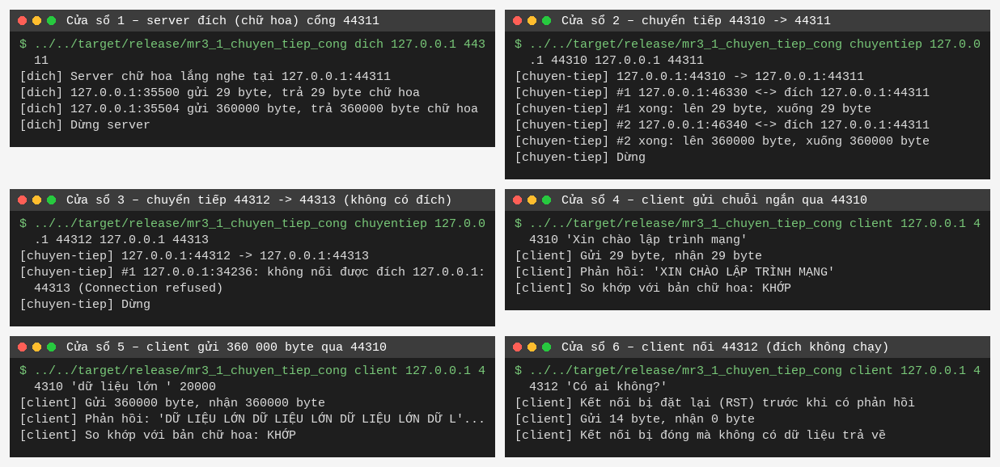

# Bài mở rộng MR3.1 – Bộ chuyển tiếp cổng TCP (TCP port forwarder) (Rust)

| Thông tin | Nội dung |
|---|---|
| Loại | **Bài mở rộng** – không có trong giáo trình, không có mã giả tương ứng |
| Liên hệ với giáo trình | Chương 3: Bài 3.1 (vòng đời socket, `SHUTDOWN` một chiều), Bài 3.2 (`SEND_ALL`); Chương 6: Bài 6.1 (mỗi kết nối một luồng) |
| Thư viện | Thư viện chuẩn Rust: `std::net` (`TcpListener`, `TcpStream`, `Shutdown`), `std::thread`; crate `ctrlc` 3.4.7 (bắt Ctrl+C để in dòng “Dừng”) |
| Bản ngôn ngữ khác | [C#](../../../csharp/Chuong03/BaiMR3.1_ChuyenTiepCong/), [Java](../../../java/Chuong03/BaiMR3.1_ChuyenTiepCong/), [Python](../../../python/Chuong03/BaiMR3.1_ChuyenTiepCong/), [Go](../../../go/Chuong03/BaiMR3.1_ChuyenTiepCong/) |

## Mục tiêu
Viết một bộ chuyển tiếp: mỗi client nối vào cổng nghe được ghép với một kết nối mới tới máy đích, hai luồng bơm dữ liệu theo hai chiều. Điểm mấu chốt là **đóng một chiều (half-close)**: khi một chiều gặp EOF, bộ chuyển tiếp gọi `shutdown(Shutdown::Write)` trên socket bên kia để chuyển tiếp gói FIN, chứ không đóng hẳn, vì chiều ngược lại có thể vẫn đang truyền. Server đích trong bài chỉ trả lời **sau khi** thấy EOF, nên nếu bộ chuyển tiếp làm sai, client và server sẽ chờ nhau mãi. Đây là nguyên lý của `ssh -L`, `socat`, proxy TCP và cân bằng tải lớp 4.

## Kiến thức chính
- `TcpStream::try_clone()` tạo thêm một “tay cầm” tới cùng một socket, nhờ đó một luồng đọc còn luồng khác ghi trên cùng kết nối.
- `read` trả 0 nghĩa là bên kia đã đóng chiều gửi (EOF); `write_all` lặp `write` đến khi gửi hết (`SEND_ALL`).
- `shutdown(Shutdown::Write)` gửi FIN nhưng socket vẫn nhận được dữ liệu; socket chỉ đóng hẳn khi mọi tay cầm bị `drop`.
- Luồng phục vụ `join` cả hai luồng bơm rồi mới đóng hai socket và in số byte mỗi chiều.

## Tệp
- `Cargo.toml`, `Cargo.lock` – gói Cargo `mr3_1_chuyen_tiep_cong`.
- `src/main.rs` – phân nhánh vai trò `dich` / `chuyentiep` / `client`; hàm `loi` in lỗi gọn như `e.strerror` của Python.
- `src/chuyen_tiep.rs` – bộ chuyển tiếp: `serve` (một kết nối), `pump` (một chiều).
- `src/server_dich.rs` – server đích “chữ hoa”: đọc tới EOF rồi trả bản viết hoa.
- `src/client_thu.rs` – client thử: gửi, `shutdown(Write)`, đọc tới EOF, so khớp.
- `demo.json` – kịch bản chạy minh họa (dùng với `tools/demo.py`).
- `ket_qua.txt`, `ket_qua.png` – kết quả thực thi thật.

## Cách chạy
Trong thư mục bài (`cargo build -q --release` một lần, sau đó dùng tệp chạy `../../target/release/mr3_1_chuyen_tiep_cong`, hoặc `cargo run -q --release -- …`):
```bash
# Cửa sổ 1 – server đích
cargo run -q --release -- dich 127.0.0.1 9001
# Cửa sổ 2 – bộ chuyển tiếp 9000 -> 9001
cargo run -q --release -- chuyentiep 127.0.0.1 9000 127.0.0.1 9001
# Cửa sổ 3 – client nối vào cổng chuyển tiếp
cargo run -q --release -- client 127.0.0.1 9000 "Xin chào"
cargo run -q --release -- client 127.0.0.1 9000 "dữ liệu lớn " 20000
```
Dừng server đích và bộ chuyển tiếp bằng Ctrl+C. Kịch bản `demo.json` (cổng 44310–44313) chạy thêm một bộ chuyển tiếp trỏ tới cổng không có server.

Tái lập kết quả từ thư mục gốc của kho: `python3 tools/demo.py rust/Chuong03/BaiMR3.1_ChuyenTiepCong`.

## Kết quả thực thi


Hai client đi qua bộ chuyển tiếp nhận đúng bản chữ hoa, kể cả 360 000 byte (20 000 lần chuỗi 18 byte UTF-8); số byte lên bằng số byte xuống. Server đích chỉ thấy địa chỉ của bộ chuyển tiếp (127.0.0.1 với một cổng tạm), không thấy client gốc – vì vậy proxy thật thường thêm thông tin nguồn (ví dụ giao thức PROXY, tiêu đề `X-Forwarded-For`). Với bộ chuyển tiếp trỏ tới cổng không có server, kết nối tới đích bị từ chối nên bộ chuyển tiếp đóng kết nối của client; client thấy RST và nhận 0 byte. Thông điệp in ra giống bản Python (trừ số cổng).

Đã thử chạy chéo: client Rust → bộ chuyển tiếp Python → server đích Rust (100 000 byte) và client Python qua cùng đường: cả hai KHỚP.

## Bài tập gợi ý
1. Thêm giới hạn số kết nối đồng thời (ví dụ 10) bằng bộ đếm `AtomicUsize`; kết nối thứ 11 bị đóng ngay kèm thông báo.
2. Thêm thời gian chờ rỗi (idle timeout) bằng `set_read_timeout`: chiều nào không có dữ liệu 30 giây thì đóng cả kết nối.
3. Cho bộ chuyển tiếp nhận nhiều đích và luân phiên (round-robin) – một bộ cân bằng tải lớp 4 thu nhỏ.

## Ghi chú
- Khi một bên đóng socket trong lúc bộ đệm nhận vẫn còn dữ liệu chưa đọc, TCP gửi RST thay vì FIN. Ở tình huống đích không chạy, kết quả phụ thuộc thời điểm: nếu dữ liệu của client tới trước lúc đóng, client thấy *Connection reset* (RST); nếu không, client thấy EOF bình thường.
- Rust bỏ qua tín hiệu SIGPIPE nên ghi vào socket đã đóng trả lỗi `BrokenPipe` thay vì làm chết tiến trình.
- Thư viện chuẩn không bắt được Ctrl+C; bài dùng crate `ctrlc` để in “[dich] Dừng server” / “[chuyen-tiep] Dừng” như bản Python.
- Bộ chuyển tiếp không có xác thực hay giới hạn: chỉ nghe trên `127.0.0.1` và chỉ dùng trong máy, mạng phòng thí nghiệm.
- Kiểm thử: Linux, Rust 1.97.0.

## Đọc thêm
- M. O. Faruque Sarker, *Python Network Programming Cookbook*, Packt, 2014, Chương 3 (công thức *Forwarding a local port to a remote host*; bài này viết lại bằng socket và luồng).

Mã nguồn của bài được viết mới cho kho này; sách trên chỉ là tài liệu tham khảo ý tưởng.
