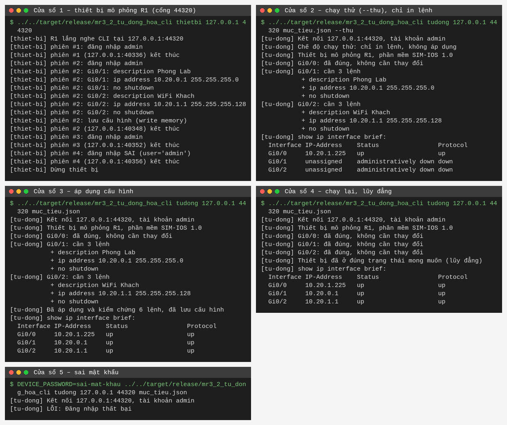

# Bài mở rộng MR3.2 – Tự động hóa cấu hình thiết bị qua CLI (kiểu expect/Netmiko, chỉ dùng socket) (Rust)

| Thông tin | Nội dung |
|---|---|
| Loại | **Bài mở rộng** – không có trong giáo trình, không có mã giả tương ứng |
| Liên hệ với giáo trình | Chương 3: Bài 3.2 (định khung – ở đây là đọc tới dấu nhắc), Bài 3.1; Chương 6: Bài 6.1 (server nhiều phiên); Chương 2: Bài 2.1 (bí mật lấy từ biến môi trường); MR1.1 (địa chỉ trong `muc_tieu.json`) |
| Thư viện | Thư viện chuẩn Rust: `std::net`, `std::io::BufReader`, `std::thread`, `std::sync::Mutex`; crate `regex` 1.13.1 (mẫu dấu nhắc), `serde_json` 1.0.154 (đọc `muc_tieu.json`), `ctrlc` 3.4.7 (in “Dừng thiết bị”) |
| Bản ngôn ngữ khác | [C#](../../../csharp/Chuong03/BaiMR3.2_TuDongHoaCLI/), [Java](../../../java/Chuong03/BaiMR3.2_TuDongHoaCLI/), [Python](../../../python/Chuong03/BaiMR3.2_TuDongHoaCLI/), [Go](../../../go/Chuong03/BaiMR3.2_TuDongHoaCLI/) |

## Mục tiêu
Luyện tự động hóa thiết bị mạng mà không cần thiết bị thật. Thiết bị mô phỏng R1 có CLI kiểu Telnet (đăng nhập, dấu nhắc `R1>` `R1#` `R1(config)#` `R1(config-if)#`, vọng lại lệnh, phân trang `--More--`). Dữ liệu CLI là luồng byte **không có khung thông điệp**, nên client phải *đọc cho tới khi gặp dấu nhắc* (READ_UNTIL bằng biểu thức chính quy) – cùng ý tưởng với `READ_LINE` ở Bài 3.2. Client tự động hóa: đọc cấu hình hiện tại, so với trạng thái mong muốn và **chỉ sinh lệnh cho phần khác biệt** (lũy đẳng – chạy lại không thay đổi gì), có chế độ chạy thử `--thu`, đọc lại để kiểm chứng rồi mới lưu cấu hình.

## Tệp
- `Cargo.toml`, `Cargo.lock` – gói Cargo `mr3_2_tu_dong_hoa_cli`.
- `src/main.rs` – phân nhánh vai trò `thietbi` / `tudong`; hàm `repr` in chuỗi kiểu Python.
- `src/thiet_bi.rs` – thiết bị mô phỏng R1 (server TCP nhiều phiên, trạng thái chung trong `Mutex`).
- `src/tu_dong.rs` – client: `CliSession` (`read_until`, `login`, `command`), `parse_interface`, `diff_commands`.
- `src/ipmask.rs` – đổi `10.20.0.1/24` ⇄ (`10.20.0.1`, `255.255.255.0`), thay cho `ipaddress.ip_interface`.
- `muc_tieu.json` – trạng thái mong muốn của ba cổng (giống bản Python).
- `demo.json` – kịch bản chạy minh họa (dùng với `tools/demo.py`).
- `ket_qua.txt`, `ket_qua.png` – kết quả thực thi thật.

## Cách chạy
Trong thư mục bài (`cargo build -q --release` một lần; `B=../../target/release/mr3_2_tu_dong_hoa_cli`):
```bash
export DEVICE_USER=admin DEVICE_PASSWORD=lab123
$B thietbi 127.0.0.1 9000                     # cửa sổ 1
$B tudong 127.0.0.1 9000 muc_tieu.json --thu  # cửa sổ 2: chỉ in lệnh
$B tudong 127.0.0.1 9000 muc_tieu.json        # áp dụng
$B tudong 127.0.0.1 9000 muc_tieu.json        # chạy lại: không thay đổi
```
Có thể nối tay vào thiết bị bằng `nc 127.0.0.1 9000` (hoặc `telnet`) để gõ lệnh và thấy phân trang `--More--` khi chưa gõ `terminal length 0`. Trên Windows (PowerShell) đặt biến bằng `$env:DEVICE_USER="admin"` và chạy `..\..\target\release\mr3_2_tu_dong_hoa_cli.exe`.

Tái lập kết quả từ thư mục gốc của kho: `python3 tools/demo.py rust/Chuong03/BaiMR3.2_TuDongHoaCLI` (cổng 44320).

## Kết quả thực thi


Lần chạy thử chỉ in 6 lệnh cần cho `Gi0/1`, `Gi0/2` (cổng `Gi0/0` đã đúng) và thiết bị không ghi nhận thay đổi nào. Lần áp dụng gửi đúng 6 lệnh đó, đọc lại để kiểm chứng rồi `write memory`; bảng `show ip interface brief` chuyển hai cổng sang `up`. Lần chạy thứ ba không gửi lệnh cấu hình nào (lũy đẳng). Sai mật khẩu: thiết bị ghi nhận đăng nhập sai, client báo *Đăng nhập thất bại* và thoát với mã 1. Bản Rust in kết quả giống hệt bản Python (trừ số cổng). Đã thử chạy chéo: client Python với thiết bị Rust và client Rust với thiết bị Python đều áp dụng đúng 6 lệnh.

## Ghi chú
- Thiết bị mô phỏng gửi mật khẩu dạng rõ như Telnet. Thiết bị thật phải dùng SSH: Python có Paramiko, Netmiko; Rust có các crate `ssh2` (bọc libssh2) hoặc `russh` (không thuộc thư viện chuẩn). Logic `read_until` dấu nhắc, so sánh và sinh lệnh khác biệt giữ nguyên khi thay kênh Telnet bằng SSH.
- Cú pháp lệnh mô phỏng theo kiểu Cisco IOS nhưng tối giản (ba cổng, một vài lệnh); không phải phần mềm của hãng nào.
- Mẫu dấu nhắc chỉ được so ở **cuối** bộ đệm; dòng kết quả nào kết thúc bằng `#` hoặc `>` đúng lúc gói tin bị chia có thể bị nhầm là dấu nhắc – thư viện thật như Netmiko cũng gặp vấn đề này và cho phép chỉ định mẫu dấu nhắc chặt hơn.
- Thiết bị bọc nửa đọc của socket trong `BufReader` (từ `try_clone()`) để vừa đọc theo dòng (`read_until(b'\n')`) vừa đọc một byte khi chờ phím ở `--More--`; nửa ghi là `TcpStream` gốc.
- `read_until` của client chỉ giải mã phần byte UTF-8 trọn vẹn, phần đuôi bị cắt giữa ký tự (ví dụ chữ “ế” 3 byte rơi vào hai lần `read`) được giữ lại chờ lần đọc sau; Python giải mã từng gói nên có thể lỗi trong trường hợp hiếm này.
- `ipmask::mask_bits` nhận mặt nạ chấm thập phân liên tục hoặc độ dài tiền tố (`24`); `ipaddress.ip_interface` của Python còn nhận cả mặt nạ đảo (hostmask) như `0.0.0.255`.
- Kiểm thử: Linux, Rust 1.97.0.

## Đọc thêm
- Eric Chou, *Mastering Python Networking*, 4th ed., Packt, 2023, Chương 2 *Low-Level Network Device Interactions* (Pexpect, Paramiko, Netmiko; mục *Idempotent network device interaction*).
- Claus Töpke, *Network Programming and Automation Essentials*, Packt, 2023, Chương 3 *Accessing the Network* (CLI, truy cập từ xa an toàn) và Chương 6 (thư viện truy cập thiết bị qua CLI).

Mã nguồn của bài được viết mới cho kho này; sách trên chỉ là tài liệu tham khảo ý tưởng.
