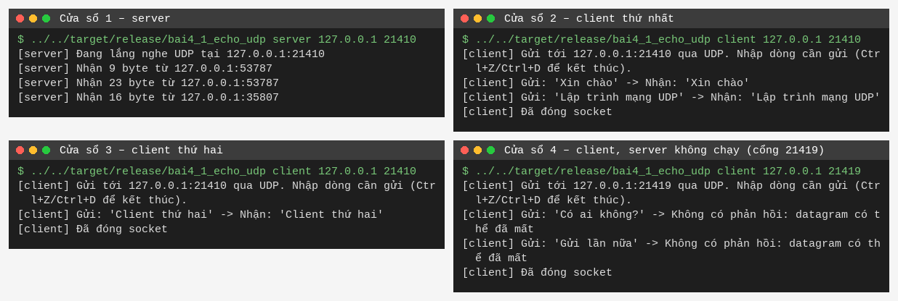

# Bài 4.1 – UDP Echo Server và UDP Echo Client có thời gian chờ (Rust)

| Thông tin | Nội dung |
|---|---|
| Mã giả tương ứng | Mã giả 4.1 (UDP Echo Server), Mã giả 4.2 (UDP Echo Client có thời gian chờ) |
| Mục giáo trình | 4.2.1 Lưu đồ và mã giả; 4.2.2 Socket UDP "có kết nối" (xử lý ICMP port unreachable trên Windows) |
| Kế thừa | Mã giả 2.1 (đọc địa chỉ, cổng); vòng đọc dòng của Mã giả 3.2 |
| Thư viện | Thư viện chuẩn Rust: `std::net::UdpSocket`, `std::io`; không dùng crate ngoài |

## Mục tiêu
Minh họa chuỗi lời gọi của chương trình UDP: server `SOCKET(DGRAM)` – `BIND` – lặp `RECVFROM`/`SENDTO`, không có `LISTEN`/`ACCEPT`; client `SOCKET` – `SENDTO` – `RECVFROM` có thời gian chờ 2 giây. Một socket server phục vụ mọi client; khi server không chạy, client chỉ nhận biết qua việc hết thời gian chờ.

## Tệp
- `Cargo.toml`, `Cargo.lock` – gói Cargo `bai4_1_echo_udp`.
- `src/main.rs` – phân nhánh vai trò `server` / `client`.
- `src/endpoint.rs` – `parse_endpoint` (Mã giả 2.1).
- `src/udp_echo_server.rs` – Mã giả 4.1.
- `src/udp_echo_client.rs` – Mã giả 4.2.
- `demo.json` – kịch bản chạy minh họa (dùng với `tools/demo.py`).
- `ket_qua.txt`, `ket_qua.png` – kết quả thực thi thật.

## Cách chạy
Trong thư mục bài:
```bash
# Cửa sổ 1 – server
cargo run -q --release -- server 0.0.0.0 9000
# Cửa sổ 2, 3 – client
cargo run -q --release -- client 127.0.0.1 9000
```
Nhập vài dòng ở các cửa sổ client; kết thúc client bằng Ctrl+D (Linux/macOS) hoặc Ctrl+Z rồi Enter (Windows). Để quan sát trường hợp mất phản hồi, dừng server (Ctrl+C) rồi gửi tiếp từ client, hoặc chạy client tới một cổng không có server.

## Kết quả thực thi


Hai client lần lượt được phục vụ bởi cùng một socket server; nhật ký server cho thấy hai cổng nguồn khác nhau. Client ở cửa sổ 4 gửi tới cổng 21419 không có server: mỗi datagram đều hết thời gian chờ 2 giây và client in "Không có phản hồi: datagram có thể đã mất".

## Ghi chú
- `SOCKET(INET, DGRAM)` + `BIND` là `UdpSocket::bind`; client gắn socket vào cổng tạm `0.0.0.0:0` (hoặc `[::]:0` nếu địa chỉ server là IPv6) để có cùng họ địa chỉ với server (`SOCKET(FAMILY(server), DGRAM)`).
- `RECV_TIMEOUT` là `set_read_timeout(Some(2000 ms))`. Khi hết thời gian chờ, thư viện chuẩn trả `ErrorKind::WouldBlock` trên Linux/macOS và `ErrorKind::TimedOut` trên Windows, nên chương trình bắt cả hai.
- Server bỏ qua lỗi `ConnectionReset` (Windows báo gói ICMP port unreachable cho lời gọi nhận kế tiếp, kể cả trên socket chưa kết nối – Mục 4.2.2); client coi lỗi này như không có phản hồi. Trên Linux, socket chưa kết nối không nhận lỗi này nên client chỉ thấy hết thời gian chờ, như kết quả ở trên.
- Dòng đọc từ bàn phím được bỏ ký tự xuống dòng trước khi gửi; mỗi dòng là đúng một datagram.
- Server dừng bằng Ctrl+C mà không in dòng "Dừng server" (thư viện chuẩn Rust không bắt tín hiệu Ctrl+C).
- Kiểm thử: Linux, Rust 1.97.0.
