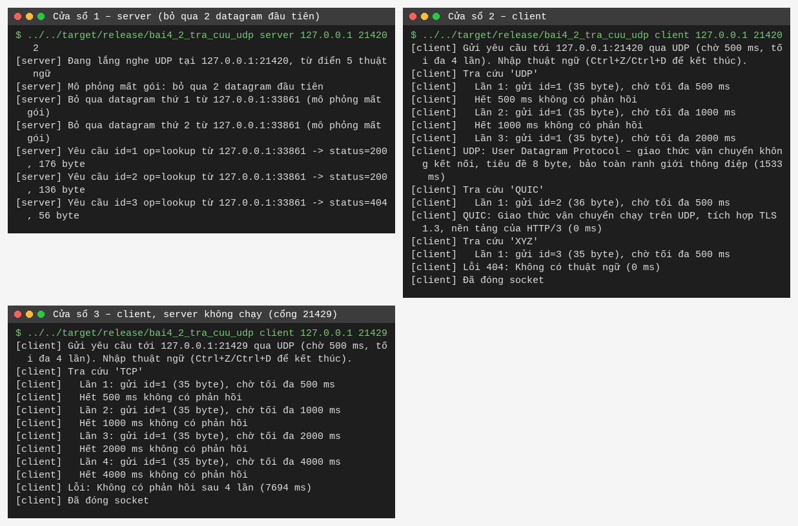

# Bài 4.2 – Dịch vụ tra cứu thuật ngữ trên UDP có gửi lại (Rust)

| Thông tin | Nội dung |
|---|---|
| Mã giả tương ứng | Mã giả 4.3 (Server tra cứu thuật ngữ trên UDP), Mã giả 4.4 (UDP_REQUEST – gửi lại có lùi thời gian, ghép mã định danh) |
| Mục giáo trình | 4.3.1 Dịch vụ tra cứu thuật ngữ trên UDP |
| Kế thừa | Mã giả 4.1, 4.2 (vòng RECVFROM/SENDTO, thời gian chờ); `PROCESS_REQUEST`, `DICT` của server tra cứu TCP (Mục 3.5.1); Mã giả 2.1 |
| Thư viện | Thư viện chuẩn Rust: `std::net::UdpSocket`, `std::time`; crate `serde_json` 1.0.143 (bật `preserve_order`) |

## Mục tiêu
Chuyển dịch vụ tra cứu của Chương 3 sang UDP: mỗi yêu cầu, mỗi phản hồi là một datagram JSON, không cần trường độ dài; yêu cầu mang `id` để ghép phản hồi; client gửi lại tối đa 4 lần với thời gian chờ 500 → 1000 → 2000 → 4000 ms. Server có tham số mô phỏng mất gói (bỏ qua N datagram đầu tiên) để quan sát cơ chế gửi lại.

## Tệp
- `Cargo.toml`, `Cargo.lock` – gói Cargo `bai4_2_tra_cuu_udp`.
- `src/main.rs` – phân nhánh vai trò `server` / `client`.
- `src/endpoint.rs` – `parse_endpoint` (Mã giả 2.1).
- `src/udp_lookup_server.rs` – Mã giả 4.3 và `process_request`.
- `src/udp_lookup_client.rs` – Mã giả 4.4 `udp_request` và vòng đọc thuật ngữ.
- `glossary.json` – từ điển thuật ngữ (giống bản Python).
- `demo.json` – kịch bản chạy minh họa (dùng với `tools/demo.py`).
- `ket_qua.txt`, `ket_qua.png` – kết quả thực thi thật.

## Cách chạy
Trong thư mục bài (nơi có `glossary.json`):
```bash
# Cửa sổ 1 – server, bỏ qua 2 datagram đầu tiên
cargo run -q --release -- server 0.0.0.0 9100 2
# Cửa sổ 2 – client
cargo run -q --release -- client 127.0.0.1 9100
```
Nhập tên thuật ngữ ở cửa sổ client (ví dụ `UDP`, `QUIC`, `XYZ`); tham số thứ ba của server là số datagram đầu tiên bị bỏ qua, bỏ trống hoặc 0 để không mô phỏng mất gói.

## Kết quả thực thi


Server bỏ qua hai datagram đầu tiên nên yêu cầu `UDP` (id=1) chỉ thành công ở lần gửi thứ ba, sau hai lần hết thời gian chờ 500 ms và 1000 ms (tổng khoảng 1,5 giây); cả ba lần gửi mang cùng `id`. Các yêu cầu sau thành công ngay lần đầu; `XYZ` nhận mã 404. Kích thước datagram (35, 176, 136, 56 byte) trùng với các ngôn ngữ khác. Cửa sổ 3 gửi tới cổng không có server: sau 4 lần gửi (chờ tổng cộng 0,5 + 1 + 2 + 4 = 7,5 giây), hàm báo lỗi "Không có phản hồi sau 4 lần".

## Ghi chú
- Thời gian chờ theo phần còn lại tới hạn chót (dòng 8 của mã giả) dùng `set_read_timeout(deadline - now)`, tối thiểu 1 ms (thư viện chuẩn không nhận thời gian chờ bằng 0). Hết thời gian chờ là `ErrorKind::WouldBlock` (Linux/macOS) hoặc `ErrorKind::TimedOut` (Windows).
- Thời gian đo được (1525 ms, 7782 ms) dài hơn bản Python (1503 ms, 7505 ms) vài phần trăm: trong môi trường kiểm thử (Linux chạy trong sandbox gVisor), tùy chọn `SO_RCVTIMEO` mà `set_read_timeout` dùng chờ lâu hơn giá trị đặt khoảng 2–4% (đo riêng: 4000 ms → 4160 ms), còn Python chờ bằng `poll`. Trên Linux thông thường sai khác này không đáng kể.
- Tham số thứ ba của server (số datagram bị bỏ qua) được thêm để mô phỏng mất gói; mã giả không có tham số này.
- Các dòng nhật ký `[client]   Lần k: ...`, `Hết ... ms không có phản hồi` trong hàm gửi yêu cầu là nhật ký minh họa, không có trong Mã giả 4.4. `NEXT_ID()` dùng một bộ đếm `AtomicU64` toàn cục.
- Lỗi `JsonError` của mã giả gồm cả lỗi giải mã UTF-8 và trường hợp JSON hợp lệ nhưng không phải đối tượng (ví dụ `[1,2]`); server trả `{"status":400,"error":"JSON sai","id":null}`.
- `serde_json` ghi JSON dạng gọn, giữ nguyên chữ có dấu; tính năng `preserve_order` đặt trường `id` ở cuối phản hồi như bản Python, nên kích thước datagram giống nhau giữa các ngôn ngữ.
- Theo Mã giả 4.4 (bản hiện hành), client xử lý `ConnectionReset` (Windows báo ICMP port unreachable, Mục 4.2.2) như hết thời gian chờ: thoát vòng chờ và chuyển sang lần gửi kế tiếp. Server bỏ qua lỗi này và tiếp tục nhận.
- Kiểm thử: Linux, Rust 1.97.0.
