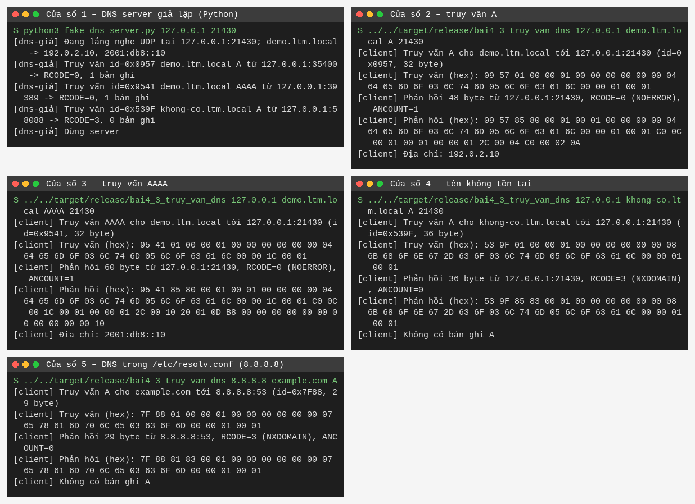

# Bài 4.3 – Tự tạo và phân tích truy vấn DNS qua UDP (Rust)

| Thông tin | Nội dung |
|---|---|
| Mã giả tương ứng | Mã giả 4.5 (BUILD_QUERY, SKIP_NAME, DNS_QUERY) |
| Mục giáo trình | 4.3.2 Tự tạo truy vấn DNS theo RFC 1035 |
| Kế thừa | Client tra cứu DNS của Mục 2.5 – thay `RESOLVE` của hệ điều hành bằng truy vấn tự tạo |
| Thư viện | Thư viện chuẩn Rust: `std::net::UdpSocket`, `Ipv4Addr`, `Ipv6Addr`; crate `getrandom` 0.3.3 (số ngẫu nhiên an toàn cho mã định danh) |

## Mục tiêu
Lập trình một giao thức nhị phân chuẩn: tạo thông điệp truy vấn DNS (tiêu đề 12 byte, QNAME dạng dãy nhãn, QTYPE, QCLASS), gửi qua UDP, kiểm tra địa chỉ nguồn và ID của phản hồi, đọc RCODE, ANCOUNT, nhảy qua tên (kể cả con trỏ nén `C0 0C`) và lấy bản ghi A/AAAA. Phần mã hóa, giải mã thông điệp được tự viết bằng thao tác byte, không dùng thư viện DNS.

## Tệp
- `Cargo.toml`, `Cargo.lock` – gói Cargo `bai4_3_truy_van_dns`.
- `src/main.rs` – Mã giả 4.5 (`build_query`, `need`, `skip_name`, `dns_query`) và chương trình chính.
- `fake_dns_server.py` – DNS server giả lập tối giản (Python, bản sao giống hệt trong thư mục bài của C#, Java, Python; không thuộc mã giả): trả lời bản ghi A `192.0.2.10` và AAAA `2001:db8::10` cho đúng tên `demo.ltm.local`, tên khác trả RCODE = 3 (NXDOMAIN).
- `demo.json` – kịch bản chạy minh họa (dùng với `tools/demo.py`).
- `ket_qua.txt`, `ket_qua.png` – kết quả thực thi thật.

## Cách chạy
Trong thư mục bài:
```bash
# Cửa sổ 1 – DNS server giả lập (cần Python 3)
python3 fake_dns_server.py 127.0.0.1 5353
# Cửa sổ 2 – truy vấn tới server giả lập
cargo run -q --release -- 127.0.0.1 demo.ltm.local A 5353
# Hoặc truy vấn DNS server thật (cổng 53)
cargo run -q --release -- 8.8.8.8 example.com AAAA
```
Tham số: `<ip_dns_server> <ten_mien> [A|AAAA] [cong]`, mặc định kiểu A, cổng 53. Địa chỉ DNS server của máy có thể xem trong `/etc/resolv.conf` (Linux) hoặc bằng `ipconfig /all` (Windows).

## Kết quả thực thi


Truy vấn `demo.ltm.local` dài 32 byte, tiêu đề `xx xx 01 00 00 01 00 00 00 00 00 00` (cờ RD = 1, QDCOUNT = 1); phản hồi chép lại phần câu hỏi, bản ghi trả lời bắt đầu bằng con trỏ nén `C0 0C`, chương trình in đúng `192.0.2.10` và `2001:db8::10`. Tên không tồn tại cho RCODE = 3 (NXDOMAIN). Cửa sổ 5 gửi truy vấn tới DNS server ghi trong `/etc/resolv.conf` của môi trường kiểm thử (8.8.8.8): mạng của môi trường này trả lời NXDOMAIN cho mọi tên (kể cả `example.com`), nên kết quả được ghi lại đúng như nhận được; trên mạng thông thường, lệnh này trả về địa chỉ thật của `example.com`.

## Ghi chú
- Bổ sung so với mã giả, theo đoạn văn ngay sau Mã giả 4.5: kiểm tra mọi chỉ số `pos` không vượt quá độ dài thông điệp (hàm `need`; phản hồi sai định dạng báo "Lỗi giao thức" thay vì đọc ngoài vùng nhớ – trong Rust, đọc ngoài mảng sẽ làm chương trình dừng đột ngột) và kiểm tra cờ TC (bit 0x02 của byte thứ 3) trước khi đọc phần trả lời. `skip_name` không đi theo con trỏ nén nên không cần giới hạn số lần nhảy.
- `UINT16_BE(x)` là `x.to_be_bytes()` khi ghi và `u16::from_be_bytes` khi đọc.
- Theo Mã giả 4.5 (bản hiện hành), `DNS_QUERY` nhận `server = (ip, cổng)` (`SocketAddr`): cổng mặc định 53, đổi được để chạy thử với DNS server giả lập; phép kiểm tra địa chỉ nguồn so sánh với đúng `server`. Socket được tạo cùng họ địa chỉ với `server.ip` (`SOCKET(FAMILY(server.ip), DGRAM)`), nên máy chủ DNS có thể là địa chỉ IPv4 hoặc IPv6 dạng số (môi trường kiểm thử không có IPv6 nên nhánh này chỉ được kiểm tra tới bước tạo socket: hệ điều hành báo `Address family not supported`).
- Bản ghi A/AAAA chỉ được nhận khi RDLENGTH đúng 4/16 byte.
- `RANDOM_UINT16()` dùng `getrandom::fill` (bộ sinh số ngẫu nhiên của hệ điều hành) vì thư viện chuẩn Rust chưa có hàm số ngẫu nhiên; ID thay đổi ở mỗi lần chạy.
- Khác bản Python (tự chuyển tên quốc tế sang Punycode bằng codec `idna`): thư viện chuẩn Rust không có IDNA, nên nhãn không phải ASCII bị từ chối với thông báo yêu cầu nhập dạng Punycode (ví dụ `xn--bcher-kva.de` thay cho `bücher.de`).
- Mã giả chỉ gửi một lần; khi cần, có thể bọc bằng cơ chế gửi lại của Mã giả 4.4.
- Kiểm thử: Linux, Rust 1.97.0.
