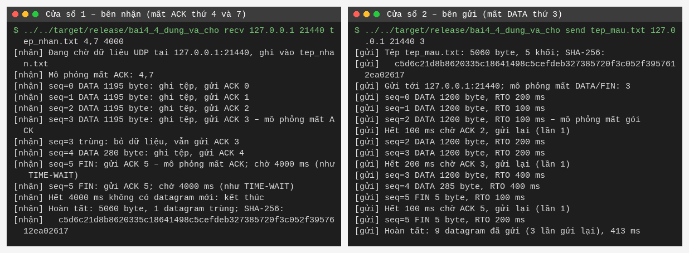

# Bài 4.4 – Truyền tệp tin cậy trên UDP bằng giao thức dừng và chờ (Rust)

| Thông tin | Nội dung |
|---|---|
| Mã giả tương ứng | Mã giả 4.6 (SAW_SEND – bên gửi), Mã giả 4.7 (SAW_RECEIVE – bên nhận) |
| Mục giáo trình | 4.4.1 Số thứ tự, xác nhận và truyền lại; 4.4.2 Ước lượng thời gian khứ hồi và thời gian chờ (RFC 6298) |
| Kế thừa | Mã giả 4.4 (chờ phản hồi đúng địa chỉ, đúng mã trong phần thời gian còn lại); Mã giả 4.1 (vòng RECVFROM/SENDTO); Mã giả 2.1 |
| Thư viện | Thư viện chuẩn Rust: `std::net::UdpSocket`, `std::time`, `std::fs`; crate `sha2` 0.10.9 (SHA-256) |

## Mục tiêu
Cài đặt độ tin cậy ở tầng ứng dụng: datagram có tiêu đề 5 byte (số thứ tự 32 bit, byte loại DATA/ACK/FIN), bên gửi chờ ACK đúng số thứ tự với RTO ước lượng theo RFC 6298 (SRTT, RTTVAR, nhân đôi khi hết thời gian chờ, thuật toán Karn), bên nhận luôn gửi ACK, bỏ datagram trùng và chờ thêm sau FIN như TIME-WAIT. Có tham số mô phỏng mất gói ở cả hai phía; tính đúng đắn được kiểm tra bằng mã băm SHA-256 của tệp gửi và tệp nhận.

## Tệp
- `Cargo.toml`, `Cargo.lock` – gói Cargo `bai4_4_dung_va_cho`.
- `src/main.rs` – phân nhánh vai trò `send` / `recv`.
- `src/saw_send.rs` – Mã giả 4.6, `RttEstimator` (RFC 6298), `wait_ack`.
- `src/saw_recv.rs` – Mã giả 4.7.
- `src/saw_common.rs` – hằng số, tiêu đề 5 byte, bộ mô phỏng mất gói `LossSim`, SHA-256 của tệp.
- `src/endpoint.rs` – `parse_endpoint` (Mã giả 2.1).
- `tep_mau.txt` – tệp mẫu 5 060 byte dùng trong demo (giống bản C#, Python).
- `demo.json` – kịch bản chạy minh họa (dùng với `tools/demo.py`).
- `ket_qua.txt`, `ket_qua.png` – kết quả thực thi thật.

## Cách chạy
Trong thư mục bài:
```bash
# Cửa sổ 1 – bên nhận, mất ACK gửi đi thứ 4 và 7
cargo run -q --release -- recv 0.0.0.0 9000 tep_nhan.txt 4,7 4000
# Cửa sổ 2 – bên gửi, mất datagram gửi đi thứ 3
cargo run -q --release -- send tep_mau.txt 127.0.0.1 9000 3
```
Tham số thứ năm của bên nhận (tùy chọn) là thời gian chờ sau FIN tính bằng ms, mặc định 2 × `MAX_RTO` = 120 000 ms như mã giả; ví dụ trên rút xuống 4000 ms để không phải chờ 2 phút. Tham số mô phỏng mất gói (tùy chọn): `0.1` – mỗi datagram gửi đi mất ngẫu nhiên với xác suất 10% (bài tập 4.32); `3,7` – mất đúng datagram gửi đi thứ 3 và thứ 7, đếm cả lần gửi lại; bỏ trống – không mất gói. Đối chiếu mã SHA-256 in ở hai cửa sổ, hoặc dùng `sha256sum` (Linux), `certutil -hashfile tep_nhan.txt SHA256` (Windows).

## Kết quả thực thi


Datagram DATA `seq=2` bị mất ở bên gửi: sau 100 ms không có ACK, bên gửi nhân đôi RTO lên 200 ms và gửi lại. ACK của `seq=3` bị mất ở bên nhận: bên gửi gửi lại `seq=3`, bên nhận nhận ra datagram trùng, bỏ dữ liệu nhưng vẫn gửi ACK. ACK của FIN bị mất: bên gửi gửi lại FIN, bên nhận (đang chờ như TIME-WAIT, rút gọn còn 4 000 ms trong kịch bản) trả lời ACK lần nữa nên bên gửi kết thúc thành công. Sau mẫu RTT hợp lệ của `seq=4`, RTO trở về 100 ms. Hai mã SHA-256 trùng nhau, xác nhận tệp nhận đúng từng byte. Diễn biến trùng khớp từng dòng với bản Python.

## Ghi chú
- `MAX_RTO` = 60 000 ms như Mã giả 4.6 (bản hiện hành; trần RFC 6298 cho phép): `BACKOFF_RTO` nhân đôi RTO nhưng không vượt giá trị này, và bên nhận mặc định chờ 2 × `MAX_RTO` = 120 000 ms sau FIN. RTO ban đầu 200 ms và RTO tối thiểu 100 ms được chọn cho mạng nội bộ (mã giả lấy ví dụ RTO ban đầu 1 000 ms; Mục 4.4.2 cho phép giá trị nhỏ hơn sau khi đo). Thời gian chờ sau FIN rút ngắn được bằng tham số thứ năm của bên nhận (thêm cho kịch bản minh họa, không có trong mã giả). α = 1/8, β = 1/4, K = 4, G = 1 ms theo RFC 6298.
- `FIN_MARK` của mã giả được biểu diễn bằng `None` trong danh sách `Option<&[u8]>` (các khối dữ liệu là `Some(khối)`).
- Bộ mô phỏng mất gói (`LossSim`) được thêm cho bài thực hành, không có trong mã giả: datagram "mất" không được gửi ra socket nhưng vẫn được ghi nhật ký. Thư viện chuẩn Rust chưa có hàm số ngẫu nhiên; xác suất mất gói dùng giá trị băm của `std::hash::RandomState` (mỗi lần tạo mang khóa ngẫu nhiên), đủ cho mô phỏng nhưng không dùng cho mật mã.
- `WAIT_ACK` (mã giả chỉ gọi tên) được cài đặt theo khuôn của Mã giả 4.4: chờ trong phần thời gian còn lại (`set_read_timeout`), bỏ datagram từ địa chỉ khác, không phải ACK hoặc sai số thứ tự; hết thời gian chờ là `ErrorKind::WouldBlock` (Linux/macOS) hoặc `TimedOut` (Windows), và `ConnectionReset` (Windows báo ICMP port unreachable) được xử lý như hết thời gian chờ, giống các client UDP khác.
- Bên nhận ghi trực tiếp vào tệp đích và nhận datagram từ mọi địa chỉ như mã giả; chương trình thật nên ghi vào tệp tạm và chỉ chấp nhận một bên gửi.
- Kiểm thử bổ sung ngoài demo: tệp ngẫu nhiên 300 000 byte, mất ngẫu nhiên 10% ở cả hai phía, chéo ngôn ngữ (Rust gửi → Python nhận, Python gửi → Rust nhận): cả hai lần mã SHA-256 đều trùng.
- Kiểm thử: Linux, Rust 1.97.0.
