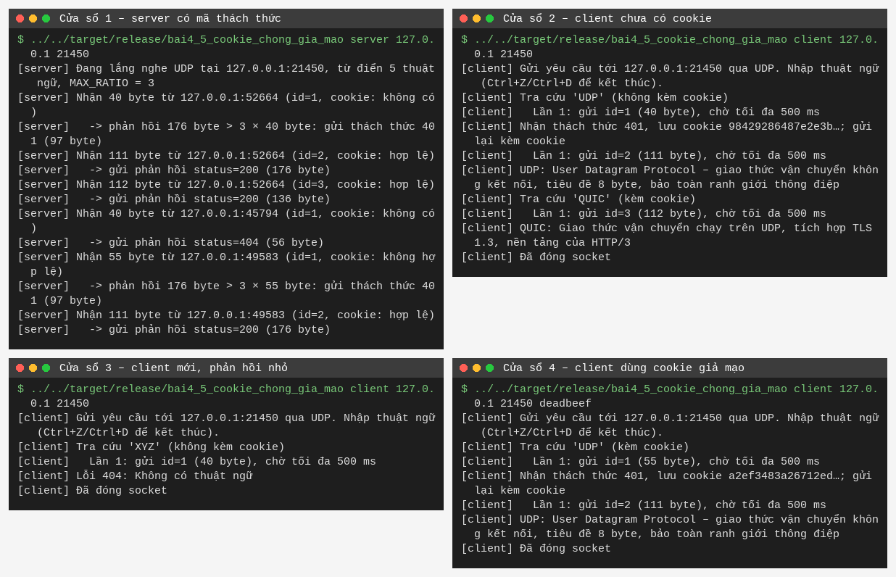

# Bài 4.5 – Xác thực địa chỉ nguồn bằng mã thách thức không trạng thái (Rust)

| Thông tin | Nội dung |
|---|---|
| Mã giả tương ứng | Mã giả 4.8 (COOKIE, HANDLE_DATAGRAM); phía client theo đoạn văn sau Mã giả 4.8 |
| Mục giáo trình | 4.6.1 Giả mạo địa chỉ nguồn và tấn công khuếch đại |
| Kế thừa | Mã giả 4.3 (server tra cứu UDP, `PROCESS_REQUEST`) – thay thân vòng lặp bằng `HANDLE_DATAGRAM`; Mã giả 4.4 (`UDP_REQUEST`) ở client; Mã giả 2.1 |
| Thư viện | Thư viện chuẩn Rust: `std::net::UdpSocket`, `std::time`; crate `serde_json` 1.0.143 (bật `preserve_order`), `sha2` 0.10.9 (SHA-256), `getrandom` 0.3.3 (khóa ngẫu nhiên) |

## Mục tiêu
Chống bị lợi dụng cho tấn công phản xạ và khuếch đại: với địa chỉ chưa xác thực, server không gửi phản hồi lớn hơn `MAX_RATIO` = 3 lần yêu cầu mà gửi thách thức nhỏ (mã 401 kèm cookie). Cookie = HMAC-SHA256(KEY, "ip:cổng:w") với w là khung thời gian 1 phút, nên server không cần lưu trạng thái; client nhận cookie, gửi lại yêu cầu kèm cookie và được phục vụ.

## Tệp
- `Cargo.toml`, `Cargo.lock` – gói Cargo `bai4_5_cookie_chong_gia_mao`.
- `src/main.rs` – phân nhánh vai trò `server` / `client`.
- `src/udp_cookie_server.rs` – Mã giả 4.8 (`cookie`, `handle_datagram`), `process_request`, HMAC-SHA256 tự viết theo RFC 2104 (kèm phép thử với RFC 4231, chạy bằng `cargo test`) và hàm so sánh thời gian hằng.
- `src/udp_cookie_client.rs` – client lưu và gửi lại cookie; `udp_request` (Mã giả 4.4).
- `src/endpoint.rs` – `parse_endpoint` (Mã giả 2.1).
- `glossary.json` – từ điển thuật ngữ (giống bản Python).
- `demo.json` – kịch bản chạy minh họa (dùng với `tools/demo.py`).
- `ket_qua.txt`, `ket_qua.png` – kết quả thực thi thật.

## Cách chạy
Trong thư mục bài (nơi có `glossary.json`):
```bash
# Cửa sổ 1 – server
cargo run -q --release -- server 0.0.0.0 9100
# Cửa sổ 2 – client
cargo run -q --release -- client 127.0.0.1 9100
# Cửa sổ 3 – client dùng cookie giả mạo
cargo run -q --release -- client 127.0.0.1 9100 deadbeef
```
Nhập tên thuật ngữ ở cửa sổ client. Tham số thứ ba của client (thêm cho bài thực hành) là cookie ban đầu, dùng để mô phỏng client gửi cookie giả mạo hoặc cookie của địa chỉ khác. Kiểm tra hàm HMAC tự viết: `cargo test --release`.

## Kết quả thực thi


Yêu cầu `UDP` đầu tiên chưa có cookie được client đệm khoảng trắng lên 40 byte; phản hồi 176 byte > 3 × 40 byte, nên server chỉ gửi thách thức 401 dài 97 byte (≤ 120 byte); client lưu cookie, gửi lại kèm cookie và được phục vụ; yêu cầu `QUIC` sau đó dùng lại cookie và được phục vụ ngay. Client mới hỏi `XYZ` không cần cookie vì phản hồi 404 (56 byte) không vượt 3 lần yêu cầu (40 byte). Client dùng cookie giả mạo `deadbeef` bị server đánh giá "không hợp lệ" và nhận thách thức như client chưa có cookie. Kích thước các datagram trùng với bản Python.

## Ghi chú
- HMAC-SHA256 được tự viết (khoảng 15 dòng, dựa trên crate `sha2`) thay vì thêm crate `hmac`, để thấy rõ cấu trúc H((K ⊕ opad) ‖ H((K ⊕ ipad) ‖ m)); phép thử `hmac_rfc4231_case2` đối chiếu với giá trị chuẩn của RFC 4231.
- `KEY ← RANDOM_BYTES(32)` dùng `getrandom::fill` (bộ sinh số ngẫu nhiên an toàn của hệ điều hành) vì thư viện chuẩn Rust chưa có hàm số ngẫu nhiên.
- Theo Mã giả 4.8 (bản hiện hành): datagram lớn hơn `MAX_DGRAM` = 1200 byte, không phải JSON hoặc không phải đối tượng bị bỏ im lặng (server chỉ ghi nhật ký cục bộ, không trả lời); phản hồi 413 của Mã giả 4.3 không còn trong `HANDLE_DATAGRAM`.
- `SAFE_EQUAL` là hàm `safe_equal`: so sánh thời gian hằng (gộp mọi khác biệt bằng phép XOR rồi mới kết luận) để tránh lộ thông tin qua thời gian xử lý.
- Client gửi lại kèm cookie đúng một lần cho mỗi thuật ngữ để tránh lặp vô hạn nếu server liên tục thách thức.
- Khóa `KEY` được sinh ngẫu nhiên mỗi lần khởi động server nên cookie cũ mất hiệu lực sau khi server khởi động lại; server chấp nhận cookie của khung thời gian hiện tại và khung liền trước (tối đa khoảng 2 phút).
- Chính thông điệp thách thức cũng bị giới hạn bởi `MAX_RATIO`: nếu nó vượt 3 lần yêu cầu (ví dụ yêu cầu `{"op":"list"}` 13 byte không đệm), server bỏ im lặng. Vì vậy client đệm yêu cầu chưa có cookie bằng khoảng trắng lên `MIN_FIRST_REQ` = 40 byte (3 × 40 = 120 byte ≥ thách thức khoảng 100 byte), tương tự gói Initial ≥ 1200 byte của QUIC. Giá trị 40 được chọn vừa đủ để vẫn minh họa được thách thức; mã giả không quy định con số cụ thể.
- Kiểm thử: Linux, Rust 1.97.0.
