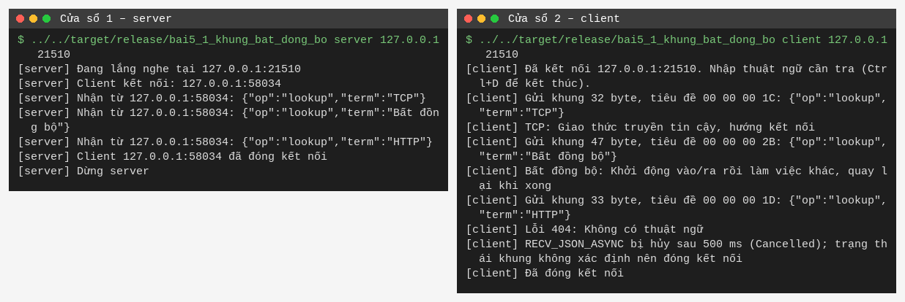

# Bài 5.1 – Các hàm gửi, nhận khung JSON bất đồng bộ (Rust)

| Thông tin | Nội dung |
|---|---|
| Mã giả tương ứng | Mã giả 5.1 (Các hàm gửi, nhận khung JSON bất đồng bộ) |
| Mục giáo trình | 5.2.4 Các hàm socket bất đồng bộ; 5.4.1 Hủy tác vụ hợp tác |
| Kế thừa | Mã giả 3.3 (SEND_ALL), 3.4 (RECV_EXACT), 3.6 (khung JSON), 3.7 (PROCESS_REQUEST), 3.8 (LOOKUP_CLIENT), 2.1 (PARSE_ENDPOINT), 2.2 (SAFE_CONNECT) |
| Thư viện | Crate `tokio` 1.47.1 (vòng lặp sự kiện, socket bất đồng bộ, `select!`, `watch`), `serde_json` 1.0.143 (bật `preserve_order`) |

## Mục tiêu
Chuyển các hàm định khung của Mục 3.4 sang bất đồng bộ theo đúng quy tắc của Mục 5.2.4: mỗi lời gọi vào/ra được thay bằng phiên bản bất đồng bộ kèm `.await`, logic giữ nguyên, và mỗi hàm nhận thêm tín hiệu hủy `ct`. Server tra cứu dùng các hàm này phục vụ mỗi kết nối bằng một tác vụ riêng; client in 4 byte tiêu đề của từng khung để đối chiếu với giải thích bước (6) và minh họa việc hủy một lời gọi nhận đang chờ bằng tín hiệu hủy (Mục 5.4.1).

## Tệp
- `Cargo.toml`, `Cargo.lock` – gói Cargo `bai5_1_khung_bat_dong_bo`.
- `src/main.rs` – phân nhánh vai trò `server` / `client`; khởi động vòng lặp sự kiện một luồng (`#[tokio::main(flavor = "current_thread")]`).
- `src/khung_json_async.rs` – `CancelToken` (tín hiệu hủy `ct`), `recv_exact_async`, `recv_json_async`, `send_json_async`, `parse_endpoint`, `safe_connect_async`, các kiểu lỗi `FrameError`, `NetError`.
- `src/frame_server.rs` – server tra cứu bất đồng bộ (mỗi kết nối một tác vụ `tokio::spawn`).
- `src/frame_client.rs` – client tra cứu, in tiêu đề khung và minh họa hủy.
- `demo.json` – kịch bản chạy minh họa (dùng với `tools/demo.py`).
- `ket_qua.txt`, `ket_qua.png` – kết quả thực thi thật.

## Cách chạy
Mở hai cửa sổ dòng lệnh trong thư mục bài:
```bash
# Cửa sổ 1 – server
cargo run -q --release -- server 0.0.0.0 9100
# Cửa sổ 2 – client
cargo run -q --release -- client 127.0.0.1 9100
```
Nhập từng thuật ngữ (ví dụ `TCP`), kết thúc bằng Ctrl+D (Linux/macOS) hoặc Ctrl+Z rồi Enter (Windows). Dừng server bằng Ctrl+C. Lần biên dịch đầu Cargo tải và biên dịch `tokio` (cần Internet một lần).

## Kết quả thực thi


Ba khung có độ dài nội dung 28, 43 và 29 byte (tiêu đề `00 00 00 1C`, `00 00 00 2B`, `00 00 00 1D`, giống hệt các ngôn ngữ khác): chuỗi "Bất đồng bộ" có 11 ký tự nhưng chiếm nhiều byte hơn trong UTF-8, nên độ dài khung luôn tính bằng byte. Thuật ngữ không có trong từ điển nhận mã 404. Lời gọi nhận cuối bị hủy sau 500 ms; client đóng kết nối thay vì dùng tiếp, và server nhận biết client đóng đúng ranh giới khung (`received = 0`) nên kết thúc phiên bình thường.

## Ghi chú
- Ánh xạ khái niệm sang Rust/tokio: tác vụ là `Future` (chạy song song bằng `tokio::spawn`), `AWAIT` là `.await`, `ASYNC FUNCTION` là `async fn`; vòng lặp sự kiện một luồng giống asyncio của Python.
- Tín hiệu hủy `ct`: tokio không có sẵn kiểu `CancellationToken` trong crate chính, nên bài tự viết `CancelToken` (khoảng 20 dòng) dựa trên kênh `tokio::sync::watch`. Mỗi điểm chờ trong `recv_exact_async`, `send_json_async` dùng `tokio::select!` chờ đồng thời dữ liệu và tín hiệu hủy; nhánh nào xong trước thì thắng, nhánh còn lại bị bỏ. Bị hủy thì hàm trả `FrameError::Cancelled`, đúng như ngoại lệ `Cancelled` của mã giả.
- `SEND_ALL_ASYNC` là `write_all(...).await`; `RECV_ASYNC` là `read(...).await`. `AsyncReadExt::read_exact` làm sẵn việc của `RECV_EXACT_ASYNC`, nhưng bài viết vòng lặp tường minh để đối chiếu với mã giả (và để báo đúng số byte đã nhận khi kết nối đóng).
- Các hàm nhận tham số kiểu `impl AsyncRead + Unpin` / `impl AsyncWrite + Unpin`, nên dùng được với cả `TcpStream` lẫn nửa đọc/nửa ghi của nó (Bài 5.4).
- Server không có trong mã giả 5.1; server dùng lại nghiệp vụ của Mã giả 3.7 với từ điển nhỏ viết sẵn trong mã thay cho tệp `glossary.json`. Thời gian chờ nhận 5000 ms của client dùng `tokio::time::timeout`. Server bắt Ctrl+C bằng `tokio::signal::ctrl_c()` và in "Dừng server".
- Bàn phím được đọc bằng `tokio::task::spawn_blocking` (luồng phụ) để không chặn vòng lặp sự kiện, tương ứng `asyncio.to_thread` của bản Python.
- Kiểm thử: Linux, Rust 1.97.0, tokio 1.47.1.
