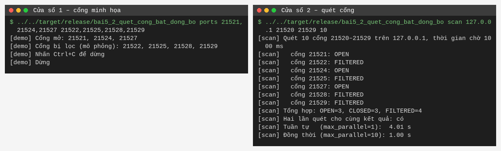

# Bài 5.2 – Kiểm tra nhiều cổng đồng thời có giới hạn (Rust)

| Thông tin | Nội dung |
|---|---|
| Mã giả tương ứng | Mã giả 5.2 (Kiểm tra nhiều cổng đồng thời có giới hạn) |
| Mục giáo trình | 5.2.5 Thực hiện nhiều tác vụ đồng thời |
| Kế thừa | Mã giả 1.2 (PORT_CHECK), Mã giả 1.1 (RESOLVE_HOST) |
| Thư viện | Crate `tokio` 1.47.1 (`Semaphore`, `spawn`, `TcpStream::connect`, `TcpSocket`, `time::timeout`) |

## Mục tiêu
Cài đặt `SCAN_PORTS` và `CHECK_ONE`: khởi động một tác vụ kiểm tra cho mỗi cổng mà chưa chờ, giới hạn số kết nối đồng thời bằng semaphore và chờ tất cả bằng `WHEN_ALL`. Chương trình quét cùng một dải cổng hai lần, tuần tự (`max_parallel` = 1) và đồng thời (`max_parallel` = k), để kiểm chứng công thức thời gian xấu nhất ⌈N/k⌉·t của Mục 5.2.5.

## Tệp
- `Cargo.toml`, `Cargo.lock` – gói Cargo `bai5_2_quet_cong_bat_dong_bo`.
- `src/main.rs` – phân nhánh vai trò `scan` / `ports`.
- `src/scan_async.rs` – `port_check_async`, `check_one`, `scan_ports`; quét tuần tự rồi đồng thời và in thời gian.
- `src/demo_ports.rs` – mở các cổng minh họa (mở, bị lọc) trên 127.0.0.1.
- `demo.json` – kịch bản chạy minh họa (dùng với `tools/demo.py`).
- `ket_qua.txt`, `ket_qua.png` – kết quả thực thi thật.

## Cách chạy
```bash
# Cửa sổ 1 – mở cổng minh họa
cargo run -q --release -- ports 9003,9011,9017 9005,9008,9013,9019
# Cửa sổ 2 – quét dải 9000–9019, k = 10
cargo run -q --release -- scan 127.0.0.1 9000 9019 10
```

## Kết quả thực thi


Để giữ đúng dải cổng dành cho bài (21520–21529), kịch bản Rust quét 10 cổng thay vì 20 cổng như bản Python: 3 cổng mở, 4 cổng bị lọc (mô phỏng) và 3 cổng đóng. Mỗi cổng bị lọc chờ hết 1000 ms, nên quét tuần tự mất khoảng 4 × 1 s = 4,01 s, còn quét đồng thời với k = 10 mất khoảng ⌈4/10⌉ × 1 s = 1,00 s; cổng đóng và cổng mở trả lời gần như tức thời qua loopback. Hai lần quét cho cùng kết quả.

## Ghi chú
- `ACQUIRE_ASYNC … FINALLY RELEASE` được viết bằng `let _permit = gate.acquire().await`: lượt của semaphore tự được trả khi `_permit` ra khỏi phạm vi, kể cả khi kiểm tra lỗi. `WHEN_ALL` được cài bằng cách `tokio::spawn` mọi tác vụ trước (chưa chờ), sau đó lần lượt `.await` các `JoinHandle`, giữ đúng thứ tự cổng (tương đương `asyncio.gather`).
- `CONNECT_TIMEOUT` dùng `tokio::time::timeout(1000 ms, TcpStream::connect(...))`; khi hết giờ, tác vụ kết nối dở bị hủy và socket được đóng.
- Cổng "bị lọc" được mô phỏng trên loopback: `TcpSocket::listen(1)` tạo socket lắng nghe với backlog 1 (thư viện chuẩn `std::net::TcpListener` không cho đặt backlog, `tokio::net::TcpSocket` thì cho), không bao giờ chấp nhận kết nối; chương trình minh họa tự lấp đầy hàng đợi; khi hàng đợi đầy, Linux bỏ qua gói SYN mới nên phía quét hết thời gian chờ giống như gặp tường lửa. Trên Windows, hàng đợi đầy thường được trả lời bằng RST, khi đó các cổng này hiện là CLOSED.
- Như Mục 1.2.5, chương trình kiểm tra nhiều cổng chỉ được chạy trên hệ thống thuộc quyền quản lý hoặc trong mạng thí nghiệm cô lập; kịch bản minh họa chỉ quét 127.0.0.1.
- Kiểm thử: Linux, Rust 1.97.0, tokio 1.47.1.
