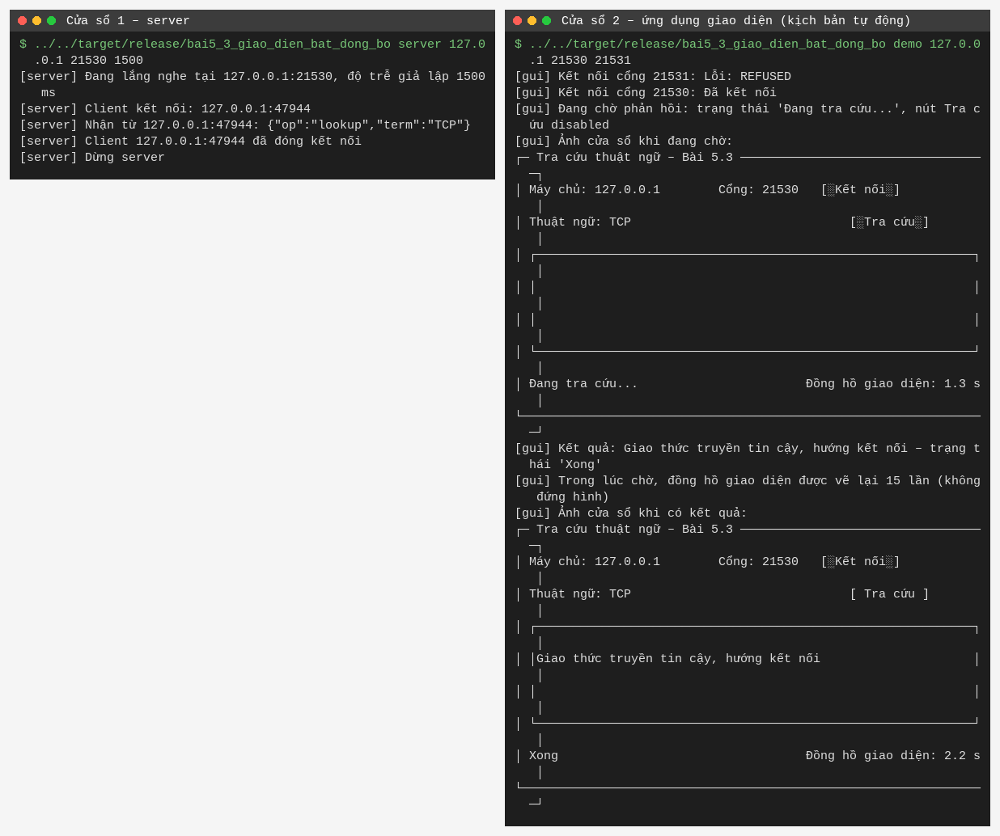

# Bài 5.3 – Ứng dụng tra cứu có giao diện bất đồng bộ (Rust)

| Thông tin | Nội dung |
|---|---|
| Mã giả tương ứng | Mã giả 5.3 (Cách (1): luồng nền và UI_INVOKE), Mã giả 5.4 (Cách (2): trình xử lý sự kiện bất đồng bộ) |
| Mục giáo trình | 5.3.1 Mô hình luồng giao diện đơn, 5.3.2 Ba cách tiếp cận, 5.3.5 Tranh chấp và quản lý trạng thái |
| Kế thừa | Mã giả 2.2 (SAFE_CONNECT), 3.7 (server tra cứu), 3.8 (một lượt tra cứu), 5.1 (khung JSON bất đồng bộ) |
| Thư viện | Crate `tokio` 1.47.1 (vòng lặp sự kiện một luồng, `LocalSet`/`spawn_local`, `mpsc`, `interval`), `serde_json` 1.0.143; giao diện vẽ bằng ký tự với mã điều khiển ANSI của terminal, không dùng thư viện giao diện |

## Mục tiêu
Kết hợp socket với giao diện theo hai cách tiếp cận của Mục 5.3.2. Nút Kết nối dùng cách (1): luồng nền gọi `SAFE_CONNECT` chặn rồi chuyển kết quả về luồng giao diện bằng `UI_INVOKE` (Mã giả 5.3). Nút Tra cứu dùng cách (2): trình xử lý sự kiện bất đồng bộ gửi yêu cầu và chờ phản hồi mà không chặn luồng giao diện (Mã giả 5.4). Một đồng hồ trên cửa sổ cập nhật mỗi 100 ms để kiểm chứng giao diện không đứng hình khi server trả lời chậm.

## Vì sao giao diện là "cửa sổ ký tự" trên terminal
Rust không có thư viện giao diện đồ họa trong thư viện chuẩn; các thư viện đồ họa (GTK, egui, iced…) kéo theo hàng trăm crate và thư viện hệ thống, quá nặng cho một bài minh họa. Bài chọn cách đơn giản nhưng giữ đúng mô hình của Mục 5.3.1:
- Luồng chính là **luồng giao diện**, chạy một **vòng lặp thông điệp** (`run_gui`): mỗi vòng nhận một thông điệp – nhịp đồng hồ 100 ms, một lệnh bàn phím (tương đương bấm nút), hoặc một việc do `UI_INVOKE` gửi tới – xử lý xong thì vẽ lại cửa sổ.
- Các "điều khiển" (ô nhập, nút, nhãn trạng thái) là trường của `Window`, đặt trong `Rc<RefCell<Window>>`. Kiểu `Rc` không được phép chuyển sang luồng khác, nên **trình biên dịch Rust bảo đảm** chỉ luồng giao diện chạm được vào điều khiển – đúng quy tắc mà WinForms, Swing chỉ kiểm tra lúc chạy.
- `UI_INVOKE` là gửi một closure vào kênh `tokio::sync::mpsc`; vòng lặp thông điệp chạy closure đó trên luồng giao diện (giống `Control.BeginInvoke`, `SwingUtilities.invokeLater`).
- Cách (2): trình xử lý nút Tra cứu là một tác vụ `spawn_local` trên chính luồng giao diện (vòng lặp sự kiện tokio một luồng + `LocalSet`), nên sau mỗi `.await` mã chạy tiếp trên luồng giao diện và gán trực tiếp `txt_result`, `lbl_status` mà không cần `UI_INVOKE` – tương đương `SynchronizationContext` của .NET và cách Python chạy Tk trong vòng lặp asyncio.

Cách dùng web UI (server HTTP + SSE) đã được cân nhắc nhưng không chọn: khi đó luồng giao diện thật là JavaScript trong trình duyệt, còn mã Rust chỉ là phần phụ trợ, không minh họa được `UI_INVOKE` và trình xử lý bất đồng bộ phía Rust.

## Tệp
- `Cargo.toml`, `Cargo.lock` – gói Cargo `bai5_3_giao_dien_bat_dong_bo`.
- `src/main.rs` – phân nhánh vai trò `server` / `gui` / `demo`; tạo `LocalSet` cho luồng giao diện.
- `src/lookup_gui.rs` – `Window`, `UiHandle` (`UI_INVOKE`), `on_connect_click`, `connect_worker` (cách 1), `on_lookup_click` (cách 2), `close`, vòng lặp thông điệp `run_gui`, hàm vẽ `render`.
- `src/demo_gui.rs` – kịch bản thao tác tự động trên cửa sổ (tương ứng `demo_gui.py`), in "ảnh chụp" cửa sổ ở dạng ký tự.
- `src/lookup_server.rs` – server tra cứu tối giản có độ trễ giả lập (từ Bài 5.1).
- `src/khung_json_async.rs` – khung JSON bất đồng bộ (Mã giả 5.1), `CancelToken` và `safe_connect` bản chặn (Mã giả 2.2).
- `demo.json` – kịch bản chạy minh họa (dùng với `tools/demo.py`).
- `ket_qua.txt`, `ket_qua.png` – kết quả thực thi thật (nhật ký của server và của kịch bản, gồm hai ảnh cửa sổ ký tự).

## Cách chạy
```bash
# Cửa sổ 1 – server, trả lời chậm 1500 ms
cargo run -q --release -- server 0.0.0.0 9100 1500
# Cửa sổ 2 – ứng dụng giao diện (cần terminal hỗ trợ mã ANSI: Linux, macOS, Windows Terminal)
cargo run -q --release -- gui 127.0.0.1 9100
```
Trong cửa sổ giao diện, gõ lệnh ở dòng `>` rồi Enter: `k [máy] [cổng]` – bấm Kết nối (có thể sửa máy chủ, cổng); `t <thuật ngữ>` – nhập thuật ngữ và bấm Tra cứu; `q` – đóng cửa sổ. Trong lúc chờ server, đồng hồ vẫn chạy và nút Tra cứu hiện `[░Tra cứu░]` (bị tắt). Kịch bản tự động: `cargo run -q --release -- demo 127.0.0.1 9100 9101`.

## Kết quả thực thi


Kịch bản bấm Kết nối tới cổng không có server: luồng nền báo `Lỗi: REFUSED` qua `UI_INVOKE` và nút Kết nối được bật lại. Bấm Kết nối tới đúng cổng rồi Tra cứu "TCP": ảnh cửa sổ thứ nhất được in khi đang chờ server (độ trễ giả lập 1500 ms) – trạng thái "Đang tra cứu...", nút Tra cứu bị tắt (chống bấm lặp), đồng hồ vẫn chạy; ảnh thứ hai khi đã có kết quả – nội dung hiển thị, trạng thái "Xong", nút được bật lại. Trong khoảng 1,5 s chờ, đồng hồ được vẽ lại 15 lần, giống bản Python (15) và Java (16). Chế độ tương tác `gui` cũng đã được chạy thử trong một terminal giả (`script`): kết nối, tra cứu `UDP` và `XYZ` (hiện `(404) Không có thuật ngữ`) rồi đóng cửa sổ.

## Ghi chú
- Trong Mã giả 5.4, `conn` là trường của cửa sổ, mở khi nạp cửa sổ; bài mở kết nối bằng nút Kết nối (cách 1) rồi chuyển socket chặn thành socket tokio (`TcpStream::from_std`) và lưu vào `Window::conn`. Mã giả 5.3 không nêu nơi lưu `conn` sau khi luồng nền kết nối xong; bài dùng thêm một `UI_INVOKE(attach, conn)` cho việc này (giống bản Python).
- `on_lookup_click` lấy `conn` ra khỏi cửa sổ trong lúc dùng (nút đã tắt nên không có lần bấm thứ hai) và không giữ `borrow_mut()` qua `.await`, để vòng lặp thông điệp vẫn vẽ lại cửa sổ trong lúc chờ.
- Phản hồi khác 200 được hiển thị kèm mã và lý do, ví dụ `(404) Không có thuật ngữ`, đúng Mã giả 5.4 (bản hiện hành).
- Đóng cửa sổ (`close`) phát tín hiệu hủy `ct` của cửa sổ và đóng kết nối (Mục 5.3.5); tác vụ tra cứu đang chờ kết thúc ở nhánh `Cancelled` và không chạm vào điều khiển nữa.
- Mã giả `CATCH NetError, ProtocolError` được mở rộng thành mọi lỗi `FrameError` (kể cả `ConnectionClosed`, lỗi socket), hiển thị "Lỗi: …" trên nhãn trạng thái.
- Khác bản Python, Java (chụp cửa sổ đồ họa thật dưới Xvfb vào `ket_qua_gui.png`), bản Rust không có ảnh `ket_qua_gui.png`: cửa sổ là ký tự nên "ảnh chụp" chính là các dòng in trong nhật ký, và `ket_qua.png` (do `tools/demo.py` vẽ) đã chứa hai ảnh đó.
- Kiểm thử: Linux, Rust 1.97.0, tokio 1.47.1.
