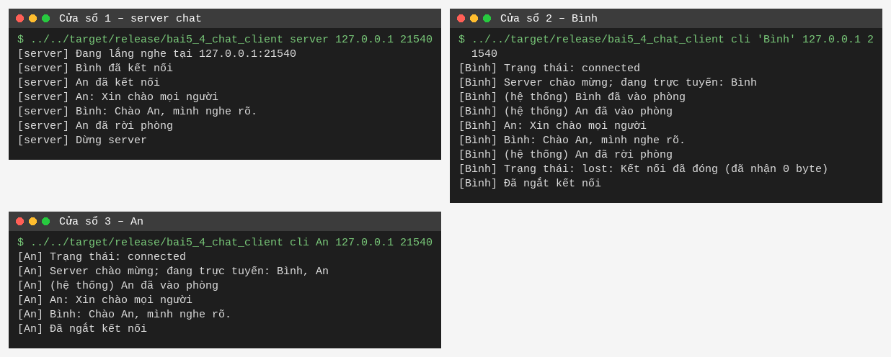

# Bài 5.4 – Lớp dịch vụ ChatClient bất đồng bộ (Rust)

| Thông tin | Nội dung |
|---|---|
| Mã giả tương ứng | Mã giả 5.5 (Lớp dịch vụ ChatClient bất đồng bộ) |
| Mục giáo trình | 5.3.2 Ba cách tiếp cận (cách 3), 5.3.3 Ví dụ: lớp dịch vụ chat client, 5.4.5 Xử lý ngoại lệ trong tác vụ bất đồng bộ |
| Kế thừa | Mã giả 5.1 (khung JSON bất đồng bộ); SAFE_CONNECT_ASYNC = Mã giả 2.2 + AWAIT; giao thức chat của Mục 6.3.1 (phần `hello`, `msg`, `sys`, `welcome`) |
| Thư viện | Crate `tokio` 1.47.1 (`spawn`, `sync::Mutex`, `sync::mpsc`, `signal`), `serde_json` 1.0.143 (bật `preserve_order`) |

## Mục tiêu
Cài đặt lớp `ChatClient` theo cách tiếp cận (3) của Mục 5.3.2: lớp dịch vụ mạng giữ kết nối dài hạn, có vòng nhận chạy nền phát sự kiện `on_message`, thủ tục gửi tuần tự hóa bằng khóa `send_lock`, và thủ tục ngắt kết nối hủy vòng nhận trước khi đóng socket. Tầng giao diện (ở đây là giao diện dòng lệnh) chỉ đăng ký hai sự kiện và gọi các thủ tục của lớp, nên lớp kiểm thử được mà không cần cửa sổ.

## Tệp
- `Cargo.toml`, `Cargo.lock` – gói Cargo `bai5_4_chat_client`.
- `src/main.rs` – phân nhánh vai trò `server` / `cli`.
- `src/chat_client.rs` – kiểu `ChatClient`: `connect`, `receive_loop`, `send_message(room, text)`, `disconnect`, sự kiện `on_message`, `on_status`.
- `src/chat_cli.rs` – giao diện dòng lệnh dùng `ChatClient`.
- `src/chat_server.rs` – server chat tối giản đi kèm.
- `src/khung_json_async.rs` – khung JSON bất đồng bộ (Mã giả 5.1), `CancelToken`, `safe_connect_async` (chép từ Bài 5.1).
- `demo.json` – kịch bản chạy minh họa (dùng với `tools/demo.py`).
- `ket_qua.txt`, `ket_qua.png` – kết quả thực thi thật.

## Cách chạy
```bash
# Cửa sổ 1 – server chat
cargo run -q --release -- server 0.0.0.0 9200
# Cửa sổ 2, 3 – hai người dùng
cargo run -q --release -- cli Bình 127.0.0.1 9200
cargo run -q --release -- cli An 127.0.0.1 9200
```
Mỗi dòng nhập được gửi thành một tin; `/quit` (hoặc Ctrl+C) để ngắt kết nối; `/cho <giây>` tạm dừng đọc bàn phím (dùng trong kịch bản minh họa).

## Kết quả thực thi


Bình kết nối trước, An kết nối sau; tin của mỗi người được server chuyển tới cả hai (gồm cả người gửi). Khi An gõ `/quit`, `disconnect` hủy vòng nhận trước rồi mới đóng socket, nên phía An kết thúc lặng lẽ (nhánh `Cancelled`), còn Bình nhận thông báo hệ thống "An đã rời phòng". Cuối kịch bản, server bị dừng trước (Ctrl+C): vòng nhận của Bình gặp kết nối đóng và báo `on_status("lost: ...")` (nhánh lỗi ngoài ý muốn), sau đó Bình được dừng bằng Ctrl+C và in "Đã ngắt kết nối". Khác bản Python, server Rust thoát ngay khi nhận Ctrl+C nên không in dòng "Bình đã rời phòng".

## Ghi chú
- `send_lock` là `tokio::sync::Mutex<Option<OwnedWriteHalf>>`: khóa sở hữu luôn nửa ghi của socket, nên trình biên dịch bắt buộc phải lấy khóa mới gửi được (không thể quên khóa như trong mã giả). Khóa tự nhả khi biến `guard` ra khỏi phạm vi, tương đương `FINALLY RELEASE`. `None` nghĩa là socket đã đóng.
- Socket được tách bằng `into_split()`: nửa đọc thuộc tác vụ `receive_loop` chạy nền (`RUN_BACKGROUND` = `tokio::spawn`), nửa ghi nằm trong khóa gửi. `CLOSE(c.sock)` là bỏ (drop) hai nửa này.
- `cts` là `CancelToken` (Bài 5.1); `DISCONNECT` gọi `cancel()` trước rồi mới bỏ nửa ghi, nên vòng nhận đi vào nhánh `FrameError::Cancelled` thay vì báo nhầm mất kết nối. Mã giả khai báo `DISCONNECT` là thủ tục thường; bản Rust là `async fn` vì việc lấy khóa gửi cần `.await`.
- Hai sự kiện là các closure kiểu `Arc<dyn Fn(...) + Send + Sync>` để dùng chung giữa tầng giao diện và tác vụ nền.
- Theo Mã giả 5.5 (bản hiện hành): vòng nhận bắt cả `JsonError` (khung không phải JSON hợp lệ) như mất kết nối, để mọi lỗi của tác vụ nền đều thành sự kiện `on_status` (Mục 5.4.5); `SEND_MESSAGE(c, room, text)` gửi `{type: "msg", room, text}` – giao diện dòng lệnh luôn dùng phòng `chung`, server tối giản chép lại trường `room` vào tin chuyển tiếp.
- Bàn phím được đọc trên một luồng phụ và chuyển vào kênh `tokio::sync::mpsc`, nên tin đến vẫn được hiển thị trong lúc chờ người dùng gõ.
- Server chat đi kèm là bản tối giản: một phòng chung, chuyển tiếp `msg`, trả lời `ping`, lỗi 409 khi trùng tên, mỗi client một khóa gửi. Trường `ts` dùng giờ UTC vì thư viện chuẩn Rust không có múi giờ địa phương. Bản đầy đủ (nhiều phòng, tin riêng) thuộc Chương 6.
- Kiểm thử: Linux, Rust 1.97.0, tokio 1.47.1.
