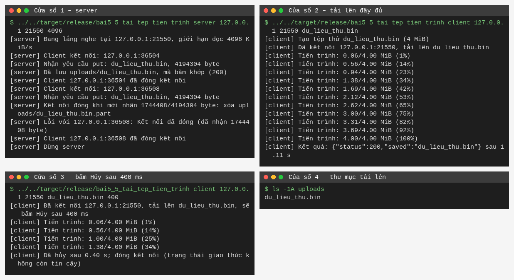

# Bài 5.5 – Tải tệp bất đồng bộ có báo cáo tiến trình và hủy (Rust)

| Thông tin | Nội dung |
|---|---|
| Mã giả tương ứng | Mã giả 5.6 (Tải tệp bất đồng bộ có báo cáo tiến trình và hủy) |
| Mục giáo trình | 5.3.4 Ví dụ: tải tệp có báo cáo tiến trình và hủy; 5.4.1 Hủy tác vụ hợp tác |
| Kế thừa | Mã giả 3.10 (PUT_CLIENT), 3.9 (HANDLE_PUT – server đi kèm), 5.1 (khung JSON bất đồng bộ) |
| Thư viện | Crate `tokio` 1.47.1 (`net::TcpSocket`, `fs`, `spawn_blocking`, `select!`), `serde_json` 1.0.143, `sha2` 0.10.9 |

## Mục tiêu
Chuyển thủ tục gửi tệp của Mục 3.5.2 sang bất đồng bộ, giữ nguyên giao thức bốn bước (tiêu đề có SHA-256, trạng thái 100, nội dung, trạng thái 200/422), bổ sung hàm báo tiến trình tối đa khoảng 10 lần mỗi giây và tín hiệu hủy. Kịch bản minh họa tải một tệp 4 MiB hoàn chỉnh, sau đó tải lại và bấm Hủy giữa chừng để kiểm chứng phía server xóa tệp `.part`.

## Tệp
- `Cargo.toml`, `Cargo.lock` – gói Cargo `bai5_5_tai_tep_tien_trinh`.
- `src/main.rs` – phân nhánh vai trò `server` / `client`.
- `src/put_client.rs` – `put_file_async` (Mã giả 5.6), hàm báo tiến trình, nút Hủy mô phỏng bằng hẹn giờ, kết nối với bộ đệm gửi 64 KiB.
- `src/put_server.rs` – server nhận tệp có kiểm tra mã băm (Mã giả 3.9), giới hạn tốc độ đọc.
- `src/khung_json_async.rs` – khung JSON bất đồng bộ (Mã giả 5.1), `CancelToken` (chép từ Bài 5.1).
- `demo.json` – kịch bản chạy minh họa (dùng với `tools/demo.py`).
- `ket_qua.txt`, `ket_qua.png` – kết quả thực thi thật.

## Cách chạy
```bash
# Cửa sổ 1 – server, đọc tối đa 4096 KiB/s
cargo run -q --release -- server 0.0.0.0 9100 4096
# Cửa sổ 2 – tải lên đầy đủ (tự tạo tệp thử 4 MiB nếu chưa có)
cargo run -q --release -- client 127.0.0.1 9100 du_lieu_thu.bin
# Tải lên và bấm Hủy sau 400 ms
cargo run -q --release -- client 127.0.0.1 9100 du_lieu_thu.bin 400
```
Tệp nhận được lưu trong thư mục `uploads/` cạnh server.

## Kết quả thực thi


Lần tải thứ nhất in tiến trình khoảng mỗi 100 ms; mức 100% chỉ được báo sau khi server xác nhận `{"status":200}` (khoảng 1,1 s, server đọc 4096 KiB/s). Lần thứ hai bị hủy sau 400 ms: client đóng kết nối; vòng nhận của server gặp kết nối đóng trước khi đủ `size` byte nên xóa `uploads/du_lieu_thu.bin.part`, đúng như thiết kế khớp nhau của hai đầu giao thức ở Mục 5.3.4. Cửa sổ 4 (thêm so với bản Python) cho thấy thư mục `uploads/` chỉ còn tệp đã tải đủ, không còn tệp `.part`.

## Ghi chú
- Tín hiệu hủy `ct` là `CancelToken` (Bài 5.1); nút Hủy được mô phỏng bằng một tác vụ `tokio::spawn` ngủ 400 ms rồi gọi `cancel()`. Mỗi điểm chờ trong `put_file_async` (tính mã băm, đọc tệp, gửi khối) dùng `tokio::select!` với `ct.cancelled()`; khi bị hủy, hàm trả `FrameError::Cancelled`, tệp được đóng tự động (`Drop`, tương đương `FINALLY CLOSE_FILE`), rồi nơi gọi đóng kết nối (Mục 5.4.1).
- Theo Mã giả 5.6 (bản hiện hành), `sent` đếm số byte đã vào bộ đệm gửi của hệ điều hành, chưa chắc server đã nhận, nên `on_progress(size, size)` (100%) chỉ được gọi sau khi nhận phản hồi `status` 200; bị hủy hoặc 422 thì không báo 100%.
- `SHA256_OF_FILE_ASYNC` chạy bản tính chặn trên luồng phụ bằng `tokio::task::spawn_blocking`; `READ_ASYNC` dùng `tokio::fs::File` (bên trong cũng chạy trên luồng phụ vì hệ điều hành không có đọc tệp bất đồng bộ phổ quát); `SEND_ALL_ASYNC` là `write_all(...).await`.
- Để quan sát được tiến trình trên loopback, server minh họa giới hạn tốc độ đọc (tham số `rate_kib`) và đặt bộ đệm nhận 64 KiB (`TcpSocket::set_recv_buffer_size`); client đặt bộ đệm gửi 64 KiB (`TcpSocket::set_send_buffer_size`) trước khi kết nối, nên phần kết nối được viết lại trong `connect_small_sndbuf` thay cho `safe_connect_async`. Đây là khác biệt so với mã giả, chỉ phục vụ minh họa.
- Tệp thử `du_lieu_thu.bin` (4 MiB) có nội dung giả ngẫu nhiên cố định sinh bằng thuật toán xorshift (khác nội dung tệp thử của bản Python). Bước chuẩn bị của `demo.json` xóa tệp thử và thư mục `uploads/` cũ; hai thứ này không được lưu kèm bài.
- `BASENAME` của server tách theo cả `/` và `\`, từ chối tên `.` và `..` như Bài 3.4 (bản Python của bài này dùng `os.path.basename`).
- Kiểm thử: Linux, Rust 1.97.0, tokio 1.47.1.
