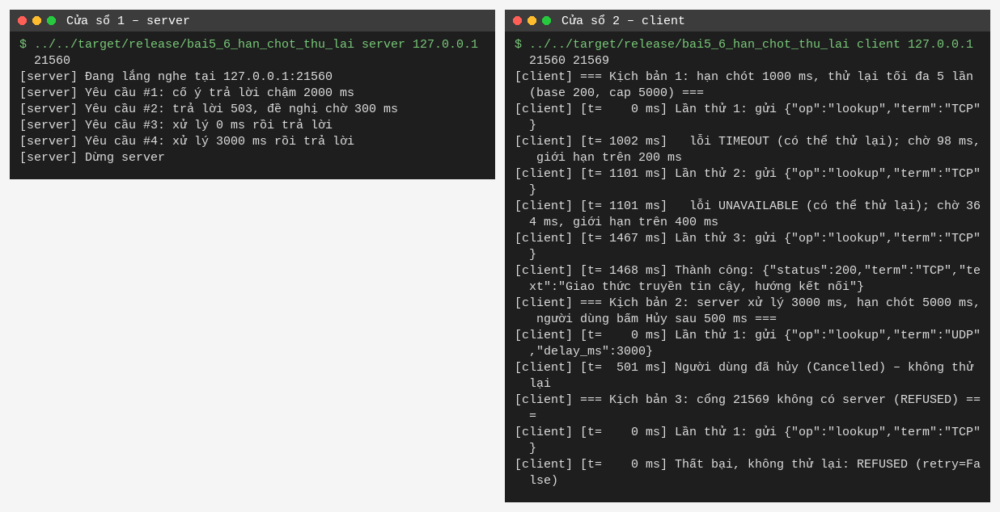

# Bài 5.6 – Hạn chót, hủy và thử lại có lùi thời gian (Rust)

| Thông tin | Nội dung |
|---|---|
| Mã giả tương ứng | Mã giả 5.7 (Yêu cầu có hạn chót và hủy), Mã giả 5.8 (Thử lại có lùi theo cấp số nhân và nhiễu ngẫu nhiên) |
| Mục giáo trình | 5.4.1 Hủy tác vụ hợp tác, 5.4.2 Thời gian chờ và hạn chót, 5.4.3 Thử lại có lùi thời gian và nhiễu ngẫu nhiên |
| Kế thừa | Mã giả 5.1 (khung JSON bất đồng bộ), 2.2 (SAFE_CONNECT, `NetError` có trường `retry`), 4.4 (UDP_REQUEST – vòng gửi lại có lùi thời gian) |
| Thư viện | Crate `tokio` 1.47.1 (`select!`, `time::sleep`, `spawn`), `serde_json` 1.0.143; `std::hash::RandomState` cho nhiễu ngẫu nhiên |

## Mục tiêu
Cài đặt `REQUEST_WITH_DEADLINE`, kết hợp tín hiệu hủy của người dùng với tín hiệu tự hủy khi hết hạn và phân biệt hai nguyên nhân, cùng `RETRY_ASYNC` thử lại có lùi theo cấp số nhân với nhiễu ngẫu nhiên, tôn trọng thời gian chờ do server đề nghị. Server đi kèm cố ý trả lời chậm ở yêu cầu thứ nhất và trả lỗi 503 ở yêu cầu thứ hai.

## Tệp
- `Cargo.toml`, `Cargo.lock` – gói Cargo `bai5_6_han_chot_thu_lai`.
- `src/main.rs` – phân nhánh vai trò `server` / `client`.
- `src/deadline_retry.rs` – `cancel_after`, `link`, `request_with_deadline` (Mã giả 5.7), `retry_async` (Mã giả 5.8), `lookup_once` (một lần thử `op(ct)`) và ba kịch bản.
- `src/flaky_server.rs` – server tra cứu cố ý trả lời chậm, trả 503.
- `src/khung_json_async.rs` – khung JSON bất đồng bộ (Mã giả 5.1), `CancelToken`, `safe_connect_async`, `NetError` có thêm `retry_after` (chép từ Bài 5.1).
- `demo.json` – kịch bản chạy minh họa (dùng với `tools/demo.py`).
- `ket_qua.txt`, `ket_qua.png` – kết quả thực thi thật.

## Cách chạy
```bash
# Cửa sổ 1 – server "khó tính"
cargo run -q --release -- server 0.0.0.0 9100
# Cửa sổ 2 – ba kịch bản; cổng thứ hai là cổng không có server
cargo run -q --release -- client 127.0.0.1 9100 9101
```
Server đếm yêu cầu từ lúc khởi động; cần khởi động lại server trước mỗi lần chạy client để lặp lại đúng kịch bản.

## Kết quả thực thi


Kịch bản 1: lần thử 1 hết hạn chót 1000 ms (lỗi `TIMEOUT`, có thể thử lại), chờ một khoảng ngẫu nhiên không quá 200 ms; lần thử 2 nhận 503 kèm đề nghị chờ 300 ms nên thời gian chờ được nâng lên ít nhất 300 ms (giới hạn trên của khoảng ngẫu nhiên lúc này là 400 ms); lần thử 3 thành công. Kịch bản 2: người dùng bấm Hủy sau 500 ms trong khi hạn chót là 5000 ms; kết quả là `Cancelled`, không phải `Timeout`, và không có lần thử lại. Kịch bản 3: kết nối bị từ chối (`REFUSED`, `retry = FALSE`) nên lỗi được báo ngay sau lần thử đầu. Thời gian chờ ngẫu nhiên khác nhau giữa các lần chạy.

## Ghi chú
- `ct ← LINK(user_ct, CANCEL_AFTER(timeout_ms))` được viết đúng như mã giả bằng hai hàm nhỏ trên `CancelToken`: `cancel_after(ms)` tạo tín hiệu tự phát sau `ms` mili giây (một tác vụ nền ngủ rồi `cancel()`), `link(a, b)` tạo tín hiệu phát khi `a` hoặc `b` phát. Khi bị hủy, hàm đóng socket rồi xem `user_ct.is_cancelled()` để báo `Cancelled` hay `Timeout`.
- `RETRY_ASYNC(op, max_tries, base_ms, cap_ms, ct)` theo Mã giả 5.8 (bản hiện hành): `op` là một closure nhận `ct` – mỗi lần gọi `op(ct)` tạo một `Future` mới (kết nối mới, yêu cầu mới); tham số kiểu `F: FnMut(CancelToken) -> Fut` nên dùng được cho mọi thao tác. Hàm bắt `Timeout` (lỗi của Mã giả 5.7, luôn đáng thử lại) và `NetError` (xem trường `retry`); `Cancelled` và lỗi khác không bị bắt nên dừng ngay. Phản hồi 503 được `op` đổi thành `NetError("UNAVAILABLE", retry ← TRUE, retry_after ← retry_after_ms)`.
- `DELAY_ASYNC(delay, ct)` là `tokio::select!` giữa `sleep(delay)` và `ct.cancelled()`, nên nút Hủy dừng được cả lúc đang chờ giữa hai lần thử.
- `RANDOM(0, x)` dùng giá trị băm của `std::hash::RandomState` (mỗi lần tạo mang khóa ngẫu nhiên do hệ điều hành cấp) vì thư viện chuẩn Rust chưa có hàm số ngẫu nhiên; đủ cho jitter, không dùng cho mật mã. `DELAY_ASYNC` là `tokio::time::sleep`.
- Kiểm thử: Linux, Rust 1.97.0, tokio 1.47.1.
