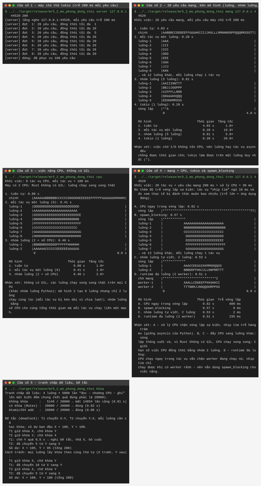

# Bài mở rộng MR5.2 – So sánh các mô hình đồng thời: tuần tự, std::thread, nhóm luồng tự viết, tokio, spawn_blocking (Rust)

| Thông tin | Nội dung |
|---|---|
| Loại | **Bài mở rộng** – không có trong giáo trình, không có mã giả tương ứng |
| Liên hệ với giáo trình | Chương 5: Bài 5.1 (khung bất đồng bộ), Bài 5.2 (kiểm tra nhiều cổng đồng thời có giới hạn); Chương 6: Bài 6.1 (server đa luồng, nhóm luồng), Bài 6.2 (server bất đồng bộ) |
| Thư viện | Thư viện chuẩn Rust: `std::thread` (`spawn`, `scope`), `std::sync::mpsc`, `Mutex`, `AtomicI64`; crate `tokio` 1.54.1 (runtime `current_thread`/`multi_thread`, `JoinSet`, `spawn_blocking`, `oneshot`) |
| Bản ngôn ngữ khác | [C#](../../../csharp/Chuong05/BaiMR5.2_MoPhongDongThoi/), [Java](../../../java/Chuong05/BaiMR5.2_MoPhongDongThoi/), [Python](../../../python/Chuong05/BaiMR5.2_MoPhongDongThoi/), [Go](../../../go/Chuong05/BaiMR5.2_MoPhongDongThoi/) |

## Mục tiêu
Cùng một khối việc, chạy bằng nhiều mô hình đồng thời, đo thời gian thật và **vẽ biểu đồ Gantt bằng văn bản** cho thấy tác vụ nào chạy trên worker nào, vào lúc nào – đối chiếu với bản Python (luồng, GIL, `asyncio`, nhóm tiến trình) và bản Go (goroutine, kênh).

| Lệnh | Khối việc | Mô hình so sánh |
|---|---|---|
| `mang` | 20 yêu cầu TCP tới máy chủ thử, mỗi yêu cầu trễ 200 ms (chờ I/O) | 1. tuần tự; 2. mỗi tác vụ một luồng (`std::thread::scope`); 3. **nhóm luồng tự viết** 5 luồng (hàng đợi việc là kênh `mpsc`); 4. `tokio` runtime **một luồng**, 20 tác vụ `async` |
| `cpu` | 8 tác vụ tính toán, mỗi tác vụ ≈ 100 ms | 1. tuần tự; 2. mỗi tác vụ một luồng; 3. nhóm luồng tự viết bằng số CPU |
| `tron` | 20 tác vụ = yêu cầu mạng 200 ms + xử lý CPU ≈ 30 ms | A. CPU ngay trong tác vụ `async` (runtime một luồng); B. `tokio::task::spawn_blocking`; C. gửi việc CPU sang nhóm luồng tự viết 2 luồng, chờ bằng `oneshot`; D. runtime **đa luồng** (worker = số CPU), CPU ngay trong tác vụ – đo thêm **độ trễ vòng lặp sự kiện** |
| `khoa` | biến đếm chung, chuyển tiền giữa hai tài khoản | tranh chấp logic (đọc – nhường – ghi) và sửa bằng `Mutex`, `AtomicI64::fetch_add`; bế tắc và cách tránh bằng thứ tự lấy khóa |

## Kiến thức chính
- **Việc chờ I/O và việc nặng CPU khác nhau:** khi chờ mạng, CPU rảnh nên luồng hay tác vụ `async` đều chồng được thời gian chờ (20 × 200 ms ≈ 4 s → ≈ 0,2 s). Nhóm 5 luồng chạy thành 4 đợt (≈ 0,8 s) – giới hạn đồng thời có chủ ý, như Bài 5.2.
- **Nhóm luồng tự viết** (`src/nhom_luong.rs`, ~40 dòng): n luồng cùng chờ trên **một** đầu nhận của kênh `mpsc` (bọc trong `Arc<Mutex<Receiver>>`), mỗi việc là `Box<dyn FnOnce() + Send>`; khi nhóm bị `drop`, đầu gửi đóng, `recv()` báo lỗi và các luồng tự thoát rồi được `join`. Thư viện chuẩn Rust không có sẵn nhóm luồng (thực tế dùng crate `rayon` hoặc `threadpool`).
- **tokio:** `#[tokio::main]` hay `Builder::new_current_thread()` tạo vòng lặp sự kiện trên một luồng; trong biểu đồ, hàng “vòng lặp” có ký hiệu `*` (nhiều tác vụ cùng lúc trên một luồng). `Builder::new_multi_thread()` tạo nhiều worker và **đánh cắp việc** (work stealing) giữa chúng.
- **Không có GIL:** luồng Rust chạy song song thật trên mọi CPU. Khối `cpu` nhanh gần gấp số CPU; tạo nhiều luồng hơn số CPU không nhanh hơn nữa, mỗi tác vụ chỉ bị kéo dài vì chia lượt – khác hẳn nhóm luồng Python (bị GIL giới hạn).
- **Đừng chặn vòng lặp sự kiện:** tokio là đa nhiệm **hợp tác** – một tác vụ chỉ nhường ở điểm `.await`. Việc CPU dài trong tác vụ `async` làm vòng lặp “đứng”: tác vụ nhịp tim (ngủ 10 ms) bị đánh thức muộn hàng trăm ms. Ngay cả runtime đa luồng cũng chỉ giảm nhẹ: worker đang chạy việc CPU không làm được gì khác. Cách đúng: `spawn_blocking` (nhóm luồng chặn riêng của tokio) hoặc gửi sang nhóm luồng riêng rồi `await` kết quả qua `oneshot`.
- **Tranh chấp dữ liệu:** Rust an toàn **không biên dịch** được chương trình để hai luồng cùng ghi một biến thường (không có *data race*). Nhưng *tranh chấp logic* vẫn có: `load()` rồi `store()` riêng rẽ trên `AtomicI64` – mỗi thao tác nguyên tử, cả cặp thì không – vẫn mất cập nhật. Sửa bằng `Mutex` (đoạn găng) hoặc `fetch_add` (đọc–cộng–ghi trong một bước).
- **Bế tắc:** hai luồng lấy hai khóa theo thứ tự ngược nhau thì chờ nhau mãi; trình biên dịch không phát hiện được. `std::sync::Mutex` không có “chờ có hạn”, bài tự viết `lock_timeout` bằng `try_lock` lặp lại; cách tránh là lấy khóa theo cùng một thứ tự.

## Cấu trúc tệp
- `Cargo.toml`, `Cargo.lock` – gói Cargo `mr5_2_mo_phong_dong_thoi`.
- `src/main.rs` – chọn vai trò: `server`, `mang`, `cpu`, `tron`, `khoa`.
- `src/dong_thoi.rs` – ba khối việc và các mô hình đồng thời.
- `src/nhom_luong.rs` – nhóm luồng tự viết bằng kênh `mpsc`.
- `src/dong_ho.rs` – ghi khoảng thời gian (`Instant`), vẽ biểu đồ Gantt, bảng so sánh.
- `src/khoa.rs` – tranh chấp dữ liệu, `Mutex`, `AtomicI64`; bế tắc và thứ tự lấy khóa.
- `src/may_chu_tre.rs` – máy chủ thử tokio trả lời sau độ trễ giả lập; báo số yêu cầu và số kết nối đồng thời lớn nhất của mỗi “đợt”.
- `demo.json` – kịch bản chạy minh họa (dùng với `tools/demo.py`).
- `ket_qua.txt`, `ket_qua.png` – kết quả thực thi thật.

## Cách chạy
Trong thư mục bài (`cargo build -q --release` một lần; `B=../../target/release/mr5_2_mo_phong_dong_thoi`, Windows: `..\..\target\release\mr5_2_mo_phong_dong_thoi.exe`):
```bash
$B server 127.0.0.1 9000 200        # cửa sổ 1: máy chủ thử, trễ 200 ms
$B mang 127.0.0.1 9000              # cửa sổ 2
$B cpu
$B tron 127.0.0.1 9000
$B khoa
```
Máy chủ thử dùng cùng giao thức `GET k` / `OK k` với bản Python và Go, nên chạy chéo được (ví dụ máy chủ `may_chu_tre.py` với client Rust). Tái lập kết quả từ thư mục gốc của kho: `python3 tools/demo.py rust/Chuong05/BaiMR5.2_MoPhongDongThoi` (cổng 44520).

## Kết quả thực thi


Cách đọc biểu đồ: mỗi hàng là một worker; mỗi cột là 1/48 trục thời gian chung của cả khối việc; chữ cái là tác vụ đang chạy (A = tác vụ 1), `*` là nhiều tác vụ cùng lúc trên một hàng (ở mô hình D, hàng “chờ mạng” gom mọi tác vụ đang đợi mạng). Lần chạy trong ảnh (Linux, 2 CPU):
- **mang:** tuần tự 4,03 s; mỗi tác vụ một luồng 0,20 s; nhóm 5 luồng 0,81 s (đúng 4 đợt); tokio một luồng 0,20 s. Cửa sổ máy chủ xác nhận số kết nối đồng thời lớn nhất của mỗi đợt: 1, 20, 5, 20.
- **cpu:** tuần tự 0,80 s; 8 luồng 0,41 s (1,9 lần); nhóm 2 luồng 0,40 s (2,0 lần) – tăng tốc theo số CPU, khác nhóm luồng Python (0,8 lần vì GIL), giống goroutine của Go.
- **tron:** A 0,82 s, nhịp tim trễ tới 608 ms (như `asyncio` của Python khi chạy CPU trong vòng lặp); B (`spawn_blocking`, tokio mở 20 luồng chặn) 0,57 s, trễ 9 ms; C (nhóm 2 luồng) 0,53 s, trễ 2 ms; D (runtime 2 worker, CPU ngay trong tác vụ) 0,51 s nhưng nhịp tim vẫn trễ 235 ms – cả hai worker cùng bận việc CPU.
- **khoa:** “không khóa” còn 5146/20000; `Mutex` và `AtomicI64::fetch_add` đều đúng 20000. Bế tắc: T1 chờ quá 0,5 s thì nhả khóa nên T2 làm xong; lấy khóa theo thứ tự X trước Y thì cả hai giao dịch đều xong, tổng số dư luôn là 200.

Thời gian đo thay đổi chút ít giữa các lần chạy và giữa các máy; quan hệ giữa các mô hình thì ổn định.

## Ghi chú
- Việc CPU là vòng lặp bộ sinh đồng dư tuyến tính giống bản Python/Go; số vòng lặp được hiệu chỉnh lúc chạy để mỗi tác vụ ≈ 100 ms (hoặc 30 ms). `std::hint::black_box` và biến `SINK` ngăn trình biên dịch tối ưu bỏ vòng lặp ở chế độ `--release`.
- Khác bản Python: không có nhóm tiến trình – luồng Rust đã song song thật nên không cần tách tiến trình để vượt GIL. Khác bản Go: tokio không tự ngắt (preempt) tác vụ chạy lâu như bộ lập lịch Go, nên mô hình A/D trễ lớn trong khi mô hình tương ứng của Go chỉ trễ vài chục ms.
- `std::thread::scope` (Rust 1.63+) cho phép luồng mượn biến cục bộ (`&rec`, `&names`) mà không cần `Arc`, vì phạm vi bảo đảm mọi luồng kết thúc trước khi biến bị hủy.
- Ở mô hình tranh chấp, `thread::yield_now()` giữa lúc đọc và lúc ghi tượng trưng cho một thao tác chậm (gọi mạng, ghi nhật ký); `Ordering::SeqCst` không cứu được vì lỗi nằm ở chỗ tách đọc và ghi thành hai bước.
- Kiểm thử: Linux, Rust 1.97.0, máy 2 CPU.

## Bài tập gợi ý
1. Đổi kích thước nhóm luồng ở khối `mang` thành 2, 10, 20; dự đoán trước thời gian (≈ ⌈20 / n⌉ × 0,2 s) rồi đo lại. Ở cửa sổ máy chủ, số đồng thời tối đa thay đổi thế nào?
2. Tăng số yêu cầu lên 10 000 với mô hình tokio và thêm `tokio::sync::Semaphore` (100 giấy phép) để không mở quá nhiều socket một lúc; so sánh với mô hình “mỗi tác vụ một luồng” (thử với 2000 luồng).
3. Ở mô hình D, chèn `tokio::task::yield_now().await` sau mỗi 1/10 việc CPU (chia `cpu_work` thành 10 đoạn): độ trễ nhịp tim giảm còn bao nhiêu? Đây là cách “nhường” thủ công của đa nhiệm hợp tác.
4. Viết lại tranh chấp theo kiểu truyền thông điệp: một luồng duy nhất giữ biến đếm, các luồng khác gửi “+1” qua kênh `mpsc` – không cần khóa.
5. (Nâng cao) Thay nhóm luồng tự viết bằng crate `rayon` (`par_iter`) ở khối `cpu` và so sánh mã nguồn, thời gian.

## Đọc thêm
- *The Rust Programming Language*, Chương 16 *Fearless Concurrency* và Chương 21 *Building a Multithreaded Web Server* (nhóm luồng bằng kênh).
- Tài liệu tokio: [*Bridging with sync code*](https://tokio.rs/tokio/topics/bridging), [`spawn_blocking`](https://docs.rs/tokio/latest/tokio/task/fn.spawn_blocking.html); bài *Async: What is blocking?* (Alice Ryhl, 2020).
- Claus Töpke, *Network Programming and Automation Essentials*, Packt, 2023, Chương 8 *Scaling Your Code*.

Mã nguồn của bài được viết mới cho kho này; các tài liệu trên chỉ là nguồn tham khảo kiến thức.
