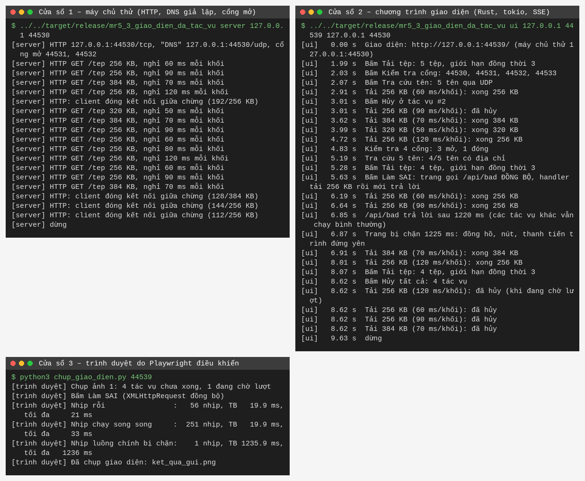
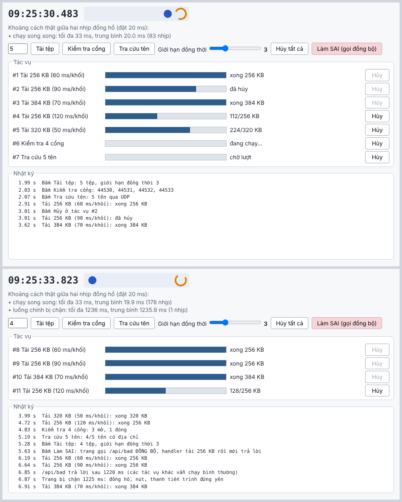

# Bài mở rộng MR5.3 – Giao diện luôn phản hồi khi nhiều tác vụ mạng chạy song song (Rust, giao diện web cục bộ)

| Thông tin | Nội dung |
|---|---|
| Loại | **Bài mở rộng** – không có trong giáo trình, không có mã giả tương ứng |
| Liên hệ với giáo trình | Chương 5: Bài 5.3 (giao diện bất đồng bộ), Bài 5.5 (tải tệp có tiến trình và hủy), Bài 5.2 (giới hạn đồng thời); Bài 1.2 (kiểm tra cổng), Bài 4.3 (tra cứu tên qua UDP), Bài 7.4 (SSE); MR5.2 (các mô hình đồng thời) |
| Thư viện | Crate `tokio` 1.54.1 (`net`, `sync::watch`, `sync::mpsc`, `sync::oneshot`, `select!`), `serde_json` 1.0.154; máy chủ HTTP/1.1 và client HTTP tối giản tự viết (`src/http.rs`), không dùng hyper/axum; `include_str!` nhúng trang; Playwright + Pillow (Python) chỉ dùng cho kịch bản minh họa |
| Bản ngôn ngữ khác | [C#](../../../csharp/Chuong05/BaiMR5.3_GiaoDienDaTacVu/) (WinForms), [Java](../../../java/Chuong05/BaiMR5.3_GiaoDienDaTacVu/) (Swing), [Python](../../../python/Chuong05/BaiMR5.3_GiaoDienDaTacVu/) (Tkinter), [Go](../../../go/Chuong05/BaiMR5.3_GiaoDienDaTacVu/) (giao diện web cục bộ) |

## Mục tiêu
Thư viện chuẩn Rust không có thư viện giao diện đồ họa, nên – chọn cách đơn giản nhất và giống bản Go – giao diện là **một trang web cục bộ** do chính chương trình Rust phục vụ (Bài 5.3 bản Rust dùng giao diện terminal; ở đây cần thanh tiến trình, nút Hủy cho từng tác vụ nên trang web dễ hơn). Trang HTML dùng chung với bản Go. Trang chạy nhiều tác vụ mạng cùng lúc – tải tệp HTTP từ máy chủ thử với độ trễ khác nhau, kiểm tra cổng TCP, tra cứu tên qua máy chủ “DNS” giả lập trên UDP – với thanh tiến trình và nút Hủy cho từng tác vụ, nút Hủy tất cả và thanh trượt giới hạn đồng thời; đồng hồ (mili giây) và hoạt hình **không bao giờ đứng**. Nút **“Làm SAI”** gọi một API chậm bằng `XMLHttpRequest` **đồng bộ**: luồng chính của trình duyệt bị chặn suốt thời gian chờ – tương đương “chờ mạng trên luồng giao diện” ở bản Tkinter. Trang tự đo **khoảng cách thật giữa hai nhịp đồng hồ** (đặt 20 ms).

## Kiến thức chính
- **Hủy trong Rust async = bỏ future:** mỗi tác vụ là một tác vụ tokio; bên trong, `tokio::select!` chạy đồng thời future của công việc và `cancel_rx.wait_for(|c| *c)` (kênh `watch`). Bấm Hủy gửi `true` vào kênh, nhánh hủy thắng, future công việc bị **drop** – mọi `TcpStream`/`UdpSocket` nó đang giữ đóng ngay, không cần cờ kiểm tra thủ công giữa các bước như bản Python (luồng) hay truyền `context` xuống từng lời gọi như bản Go.
- **Giới hạn đồng thời công bằng (FIFO):** tác vụ lấy “vé” (`oneshot`) theo thứ tự bấm nút (`Limiter::enter`); vé được gửi khi tới lượt; đổi giới hạn bằng thanh trượt thì cấp thêm lượt ngay; tác vụ bị hủy khi còn chờ thì rời hàng đợi (`Limiter::leave`) mà không mở kết nối.
- **Đẩy tiến trình bằng Server-Sent Events** (`/api/events`, `text/event-stream`, như Bài 7.4): trạm phát (hub) giữ một kênh `mpsc` có bộ đệm 1024 cho mỗi trình duyệt; `try_send` không bao giờ chờ nên tác vụ không phải đợi trình duyệt chậm.
- **Máy chủ HTTP tối giản:** đọc dòng yêu cầu và tiêu đề bằng `BufReader::read_line`, tách `?k=v&…`, giải mã `%XX` (`encodeURIComponent` của trang); mỗi kết nối một yêu cầu (`Connection: close`), riêng luồng SSE giữ kết nối mở. Client tải tệp cũng tự viết: gửi `GET`, đọc `Content-Length`, đọc thân theo khối 16 KB và báo tiến trình.
- **Phía trình duyệt:** luồng chính của JavaScript là “luồng giao diện”; nút bấm chỉ gọi `fetch()` bất đồng bộ, cập nhật đến qua `EventSource`. `XMLHttpRequest` đồng bộ (đã bị khuyến cáo không dùng) chặn cả trang – cách sai để đối chứng.
- **Handler chờ ≠ server đứng:** `/api/bad` tải 256 KB xong mới trả lời (≈ 1,2 s), nhưng handler là một tác vụ `async`: khi chờ mạng nó nhường luồng cho tác vụ khác, nên các tác vụ tải và luồng SSE vẫn chạy bình thường – chỉ trang đang chờ đồng bộ là đứng.

## Cấu trúc tệp
- `Cargo.toml`, `Cargo.lock` – gói Cargo `mr5_3_giao_dien_da_tac_vu`.
- `src/main.rs` – chọn vai trò: `server` (máy chủ thử), `ui` (chương trình giao diện).
- `src/ui.rs` – quản lý tác vụ (tác vụ tokio + kênh hủy `watch`), trạm phát SSE, các API `/api/start`, `/api/cancel`, `/api/cancel_all`, `/api/limit`, `/api/log`, `/api/bad`.
- `src/tac_vu.rs` – bộ giới hạn FIFO; tải tệp HTTP có tiến trình, kiểm tra cổng, tra cứu tên qua UDP.
- `src/http.rs` – máy chủ và client HTTP/1.1 tối giản trên tokio, giải mã `%XX` (có `cargo test`).
- `src/may_chu_thu.rs` – máy chủ thử cục bộ: HTTP `GET /tep?kb=..&tre=..`, “DNS” giả lập trên UDP, hai cổng TCP mở.
- `giaodien.html` – trang giao diện (HTML + JavaScript thuần, dùng chung với bản Go), nhúng vào tệp chạy bằng `include_str!`.
- `chup_giao_dien.py` – chép từ bản Go: kịch bản Playwright điều khiển trình duyệt, chụp ảnh và in thống kê nhịp (chỉ cho minh họa).
- `demo.json` – kịch bản chạy minh họa (dùng với `tools/demo.py`).
- `ket_qua.txt`, `ket_qua.png` – nhật ký thật của máy chủ, chương trình giao diện, trình duyệt; `ket_qua_gui.png` – hai ảnh chụp trang thật.

## Cách chạy
Trong thư mục bài:
```bash
cargo build -q --release
B=../../target/release/mr5_3_giao_dien_da_tac_vu        # Windows: ..\..\target\release\mr5_3_giao_dien_da_tac_vu.exe
$B server 127.0.0.1 9000                  # cửa sổ 1: máy chủ thử (cổng 9000–9002; 9003 để trống)
$B ui 127.0.0.1 8080 127.0.0.1 9000       # cửa sổ 2: chương trình giao diện
```
Mở trình duyệt tại `http://127.0.0.1:8080/` rồi bấm **Tải tệp**, **Kiểm tra cổng**, **Tra cứu tên**, **Hủy**, kéo thanh trượt; cuối cùng bấm **Làm SAI** và quan sát đồng hồ, quả bóng đứng khoảng 1,2 s trong khi cửa sổ dòng lệnh của chương trình Rust vẫn ghi nhận các tác vụ khác hoàn thành.

Tái lập kết quả từ thư mục gốc của kho: `python3 tools/demo.py rust/Chuong05/BaiMR5.3_GiaoDienDaTacVu` (cổng 44530–44533, 44539) (bước trình duyệt cần `pip install playwright pillow && playwright install chromium`).

## Kết quả thực thi




Kịch bản (giới hạn đồng thời 3): bấm Tải 5 tệp, Kiểm tra cổng, Tra cứu tên – 7 tác vụ, vào chạy đúng thứ tự bấm; bấm Hủy tác vụ #2 khi đang tải (`đã hủy`, máy chủ thử ghi “client đóng kết nối giữa chừng (192/256 KB)”). **Ảnh trên:** 4 tác vụ chưa xong, các thanh tiến trình đang chạy, tác vụ #7 “chờ lượt”. Kiểm tra cổng: 3 mở, 1 đóng; tra cứu tên: 4/5 tên có địa chỉ. Sau đó bấm Tải 4 tệp rồi **Làm SAI**: `/api/bad` trả lời sau 1220 ms, trang bị chặn 1225 ms; trong lúc đó chương trình vẫn ghi nhận hai tệp #8, #9 tải xong (5,63 s → 6,19 s, 6,64 s). **Ảnh dưới** chụp ngay sau đó: khoảng cách lớn nhất giữa hai nhịp khi chạy song song chỉ 33 ms, còn khi luồng chính bị chặn là 1236 ms. Cuối cùng bấm Tải 4 tệp rồi **Hủy tất cả**: 3 tác vụ đang tải dừng ngay (máy chủ thử ghi 3 lần “client đóng kết nối giữa chừng”), tác vụ đang chờ lượt bị hủy mà không mở kết nối.

Thống kê do trang đo (in ở cửa sổ trình duyệt): rỗi 56 nhịp, tối đa 21 ms; chạy song song 251 nhịp, trung bình 19,9 ms, tối đa 33 ms; luồng chính bị chặn: một “nhịp” dài 1236 ms. Kết quả tương đương bản Go.

## Ghi chú
- Trình duyệt ghi cảnh báo *Synchronous XMLHttpRequest on the main thread is deprecated* – đúng là lý do nó được dùng làm ví dụ sai.
- Hub bỏ sự kiện khi bộ đệm 1024 sự kiện của một trình duyệt đầy (trình duyệt quá chậm hoặc đang đứng) thay vì chặn tác vụ; ứng dụng thật nên gửi kèm trạng thái đầy đủ định kỳ để trang tự đồng bộ lại.
- Thời gian chụp ảnh trong kịch bản minh họa không được tính vào thống kê nhịp (trang có hàm `demo.pause`).
- Chương trình giao diện chỉ nên lắng nghe trên `127.0.0.1`: API không có xác thực.
- Máy chủ thử phát hiện client hủy bằng cách vừa nghỉ giữa hai khối vừa `read` trên cùng kết nối (`select!`): client đóng thì `read` trả 0 ngay.
- Bản Go dùng `context` truyền xuống từng lời gọi mạng; bản Rust không cần vì bỏ future là hủy – nhưng chỉ hủy được tại điểm `.await`, một vòng lặp CPU không có `.await` thì không hủy được (xem MR5.2).
- Kiểm thử: Linux, Rust 1.97.0; trình duyệt Chromium không màn hình qua Playwright.

## Bài tập gợi ý
1. Mở hai thẻ trình duyệt cùng lúc: cả hai có thấy cùng tiến trình không? Vì sao (trạm phát SSE gửi tới mọi người đăng ký)? Tác vụ tạo ở thẻ mới có hiện ở thẻ cũ không?
2. Thêm cột tốc độ (KB/s) và thời gian còn lại, tính trong tác vụ tokio và gửi kèm sự kiện `progress`.
3. Thay nút “Làm SAI” bằng một vòng lặp JavaScript tính toán 1 s trên luồng chính; rồi chuyển phép tính đó vào một Web Worker. So sánh thống kê nhịp.
4. Khi trình duyệt mất kết nối SSE rồi kết nối lại (`EventSource` tự kết nối lại), trang mất các sự kiện ở giữa. Thêm `/api/state` trả trạng thái toàn bộ tác vụ, gọi khi `es.onopen`.
5. (Nâng cao) Thêm hạn chót cho từng tác vụ bằng `tokio::time::timeout` (Bài 5.6) và hiển thị “quá hạn” khác với “đã hủy” (`Err(Elapsed)`).

## Đọc thêm
- Tài liệu tokio: [`select!`](https://docs.rs/tokio/latest/tokio/macro.select.html) (mục *Cancellation safety*), [`sync::watch`](https://docs.rs/tokio/latest/tokio/sync/watch/), [*Graceful Shutdown*](https://tokio.rs/tokio/topics/shutdown).
- RFC 9112 – *HTTP/1.1* (cú pháp thông điệp, `Content-Length`).
- WHATWG HTML Living Standard, mục [*Server-sent events*](https://html.spec.whatwg.org/multipage/server-sent-events.html).
- WHATWG *XMLHttpRequest Living Standard*, phương thức `open()` – ghi chú về yêu cầu đồng bộ trên luồng chính.

Mã nguồn của bài được viết mới cho kho này; các tài liệu trên chỉ là nguồn tham khảo kiến thức.
