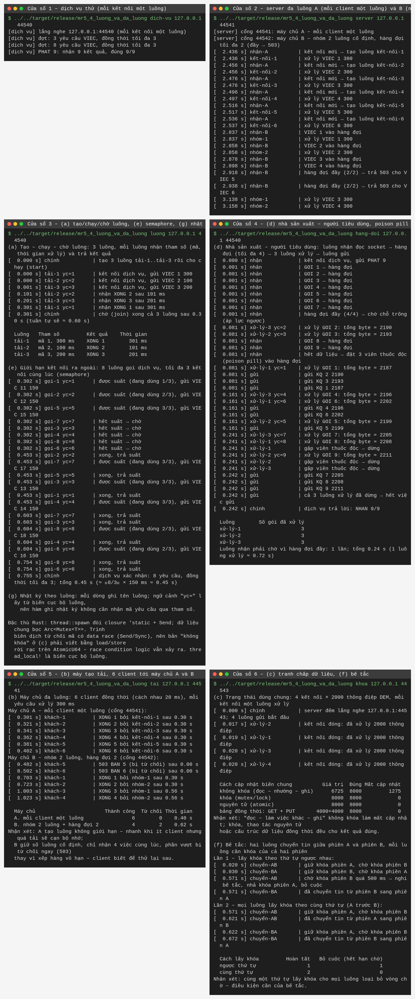

# Bài mở rộng MR5.4 – Luồng (thread) và đa luồng trong chương trình mạng (Rust)

| Thông tin | Nội dung |
|---|---|
| Loại | **Bài mở rộng** – không có trong giáo trình, không có mã giả tương ứng |
| Liên hệ với giáo trình | Chương 5 (Bài 5.1–5.6); Chương 6 (Bài 6.1 server đa luồng, nhóm luồng; Bài 6.2) |
| Thư viện | Chỉ thư viện chuẩn (không crate ngoài): `std::thread`, `std::sync` (`Arc`, `Mutex`, `RwLock`, `Condvar`, `mpsc::sync_channel`, `atomic::AtomicU64`), `thread_local!`, `std::net` |
| Bản ngôn ngữ khác | [Python](../../../python/Chuong05/BaiMR5.4_LuongVaDaLuong/) (bản tham chiếu), [C#](../../../csharp/Chuong05/BaiMR5.4_LuongVaDaLuong/), [Java](../../../java/Chuong05/BaiMR5.4_LuongVaDaLuong/), [Go](../../../go/Chuong05/BaiMR5.4_LuongVaDaLuong/) |

## Mục tiêu
Cùng kịch bản, cùng giao thức và cùng thông điệp với bản Python: đi từng bước vào `std::thread` trong một chương trình mạng, và thấy trình biên dịch Rust ngăn **data race** ngay từ lúc biên dịch:

| Vai trò | Phần | Nội dung |
|---|---|---|
| `luong` | (a) | `thread::Builder::new().name("tải-1").spawn(move || ...)`; tham số chuyển vào bằng `move`; **`JoinHandle<T>::join()` trả về giá trị** của luồng |
| `server` + `tai` | (b) | Server A: **mỗi client một luồng**; server B: **2 luồng cố định nhận từ `mpsc::sync_channel(2)`** (Receiver bọc `Arc<Mutex<_>>`), `try_send` → `Err(Full)` → `503 BAN` |
| `khoa` | (c) | 4 kết nối × 2000 `DEM`: “không khóa” (load → `yield_now` → store trên `AtomicU64`), `Mutex<u64>`, `fetch_add`, `RwLock<HashMap<String, AtomicU64>>` |
| `hang-doi` | (d) | Nhà sản xuất – người tiêu dùng với `sync_channel(4)`, viên thuốc độc `None`; `TcpStream::try_clone` cho luồng nhận và luồng gửi |
| `luong` | (e) | Semaphore tự làm bằng **`Mutex<usize>` + `Condvar`** (std chưa có semaphore) |
| `khoa` | (f) | Bế tắc hai khóa ngược thứ tự; `std::sync::Mutex` không có chờ có hạn → `KhoaCoHan` = `Mutex<bool>` + `Condvar::wait_timeout` |
| mọi vai trò | (g) | Nhật ký có `thread::current().name()` và ngữ cảnh `yc=` trong `thread_local!` |

## Liên hệ giáo trình
- **Chương 5 (Bài 5.1–5.6):** bản Rust của Chương 5 dùng `tokio`; bài này là lớp dưới – luồng HĐH của `std`. Giới hạn đồng thời (Bài 5.2) xuất hiện lại ở (e).
- **Chương 6 (Bài 6.1, 6.2):** phần (b) là hai kiến trúc server của Bài 6.1; [MR5.5](../BaiMR5.5_PhoiHopDaLuongBatDongBo/) phối hợp `tokio` với luồng.

## Kiến thức chính
- `thread::spawn` đòi closure **`'static + Send`**: luồng có thể sống lâu hơn hàm tạo ra nó nên phải *sở hữu* dữ liệu (`move`); dữ liệu chung bọc **`Arc<T>`** (đếm tham chiếu nguyên tử), muốn sửa thì `Arc<Mutex<T>>`. `std::thread::scope` cho phép mượn dữ liệu trên stack khi mọi luồng chắc chắn kết thúc trong phạm vi.
- **Rust không cho biên dịch data race:** kiểu `Send`/`Sync` bảo đảm không có hai luồng truy cập không đồng bộ vào cùng bộ nhớ. Vì vậy bản “không khóa” ở (c) phải viết tường minh `load` → `yield_now` → `store` trên `AtomicU64` – không còn hành vi không xác định nhưng vẫn là **race condition logic** (mất cập nhật). Rust ngăn data race, không ngăn lỗi logic.
- `Mutex<T>` gói dữ liệu *bên trong* khóa – không thể đọc dữ liệu khi chưa `lock()`; khóa tự nhả khi `MutexGuard` ra khỏi phạm vi. `RwLock` cho nhiều luồng đọc cùng lúc; kết hợp với `AtomicU64` trong bảng: khóa đọc để tăng bộ đếm có sẵn, khóa ghi chỉ khi thêm khóa mới.
- **Kênh:** `mpsc::channel` không giới hạn, `sync_channel(n)` có giới hạn (`send` chặn khi đầy, `try_send` trả `Full`). Receiver chỉ có một chủ → nhiều worker dùng chung phải bọc `Arc<Mutex<Receiver>>` (mẫu “ThreadPool” trong Rust Book). Khi mọi `Sender` bị thả, `recv()` trả `Err` – một cách dừng tự nhiên thay cho viên thuốc độc.
- **`Condvar`:** `wait(guard)` nhả mutex và ngủ tới khi `notify_one/all`; `wait_timeout` có hạn; luôn kiểm tra điều kiện trong vòng `while`.
- `thread_local!` + `RefCell` là biến cục bộ luồng (chỉ luồng sở hữu truy cập nên không cần khóa).

**Khác biệt so với bản Python:** không có GIL – ở (c) mất cập nhật nhiều hơn; bản không khóa dùng load/store rời rạc vì không thể viết data race; kết quả luồng lấy qua `join()` thay vì ô dùng chung; semaphore và khóa có hạn tự dựng bằng `Condvar`. Luồng chính của Rust tên `main` được hiển thị là `chính`.

## Tệp
- `Cargo.toml`, `Cargo.lock` – gói `mr5_4_luong_va_da_luong` (edition 2021, không phụ thuộc ngoài).
- `src/main.rs` – phân nhánh vai trò; (a), (e) với `GioiHan`, (g).
- `src/nhat_ky.rs` – nhật ký theo luồng (`thread_local!`), đọc/ghi dòng trên `TcpStream`, `spawn_ten`.
- `src/dich_vu.rs` – dịch vụ thử `VIEC`, `PHAT`, `THONGKE`.
- `src/may_chu.rs` – (b) server A, B và máy tạo tải.
- `src/khoa.rs` – (c) tranh chấp dữ liệu, (f) bế tắc với `KhoaCoHan`.
- `src/hang_doi.rs` – (d) nhà sản xuất – người tiêu dùng.
- `demo.json`; `ket_qua.txt`, `ket_qua.png` – kết quả thực thi thật.

## Cách chạy
Trong thư mục bài (thư mục build chung `rust/target` theo `rust/.cargo/config.toml`):
```bash
cargo build -q --release
cargo run -q --release -- dich-vu  127.0.0.1 9000     # cửa sổ 1
cargo run -q --release -- server   127.0.0.1 9001     # cửa sổ 2: A ở 9001, B ở 9002
cargo run -q --release -- luong    127.0.0.1 9000
cargo run -q --release -- hang-doi 127.0.0.1 9000
cargo run -q --release -- tai      127.0.0.1 9001
cargo run -q --release -- khoa     127.0.0.1 9003
```
Tái lập: `python3 tools/demo.py rust/Chuong05/BaiMR5.4_LuongVaDaLuong` (cổng 44540–44543).

## Kết quả


Lần chạy trong ảnh (Linux, 2 CPU, Rust 1.97):
- **(a)** ba luồng xong sau 0,30 s (tuần tự ≈ 0,60 s); bảng lấy giá trị trả về từ `join()`.
- **(b)** A: 6/6 trong 0,40 s; B: VIEC 5, 6 nhận `503` sau 0,00 s, VIEC 3, 4 xong sau 0,56 s, tổng 0,62 s.
- **(c)** “không khóa” còn 6725/8000 (mất 1275); `Mutex`, `AtomicU64`, `RwLock<HashMap>` đúng 8000.
- **(d)** 9 gói, mỗi luồng 3 gói, 0,24 s; luồng nhận chờ 1 lần; `NHAN 9/9`.
- **(e)** đồng thời tối đa 3, tổng 0,45 s.
- **(f)** ngược thứ tự: 1 hoàn tất, 1 bỏ cuộc; cùng thứ tự: 2 hoàn tất.

## Bài tập gợi ý
1. Thử khai báo `static mut DEM: u64` và tăng nó từ nhiều luồng: trình biên dịch nói gì? Đọc thông báo lỗi `Send`/`Sync` khi chia sẻ `Rc<RefCell<u64>>` giữa luồng.
2. Viết lại (a) bằng `std::thread::scope` để luồng mượn `&host` thay vì `to_string()` + `move`.
3. Ở (d), bỏ viên thuốc độc: thả `tx_viec` sau khi đọc hết và để `recv()` trả `Err` báo dừng.
4. Thay `Arc<Mutex<Receiver>>` ở server B bằng một kênh riêng cho mỗi worker và phân việc vòng tròn (round-robin); ưu, nhược điểm?
5. Tìm hiểu crate `crossbeam-channel` (kênh nhiều người nhận) và `parking_lot` (`Mutex::try_lock_for`), so sánh với bản tự dựng ở (e), (f).

## Đọc thêm
- *The Rust Programming Language*: [Chương 16 – Fearless Concurrency](https://doc.rust-lang.org/book/ch16-00-concurrency.html), [Chương 21 – Multithreaded Web Server](https://doc.rust-lang.org/book/ch21-00-final-project-a-web-server.html).
- Tài liệu `std`: [`std::thread`](https://doc.rust-lang.org/std/thread/), [`std::sync::mpsc`](https://doc.rust-lang.org/std/sync/mpsc/), [`Condvar`](https://doc.rust-lang.org/std/sync/struct.Condvar.html), [`std::sync::atomic`](https://doc.rust-lang.org/std/sync/atomic/), [`thread_local!`](https://doc.rust-lang.org/std/macro.thread_local.html); [The Rustonomicon – Data Races and Race Conditions](https://doc.rust-lang.org/nomicon/races.html).

Mã nguồn của bài được viết mới cho kho này; các tài liệu trên chỉ là nguồn tham khảo kiến thức.
