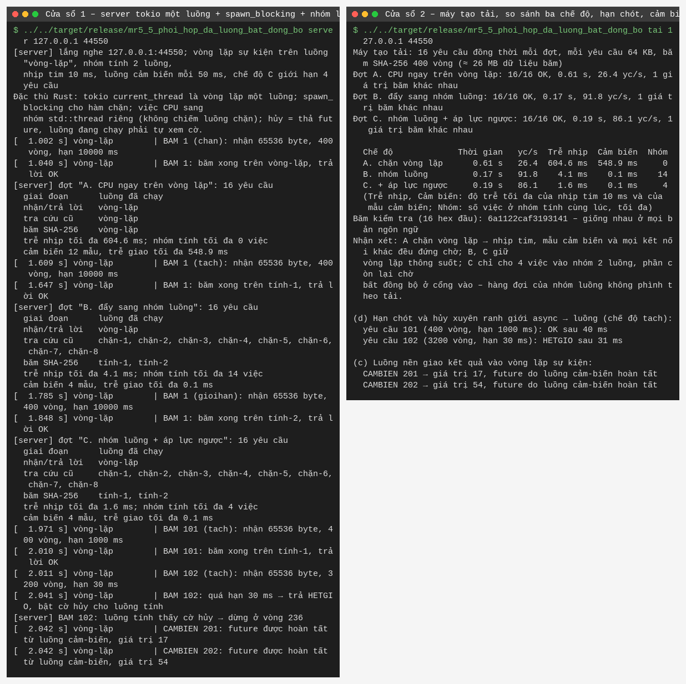

# Bài mở rộng MR5.5 – Phối hợp đa luồng và bất đồng bộ trong server mạng (Rust)

| Thông tin | Nội dung |
|---|---|
| Loại | **Bài mở rộng** – không có trong giáo trình, không có mã giả tương ứng |
| Liên hệ với giáo trình | Chương 5 (Bài 5.1–5.6); Chương 6 (Bài 6.1, 6.2); MR5.4 |
| Thư viện | Crate `tokio` 1.47.1 (`current_thread`, `spawn_blocking`, `time::timeout`, `sync::{mpsc, oneshot, Semaphore}`), `sha2` 0.10.9; `std::thread`, `std::sync::mpsc`, `AtomicBool` |
| Bản ngôn ngữ khác | [Python](../../../python/Chuong05/BaiMR5.5_PhoiHopDaLuongBatDongBo/) (bản tham chiếu), [C#](../../../csharp/Chuong05/BaiMR5.5_PhoiHopDaLuongBatDongBo/), [Java](../../../java/Chuong05/BaiMR5.5_PhoiHopDaLuongBatDongBo/), [Go](../../../go/Chuong05/BaiMR5.5_PhoiHopDaLuongBatDongBo/) |

## Mục tiêu
Cùng kịch bản, giao thức và thông điệp với bản Python: server tokio **một luồng** (`new_current_thread`, giống asyncio) nhận `BAM` (64 KB), gọi **hàm thư viện cũ kiểu chặn** (20 ms) rồi **băm SHA-256** 400 vòng; so sánh ba chế độ A (làm ngay trên vòng lặp – SAI), B (đẩy sang luồng), C (B + áp lực ngược) bằng **nhịp tim 10 ms**; thêm hạn chót/hủy và một luồng nền giao kết quả vào vòng lặp.

| Phần | Cách làm trong Rust |
|---|---|
| (a) việc CPU | nhóm **`std::thread` riêng** `tính-1`, `tính-2` nhận việc qua `std::sync::mpsc`, trả kết quả qua `tokio::sync::oneshot` (gửi được từ luồng thường, phía async `.await`) |
| (b) hàm chặn | `tokio::task::spawn_blocking(tra_cuu_cu).await` – nhóm luồng chặn của tokio (tối đa 8, tên `chặn-k`) |
| (c) luồng nền → async | `std::thread` `cảm-biến` gọi `tokio::sync::mpsc::Sender::blocking_send` (bằng `Handle::block_on(tx.send(..))`); `CAMBIEN` nhận `oneshot::Sender` qua kênh std và gửi kết quả |
| (d) hủy, hạn chót | `tokio::time::timeout(hạn, future)` – hết hạn thì **thả (drop) future**; bật `AtomicBool` để luồng băm đang chạy tự dừng |
| (e) áp lực ngược | `tokio::sync::Semaphore::new(4)`, `acquire().await` |
| (f) cách làm SAI | chế độ `chan`: gọi `tra_cuu_cu()` (`std::thread::sleep`!) và `bam()` ngay trong tác vụ async |

## Liên hệ giáo trình
- **Chương 5 (Bài 5.1–5.6):** bản Rust Chương 5 dùng tokio `current_thread`; hủy bằng tín hiệu và hạn chót (Bài 5.6) – ở đây sang cả luồng thường.
- **Chương 6 (Bài 6.1, 6.2):** nhóm luồng + server bất đồng bộ; nối tiếp [MR5.4](../BaiMR5.4_LuongVaDaLuong/).

## Kiến thức chính
- **Không gọi hàm chặn trong `async fn`:** tokio chỉ chuyển tác vụ ở điểm `.await`; `std::thread::sleep`, đọc tệp đồng bộ, vòng băm dài… giữ chặt luồng runtime. Với `current_thread` cả server đứng; với `multi_thread` thì một luồng worker đứng (và tác vụ khác xếp sau nó).
- **`spawn_blocking` cho hàm chặn, luồng riêng cho việc CPU dài:** nhóm chặn của tokio được thiết kế cho việc *chờ* (tới 512 luồng mặc định); việc CPU nên có nhóm riêng cỡ bằng số CPU (tự dựng bằng `std::thread` như bài, hoặc crate `rayon`) để không chiếm chỗ của hàm chặn và để giới hạn mức song song.
- **Cầu nối luồng thường ↔ async:** `oneshot::Sender::send` và `mpsc::UnboundedSender::send` không cần runtime; `Sender::blocking_send` / `Handle::block_on` chỉ được gọi từ luồng **không** chạy runtime (gọi trong tác vụ async sẽ panic). Ngược lại, tác vụ async chờ luồng thường bằng `.await` trên `oneshot::Receiver` hoặc `JoinHandle` của `spawn_blocking`.
- **Hủy trong async Rust = thả future:** `timeout` thả future đang chờ ở `.await`; mã sau điểm đó không chạy nữa. Nhưng việc đã giao cho luồng khác vẫn chạy → cần cờ `AtomicBool` (hoặc `tokio_util::sync::CancellationToken`) mà luồng kiểm tra.
- **`tokio::spawn` đòi `Send + 'static`:** trạng thái dùng chung giữa các tác vụ bọc `Arc<Mutex<_>>` dù chỉ có một luồng runtime; có thể dùng `Rc<RefCell<_>>` với `tokio::task::LocalSet`.

**Khác biệt so với bản Python:** vòng lặp là runtime tokio một luồng (luồng `main`, hiển thị `vòng-lặp`); nhóm tính là `std::thread` tự dựng, nhóm chặn là của tokio (tên đặt bằng `thread_name_fn`); luồng tính báo “đã xong thật” về vòng lặp qua kênh `mpsc::unbounded_channel` (bản Python dùng `call_soon_threadsafe`).

## Tệp
- `Cargo.toml`, `Cargo.lock` – gói `mr5_5_phoi_hop_da_luong_bat_dong_bo` (tokio 1.47.1, sha2 0.10.9 – ghim phiên bản).
- `src/main.rs` – phân nhánh vai trò; máy tạo tải tokio (16 tác vụ mỗi đợt), bảng so sánh, hạn chót, `CAMBIEN`.
- `src/may_chu.rs` – server: runtime một luồng, `spawn_blocking`, nhóm luồng tính, luồng cảm biến, nhịp tim, thống kê.
- `src/chung.rs` – hằng số, `bam()` (SHA-256 có cờ hủy), `tra_cuu_cu()`, nhật ký.
- `demo.json`; `ket_qua.txt`, `ket_qua.png` – kết quả thực thi thật.

## Cách chạy
```bash
cargo build -q --release
cargo run -q --release -- server 127.0.0.1 9000     # cửa sổ 1
cargo run -q --release -- tai    127.0.0.1 9000     # cửa sổ 2
```
Tái lập: `python3 tools/demo.py rust/Chuong05/BaiMR5.5_PhoiHopDaLuongBatDongBo` (cổng 44550). Client Rust chạy được với server Java (đã thử: cùng giá trị băm `6a1122caf3193141`).

## Kết quả


Lần chạy trong ảnh (Linux, 2 CPU, Rust 1.97):

| Chế độ | Thời gian 16 yêu cầu | Trễ nhịp tối đa | Trễ giao mẫu cảm biến | Việc ở nhóm tính tối đa |
|---|---|---|---|---|
| A. chặn vòng lặp | 0,61 s | 605 ms | 549 ms | 0 |
| B. đẩy sang luồng | 0,17 s | 4,1 ms | 0,1 ms | 14 |
| C. + áp lực ngược | 0,19 s | 1,6 ms | 0,1 ms | 4 |

- Bảng giai đoạn: ở B, C tra cứu cũ chạy trên `chặn-1…chặn-8`, băm trên `tính-1`, `tính-2`.
- **(d)** yêu cầu 102 (hạn 30 ms) nhận `HETGIO` sau 31 ms; luồng băm dừng ở vòng 236.

## Bài tập gợi ý
1. Chuyển server sang `new_multi_thread().worker_threads(2)` và chạy lại chế độ A: trễ nhịp còn bao nhiêu? Vì sao vẫn không nên chặn?
2. Đưa cả việc băm vào `spawn_blocking` (bỏ nhóm `std::thread`): số luồng `chặn-k` và trễ nhịp thay đổi thế nào? Giới hạn mức song song bằng `Semaphore` ra sao?
3. Dùng `tokio::task::block_in_place` (chỉ với runtime nhiều luồng) cho hàm chặn và so sánh với `spawn_blocking`.
4. Thay `Arc<Mutex<ThongKe>>` bằng `Rc<RefCell<ThongKe>>` + `LocalSet::spawn_local`.
5. Thêm hạn chờ ở cổng vào cho chế độ C (`tokio::time::timeout` quanh `acquire()`): quá 100 ms thì trả `503`.

## Đọc thêm
- Tokio: [*Bridging with sync code*](https://tokio.rs/tokio/topics/bridging), [Tutorial – Spawning](https://tokio.rs/tokio/tutorial/spawning); API [`spawn_blocking`](https://docs.rs/tokio/1.47.1/tokio/task/fn.spawn_blocking.html), [`mpsc::Sender::blocking_send`](https://docs.rs/tokio/1.47.1/tokio/sync/mpsc/struct.Sender.html#method.blocking_send), [`Handle::block_on`](https://docs.rs/tokio/1.47.1/tokio/runtime/struct.Handle.html#method.block_on), [`time::timeout`](https://docs.rs/tokio/1.47.1/tokio/time/fn.timeout.html), [`sync::Semaphore`](https://docs.rs/tokio/1.47.1/tokio/sync/struct.Semaphore.html).
- *The Rust Programming Language*: [Chương 17 – Async and Await](https://doc.rust-lang.org/book/ch17-00-async-await.html).

Mã nguồn của bài được viết mới cho kho này; các tài liệu trên chỉ là nguồn tham khảo kiến thức.
