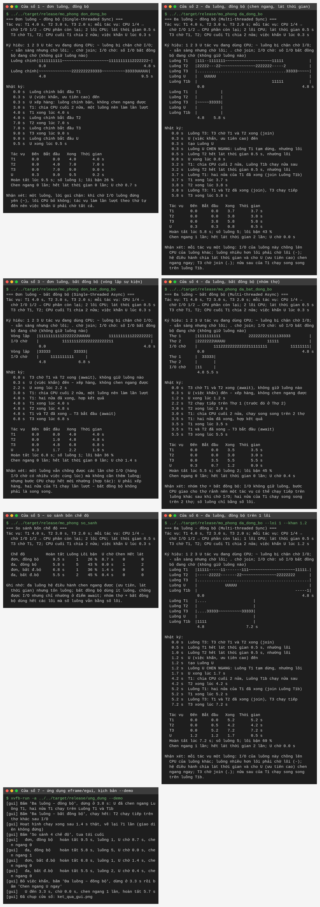
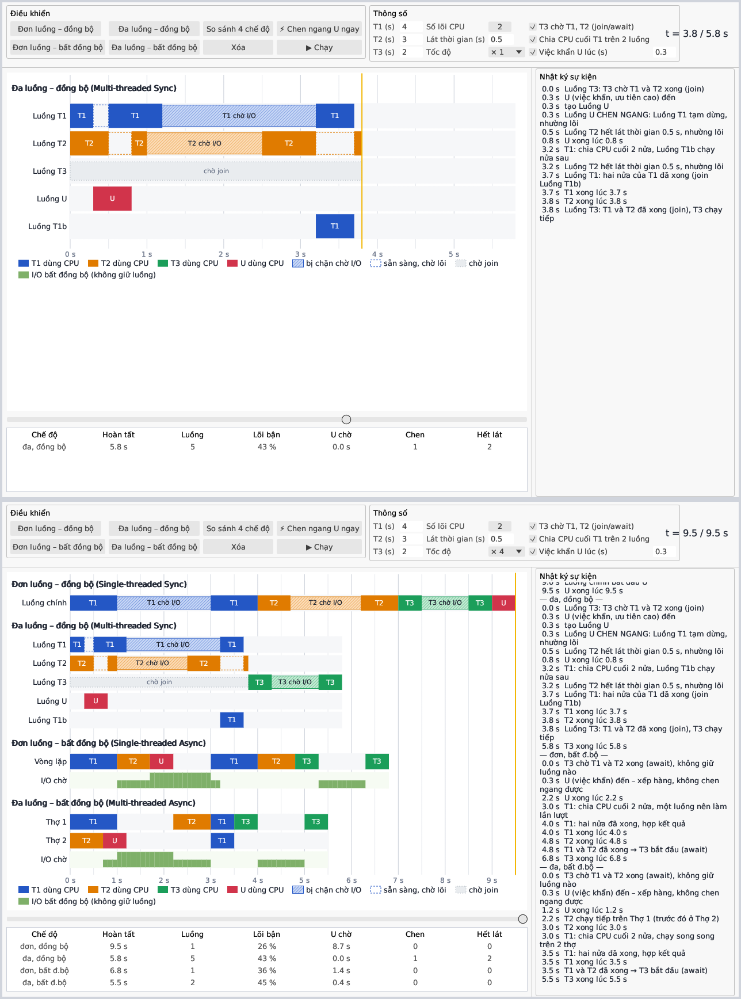

# Bài mở rộng MR5.6 – Mô phỏng thực thi tác vụ: đơn luồng/đa luồng × đồng bộ/bất đồng bộ, chen ngang, phụ thuộc, một việc trên hai luồng (Rust)

| Thông tin | Nội dung |
|---|---|
| Loại | **Bài mở rộng** – không có trong giáo trình, không có mã giả tương ứng |
| Liên hệ với giáo trình | Chương 5: Bài 5.1–5.3 (bất đồng bộ, giao diện không treo), Bài 5.2 (giới hạn đồng thời); Chương 6: Bài 6.1, 6.2 (server đa luồng, nhóm luồng, server bất đồng bộ); MR1.2 (mô phỏng bên trong máy chủ), MR5.2, MR5.4, MR5.5 (đo thật cùng các mô hình) |
| Thư viện | Lõi và bản dòng lệnh: chỉ thư viện chuẩn. Giao diện: crate `eframe`/`egui` 0.29.1 (`glow`, `x11`, `wayland`, `default_fonts`), `miniz_oxide` 0.8.9 (nén zlib cho ảnh PNG chụp cửa sổ). Không tạo luồng thật – luồng, lõi CPU, lát thời gian, vòng lặp sự kiện đều được mô phỏng trong `src/lap_lich.rs` |
| Bản ngôn ngữ khác | [Python](../../../python/Chuong05/BaiMR5.6_MoPhongThucThiTacVu/) (bản tham chiếu), [C#](../../../csharp/Chuong05/BaiMR5.6_MoPhongThucThiTacVu/), [Java](../../../java/Chuong05/BaiMR5.6_MoPhongThucThiTacVu/), [Go](../../../go/Chuong05/BaiMR5.6_MoPhongThucThiTacVu/) |

## Mục tiêu
Một ứng dụng giao diện để **nhìn thấy** cùng một khối việc chạy khác nhau thế nào khi tổ chức chương trình theo bốn cách – *đơn luồng/đa luồng × đồng bộ/bất đồng bộ* – theo thời gian, với đủ các hiện tượng mà sinh viên thường chỉ đọc trong sách: chờ I/O chặn luồng, chồng thời gian chờ, tranh lõi CPU, **chia lát thời gian**, **chen ngang** của việc ưu tiên cao, **phụ thuộc** (join/await), **một công việc chạy trên hai luồng** (chia đôi chạy song song; chạy tiếp trên luồng khác sau khi chờ I/O).

Ba tác vụ T1, T2, T3 (thời lượng nhập được, mặc định 4, 3, 2 s), mỗi tác vụ: **CPU 1/4 → chờ I/O 1/2 → CPU phần còn lại**. Tùy chọn: T3 chờ T1 và T2; chia bước CPU cuối của T1 làm hai nửa chạy cùng lúc (chỉ khi bước đó dài ít nhất 0,2 s); **việc khẩn U** (0,5 s CPU, ưu tiên cao) đến lúc 0,3 s hoặc lúc bấm nút *Chen ngang U ngay*; số lõi CPU (1–4); lát thời gian (mặc định 0,5 s).

| Chế độ | Cách chạy | Điều cần quan sát |
|---|---|---|
| Đơn luồng – đồng bộ | một luồng, lời gọi chặn, làm lần lượt theo thứ tự đến | luồng đứng yên khi chờ I/O; U phải chờ tất cả (8,7 s) |
| Đa luồng – đồng bộ | mỗi tác vụ một luồng hệ điều hành; bộ lập lịch cấp lõi theo ưu tiên rồi thứ tự đến, chia lát thời gian, cho ưu tiên cao chen ngang | U chen ngang Luồng T1 ngay khi đến (chờ 0 s); luồng hết lát thì nhường lõi; T3 chờ join; nửa sau của T1 chạy trên Luồng T1b song song; 5 luồng |
| Đơn luồng – bất đồng bộ | một luồng chạy vòng lặp sự kiện; bước CPU chạy trên vòng lặp tới khi xong; chờ I/O không giữ luồng; hàng việc FIFO | hàng *I/O chờ* có 2 lệnh chờ cùng lúc (T1, T2) mà chỉ một luồng; U xếp hàng sau T2 (chờ 1,4 s); hai nửa của T1 chạy lần lượt – bất đồng bộ không phải là song song |
| Đa luồng – bất đồng bộ | nhóm thợ (số thợ = số lõi), mỗi bước CPU giao cho thợ rảnh đầu tiên | T2 bắt đầu trên Thợ 2, sau I/O **chạy tiếp trên Thợ 1**; hai nửa của T1 chạy song song trên 2 thợ; hoàn tất sớm nhất (5,5 s) với 2 luồng |

## Kiến thức chính
- **Đồng bộ và bất đồng bộ.** Lời gọi đồng bộ (chặn, ví dụ `TcpStream::read` của `std`) giữ luồng suốt thời gian chờ I/O; lời gọi bất đồng bộ (`tokio::net::TcpStream::read(..).await`) đăng ký chờ rồi trả luồng lại cho runtime, kết quả đến sau như một sự kiện. Vì vậy *đơn luồng – bất đồng bộ* (`tokio` với `#[tokio::main(flavor = "current_thread")]`) chồng được các lần chờ I/O mà không cần thêm luồng.
- **Đơn luồng và đa luồng.** `std::thread::spawn` tạo một luồng hệ điều hành; nhiều luồng thì nhiều việc tiến triển cùng lúc; *song song thật* chỉ có khi có nhiều lõi (ở chế độ 1 lõi, các luồng chỉ xen kẽ nhau). `std::thread::available_parallelism()` cho số lõi.
- **Bộ lập lịch hệ điều hành** (mô phỏng): mỗi nhịp 0,1 s, lõi trống được cấp cho luồng sẵn sàng có ưu tiên cao nhất, cùng ưu tiên thì luồng chờ lâu nhất; luồng chạy hết **lát thời gian** mà có luồng cùng hoặc cao hơn ưu tiên đang chờ thì phải nhường (round-robin); luồng **ưu tiên cao** sẵn sàng mà không còn lõi thì **chen ngang** (preemption) luồng ưu tiên thấp đang chạy. Luồng bị chen ngang chuyển sang *sẵn sàng* (ô viền đứt), không mất công đã làm.
- **Đa nhiệm hợp tác** (cooperative): runtime `tokio` chỉ đổi việc ở điểm `.await`; một bước CPU dài trong `async fn` làm mọi tác vụ khác trên luồng đó chờ – nên việc khẩn U không chen ngang được. Việc CPU dài nên chuyển sang `tokio::task::spawn_blocking` (nhóm luồng riêng) hoặc tự nhường bằng `tokio::task::yield_now().await`.
- **Phụ thuộc:** T3 chờ T1, T2 bằng `JoinHandle::join()` (đồng bộ – luồng T3 bị chặn, ô chấm) hoặc `tokio::join!(t1, t2)` / `futures::future::join_all` (bất đồng bộ – không giữ luồng nào, T3 chỉ xuất hiện khi bắt đầu chạy).
- **Một việc trên hai luồng:** (1) chia đôi phần CPU và chạy hai nửa song song (`std::thread::scope` với hai luồng, hoặc hai `spawn_blocking`) rồi hợp kết quả – chỉ nhanh hơn khi có ≥ 2 lõi; (2) ở nhóm thợ + bất đồng bộ (`tokio` mặc định `multi_thread`, `tokio::spawn`), phần tiếp theo sau `.await` chạy trên thợ rảnh bất kỳ – nhờ *work stealing* – không nhất thiết luồng cũ; vì vậy future đưa vào `tokio::spawn` phải là `Send + 'static`.
- **Tất định:** mô phỏng không dùng luồng thật và không ngẫu nhiên nên cùng tham số cho cùng biểu đồ ở cả năm ngôn ngữ; bấm *Chen ngang U ngay* lúc t chỉ là mô phỏng lại với U đến lúc t – phần trước t không đổi. Bản Rust đổi giây → nhịp bằng `f64::round_ties_even` để làm tròn giống `round()` của Python (0,25 s → 2 nhịp).

## Cấu trúc tệp
- `src/lap_lich.rs` – thư viện `lap_lich` (bộ lập lịch mô phỏng, chỉ thư viện chuẩn): `ThamSo`, `Viec`, chế độ đồng bộ (`DongBo`: luồng, hàng sẵn sàng, cấp lõi, lát thời gian, chen ngang, join, luồng phụ) và bất đồng bộ (`BatDongBo`: vòng lặp/nhóm thợ, hàng việc FIFO, I/O không giữ luồng, join), chỉ số, biểu đồ Gantt văn bản. Mỗi luồng là một chỉ số trong `Vec<Luong>` thay cho tham chiếu đối tượng.
- `src/mo_phong.rs` – chương trình `mo_phong` (dòng lệnh): in tham số, Gantt, nhật ký, bảng tác vụ, chỉ số, nhận xét; lệnh `so_sanh`, `tat_ca`.
- `src/ung_dung.rs` – chương trình `ung_dung` (eframe/egui): nút bốn chế độ, *So sánh 4 chế độ*, *Xóa*, *Chen ngang U ngay*, *Dừng/Chạy*, thanh kéo thời gian, tốc độ; ô nhập thời lượng T1–T3, số lõi, lát thời gian, ba tùy chọn; Gantt hoạt hình, bảng chỉ số, nhật ký sự kiện, chú giải; vai trò `--demo` tự thao tác và chụp `ket_qua_gui.png`.
- `Cargo.toml`, `Cargo.lock` – một crate, hai chương trình (ghim phiên bản như các bài giao diện Rust khác của kho).
- `demo.json` – kịch bản chạy minh họa; `ket_qua.txt`, `ket_qua.png`, `ket_qua_gui.png` – kết quả thực thi thật.

## Cách chạy
Trong thư mục bài (`cargo build -q --release` một lần; các bài Rust dùng chung thư mục `../../target`):
```bash
cargo run --release --bin ung_dung                                   # ứng dụng giao diện
../../target/release/mo_phong da_dong_bo                             # bản dòng lệnh, một chế độ
../../target/release/mo_phong so_sanh --loi 1                        # so sánh bốn chế độ trên 1 lõi
../../target/release/mo_phong da_bat_dong_bo --t1 6 --khong-chia --khan 2
```
Windows (cần Rust bản MSVC như các bài khác; `eframe` không cần cài thêm thư viện nào): `cargo build --release` rồi `..\..\target\release\ung_dung.exe`, `..\..\target\release\mo_phong.exe so_sanh`.

Tham số dòng lệnh: `--t1 --t2 --t3` (giây), `--loi` (số lõi), `--lat` (lát thời gian, giây), `--khan` (lúc U đến), `--khong-khan`, `--khong-phu-thuoc`, `--khong-chia`. Tái lập kết quả từ thư mục gốc của kho: `python3 tools/demo.py rust/Chuong05/BaiMR5.6_MoPhongThucThiTacVu` (bước giao diện cần X11/OpenGL – dưới Linux không màn hình dùng `xvfb-run` với Mesa, ví dụ `sudo apt-get install -y xvfb libgl1-mesa-dri libxkbcommon-x11-0`).

## Kết quả thực thi


Ảnh ứng dụng (trên: *Đa luồng – đồng bộ* dừng ở 3,8 s – U đã chen ngang Luồng T1 lúc 0,3 s, Luồng T2 hết lát nhường lõi, hai nửa T1 chạy cùng lúc trên Luồng T1 và T1b, T3 đang chờ join; dưới: *So sánh 4 chế độ* chạy hết):



| Chế độ (mặc định, 2 lõi) | Hoàn tất | Luồng | Lõi bận | U chờ | Chen ngang | Hết lát |
|---|---|---|---|---|---|---|
| đơn luồng, đồng bộ | 9,5 s | 1 | 26 % | 8,7 s | 0 | 0 |
| đa luồng, đồng bộ | 5,8 s | 5 | 43 % | 0,0 s | 1 | 2 |
| đơn luồng, bất đồng bộ | 6,8 s | 1 | 36 % | 1,4 s | 0 | 0 |
| đa luồng, bất đồng bộ | 5,5 s | 2 | 45 % | 0,4 s | 0 | 0 |

Cửa sổ 6 chạy *đa luồng – đồng bộ* trên 1 lõi, U đến lúc 1,2 s: T1 và T2 xen kẽ từng lát 0,5 s, U chen ngang T1; hai nửa của T1 không còn song song (Luồng T1b chờ lõi) nên hoàn tất 7,2 s. Đầu ra dòng lệnh trùng từng ký tự với bản Python (đã so bằng `cmp` cho mọi tiến trình của `demo.json` và hơn 300 tổ hợp tham số khác). Kiểm thử: Linux, Rust 1.97.0; giao diện dưới Xvfb + Mesa llvmpipe.

## Ghi chú
- Mô hình đã đơn giản hóa: chuyển ngữ cảnh tốn 0; luồng phụ T1b và luồng U được tạo tức thời; I/O không giới hạn số lệnh cùng lúc; vòng lặp/nhóm thợ dùng hàng FIFO (không ưu tiên); số thợ bằng số lõi nên thợ không phải tranh lõi. (Bộ lập lịch thật của `tokio` có hàng cục bộ cho từng thợ và *work stealing*; ở đây chỉ một hàng chung để dễ theo dõi.)
- Thứ tự trong một nhịp: tác vụ đến → các luồng sang thao tác kế tiếp (hai lượt, để join thấy ngay luồng vừa kết thúc) → lập lịch (hết lát → cấp lõi trống → chen ngang: nạn nhân là luồng ưu tiên thấp nhất, rồi đã chạy lâu nhất trong lát, rồi đứng đầu) → chạy một nhịp. Các bản ngôn ngữ khác theo đúng thứ tự này nên in trùng từng ký tự. Căn lề `{:<11}` của Rust đếm theo ký tự Unicode như Python.
- Ứng dụng giao diện chỉ dùng luồng giao diện: mô phỏng chạy trong vài mili giây, hoạt hình bằng `ctx.request_repaint_after(30 ms)`; không có luồng nền nên không cần `Mutex`/kênh. egui là *immediate mode*: mỗi khung hình hàm `update` dựng lại toàn bộ giao diện từ trạng thái, nên thanh kéo, bảng, nhật ký luôn khớp với thời điểm đang xem.
- Phông mặc định của egui thiếu nhiều chữ tiếng Việt có dấu; chương trình nạp thêm phông hệ thống (Segoe UI/Arial trên Windows, DejaVu Sans/Noto Sans trên Linux). Vai trò `--demo` chụp cửa sổ bằng `ViewportCommand::Screenshot` và tự ghi PNG (không cần ImageMagick).

## Bài tập gợi ý
1. Đặt số lõi 1, 2, 4 và so sánh bốn chế độ: chế độ nào nhanh lên khi thêm lõi, chế độ nào không? Vì sao *đơn luồng – bất đồng bộ* không đổi?
2. Đổi lát thời gian 0,1 s và 2 s ở *đa luồng – đồng bộ* trên 1 lõi: số lần hết lát, thời gian chờ của từng tác vụ thay đổi thế nào? Lát quá nhỏ trong thực tế tốn gì (chuyển ngữ cảnh)?
3. Thêm ưu tiên cho hàng việc của nhóm thợ (U đứng đầu hàng): U chờ còn bao lâu? Vì sao vẫn không bằng 0?
4. Thêm “chia nhỏ việc CPU” cho chế độ bất đồng bộ: mỗi bước CPU dài hơn 0,2 s tự nhường (`yield_now().await`) sau mỗi 0,2 s. U chờ bao lâu? So sánh với chen ngang của hệ điều hành.
5. (Nâng cao) Đổi tỉ lệ CPU/I/O của tác vụ thành 80/20 (việc nặng CPU) rồi 10/80 (việc nặng I/O) và kết luận mô hình nào hợp với máy chủ mạng thông thường.

## Đọc thêm
- *The Rust Programming Language*, chương 16 “Fearless Concurrency” (`thread::spawn`, `join`, kênh, `Mutex`) và chương 17 “Fundamentals of Asynchronous Programming: Async, Await, Futures, and Streams” (doc.rust-lang.org/book); tài liệu `std::thread` (`spawn`, `scope`, `available_parallelism`) tại doc.rust-lang.org/std/thread.
- Tokio Tutorial – *Spawning*, *Async in depth*, *Select* (tokio.rs/tokio/tutorial); tài liệu `tokio::task` (`spawn`, `spawn_blocking`, `yield_now`), `tokio::join!`, `tokio::runtime` (`current_thread`, `multi_thread`) tại docs.rs/tokio.
- Tài liệu `egui`/`eframe` (docs.rs/egui, docs.rs/eframe) – mô hình immediate mode, `Painter`, `request_repaint_after`.
- A. Silberschatz, P. B. Galvin, G. Gagne, *Operating System Concepts*, Wiley – chương *CPU Scheduling* (round-robin, ưu tiên, preemption) và *Threads & Concurrency*.
- Dan Kegel, *The C10K problem* (kegel.com/c10k.html) – các mô hình máy chủ: mỗi kết nối một luồng, nhóm luồng, vòng lặp sự kiện.

Mã nguồn của bài được viết mới cho kho này; các tài liệu trên chỉ là nguồn tham khảo kiến thức.
