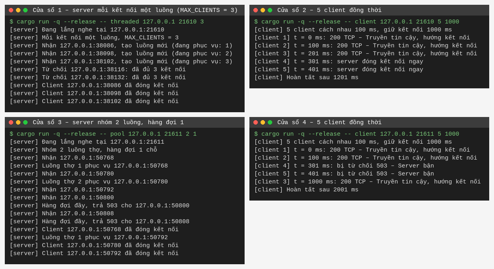

# Bài 6.1 – Server tra cứu đa luồng và server nhóm luồng (Rust)

| Thông tin | Nội dung |
|---|---|
| Mã giả tương ứng | Mã giả 6.1 (Server đa luồng: mỗi kết nối một luồng), Mã giả 6.2 (Server dùng nhóm luồng và hàng đợi có giới hạn) |
| Mục giáo trình | 6.2.1 Luồng cho mỗi kết nối, 6.2.2 Nhóm luồng |
| Kế thừa | Mã giả 2.1 (PARSE_ENDPOINT), 2.2 (SAFE_CONNECT), 3.1 (khung server), 3.4 (RECV_EXACT), 3.6 (khung JSON), 3.7 (PROCESS_REQUEST, HANDLE_LOOKUP), 3.8 (client tra cứu, rút gọn) |
| Thư viện | Thư viện chuẩn: `std::net`, `std::thread`, `std::sync` (`AtomicUsize`, `Mutex`, `mpsc::sync_channel`); crate `serde_json` (JSON) |

## Mục tiêu
Chuyển server tra cứu tuần tự của Chương 3 thành server phục vụ đồng thời nhiều client theo hai cách: mỗi kết nối một luồng có trần `MAX_CLIENTS`, và nhóm k luồng thợ với hàng đợi có giới hạn, trả mã 503 khi hàng đợi đầy (áp lực ngược). Phần nghiệp vụ `HANDLE_LOOKUP` được giữ nguyên.

## Tệp
- `src/main.rs` – phân nhánh theo tham số `threaded` / `pool` / `client`.
- `src/thread_server.rs` – Mã giả 6.1: `run` (THREADED_SERVER), `serve` (SERVE), `AtomicCounter`.
- `src/pool_server.rs` – Mã giả 6.2: `run` (POOL_SERVER), `worker` (WORKER).
- `src/lookup_service.rs` – Mã giả 3.7: `process_request`, `handle_lookup`.
- `src/netutil.rs` – Mã giả 2.1, 2.2, 3.4, 3.6.
- `src/multi_client.rs` – chương trình mở n client tra cứu đồng thời.
- `glossary.json` – từ điển thuật ngữ.
- `Cargo.toml`, `Cargo.lock` – gói Cargo `bai6_1_server_da_luong`.
- `demo.json` – kịch bản chạy minh họa (dùng với `tools/demo.py`).
- `ket_qua.txt`, `ket_qua.png` – kết quả thực thi thật.

## Cách chạy
Mở các cửa sổ dòng lệnh trong thư mục bài:
```bash
cargo build --release
# Cửa sổ 1 – server mỗi kết nối một luồng (mặc định 0.0.0.0 9000, MAX_CLIENTS 500)
cargo run --release -- threaded 0.0.0.0 9000
# hoặc server nhóm luồng: k = 8 luồng thợ, hàng đợi 16 chỗ
cargo run --release -- pool 0.0.0.0 9000 8 16
# Cửa sổ 2 – 5 client đồng thời, mỗi client giữ kết nối 1000 ms
cargo run --release -- client 127.0.0.1 9000 5 1000
```
Dừng server bằng Ctrl+C.

## Kết quả thực thi


Kịch bản chạy hai server với tham số nhỏ để thấy rõ giới hạn: server mỗi kết nối một luồng với `MAX_CLIENTS = 3` phục vụ ngay ba client đầu (mỗi client một luồng, client 2 và 3 không phải chờ client 1 giữ kết nối), client 4 và 5 bị đóng kết nối ngay sau `ACCEPT`. Server nhóm 2 luồng thợ, hàng đợi 1 chỗ phục vụ ngay client 1, 2; client 3 nằm trong hàng đợi và chỉ được phục vụ ở t ≈ 1000 ms khi luồng thợ 1 rảnh; client 4, 5 nhận phản hồi `503 Server bận`.

## Ghi chú
- Phần nghiệp vụ dùng `HANDLE_LOOKUP` (khung JSON, Mã giả 3.7) thay cho `HANDLE_ECHO` vì Mã giả 6.2 trả lỗi 503 dưới dạng khung JSON; Mục 6.2 cho phép giữ nguyên `HANDLE_ECHO` hoặc `HANDLE_LOOKUP`.
- `serve` ghi nhật ký mọi lỗi trả về từ `handle_lookup` (`NetError::ConnectionClosed` khi đóng giữa khung, `NetError::Protocol` khi khung quá lớn, `NetError::Io` gồm hết thời gian chờ) như khối `CATCH` của Mã giả 3.1; Mã giả 6.1 chỉ ghi `NetError`, `Timeout`. Phần `FINALLY` (đóng socket, giảm bộ đếm) luôn chạy sau đó.
- `TcpListener::bind` gộp bốn bước `SOCKET`, `SETOPT(REUSEADDR)`, `BIND`, `LISTEN`: trên Linux/macOS thư viện chuẩn Rust tự bật `SO_REUSEADDR` và dùng backlog 128, đúng giá trị của Mã giả 6.1.
- Tham số thứ ba của server mỗi kết nối một luồng ghi đè `MAX_CLIENTS` (mặc định 500) để minh họa. Giáo trình không quy định giá trị mặc định của k và `queue_size`; bài chọn k = 8 (theo ví dụ ở Mục 6.2.2) và 16.
- `ATOMIC_COUNTER` là `Arc<AtomicUsize>` (`fetch_add`, `fetch_sub`); `BLOCKING_QUEUE` là `mpsc::sync_channel(queue_size)`: `try_send` = `try_put` (trả lại kết nối khi đầy), `recv` = `take`. Các luồng thợ dùng chung đầu nhận nên đầu nhận được bọc trong `Arc<Mutex<…>>`. `println!` khóa stdout trong lúc in một dòng nên các luồng không in chen vào giữa dòng của nhau.
- Khi server đóng kết nối ngay sau `ACCEPT` trong lúc yêu cầu của client đã đến, hệ điều hành gửi RST thay cho FIN; client có thể thấy EOF hoặc lỗi `ConnectionReset` và cả hai đều được báo là "server đóng kết nối ngay". Trên Linux, phản hồi 503 đã nằm trong bộ đệm nhận vẫn đọc được sau RST.
- `multi_client` là chương trình minh họa bổ sung (không có trong mã giả): các client khởi động cách nhau 100 ms để thứ tự `ACCEPT` ổn định; thời điểm t thay đổi nhẹ giữa các lần chạy.
- Thư viện chuẩn Rust không có hàm bắt Ctrl+C, nên server dừng ngay khi nhận tín hiệu và không in dòng `[server] Dừng server` như bản Python.
- Tệp `glossary.json` được đọc theo đường dẫn thư mục gói (`CARGO_MANIFEST_DIR`), nên chạy được từ thư mục bất kỳ.
- Kiểm thử: Linux, Rust 1.97.0, serde_json 1.0.154.
