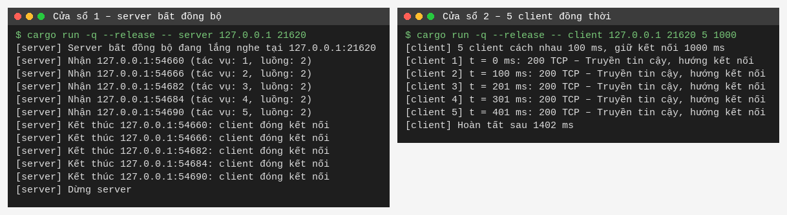

# Bài 6.2 – Server tra cứu bất đồng bộ (Rust)

| Thông tin | Nội dung |
|---|---|
| Mã giả tương ứng | Mã giả 6.3 (Server bất đồng bộ: mỗi kết nối một tác vụ) |
| Mục giáo trình | 6.2.3 Server bất đồng bộ |
| Kế thừa | Mã giả 6.1 (SOCKET, SETOPT, BIND, LISTEN), 5.1 (RECV_JSON_ASYNC, SEND_JSON_ASYNC), 3.7 (PROCESS_REQUEST), 2.1; client: 2.2, 3.6, 3.8 (rút gọn) |
| Thư viện | crate `tokio` (`TcpSocket`, `TcpListener`, `spawn`, `time::timeout`, `signal::ctrl_c`), `serde_json`; client dùng thư viện chuẩn `std::net`, `std::thread` |

## Mục tiêu
Phục vụ mỗi kết nối bằng một tác vụ bất đồng bộ thay cho một luồng: khi tác vụ chờ ở `AWAIT RECV_JSON_ASYNC`, nó không chiếm luồng nào. Mã nguồn gần như giống phiên bản đa luồng, chỉ khác ở các lời gọi bất đồng bộ (`async fn`, `.await`).

## Tệp
- `src/main.rs` – phân nhánh theo tham số `server` / `client`.
- `src/async_server.rs` – Mã giả 6.3: `async_server` (ASYNC_SERVER), `serve_async` (SERVE_ASYNC), `process_request` (Mã giả 3.7).
- `src/async_frame.rs` – Mã giả 5.1: `recv_json_async`, `send_json_async`.
- `src/netutil.rs` – Mã giả 2.1, 2.2, 3.4, 3.6 (dùng cho client đồng bộ).
- `src/multi_client.rs` – chương trình mở n client tra cứu đồng thời.
- `glossary.json` – từ điển thuật ngữ.
- `Cargo.toml`, `Cargo.lock` – gói Cargo `bai6_2_server_bat_dong_bo`.
- `demo.json` – kịch bản chạy minh họa (dùng với `tools/demo.py`).
- `ket_qua.txt`, `ket_qua.png` – kết quả thực thi thật.

## Cách chạy
Mở các cửa sổ dòng lệnh trong thư mục bài:
```bash
cargo build --release
# Cửa sổ 1 – server (mặc định 0.0.0.0 9000)
cargo run --release -- server 0.0.0.0 9000
# Cửa sổ 2 – 5 client đồng thời, mỗi client giữ kết nối 1000 ms
cargo run --release -- client 127.0.0.1 9000 5 1000
```
Dừng server bằng Ctrl+C.

## Kết quả thực thi


Năm client khởi động cách nhau 100 ms đều được phục vụ ngay (t ≈ 0, 100, …, 400 ms) dù các client trước vẫn giữ kết nối. Số tác vụ tăng theo số client trong khi số luồng thợ không đổi, minh họa việc tác vụ đang chờ không chiếm luồng.

## Ghi chú
- `SERVE_ASYNC` không có thao tác `bye` (khác `HANDLE_LOOKUP` của Mã giả 3.7), nên client chỉ đóng kết nối; server nhận `ConnectionClosed` với 0 byte và ghi "client đóng kết nối".
- Mã giả không liệt kê `JsonError` trong khối `CATCH`; bản cài đặt coi JSON sai như `ProtocolError` và kết thúc phiên (Mã giả 3.7 thì trả 400 và tiếp tục).
- Con số "luồng" in ra có ý nghĩa khác nhau giữa các nền tảng; điểm cần quan sát là con số này không tăng theo số client. Ở bản Rust, "luồng" là số luồng thợ của môi trường chạy đa luồng tokio (`metrics().num_workers()`, mặc định bằng số lõi CPU; máy kiểm thử có 2 lõi).
- Socket lắng nghe được tạo đúng bốn bước của Mã giả 6.1 bằng `TcpSocket`: `new_v4` (SOCKET), `set_reuseaddr` (SETOPT), `bind`, `listen(128)`; `TcpListener::bind` của tokio cũng làm được nhưng dùng backlog 1024.
- `ACCEPT_ASYNC` là `srv.accept().await`; `RUN_BACKGROUND` là `tokio::spawn` (không chờ). Bộ đếm `tasks` (`AtomicUsize`) đếm số tác vụ đang chạy để in ra. `WITH_TIMEOUT` là `tokio::time::timeout`.
- `RECV_EXACT_ASYNC` tự lặp `read` thay cho `read_exact` để biết số byte đã nhận khi đối tác đóng giữa khung (`read_exact` chỉ báo `UnexpectedEof`).
- Client đồng bộ (luồng và socket chặn) không cần tokio nên chạy ngoài môi trường bất đồng bộ.
- Kiểm thử: Linux, Rust 1.97.0, tokio 1.54.1, serde_json 1.0.154.
