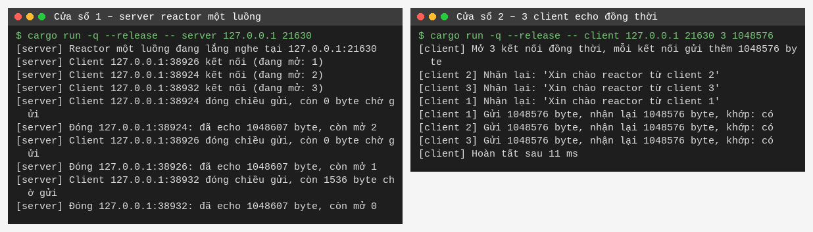

# Bài 6.3 – Server echo một luồng theo mô hình reactor (Rust)

| Thông tin | Nội dung |
|---|---|
| Mã giả tương ứng | Mã giả 6.4 (Server echo một luồng dùng dồn kênh vào/ra) |
| Mục giáo trình | 6.2.4 Dồn kênh vào/ra và mô hình reactor |
| Kế thừa | Mã giả 3.1 (chức năng echo, SOCKET/SETOPT/BIND/LISTEN), 2.1; client: 2.2, 3.2, 3.4 (RECV_EXACT) |
| Thư viện | crate `polling` (epoll trên Linux, kqueue trên macOS, IOCP trên Windows); thư viện chuẩn `std::net`, `std::thread` (client) |

## Mục tiêu
Phục vụ nhiều client bằng một luồng duy nhất: mọi socket ở chế độ không chặn, vòng lặp chỉ chặn tại `SELECT` rồi xử lý các socket đã sẵn sàng. Mỗi kết nối có bộ đệm gửi riêng vì `SEND` có thể chỉ gửi một phần; socket có bộ đệm gửi đạt `MAX_BUF` bị loại khỏi tập theo dõi đọc (áp lực ngược). Client đóng chiều gửi (FIN) được đưa vào tập `closing`: server gửi nốt phần dữ liệu còn lại rồi mới đóng.

## Tệp
- `src/main.rs` – phân nhánh theo tham số `server` / `client`.
- `src/reactor_server.rs` – Mã giả 6.4: `run` (REACTOR_SERVER) với `polling::Poller`.
- `src/echo_clients.rs` – n client echo đồng thời, kiểm tra dữ liệu nhận lại.
- `src/netutil.rs` – Mã giả 2.1, 2.2, 3.4.
- `Cargo.toml`, `Cargo.lock` – gói Cargo `bai6_3_reactor`.
- `demo.json` – kịch bản chạy minh họa (dùng với `tools/demo.py`).
- `ket_qua.txt`, `ket_qua.png` – kết quả thực thi thật.

## Cách chạy
Mở các cửa sổ dòng lệnh trong thư mục bài:
```bash
cargo build --release
# Cửa sổ 1 – server (mặc định 0.0.0.0 9000)
cargo run --release -- server 0.0.0.0 9000
# Cửa sổ 2 – 3 kết nối đồng thời, mỗi kết nối gửi thêm khối 1 MiB
cargo run --release -- client 127.0.0.1 9000 3 1048576
```
Dừng server bằng Ctrl+C.

## Kết quả thực thi


Ba kết nối được một luồng duy nhất phục vụ xen kẽ. Mỗi client nhận lại đúng dòng chào và đúng khối 1 048 576 byte giả ngẫu nhiên; khi đóng, server ghi tổng số byte đã echo của từng kết nối. Một client gửi FIN lúc server còn dữ liệu chờ gửi (ví dụ 1 536 byte): kết nối nằm trong `closing` đến khi gửi hết rồi mới đóng, nên client vẫn nhận đủ khối.

## Ghi chú
- Thư viện chuẩn Rust không có `select`/`poll`, nên bài dùng crate `polling` (một lớp mỏng trên epoll, kqueue, IOCP). Mỗi socket được gắn một khóa số (`key`); bảng `out_buf` của mã giả là `HashMap<usize, Conn>`, mỗi `Conn` giữ socket và bộ đệm gửi.
- `polling` mặc định ở chế độ "một lần" (oneshot): sau mỗi sự kiện phải khai báo lại mối quan tâm. Vì vậy mỗi vòng lặp gọi `modify` cho từng socket với cờ đọc = "chưa đóng chiều gửi và bộ đệm gửi chưa đầy" (tập `room` = `KEYS(out_buf) − closing` có bộ đệm dưới `MAX_BUF`) và cờ ghi = "còn dữ liệu chờ gửi" (tập `pending`), đúng như việc dựng lại hai tập trước `SELECT` trong mã giả. `Event::none` dùng cho socket không cần theo dõi.
- Tập `closing` là cờ `closing` trong `Conn`; sau vòng ghi, các kết nối có cờ này và bộ đệm rỗng được đóng (`COPY(closing)` của mã giả là danh sách khóa lấy trước khi xóa). Socket trong `closing` không được theo dõi đọc vì sau FIN nó luôn được báo "sẵn sàng đọc".
- `Poller::add` là hàm `unsafe` vì socket phải được xóa khỏi poller (`delete`) trước khi đóng; hàm `close_conn` làm đúng thứ tự này.
- `MAX_BUF` = 65 536 byte như mã giả.
- Mã giả không xử lý lỗi của `RECV`/`SEND`; bản cài đặt đóng ngay kết nối gặp lỗi (ví dụ ConnectionReset): xóa khỏi bảng và đóng socket, để một client lỗi không làm dừng vòng lặp của cả server. Lỗi `WouldBlock` (sự kiện báo nhầm) được bỏ qua. Dòng "đóng chiều gửi, còn … byte chờ gửi" là nhật ký bổ sung để quan sát tập `closing`.
- Client gửi khối lớn ở một luồng phụ (dùng bản sao socket `try_clone`), gửi xong thì đóng chiều gửi (`shutdown(Write)`, như `SHUTDOWN(s, WRITE)` của client echo Mã giả 3.2) và nhận song song ở luồng chính. Nếu gửi hết rồi mới nhận, hai bên bế tắc: server ngừng đọc khi bộ đệm gửi đạt `MAX_BUF` (áp lực ngược, Mục 6.2.4), còn client không đọc phản hồi.
- Thư viện chuẩn Rust không có bộ sinh số ngẫu nhiên; khối dữ liệu được tạo bằng thuật toán xorshift khởi tạo từ đồng hồ hệ thống (đủ để kiểm tra dữ liệu echo).
- `TcpListener::bind` dùng backlog 128 (Mã giả 3.1 dùng 16); không ảnh hưởng tới kết quả của bài.
- Thư viện chuẩn Rust không có hàm bắt Ctrl+C, nên server dừng ngay khi nhận tín hiệu và không in dòng `[server] Dừng server` như bản Python.
- Kiểm thử: Linux, Rust 1.97.0, polling 3.11.0.
