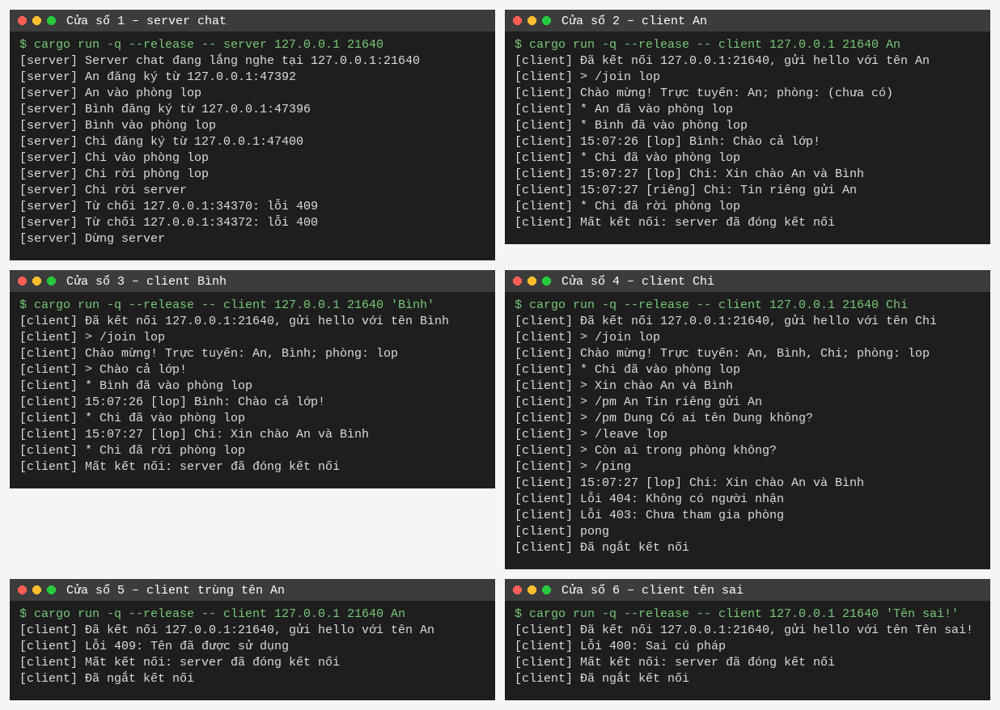

# Bài 6.4 – Server chat nhiều phòng (Rust)

| Thông tin | Nội dung |
|---|---|
| Mã giả tương ứng | Mã giả 6.5 (Server chat: cấu trúc dữ liệu và tác vụ phiên), Mã giả 6.6 (Server chat: phát tới phòng, gửi riêng và tác vụ ghi) |
| Mục giáo trình | 6.3.1 Đặc tả giao thức chat, 6.3.2 Kiến trúc server, 6.3.3 Mã giả server chat, 6.3.4 Các vấn đề bảo mật |
| Kế thừa | Mã giả 6.3 (server bất đồng bộ), 5.1 (khung JSON bất đồng bộ), 5.5 (lớp ChatClient), 2.1, 2.2 |
| Thư viện | crate `tokio` (`TcpSocket`, `into_split`, `sync::mpsc`, `sync::watch`, `sync::Mutex`, `time`, `signal`), `serde_json`; thư viện chuẩn `std::sync::Mutex`, `std::thread` |

## Mục tiêu
Xây dựng server chat theo đặc tả Mục 6.3.1: đăng ký tên bằng `hello` trong 10 giây (`welcome` hoặc lỗi 409), tham gia và rời phòng, tin nhóm (`msg`), tin riêng (`pm`), nhịp tim `ping`/`pong`, mã lỗi 400, 403, 404, 409, 429. Mỗi client có một tác vụ phiên đọc socket, một hộp thư đi 256 thông điệp và đúng một tác vụ ghi; bảng `users`, `rooms` được bảo vệ bằng khóa và không thực hiện vào/ra khi giữ khóa.

## Tệp
- `src/main.rs` – phân nhánh theo tham số `server` / `client`.
- `src/chat_server.rs` – Mã giả 6.5: `chat_server` (vòng chấp nhận), `chat_session` (CHAT_SESSION).
- `src/chat_broadcast.rs` – Mã giả 6.6: `broadcast`, `send_to`, `enqueue`, `writer`; `Client`, `Tables` (`users`, `rooms`), `LOCK`; `register`, `unregister`, `join_room`, `leave_room`.
- `src/chat_client.rs` – Mã giả 5.5: kiểu `ChatClient` và client dòng lệnh.
- `src/async_frame.rs` – Mã giả 5.1, 2.1.
- `Cargo.toml`, `Cargo.lock` – gói Cargo `bai6_4_server_chat`.
- `demo.json` – kịch bản chạy minh họa (dùng với `tools/demo.py`).
- `ket_qua.txt`, `ket_qua.png` – kết quả thực thi thật.

## Cách chạy
Mở các cửa sổ dòng lệnh trong thư mục bài:
```bash
cargo build --release
# Cửa sổ 1 – server (mặc định 0.0.0.0 9200)
cargo run --release -- server 0.0.0.0 9200
# Cửa sổ 2, 3, … – mỗi cửa sổ một client
cargo run --release -- client 127.0.0.1 9200 An
cargo run --release -- client 127.0.0.1 9200 Bình
```
Lệnh của client: `/join phòng`, `/leave phòng`, `/pm tên nội dung`, `/ping`, `/quit`; dòng khác được gửi thành tin `msg` tới phòng của lệnh `/join` gần nhất. Dừng server bằng Ctrl+C.

## Kết quả thực thi


Ba client An, Bình, Chi cùng vào phòng `lop`: tin nhóm đến mọi thành viên (kể cả người gửi), tin riêng của Chi chỉ đến An, tin riêng tới người không tồn tại trả lỗi 404, tin gửi vào phòng sau khi đã rời trả lỗi 403, `ping` nhận `pong`. Client đăng ký trùng tên An nhận lỗi 409, client có tên chứa ký tự không cho phép nhận lỗi 400; cả hai bị đóng kết nối ngay. Hai dòng "Mất kết nối" ở cuối cửa sổ An, Bình xuất hiện vì kịch bản dừng server trước khi dừng hai client chạy nền.

## Ghi chú
- Mã giả chỉ nêu tên `REGISTER`, `UNREGISTER`, `JOIN_ROOM`, `LEAVE_ROOM`. Bản cài đặt: `JOIN_ROOM` thêm tên vào phòng rồi phát thông báo hệ thống `sys`; `LEAVE_ROOM` phát `sys` cho các thành viên còn lại, hoặc trả 403 nếu người gửi không ở trong phòng; `UNREGISTER` xóa client khỏi `users` và mọi phòng, phát "đã rời phòng" tới các phòng đó (ngoài khóa).
- Thông điệp `welcome` gửi cả `users` và `rooms` theo bảng đặc tả (Mã giả 6.5 dòng 10 chỉ có `users`); thông điệp `error` có thêm trường `text` theo bảng đặc tả.
- Bổ sung theo Mục 6.3.4 (không có trong mã giả): tên người dùng và tên phòng phải gồm 1–32 ký tự chữ, số, `_` hoặc `-` (tương đương biểu thức `^[\w-]{1,32}$` của bản Python, kiểm tra bằng `char::is_alphanumeric` nên chấp nhận chữ tiếng Việt; sai → 400), thông điệp thiếu trường bắt buộc → 400, mỗi client tối đa 10 tin `msg`/`pm` mỗi giây (vượt → 429; bộ đếm `RateWindow` là biến cục bộ của tác vụ phiên). Vì giới hạn tốc độ, bài tập "client chậm" cần nhiều client gửi hoặc tin dài để làm đầy hàng đợi 256 thông điệp.
- Socket được tách bằng `into_split`: tác vụ phiên giữ nửa đọc, tác vụ ghi giữ nửa ghi, nên mỗi socket chỉ có đúng một nơi ghi. Hộp thư đi là `mpsc::channel(256)` chứa `Option<Value>`: `try_send` = `try_put`, giá trị `None` là dấu kết thúc của `outbox.close()`. `CLOSE(c.sock)` được thực hiện bằng tín hiệu `watch` (`kill`): tác vụ phiên và tác vụ ghi cùng theo dõi tín hiệu này và dừng ngay, socket đóng khi cả hai nửa được giải phóng.
- `lock` là `std::sync::Mutex<Tables>` (biến tĩnh `LOCK`); mọi đoạn giữ khóa đều ngắn và không có `.await`, đúng nguyên tắc "không vào/ra khi giữ khóa". Trường `ts` do server gán theo giờ UTC (hàm `now_ts` tự đổi số giây sang ngày giờ vì thư viện chuẩn Rust không có lịch); client hiển thị phần HH:MM:SS.
- Client: thủ tục `SEND_MESSAGE` của Mã giả 5.5 được tổng quát thành `send(obj)` vì cần gửi nhiều loại thông điệp, và tin `msg` mang thêm trường `room`. `send_lock` là `tokio::sync::Mutex` bọc nửa ghi. Sự kiện trạng thái "connected" được báo trước khi khởi động vòng nhận (đảo dòng 12–13 của Mã giả 5.5) để dòng "Đã kết nối" luôn in trước thông điệp đầu tiên; vòng nhận chạy song song trên luồng thợ của tokio nên thứ tự dòng `>` và thông điệp nhận được có thể xen kẽ khác nhau giữa các lần chạy.
- Đọc bàn phím chạy trong một luồng phụ (`std::thread`) và chuyển từng dòng vào vòng lặp bất đồng bộ qua `mpsc::unbounded_channel`, giống bản Python; cách này không giữ môi trường chạy tokio khi chương trình kết thúc. Khi hết dữ liệu nhập (Ctrl+D/Ctrl+Z), client chờ 1 giây để nhận nốt các thông điệp rồi mới ngắt kết nối.
- Khi nhận Ctrl+C, server in `[server] Dừng server` rồi thoát; các tác vụ phiên bị hủy cùng môi trường chạy nên không in dòng "… rời server" của An, Bình như bản Python (asyncio hủy tác vụ và chạy khối `finally`).
- Kiểm thử: Linux, Rust 1.97.0, tokio 1.54.1, serde_json 1.0.154.
